# day01_Coze基本使用


今日内容：

* 1- 什么是智能体 【了解】
* 2- Coze平台介绍 【了解】
* 3- Coze的版本说明 【了解】
* 4- Coze平台的基本使用 【实操】
* 5- 基于Coze搭建一个基础的智能体  【实操】
* 6- Coze中多模态的组件操作  【实操】


## 1- 什么是智能体(Agent)

​		智能体（Agent）是指能够感知环境、分析信息、自主决策并采取行动以实现特定目标的软件实体或系统。它以大模型（如GPT等）为“大脑”，具备理解、规划、决策、记忆和行动的能力。AI Agent = LLM + 记忆 + 任务规划 + 工具使用

>​		在以chatgpt的大模型出现以后，模型具备了“思考”能力，能够帮助我们解决一些知识获取和推理等问题。但是因为大模型只能输出内容，能够帮助我们解决的业务问题有限，如果能让大模型具备使用工具的能力，将很大程度上拓宽大模型能力的边界。 于是基于大模型+工具调用这种解决方案，“智能体”和“Agent”这个概念在业界出现并大火。

和大模型的区别：

​		传统的大模型就像一个“百科全书”，知识渊博，有问必答，但它不会主动去“做”什么事。而智能体则像一个“全能助理”，比如你告诉它“我下周三要去杭州出差，帮我安排好行程”，它就能自主完成查询航班、预订酒店、规划市内交通、提醒天气等一系列操作 。它不仅“有脑”（能思考），还“有手有脚”（能调用工具去执行）。

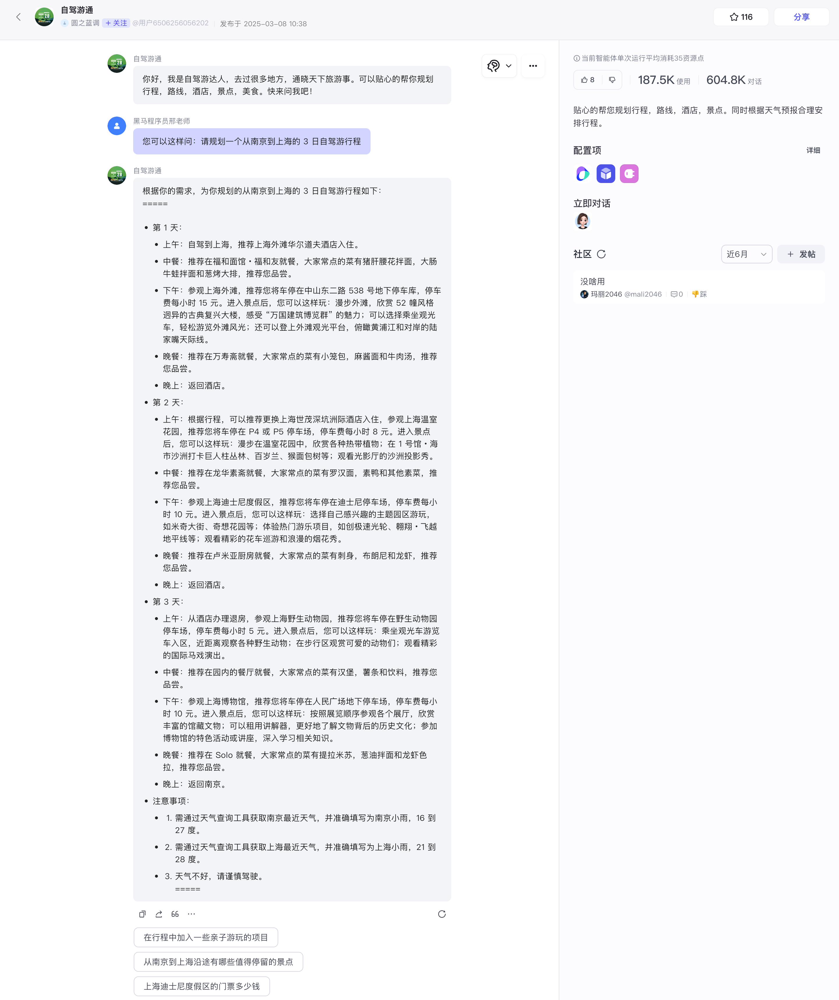


## 2- Coze平台介绍

### 2.1 什么是Coze

一句话： 字节跳动旗下的一站式 AI 智能体开发平台，支持零代码创建 AI 应用产品 。

- ‌**主要功能**‌：提供工作流编排、插件集成及知识库调用，能像搭积木一样组装 AI 机器人 。
- ‌**适用对象**‌：面向个人开发者、企业团队及内容创作者，无需深厚编程基础即可上手 。
- ‌**发布渠道**‌：创建的应用可一键发布至飞书、微信、豆包等多个社交平台 。‌‌‌

官方地址： https://www.coze.cn/

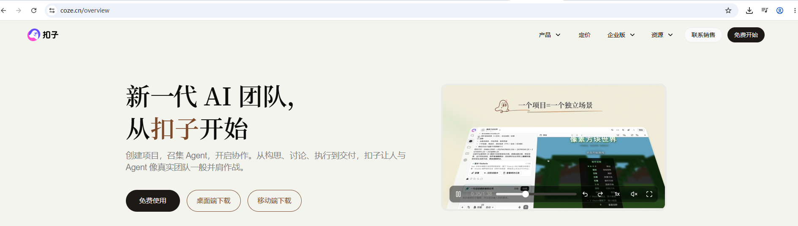

开发coze产品的平台界面：扣子编程

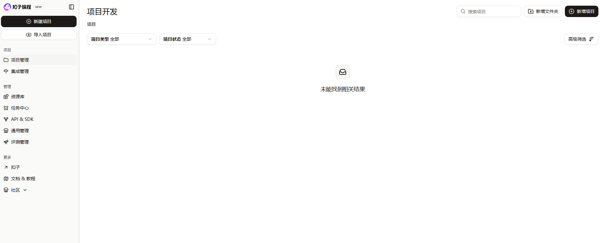

### 2.2 Coze中智能体与应用

​		智能体和应用是Coze平台的Agent的两种不同的形式，都可以使用Coze平台自带的功能进行开发和完成部署。在“作品社区”中，我们可以看到其他用户或者企业上线的的智能体和应用。 区分方式：是否有“应用”图标。

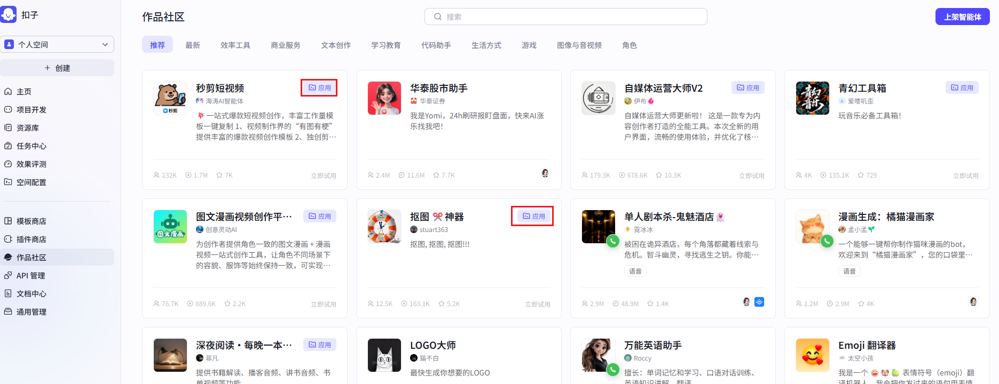

Coze智能体:

​		智能体是基于对话的 AI 项目，它通过对话方式接收用户的输入，由大模型自动调用插件或工作流等方式执行用户指定的业务流程，并生成最终的回复。智能客服、虚拟伴侣、个人助理、英语外教都是智能体的典型应用场景。

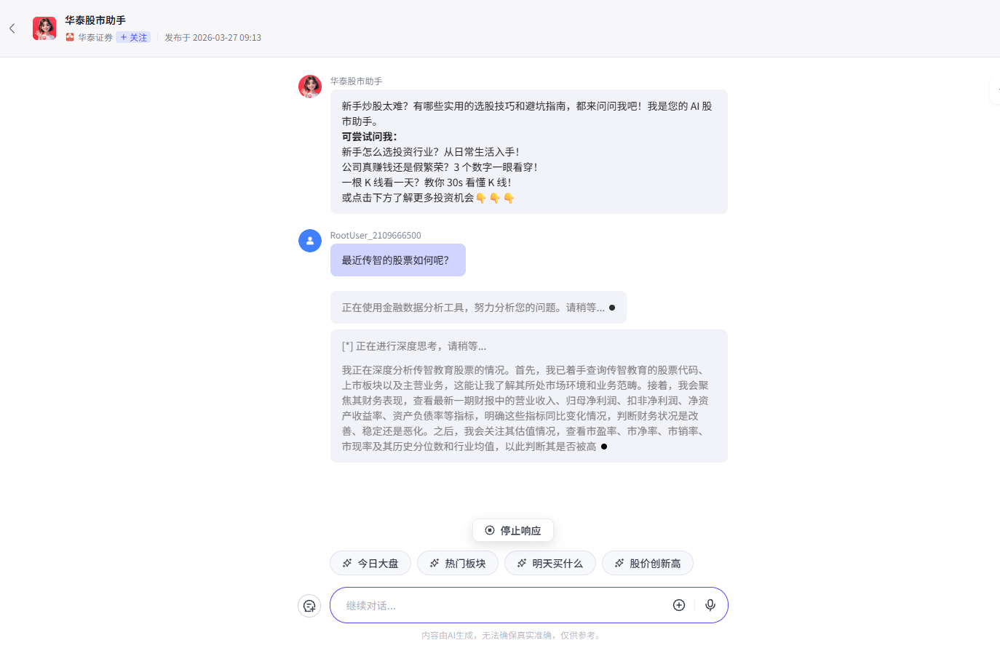

Coze应用：

​		应用是指利用大模型技术开发的应用程序。扣子中搭建的应用具备完整业务逻辑和可视化用户界面，是一个独立的 AI 项目。通过扣子开发的应用有明确的输入和输出，可以根据既定的业务逻辑和流程完成一系列简单或复杂的任务，例如 AI 搜索、翻译工具、饮食记录等。

> 智能体和应用并非互斥，它们可以协同工作，形成更强大的解决方案。一个常见的模式是：AI 应用负责收集结构化的用户输入并呈现最终结果，而在处理过程中，可以调用一个或多个智能体来完成特定的分析、推理或创意生成任务

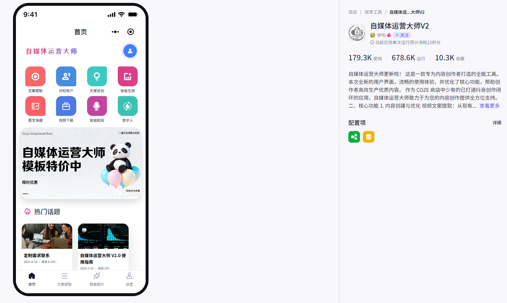

对比说明: 从原理层面上讲，智能体和应用的区别不大，主要在于呈现和交互的方式不同，接下来我们做一个对比

| 对比维度           | 智能体 (Agent)                                   | AI 应用 (Application)                                      |
| :----------------- | :----------------------------------------------- | :--------------------------------------------------------- |
| **核心交互形态**   | **对话驱动**，以自然语言多轮对话为主             | **界面驱动**，提供图形化界面（如表单、按钮）进行交互       |
| **设计目标与心智** | “**跟我聊**”，像一个专家或助手，灵活响应         | “**帮我做**”，像一个标准化工具，完成固定流程               |
| **功能复杂度**     | 相对轻量，适合**单一或特定任务**                 | 相对复杂，整合**多个智能体、工具和流程**，形成完整解决方案 |
| **典型发布渠道**   | 对话框、Bot Store、集成到飞书/微信等即时通讯工具 | 独立的 Web App、H5 页面、小程序，或通过 SDK/API 集成       |

## 3. Coze的版本说明

### 3.1 Coze平台在线版

在线版本的Coze(SaaS版，这个概念参考后面拓展内容的介绍)， Coze（扣子）分为国内版和国外版：

- 国内版访问地址：https://www.coze.cn/home，背后大模型应用的是字节自研的豆包大模型、通义千问和kimi大模型
- 国外版访问地址：https://www.coze.com/home，背后大模型应用的是GPT-4、Gemini等，但是需要一些科学上网的方法。

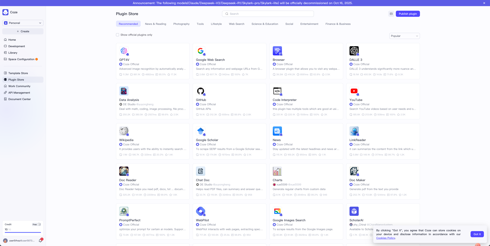

两个版本的对比：从模型的维度，当前国外版的Coze的确比国内版的要有优势，主要体现在模型上；从生态的维度，国内版本的Coze对接的各类插件都是国内的各类平台的（高德地图、企查查等）的，更符合国内的生态。

接下来的教程就以国内版 Coze 来进行，也可以参考官网文档：https://www.coze.cn/docs/guides/welcome 实现Coze平台的应用。


**拓展：什么是SaaS**

> 简单来说，SaaS（Software as a Service，软件即服务）就像软件的“订阅制”。您无需购买软件光盘安装到电脑上，而是通过互联网直接使用软件服务，按需订阅，按使用付费。 简单概括就是“可以在线使用的软件服务”。比如：腾讯文档、金蝶云、腾讯会议、钉钉、法大大等。需要注意的是这里的SaaS指的是商业软件，不包括爱奇艺、QQ会员这类面向用户的软件。


### 3.2 Coze平台开源版

在介绍Coze平台之前，先给同学们介绍一下，什么是开源软件

> 开源软件（Open Source Software）是一种将其**源代码**向公众开放的软件，允许任何人出于任何目的**自由地查看、使用、修改和分发**其原始代码。 比如我们使用的Linux操作系统、Mysql数据库、甚至Python语言，都属于开源软件。全球最大的开源社区
>
> github: https://github.com/

仅仅公开源代码并不足以称为“开源”。真正的开源软件通常具备以下几个关键特征

- **自由再分发**：允许自由地销售和分发软件。
- **允许派生作品**：允许在原始软件基础上进行修改和创建新的衍生软件。
- **不歧视个人或领域**：不得限制任何个人、团体或将软件用于特定领域（如商业用途）。

这些规则通过**开源许可证**这一法律文件来明确和保障，常见的开源许可证包括对使用者要求较为宽松的**MIT许可证**、**Apache许可证**，以及要求衍生软件也必须以相同开源条款发布的**GPL许可证**等。常见的开源软件：

* 编程语言：Python、Java(Open JDK，不是所有的版本都是开源的)
* 操作系统：Linux
* 开发工具：Visual Studio Code、 Git
* 数据库软件：Mysql
* 人工智能：Tensorflow、Pytorch


#### 3.2.1 什么是开源版Coze

因某些业务场景的数据安全要求较高，要求模型、数据不能暴露到公网。因此，私有化部署成为了部分业务场景的刚需。

Coze针对私有化部署场景进行了开源，github地址：[Coze Studio](https://github.com/coze-dev/coze-studio) ，在2025年7月26日正式开源，允许免费商用和本地化部署。‌‌


Coze的官方介绍：

* [Coze Studio](https://www.coze.cn/home) 是一站式 AI Agent 开发工具。提供各类最新大模型和工具、多种开发模式和框架，从开发到部署，为你提供最便捷的 AI Agent 开发环境。
  - **提供 AI Agent 开发所需的全部核心技术**：Prompt、RAG、Plugin、Workflow，使得开发者可以聚焦创造 AI 核心价值。
  - **开箱即用，用最低的成本开发最专业的 AI Agent**：Coze Studio 为开发者提供了健全的应用模板和编排框架，你可以基于它们快速构建各种 AI Agent ，将创意变为现实。

#### 3.2.2 开源版Coze和SaaS版的区别

* 开源版Coze与SaaS版区别如下：

| 功能模块             | **SaaS 企业版 / 云端版**                                     | **开源版 (Coze Studio)**                                     |
| :------------------- | :----------------------------------------------------------- | :----------------------------------------------------------- |
| **核心协作功能**     | 支持**团队空间**、多人协作、权限管理、审批流                 | 仅支持**个人空间**，缺乏原生的团队协作功能                   |
| **插件与工具**       | 提供丰富的官方和第三方**插件市场**，支持图像理解、音视频处理等 | 仅内置约 **19 个官方插件**，不支持用户插件市场，部分高级节点（如图像理解）被移除 |
| **智能体类型**       | 支持**对话型智能体**和**应用型智能体**（有UI界面）           | 主要支持**对话型智能体**，不支持开发应用型智能体             |
| **发布与集成**       | 一键发布至**飞书、微信公众号、Discord**等多种平台            | 发布渠道有限，主要支持 **Web SDK 和 API 集成**               |
| **多模态与高级功能** | 支持**语音交互、图像生成**等多模态能力                       | 缺少官方支持的语音、图像生成等多模态功能                     |
| **运维与数据分析**   | 提供完善的**运营仪表盘**，监控Token消耗、用户互动等          | 需要自行构建运维监控体系，缺乏开箱即用的数据分析面板         |

私有化部署使用的话，一般使用Dify，原因有以下几点：

* dify是一个更早开源的平台，与coze功能类似，且社区成熟、功能对比coze更加强大，已经占据了较大的市场
* coze对比dify的优势在于丰富的插件库、应用型智能体、以及对于多模态的支持，在开源版这些功能被阉割比较
* coze是golang开发的，语言对比dify相对小众


​		因coze开源版在企业中使用较少，且安装和使用需要依赖Docker作为前置知识，因此，coze开源版的部署和使用我们将放在Dify的课程中进行。


## 4. Coze平台的基本使用

说明:  部分同学在登录后, 无法进入旧版本的Coze中, 此时可以通过以下地址直接进入:

https://www.coze.cn/home?stay_studio=1


https://www.coze.cn/session 已经废弃

https://www.coze.cn/home 扣子编程

https://www.coze.cn/space 扣子工作空间

`code.coze.cn/w`（扣子编程） vs `www.coze.cn/space`（扣子空间）

### 4.1 功能简介

#### 4.1.1 项目 

​		项目分为智能体和 AI 应用两种类型，AI 应用内可以创建多种应用专属资源，也可以和智能体共享空间资源库中的资源。当我们创建一个项目时，如下图，有智能体和应用两种选择：

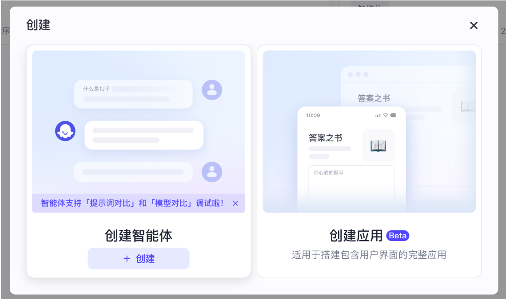

#### 4.1.2 资源库

​		**资源库**：你可以在资源库内创建、发布、管理共享资源，例如插件、知识库、数据库、提示词等。这些资源可以被同一空间内的智能体和应用使用。

资源可以存在于两个实体内，一个是空间的资源库，一个是 AI 应用项目中的项目资源库。

- **空间资源库**：在空间资源库内创建的资源可以被空间内的 AI 应用项目和智能体项目使用，属于空间内的共享资源。
- **AI 应用项目**：在 AI 应用项目中也可以创建资源，但这些资源是项目自有的资源，默认不可以被其他项目使用也不会展示在空间资源库内。

当需要将 AI 应用项目中的资源转换成公共资源给其他 AI 应用或智能体使用时，可以将这些资源转移或复制到空间资源库内。


在资源库中添加一个资源，我们可以看到，coze平台支持如下几种资源类型。并非所有的资源类型都是常用的，在实际工作中，我们最常用的是**插件**、**工作流、对话流、知识库、数据库**。

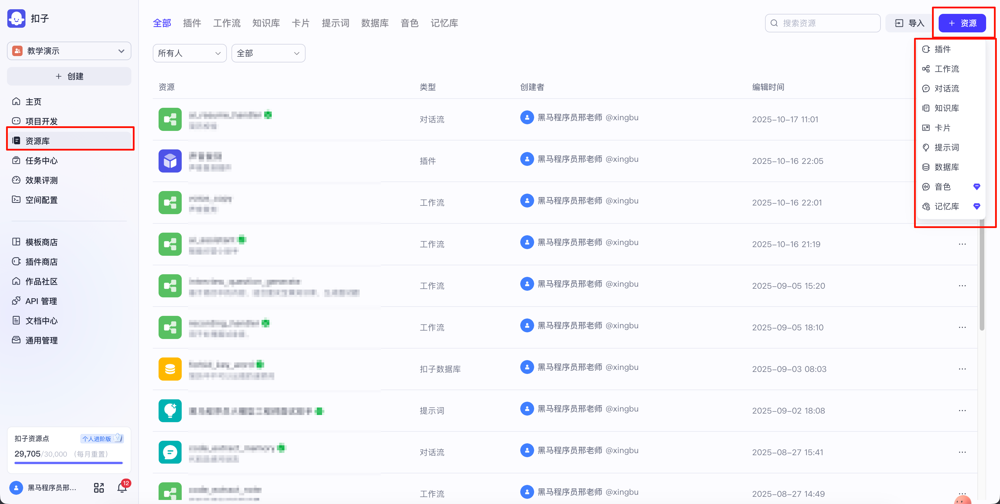


#### 4.1.3 插件

​		扣子平台提供了一个多样化的插件库，这些插件涵盖了从基础的文本处理到高级的机器学习功能。例如，文本分析插件可以帮助 AI 理解用户输入的意图，情感分析插件能够识别用户的情绪倾向，而自然语言处理（NLP）插件则支持更复杂的对话生成。

​		此外，还有图像识别、语音识别、数据分析等插件，这些插件的数量和种类不断增加，以适应不断变化的技术趋势和市场需求。

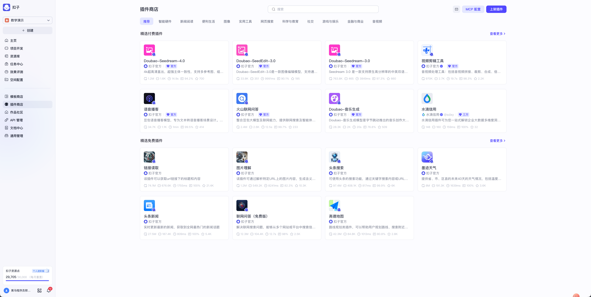

#### 4.1.4 工作流和对话流

​		coze平台 **提供了灵活的工作流设计工具，开发者可以通过拖拽式界面轻松搭建复杂的对话流程** 。工作流本质是一个有向无环图，由边和节点构成， 边代表执行顺序，节点则表示一个具体的执行步骤

​		工作流用于处理功能类的请求，可通过顺序执行一系列节点实现某个功能。适合数据的自动化处理场景，例如生成行业调研报告、生成一张海报、制作绘本等。

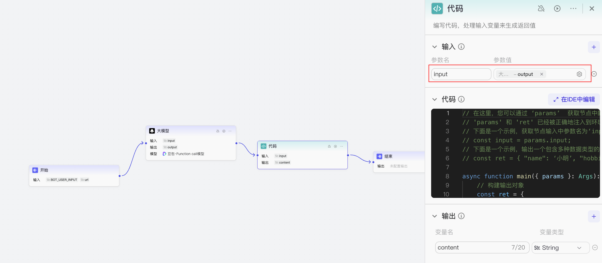

​		工作流是coze平台最核心的功能，它是资源库中一种特殊的资源类型，我们在实际工作中，几乎所有的功能都需要基于工作流实现。 我们上文中提到的插件、知识库、数据库这些核心功能，在实际开发时，都是作为工作流中的节点进行使用。

​		对话流是基于对话场景的特殊工作流，更适合处理对话类请求。对话流通过对话的方式和用户交互，并完成复杂的业务逻辑。对话流适用于 Chatbot 等需要在响应请求时进行复杂逻辑处理的对话式应用程序，例如个人助手、智能客服、虚拟伴侣等。


工作流的具体使用方法，我们在后面将用一个较长的篇幅进行介绍。

#### 4.1.5 知识库和数据库

​		扣子开发平台支持使用扣子官方知识库和火山知识库（更加专业版的知识库），两者均支持上传和存储外部知识内容，并提供了多种检索能力。扣子的知识能力可以解决大模型幻觉、专业领域知识不足的问题，提升大模型回复的准确率。

​		知识库中一般存放的是各类文档数据，比如专业书籍、说明书、产品介绍文档等文本类数据。

​		数据库存放的是各类业务记录，比如订单、流水、操作记录等结构化数据。

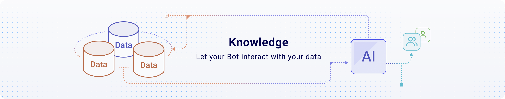

### 4.2 工作流的使用

智能体、AI应用和工作流的关系和前文中项目和资源库的关系类似， 一个项目（智能体、AI应用）可以引用多个工作流。但是在这里我们强调的是， 几乎所有的资源类型都是以智能体引入工作流的方式。

接下来，我们将使用一个”旅游规划小助手“作为案例，帮助同学理解工作流的使用和

#### 4.2.1 创建一个工作流

进入资源库页面，点击右上角的”+资源“，即可完成工作流的创建

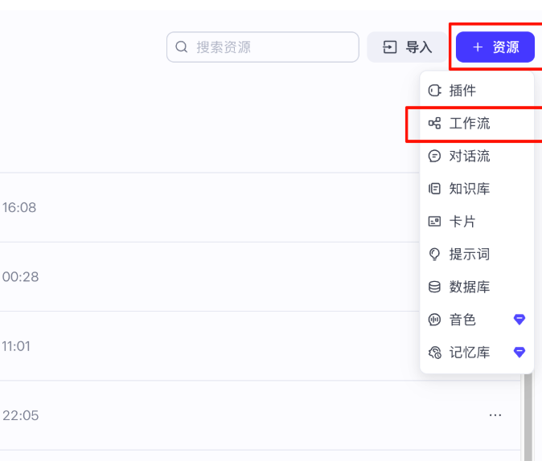

点击后，弹出如下页面：

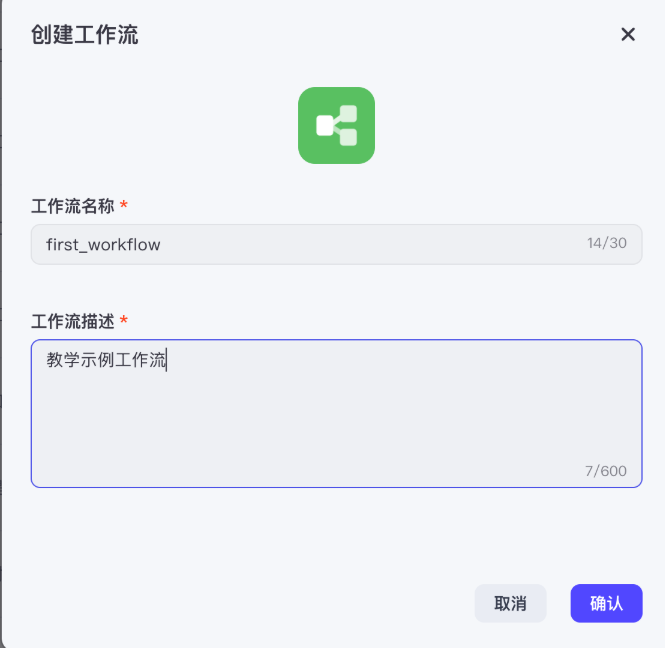

输入以下内容：

* 工作流名称：需要全英文+数字+下划线的方式输入， 长度不可超过30
* 工作流的描述：需要告诉大模型什么时候调用工作流。 **在一个智能体中添加多个工作流时， 大模型可以通过工作流描述，自动去调用工作流。**在后续的项目中，我们将使用这种方式实现一个智能体根据业务场景不同调用多个工作流。


点击创建后，进入如下页面。这个页面是一个可以拖动控件进行操作的画布，初始包含：开始和结束两个节点

* 开始：工作流的入口，相当于一段程序中的主函数，接收变量并传递到后面的节点。开始节点支持配置 String、Number 等多种类型的输入参数。其中 Object 类型的参数最多支持 3 层嵌套。

  * 返回变量模式下，工作流运行结束后会以 JSON 格式输出所有返回参数，适用于工作流绑定卡片或作为子工作流的场景。如果工作流直接绑定了智能体，对话中触发了工作流时，大模型会自动总结 JSON 格式的内容，并以自然语言回复用户。返回变量支持配置 String、Number、Object 等多种类型，其中 Object 类型的参数最多支持 3 层嵌套。

* 结束：工作流的出口，相当于一段程序中的最后一行代码，返回变量给工作流的调用方。结束节点支持两种返回方式，即返回变量和返回文本。

  * 返回文本模式下，工作流运行结束后，智能体中的模型将直接使用指定的内容回复对话。回答内容中支持引用输出参数，也可以设置流式输出。具体说明如下：

  | 设置     | 说明                                                         |
  | -------- | ------------------------------------------------------------ |
  | 输出变量 | 输出节点中输出的参数。为工作流绑定卡片时可以使用这些参数。   |
  | 回答内容 | 工作流的最终输出内容，不可设置为空。 支持引用输出参数，引用方式为{{变量名}}。 |

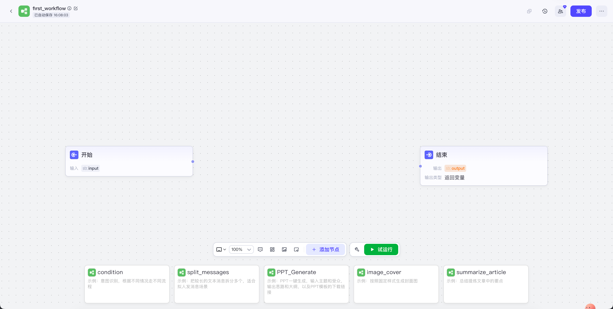


很明显，只有一个开始和一个结束节点是无法组成一个可执行的工作流的。接下来我们将继续学习工作流的常用节点。、

#### 4.2.2 大模型节点

​		大模型节点可以调用大型语言模型，根据输入参数和提示词生成回复，通常用于执行文本生成任务，例如文案制作、文本总结、文章扩写等。

**创建一个大模型节点：**

在画布中点击“+”按钮，**添加大模型节点**：

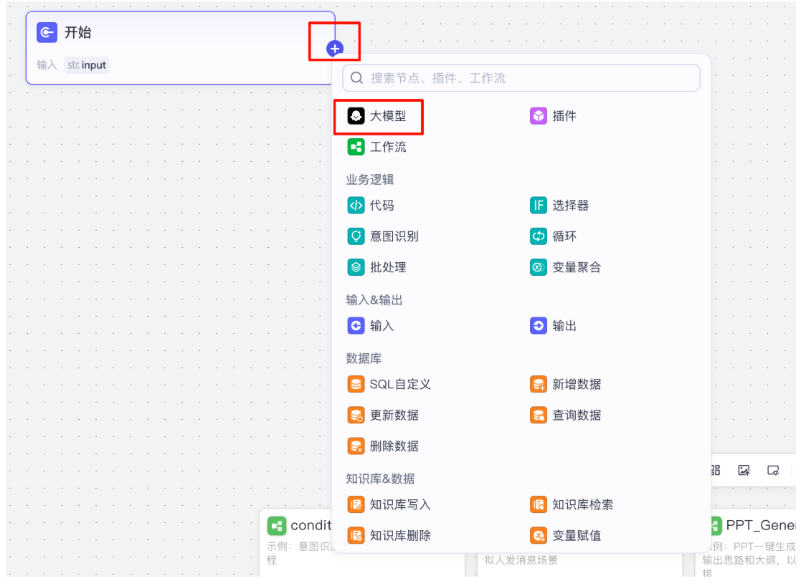

**选择模型**：选择要使用的模型。此节点的输出内容质量很大程度上受模型能力的影响，建议根据实际业务场景选择模型。可选的模型范围取决于当前的账号类型，个人免费版或个人进阶版用户可以使用默认的几类模型，且存在对话数量限制，团队版或企业版套餐用户可以使用火山引擎方舟平台的模型。

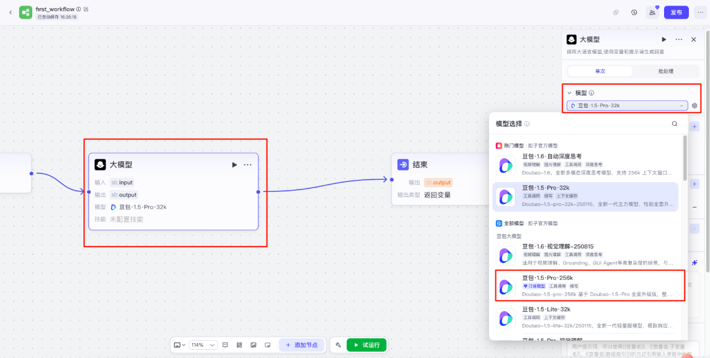


**设置模型的参数：**

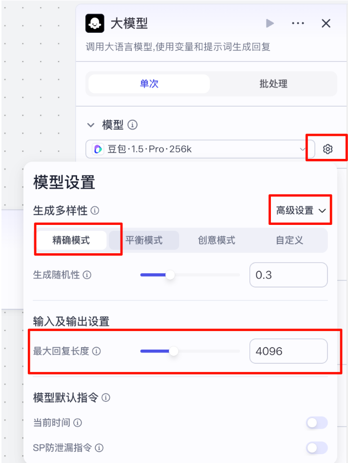


用于从多个维度调整不同模型在生成内容时的随机性。扣子提供以下预置的模式供你选择，每个模式的模型参数取值不同。

- 精确模式：模型的输出内容严格遵循指令要求，可能会反复讨论某个主题，或频繁出现相同词汇。

- 平衡模式：模型的输出内容更具随机性和准确性。

- 创意模式：模型的输出内容更具多样性和创新性，某些场景下可能会偏离主旨。

  

你也可以根据需求，展开**高级设置**，修改每个模式下的具体参数值。参数随机性，即 temperature，用于控制结果的随机性。

- 调高此参数值，会使模型的输出更具多样性和创新性。
- 降低此参数值，会使输出内容更加严格遵循指令要求。当该数值接近零时，模型将变得确定和重复。


在基于事实的问答场景，你可以使用较低的回复随机性数值，以获得更真实和简洁的答案，例如售后客服场景；在创造性的任务例如小说创作，你可以适当调高回复随机性数值。

最大长度：模型每次生成的内容长度受限于最大输出长度（max_token），过长的内容会被截断，试运行时大模型节点同时提示“ 输出内容因超出模型最大输出长度被截断。”


**给大模型添加技能：**

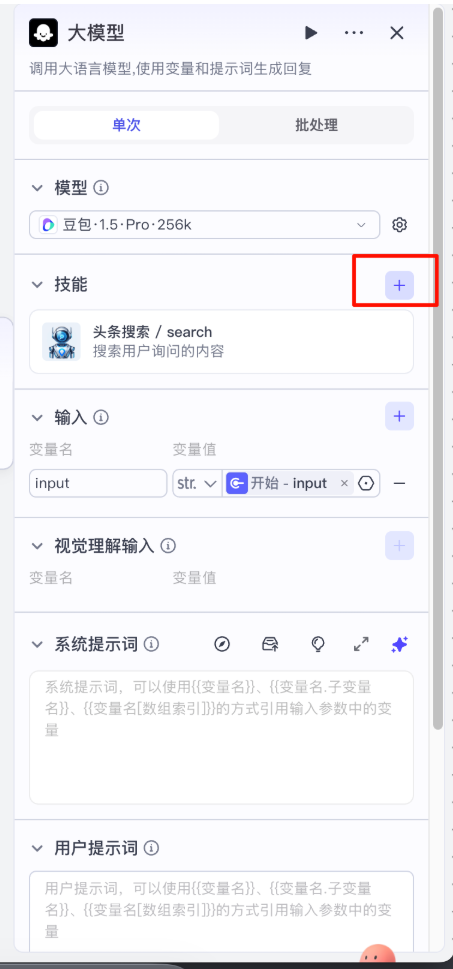


* 给大模型添加一个技能：头条搜索。 大模型在执行任务时，可以自动的把我们输入的提示词的一部分，调用技能中的”头条搜索“进行联网检索。技能可以拓宽大模型的能力边界， 但是也是因为这个调用是自动化的，所以我们不知道调用工具时到底检索了什么内容。
* 技能的本质实际上就是”插件“，插件是coze中非常核心且具有竞争力的功能，它可以完成各类工具的调用，我们在后续的内容中将详细介绍。


**给大模型输入prompt：**

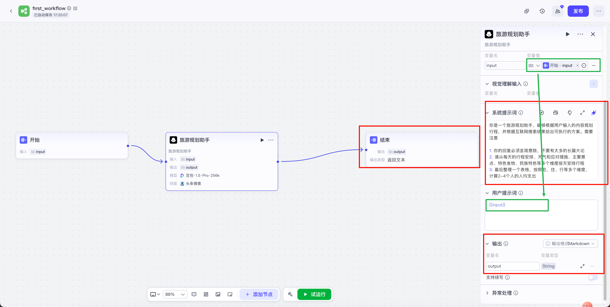

* 输入：点击“+”，把开始节点的输入传过来作为大模型的输入

* 在prompt引入变量： 使用 {{变量名}}的方式引入和使用变量，系统提示词和用户提示词都可以使用。

* 系统提示词：用于指定人设和回复风格。支持直接插入提示词库中的提示词模版、插入团队资源库下已创建的提示词，也可以自行编写提示词。

  ````properties
  你是一个旅游规划助手，能够根据用户输入的内容规划行程，并根据互联网搜索结果给出可执行的方案。需要注意
  
  1. 你的回复必须言简意赅，不要有太多的长篇大论
  2. 请从每天的行程安排、天气和应对措施、主要景点、特色食物、民族特色等多个维度按天安排行程
  3. 最后整理一个表格，按照吃、住、行等多个维度，计算2-4个人的人均支出
  4. 不要回答用户任何无关旅游的话题.如果话题无关,请回答"我只能回答您关于旅游的问题"
  ````

* 用户提示词：模型的用户提示词是用户在本轮对话中的输入，用于给模型下达最新的指令或问题。

  ````properties
  {{input}}
  ````

  

* 指定输出：指定模型的输出格式，因为在结束的节点我们就直接输出了，所以这里我们使用markdown格式。

  * **文本**：纯文本格式。此时大模型节点只有一个输出参数，参数值为模型回复的文本内容。
  * **Markdown**：Markdown 格式。此时大模型节点只有一个输出参数，参数值为模型回复的文本内容。
  * **JSON**：标准 JSON 格式。你可以直接导入一段 JSON 样例，系统会根据样例格式自动设置输出参数的结构，也可以直接添加多个参数并设置参数类型。


**设置输出节点**：

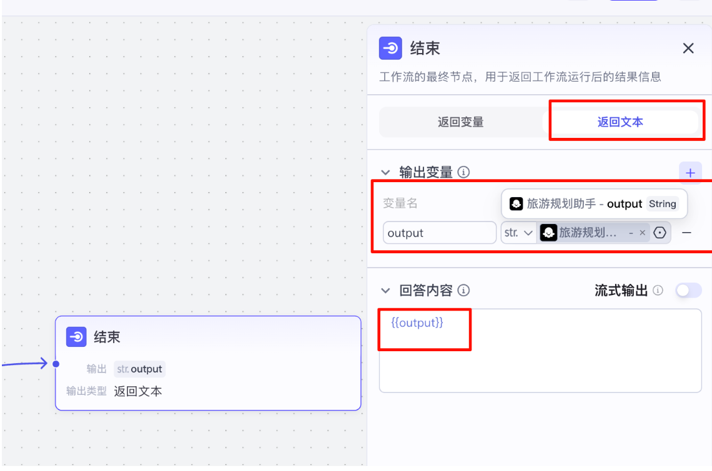

* 一般来讲，对于输出的内容是对话类型的，设置返回文本格式；需要格式化的输出（比如返回JSON的），设置返回变量。最后，使用{{变量名}}的方式，把上一步的输出返回给调用方。如果生成内容比较多，可以勾选“流式输出”，这样模型则会边生成内容，边返回


#### 4.2.3 试运行工作流

##### 4.2.3.1 调试工作流

点击试运行工作流，并给开始节点的所有输入变量赋值后，再点击右侧下方的试运行按钮，即可完成调试。

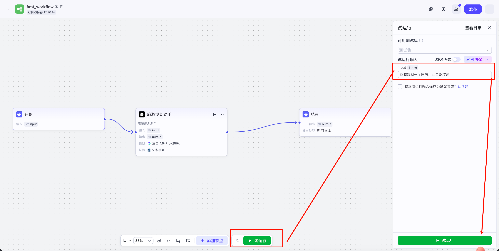

点击试运行后，效果如下：

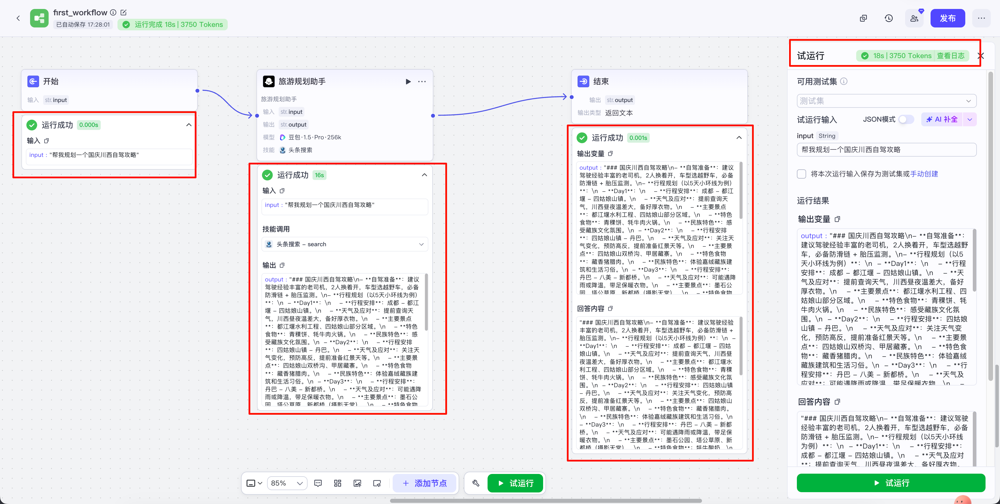

运行过程中，每个节点的执行结果都可以看到，方便我们进行调试。 也会展示整体的执行时间，以及token的消耗数。 可以看到，因为加入了头条搜索的功能，消费3750个token数，并不算少。


##### 4.2.3.2 查看工作流执行日志

如果想看到更加细节的信息，比如将具体每个节点的执行时间，输入/输出的token数分别是多少等信息，可以查看日志。

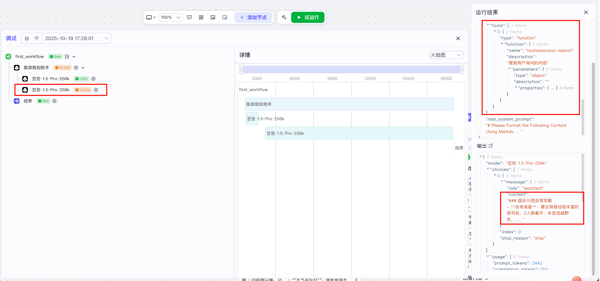

如上图，在“旅游规划助手”这个LLM节点，我们看到它分了两个阶段，第二个节点右侧可以看到这里调用了插件，并返回了对应的结果。同时也看到了这个阶段消耗的token数，包括输入/输出的token数细节。


同样的，工作流在修改之后如果效果不如预期，可能会需要去查看之前的调用日志，可以在下拉框中选择历史的执行记录，去查看历史版本的执行结果。

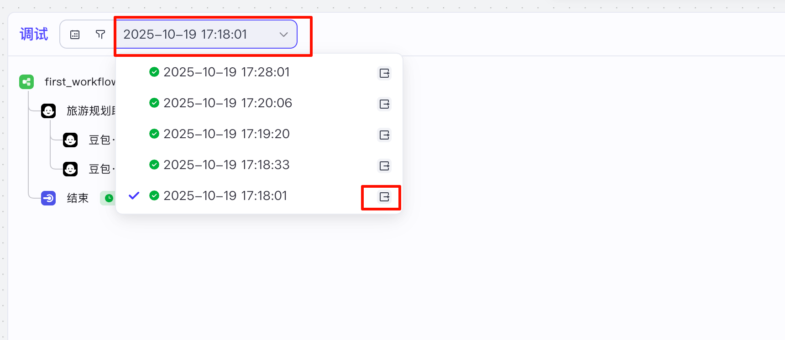

点击右侧的按钮，跳转到了历史的执行记录中，可以看到：**执行日志中不仅仅只是调用时的输入和返回值， 还有当时的整个工作流节点的各类信息**，比如当时的prompt是怎么写的。这对于工作流的调试起到非常重要的指导作用。

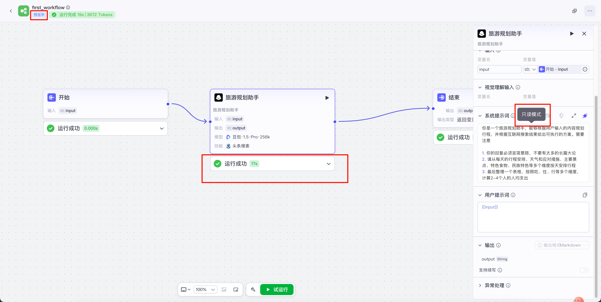


在实际工作中，往往一个工作流会复杂的多，学会调试工作流、查看日志，是coze应用开发的基本功。基本功的好与坏影响开发一个应用的时间，希望同学们认真对待。


#### 4.2.4  其他常用节点

##### 4.2.4.1 选择器节点

该节点是一个 if-else 节点，用于设计工作流内的分支流程。当向该节点输入参数时，节点会判断是否符合**如果**区域的条件，符合则执行**如果**对应的工作流分支，否则执行**否则**对应的工作流分支。

接下来，我们在这个demo中增加一个选择器节点，用来判断用户输如是否为空，如果为空直接结束不调用大模型。如果不为空则执行后续的逻辑。

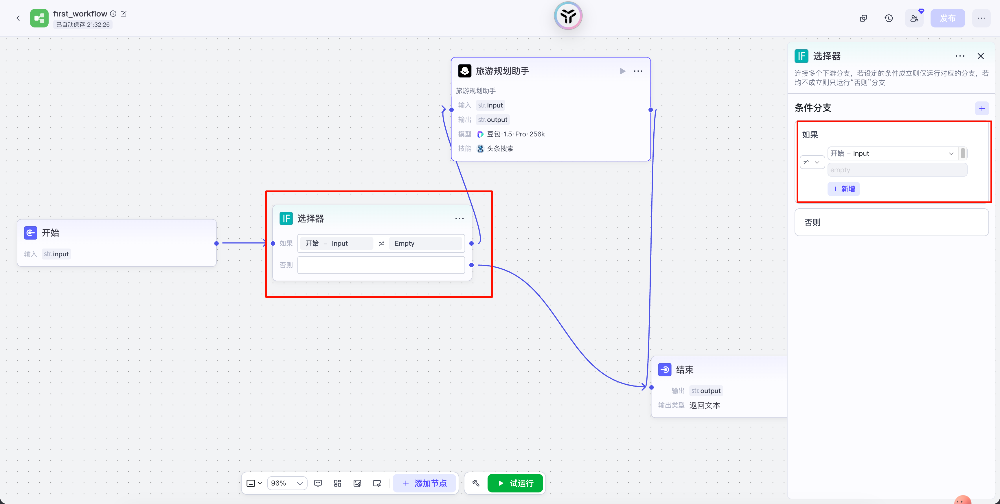


##### 4.2.4.2 意图识别节点

​		意图识别（Intent Recognition）指的是让智能体理解用户通过自然语言表达的意图或目的。意图识别是智能助手的典型能力，例如用户在对话中输入“我想查看今天的 AI 新闻”，其中“查看新闻”为用户意图，也就是用户希望智能体执行的操作。扣子工作流支持意图识别节点对用户意图进行归类，无需再通过大模型节点配合选择器节点实现意图识别，使工作流运行更加高效。

意图识别节点可用于以下场景：

- 客户服务：识别用户问题的类型，并转交各类知识库处理，对于知识库中未匹配的问题，转交人工客服处理。
- 医疗咨询：对用户咨询的医学问题进行归类，非医学问题的咨询则拒绝回复。
- 综合类智能体：对于功能多样的智能体，可以先由意图识别节点对用户咨询进行初步分类，转交各个 Agent 分支处理。

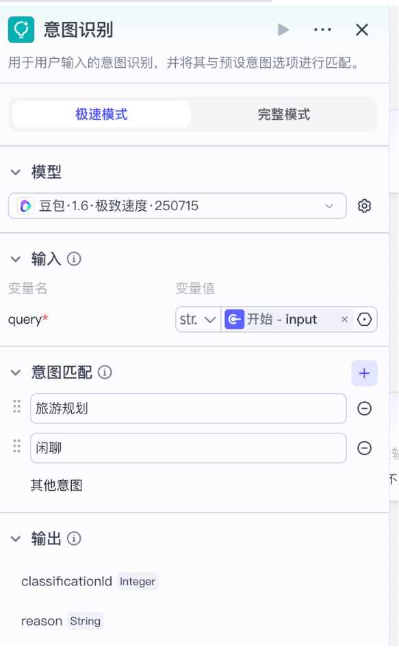

意图识别节点支持极速模式或完整模式运行。

- 极速模式：以较快的速度对用户意图进行分类，适用于关注工作流运行效率的场景。极速模式不支持设置**系统提示词**。
- 完整模式：意图识别效果优先，响应速度可能较长，适用于需要复杂逻辑判断的场景，例如剧情类游戏中根据情节发展切换剧情。完整模式往往需要选择意图识别能力较强的模型，并配合细致、严谨的提示词。


和选择器一样，意图识别节点也是一种分支选择节点，区别就是在于意图识别是基于大模型做场景分类，选择器是基于代码层面的逻辑判断。接下来，我们将结合意图识别、输入和输出节点，改造一下我们的旅游规划小助手。


##### 4.4.4.3 输入和输出节点

**输入节点**：

在比较复杂的工作流场景中，某些节点的执行往往需要额外的用户输入。如果上游节点中没有获取到这些信息，你可以添加一个输入节点来主动收集信息。工作流执行到输入节点时会暂时中断，直到此节点收集到必要的用户输入。实际上，开始节点就是特殊的输入节点

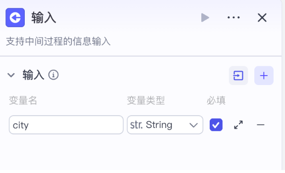

**输出节点：**

通常情况下，工作流会在执行完毕后通过结束节点输出最终的执行结果。当工作流处理流程较长、运行时间较久时，开发者可以在工作流中添加输出节点，临时输出一段消息，避免用户等待时间过长、放弃对话。例如提示用户任务正在执行中，建议用户耐心等待。

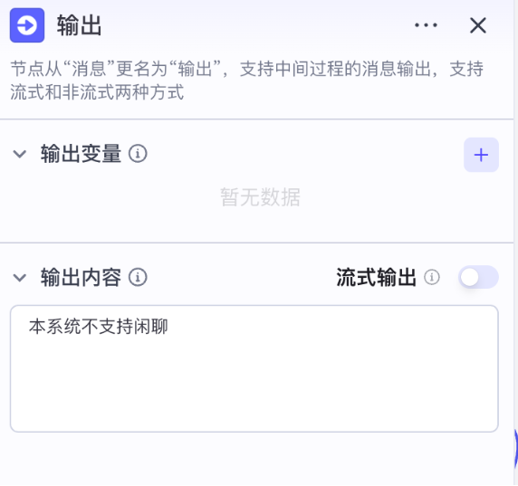

**改造小助手**

接下来，结合意图识别、输入和输出节点，改造一下我们的旅游规划小助手。首先，增加一个意图识别节点：

把开始节点的input作为query，判断意图：

* 旅游规划：提示用户输入”城市“，然后把用户输入的城市作为旅游助手的输入。
* 其他意图：输出”本系统不支持闲聊“，然后退出

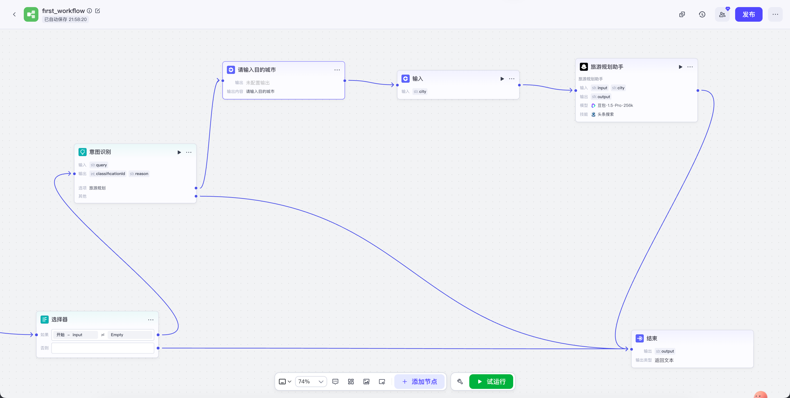

别忘了修改大模型中的变量：

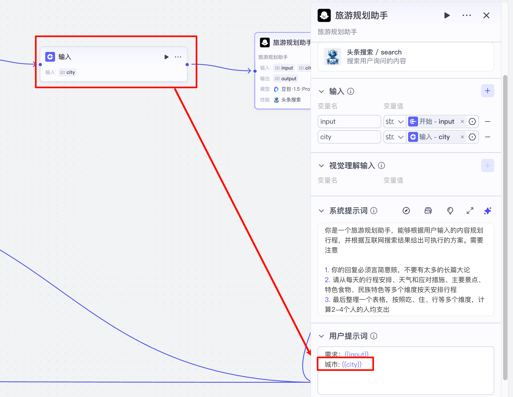


**编辑后，试运行模型：**

输入：

````properties
帮我规划一个7天的自驾游
````

点击执行后，如下图：

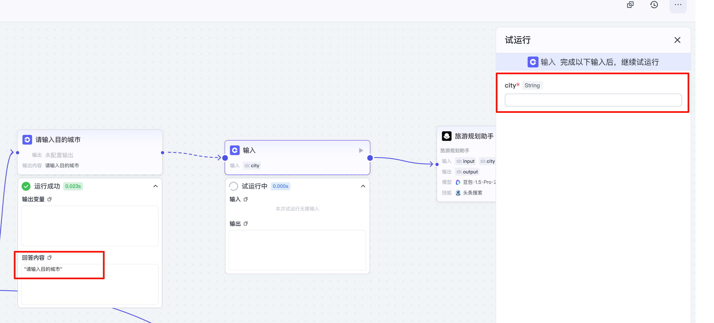

输入：

````properties
成都
````


然后继续执行，结果如下：

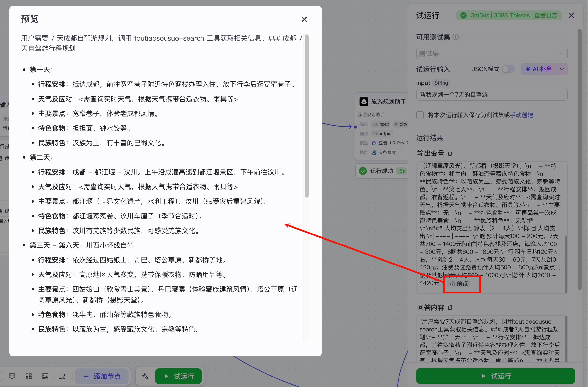


到这里，说明了意图识别、分支判断等功能都正确无误得到了执行。（因大模型产生的内容具有随机性，所以同学们执行后这里的内容很可能和教案中有一些出入，只要是7天+成都，就说明流程是没有问题的）


截止到目前的工作流的流程:

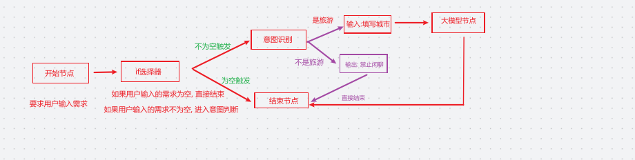


##### 4.2.4.4 代码节点

​		代码节点支持通过编写代码来生成返回值。扣子支持在代码节点内使用 IDE 工具，通过 AI 自动生成代码或编写自定义代码逻辑，来处理输入参数并返回响应结果。

代码节点支持 JavaScript 和 Python 两种语言。我们展开说一下python，官方介绍：

> 不支持的模块包括 curses、dbm、ensurepip、fcntl、grp、idlelib、lib2to3、msvcrt、pwd、resource、syslog、termios、tkinter、turtle.py、turtledemo、venv、winreg、winsound、multiprocessing*、*threading*、*sockets*、*pty 和 tty*。*
>
> 在 Python 环境中，仅内置了两个第三方依赖库：requests_async 和 numpy。其中，requests_async 与 requests 类似，但在使用时需要搭配 await。
>
> **说明**：
>
> - Python 运行时暂不支持 Http.client 方式的请求。
> - 不支持使用除 requests_async 、numpy 以外的第三方依赖库。
> - time.sleep() 方法由于是阻塞调用，会对代码执行性能产生影响，因此推荐使用异步版本的 asyncio.sleep() 来替代。

示例如下：

````python
import requests_async as requests

async def main(args: Args) -> Output:
    # args是调用这个节点传入的参数，通过args.params['url']这种方式获取。 通过requests方法，我们这里就可以通过代码实现一个服务接口的调用，从而实现复杂的逻辑。 
    url = args.params['url']
    response = await requests.get(url)
    ret = {
      'code': response.status_code,
      'res': response.text,
    }
    return ret

````

接下来，我们继续改造小助手，给它增加一个代码块组件，让小助手知道我们运行工作流时的当前时间。

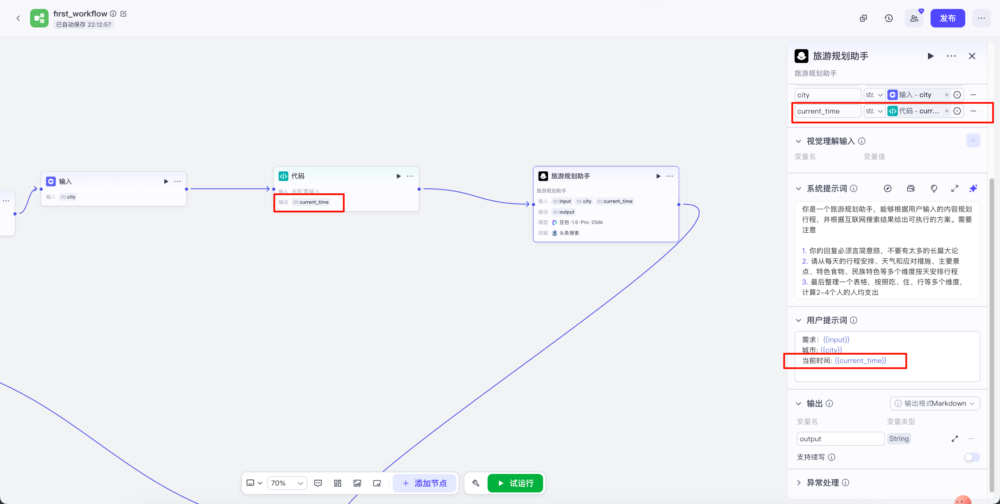


具体代码如下：

```properties
# 在这里，您可以通过 'args'  获取节点中的输入变量，并通过 'ret' 输出结果
# 'args' 已经被正确地注入到环境中
# 下面是一个示例，首先获取节点的全部输入参数params，其次获取其中参数名为'input'的值：
# params = args.params; 
# input = params['input'];
# 下面是一个示例，输出一个包含多种数据类型的 'ret' 对象：
# ret: Output =  { "name": '小明', "hobbies": ["看书", "旅游"] };
import datetime
async def main(args: Args) -> Output:
    params = args.params
    # 获取当前系统时间
    current_time = datetime.datetime.now().isoformat()
    # 构建输出对象
    ret: Output = {
        "current_time": current_time # 添加当前时间到输出
    }
    return ret
```

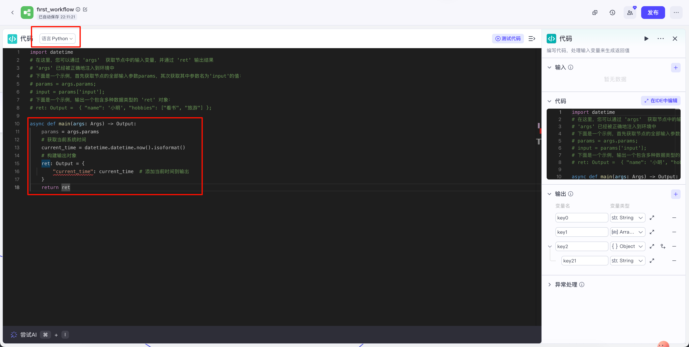


接下来，我们再次试运行工作流，输入：

````properties
请帮我规划以下周末2天的自驾游行程
````

弹出后续输入框时，输入：

````properties
河北
````

中间过程略， 最终输出可以看到，规划出来的行程是基于当前时间做出来的方案。

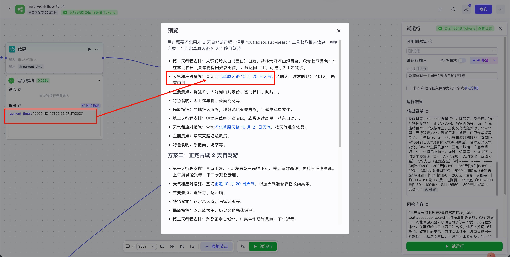


### 4.3 在工作流中使用插件

插件节点用于在工作流中调用插件运行指定工具。

插件是一系列工具的集合，每个工具都是一个可调用的 API。商店中的上架插件或已创建的个人或团队插件支持以节点形式被集成到工作流中，拓展智能体的能力边界。

接下来我们介绍一些常见的插件。

#### 4.3.1 联网搜索插件

联网搜索插件包括头条、B站、懂车帝、百度、谷歌、豆瓣、微博、小红书等各种平台，具体使用哪个需要结合业务。

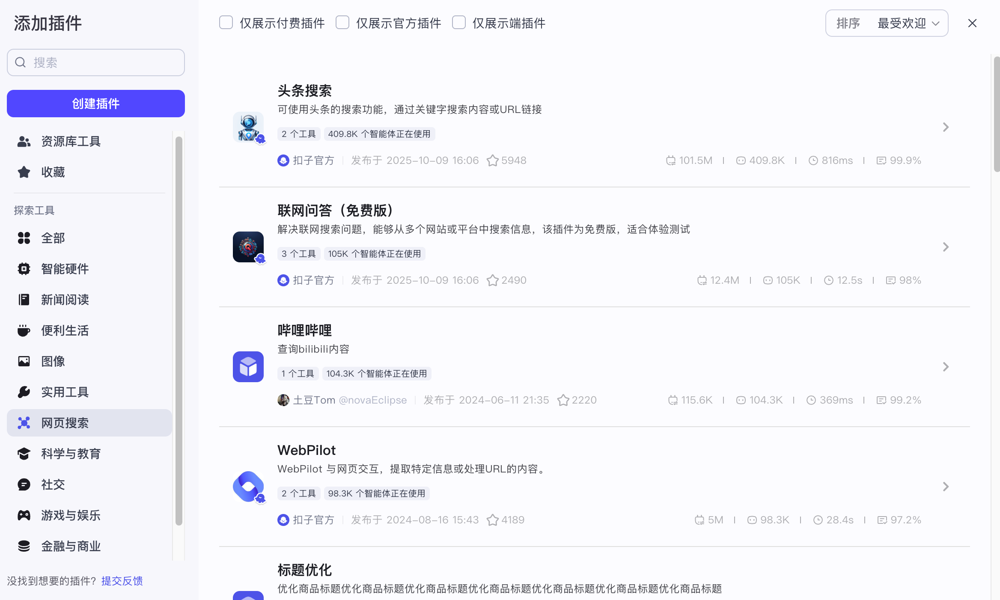

我们以头条搜索为例：

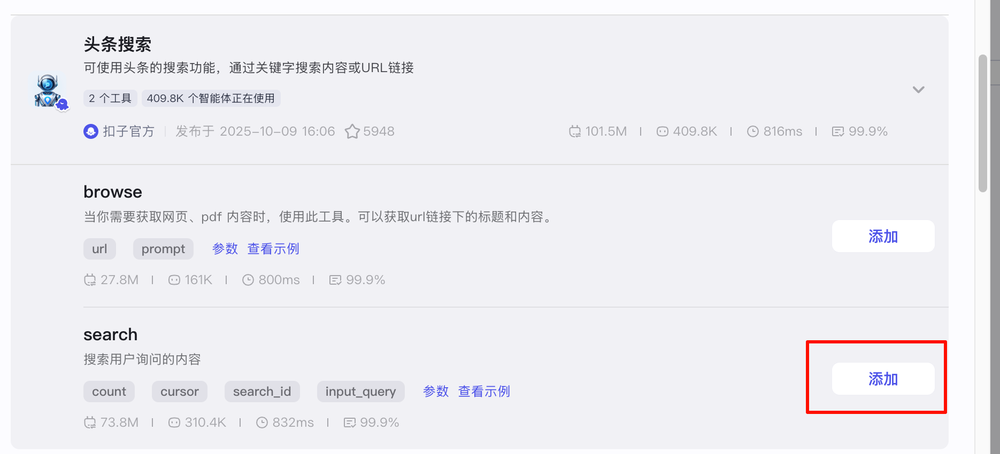

查看示例：

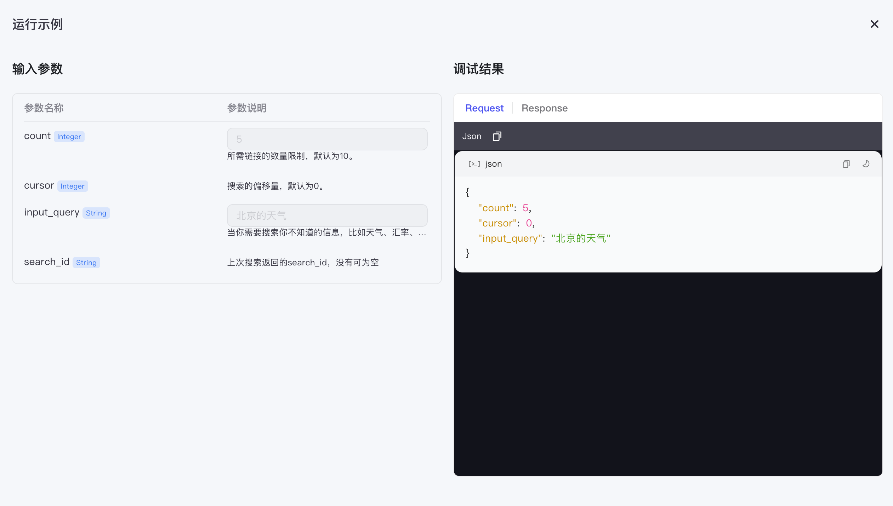

在search工具中输入上述内容，输出如下：

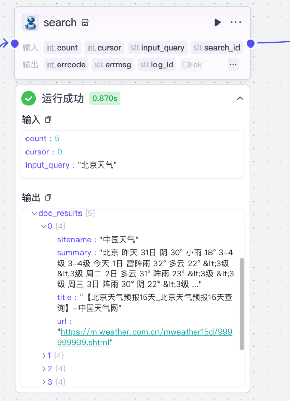

#### 4.3.2 图片理解插件

图片理解插件可以实现图片到文字的转化，需要依赖两部分的输入：

* 图片
* 用户提示词


接下来我们使用一个案例帮助大家理解如何使用图片理解插件，首先，我们准备好一张图片：教案素材中的 **01-编码器细节.jpg**，然后搭建一个简单的工作流。如下图：

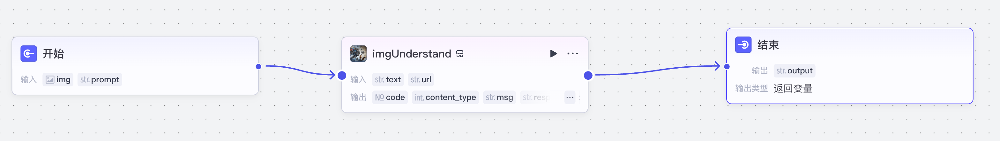

开始节点输入

* img ：需要被理解的图片, image类型，支持常见的jpg、bmp、png等图片类型
* prompt：用户提示词，str类型。就是用户要对图片问的问题

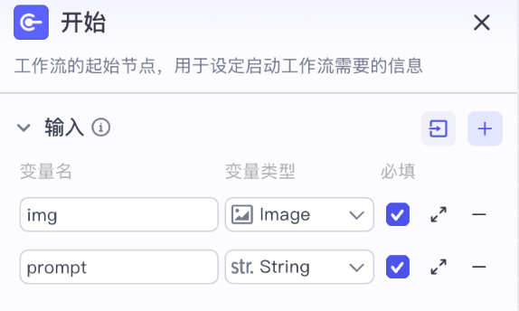

将输入部分的参数赋值给图片理解插件

* text：接收str类型，输入用户的提示词
* url：接收str图片地址。 这里需要注意：**如果是从输入节点上传过来的图片类型，这里会报红，但是可以正常执行、**

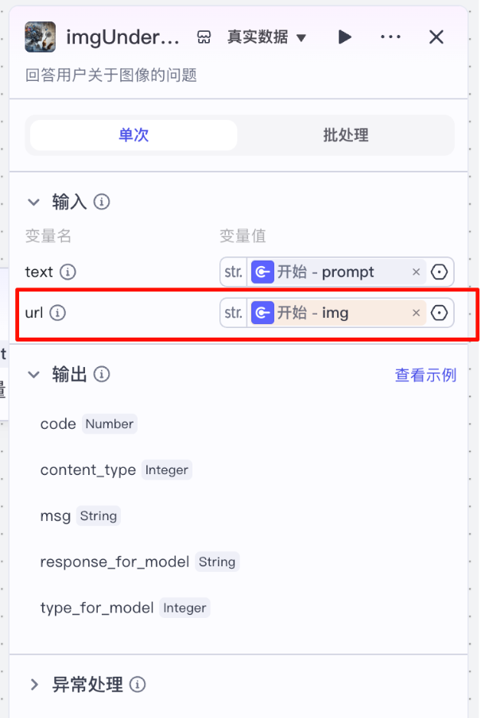

接下来，我们执行一下流水线：

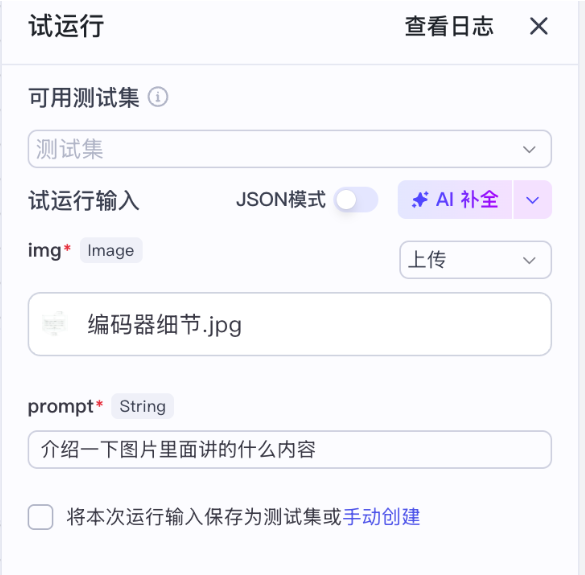

可以看到，输入的图片被转成了url，同时。在response_for_model字段中，返回了图片的内容，且内容是正确的。

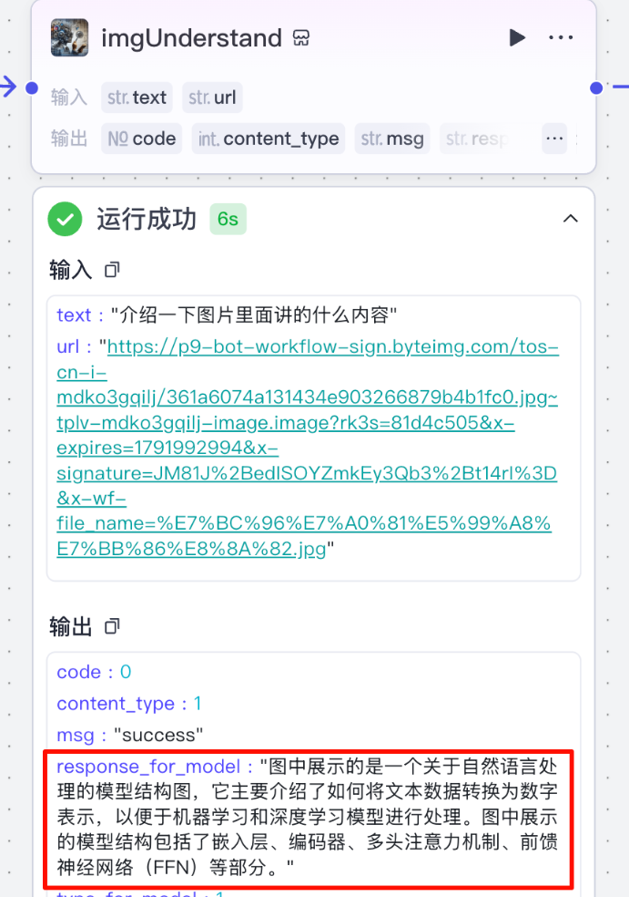

#### 4.3.3 链接读取插件

​		链接读取插件也是我们使用coze开发时常用的插件，不要被它的名称迷惑了，它实际上是一个”文件阅读器“而不是一个”链接阅读器“，它主要包含两个功能：

* 链接内容获取：当传入给插件的输入是一个html页面时，获取html页面中的文本内容
* 文档内容提取：当传入的内容是doc、pdf时，提取文档中的文本内容

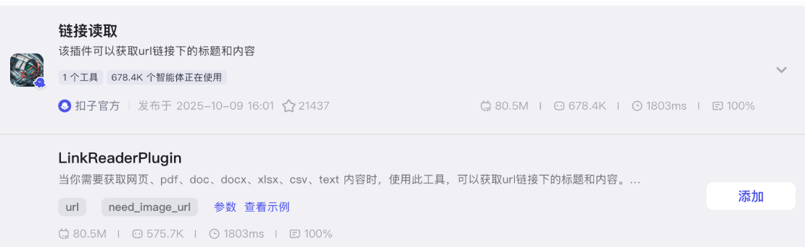

​		所以，这个插件我们经常会用来处理用户上传的各类文档，效果还算可以。除此以外，还有一些其他官方或者非官方的类似功能的插件，但是毫无疑问，链接读取插件这个插件的使用量要多的多。同时，除非业务有特殊需求以及通过多个case验证这些插件，否则还是建议使用官方提供的”链接读取“插件，大量的调用量已经说明这个插件已经被证明可以用到生产中。

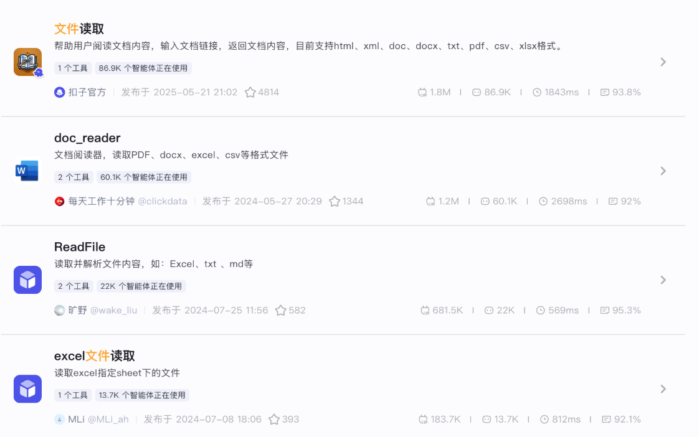


接下来，我们通过一个案例，让同学们理解这个插件如何使用。首先，我们先构建一个简单的流水线：

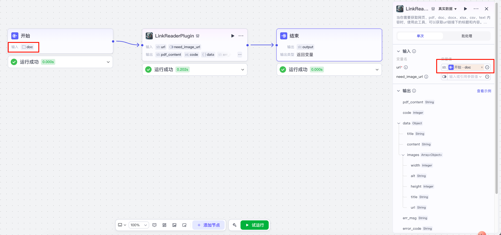

上传文件：素材 **02-简历.docx**，执行流水线。

查看日志，我们可以看到，在插件输出的字段中，pdf_content字段有内容，并且正确识别了素材文件中的文字，而其他字段都是空的。这是因为我们给的链接是docx的文件，而不是html。 


如果我们传入的是一个html的网页，比如:http://www.baidu.com。那执行结果则会如下（修改流水线过程略）：可以看到，数据出现在了data字段中。 


因此我们可以总结到一个规律：

* 如果给的docx、pdf文件地址，那么数据则会出现在pdf_content中
* 如果我们传入的是html页面地址，那么数据则会出现在data中。并且在error_code和error_msg字段中还会有调用报错信息。

请记住以上规律，对使用这个插件开发一个支持文件、网页内容获取能力智能体很要。


#### 4.3.4 其他插件

- 新闻资讯
  -   头条新闻
- 天气预报
  -   墨迹天气
- 出行必备
  -   飞常准
  -   猫途鹰
- 生活便利
  -   快递查询助手，国内快递查询
  -   食物大师
  -   懂车帝
  -   幸福里
  -   猎聘


## 5. 搭建一个完整的智能体

### 学习目标

本节课要完成一个能正常使用的 Coze 智能体。

它需要具备两个能力：

1. 用户问旅游问题时，能调用旅游规划工作流。
2. 查询天气预报的
3. 用户上传文档时，能调用文档读取工作流。


简单理解：

> 我们不是做一个只会聊天的机器人，而是做一个能判断任务、能自动调用工作流的AI智能体。

最终效果：


原理拆解：


Agent智能体实施步骤：

1. 创建一个智能体
2. 编写提示词
3. 添加工作流
4. 调试智能体
5. 发布智能体

以上5个步骤完成。

### 5.1 创建一个智能体

输入智能体名称和功能介绍，然后单击**图标**旁边的**生成**图标，自动生成一个头像。


### 5.2 编写提示词

在左侧**人设与回复逻辑**面板中描述智能体的身份和任务。

在中间**技能**面板为智能体配置各种扩展能力。

在右侧**预览与调试**面板中，实时调试智能体。


提示词：

````properties
# 角色 
你是一个多功能机器人，能够根据用户输入的提示词选择使用不同的工作流完成对应的工作。


## 工作步骤 
- 如果用户上传了文档，则识别文档中的文本内容
- 如果用户输入的内容和旅行相关，则进行旅游规划


-----------------------------------------------------------------------------
# 角色 
你是一个多功能机器人，能够根据用户输入的提示词选择使用不同的工作流完成对应的工作。


## 工作步骤 
- 如果用户输入的内容跟天气预报有关,则调用天气预报的工作流workflow_test_5
- 如果用户输入的内容和旅行相关，则调用旅游助手工作流
workflow_test_4

````


如下图：


在这里我们保持默认的"单Agent(自助规划模式)"不动，把工作流调用的选择权交给模型。

### 5.3 添加工作流

在添加工作流之前，我们要修改工作流的名称和描述，以便大模型去选择调用哪个

* 旅游助手工作流改为：


文档内容读取工作流改为：


​		编辑完成后，还需要发布工作流。 这里需要注意： **只有发布过的工作流才能被智能体使用**。 因为我们之前已经调试过了，所以在这里发布时，点击"坚持发布"即可，实际工作中，如果工作流没有试运行过，不建议抱有侥幸心理直接发布。 这样会让BUG隐患带到智能体中，在实际生产中，我们建议尽量把风险前置，越早发现BUG，越早解决，这样最后整个工程的质量就越容易把控。


最后，我们把刚刚发布的两个工作流添加到编排内容中：


### 5.4 调试智能体

给智能体添加开场白和预置问题：

```markdown
你好，我是个多功能机器，支持旅游规划和档识别两个功能。你可以跟我说：


帮我规划一下郑州3天2夜旅游规划
帮我分析一下这个文档的内容
```


预览和调试：


试运行机器人：

旅游规划：


文档读取：


可以看到，工作流被正常调用。输出正常


### 5.5 发布智能体

完成调试后，单击**发布**将智能体发布到各种渠道中，在终端应用中使用智能体。目前支持将智能体发布到飞书、微信、抖音、豆包等多个渠道中，你可以根据个人需求和业务场景选择合适的渠道。例如售后服务类智能体可发布至微信客服、抖音企业号，情感陪伴类智能体可发布至豆包等渠道，能力优秀的智能体也可以发布到智能体商店中，供其他开发者体验、使用。

1. 在智能体的编排页面右上角，单击**发布**。
2. 在发布页面输入发布记录，并选择发布渠道。
3. 单击**发布**。


## 6. 多模态组件

### 6.1 多模态数据处理

在使用Coze实现Agent的时候，经常会处理一些文字以外的输入类型，比如图片、音频、视频。

在Coze中，图片、音频、视频处理的方式大多是通过自带的音视频数据处理节点或插件完成，这些插件大多数都是由各个大模型供应商企业提供，通过调用其他大模型实现。

多模态应用场景：

* 文案：基于产品介绍和LLM，生成风格化的文案（比如小红书文案）
* 商品图片：基于文生图、图生图等功能，生成商品图。还可结合一些图像编辑类的模型，一件替换模特衣服、首饰等，节省模特成本。
* 广告语音：基于文案生成广告配音
* 广告视频：基于文案，商品图片等生成广告视频，节省 广告拍摄成本

综上所述，接下来我们将通过一些案例介绍一些比较常用的多模态数据的处理工具。


### 6.2 图像类型

在Coze平台基础使用章节中，我们已经学习过了图片理解功能，但是在Coze平台中，图片类型相关的处理能力不仅只有这一种。还包括：文生图、图像画质提升功能。

#### 6.2.1 文生图

文生图就是根据文字描述生成图片。

例如输入：

帮我生成一张宠物狗的图片，品种是金毛，背景是在雪地里，正在玩雪，效果如下图所示：

>


文生图构建流程图


模型会根据提示词生成一张符合描述的图片。

它适合用在：

- 商品宣传图
- 课程封面图
- 海报配图
- 小红书配图
- 广告素材图


文生图工作流设计：

在流水线中添加图像生成节点，选择模型、设置好分辨率等信息，如图所示：


输入提示词：

````properties
帮我生成一张宠物狗的图片，品种是金毛，背景是在雪地里，正在玩雪。
````

> 注意：文生图效果好不好，很大程度取决于提示词是否具体。一个好的图片提示词，通常要包含：主体 + 场景 + 风格 + 光线 + 构图 + 细节。

例如：

主体：金毛犬
场景：雪地
动作：玩雪
风格：真实摄影风
光线：自然光
细节：毛发清晰、背景有景深

---

以下是生成结果，因为我们这里使用的是字节当前最强的图片生成模型Seedream 4.0。可以看到，图片生成的效果非常逼真，光影效果好，并且还有景深，就像使用微单相机拍摄的。


**课堂练习：（8分钟）**

请创建一个 **文生图工作流**，根据提示词生成一张图片。

图片主题可以任选一个：

```powershell
1. 金毛犬雪地玩耍图
2. AI 大模型课程宣传图
3. 咖啡杯商品宣传图
4. 冲锋衣户外场景图
5. 智能机器人科技海报
```


#### 6.2.2 图像画质提升

本节课我们要学会使用图像画质提升能力，把低清图片处理得更清晰。它不是重新生成一张完全不同的图片，而是在原图基础上进行优化：

\- 图片比较模糊时，可以提升清晰度；
\- 图片分辨率较低时，可以增强画面细节；
\- 商品图、老照片、宣传图质量不够好时，可以做基础优化。

一句话理解：

> 图像画质提升负责"优化原图质量"，不是"重新创作一张新图"。


图像提升工作流：


在工作流中添加一个图片清晰度提升节点，并把原图传入


图片提升前（素材 **05-低分辨率图片.jpg**）：


提升后：


可以看到图像的分辨率得到了提升，但由于本身的素材就只能这样了。


**课堂练习：（8分钟）**

使用 Coze 的图像画质提升能力，把一张低清图片处理得更清晰。


通过这个练习，理解：

> 图像画质提升是"优化原图质量"，不是"重新生成一张新图"。


### 6.3 音频类型

#### 6.3.1 语音识别(ASR)

本节课我们要学会使用语音识别能力，把音频内容转换成文字。

它不是让智能体"听懂所有业务逻辑"，而是先完成第一步：

\- 用户上传音频，系统可以识别其中的文字内容；
\- 课堂录音、会议录音、面试录音可以被转成文本；
\- 识别后的文本还可以继续交给大模型整理、总结和润色

应用场景：阿里的通义听悟就是基于ASR语音识别实现的

一句话理解：

>  音频识别负责"把声音转成文字"，大模型负责"把文字整理好"。


语音识别（ASR, Automatic Speech Recognition）就是把语音转化成文字的算法， 在coze中使用插件即可实现。 在插件商店中搜索 "语音识别"，包含两个版本。一个是小模型的语音识别，一个是大模型的语音识别。 区别在于识别准确率和资费上。


在工作流中添加一个"语音识别"节点：


试运行，并上传我们的素材 **06-音频片段.MP3**：


可以看到，这里输出了素材中的内容。文字识别都是对的，但是这里的问题在于没有标点符号，可以在语音识别节点后追加一个LLM节点，用于输出润色。过程略，同学们可自行优化。


**课堂练习：（8分钟）**

使用 Coze 的语音识别能力，把06-音频片段.MP3这个音频文件转换成文字。

通过这个练习，理解：

> ASR 负责把音频中的声音识别成文字。


#### 6.3.2 语音合成(TTS)

本节课我们要学会使用语音合成能力，把文字内容转换成语音。

它不是简单"把字读出来"，而是可以根据业务需要生成不同风格的声音：

\- 输入广告文案，可以生成广告配音；
\- 输入课程讲解词，可以生成课程旁白；
\- 输入客服回复话术，可以生成语音回复；
\- 输入短视频文案，可以生成解说音频。


语音合成（Text-to-Speech）是将文本信息转化为语音信息的人工智能技术，在Coze中同样可通过插件实现。在插件中搜索"语音合成"。分为两个版本

* 语音合成：使用扣子的模型实现语音合成
* 语音合成火山版：使用火山引擎上的更加专业的模型实现语音合成


在工作流中创建一个语音合成节点：


除了文本是必填项以外，其他的都是可选项。具体可根据coze官方手册使用。可以指定情绪、语种、播报人、音色等。 接下来，我们试运行工作流，输入以下提示词：

````properties
广袤的草原上，晨曦微露，成群的斑马在悠闲地散步，非洲狮正趴在巨石上享受阳光的沐浴，万物复苏，又到了动物们活跃的季节
````


生成音频如下(词性解说男声)：

<audio src="../audio/speech_7468512265151528987_04758d63-a23c-4290-97af-85080403224d.mp3"></audio>

**课堂练习：（8分钟）**

使用 Coze 的语音合成能力，把一段文字文案（学IT，就来黑马程序员）转换成语音音频。

通过这个练习，理解：

> TTS 负责把文字转换成语音，让智能体具备语音输出能力。


### 6.4 视频类型

本节课我们要学会使用视频生成能力，把文字描述或图片素材生成短视频。

它不是简单"让 AI 随便生成视频"，而是要通过清晰的提示词告诉模型：

\- 视频主题是什么；
\- 画面中有什么主体；
\- 场景和背景是什么；
\- 镜头如何运动；
\- 视频整体是什么风格。

一句话理解：

> 视频生成负责"把创意变成动态画面"，让智能体具备生成短视频素材的能力。


视频类型的处理这里我们主要介绍视频生成。视频生成是多模态大模型近期比较新型的场景，能够根据用户输入的文字、图片，以及各类设置（如分辨率、时长等），生成视频。

在工作流中增加一个"视频生成节点"，传入数据，设置使用的模型，并设置参数，如下图：


试运行工作流，传入提示词：

````properties
核心主题与风格​​：拍摄一个用于电商平台的、展现奢华与时尚感的足金手镯短视频。视频整体质感高级，凸显金手镯的精致工艺与佩戴时的优雅气质
。
​​场景与布景​​：
​​主场景​​：一个光线柔和、布置现代的室内空间，可能包含简约的梳妆台或铺有浅色丝绸的桌面
。背景简洁，以突出手镯本身。
​​细节​​：可有少量高端饰品（如香水瓶、珠宝盒）作为点缀，但遵循"少即是多"的原则，避免分散注意力
。
​​光线​​：利用从窗户透进的柔和自然光，或在影棚内使用扩散照明，确保手镯光泽得到最佳呈现，减少金属表面的强烈反光
。
​​主体与画面​​：
​​主角​​：一款设计精美的足金手镯。
​​关键画面​​：
​​开场特写​​：镜头对手镯进行极致特写，清晰展现其精细花纹、质感与璀璨光泽
。
​​佩戴展示​​：一只优雅的手缓缓拿起并佩戴上手镯，展示佩戴的便捷性与上手效果
。
​​动态光泽​​：手腕轻轻转动，展示手镯在不同角度下流动的光泽
。
​​组合搭配​​（可选）：可与其他简约手链或手表叠戴，展示其搭配可能性。
​​运镜与节奏​​：
​​镜头一（开场）​​：​​缓慢推近​​的特写镜头，聚焦于手镯最精美的雕刻或纹理部分，瞬间抓住眼球。
​​镜头二（展示）​​：​​平稳跟随​​镜头，从手镯被拿起至佩戴上手腕的过程，保持画面稳定。
​​镜头三（动态）​​：​​环绕运动​​或​​轻微旋转​​拍摄佩戴手镯的手腕，多角度展现手镯形态与光泽变化。
​​镜头四（收尾）​​：​​缓慢拉远​​，展示手镯作为整体造型一部分的完整效果，画面定格于优雅的姿势。
​​节奏​​：整体节奏舒缓，突出高级感和品质感。
​​情感与氛围​​：通过光影和运镜，传递金手镯所代表的"富贵象征"、"永恒承诺"或"圈住幸福"的美好寓意，营造轻奢、愉悦的情感氛围
。
````


点击运行，并等待。结果如下图。 这里在执行的时候时间会比较长，且消耗的token比较高。


**课堂练习：（8分钟）**

请创建一个视频生成工作流，为一个商品生成短视频素材。

商品可以任选一个：

1. 足金手镯；
2. 运动鞋；
3. 冲锋衣；
4. 咖啡杯；
5. AI 大模型课程宣传海报。


操作要求

工作流至少包含以下节点：

1. 开始节点：接收用户输入的视频提示词；
2. 视频生成节点：根据提示词生成视频；
3. 输出节点：输出生成的视频结果。