# Coze平台介绍

## 学习目标

- 了解Agent智能体的基本概念
- 了解Agent智能体和应用

## 1、 智能体的基本概念

### 1.1  Agent智能体

在以chatgpt为代表的大模型出现以后，模型具备了“思考”能力，能够帮助我们解决一些知识获取和推理等问题。但是因为大模型只能输出内容，能够帮助我们解决的业务问题有限，如果能让大模型具备使用工具的能力，将很大程度上拓宽大模型能力的边界。 于是基于大模型+工具调用这种解决方案，“Agent智能体”这个概念在业界出现并大火。

智能体，又称Agent。是指能够感知环境、分析信息、自主决策并采取行动以实现特定目标的软件实体或系统。它以大模型（如GPT等）为“大脑”，具备理解、规划、决策、记忆和行动的能力。

AI Agent = LLM+ 记忆 + 任务规划 + 工具使用

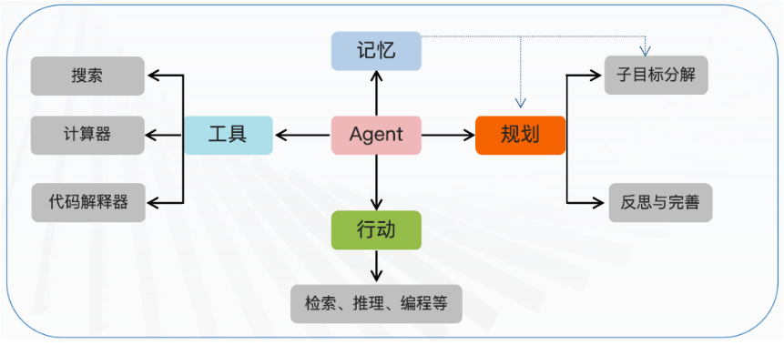

大模型就像一个“百科全书”，知识渊博，有问必答，但它不会主动去“做”什么事。而智能体则像一个“全能助理”，比如你告诉它“我下周三要去杭州出差，帮我安排好行程”，它就能自主完成查询航班、预订酒店、规划市内交通、提醒天气等一系列操作 。它不仅“有脑”（能思考），还“有手有脚”（能调用工具去执行）。

Agent的目标和理念：让它成为一个能自主思考、能帮你办事的“智能大脑”或“数字员工”。

现阶段，我们的Agent还处于过渡阶段，一般是以一个“流水线”的方式事先规定好业务流程，通过串联多个大模型负责处理不同的任务，从而解决一个复杂的业务场景。

目前实现智能体的技术路径：

| 技术栈          | 优势                                                         | 劣势                                   |
| :-------------- | :----------------------------------------------------------- | :------------------------------------- |
| Coze            | 快速实现需求，低代码，互联网上提供的插件多                   | 限制较多，无法实现比较定制化的功能     |
| Dify            | 快速实现需求，低代码，能够对接本地模型和服务                 | 本地版插件太少，很多功能需要重新造轮子 |
| Langgraph等框架 | 扩展性极强，基本上不受限制，可以对接本地模型，实现自定义复杂逻辑等 | 从零构建                               |

而Agent的终极形态是不需要开发这些流水线，Agent能够完全自主完成我们的各种需求，这依赖于大模型的能力，目前来看还需要一定的时间。

### 1.2 智能体开发平台-GPTS

2023年11月，OpenAI 为旗下的 ChatGPT 推出了一项名为“GPTs”的服务，允许用户无需写代码就可以根据特定需求创建“属于自己的 ChatGPT 版本”，也就是基于 ChatGPT 创建一个Agent。

GPT Store访问地址：https://chat.openai.com/gpts，注意需要科学上网，以及当前只针对plus用户开通了使用权限。

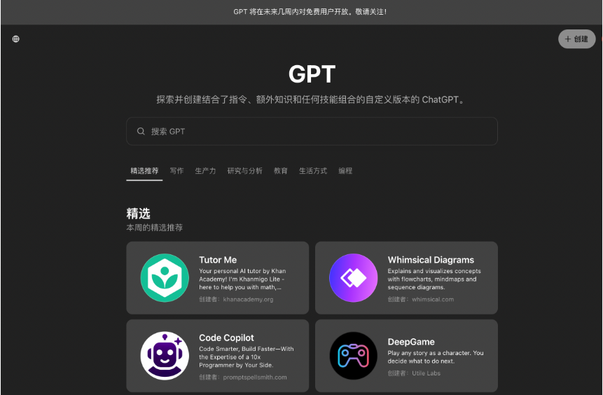

## 2、Coze平台简介

### 2.1 Coze平台介绍

#### 2.1.1 Coze介绍

Coze 是由字节跳动推出的一个AI聊天机器人和应用程序编辑开发平台，可以理解为国产版的GPTs. Coze（扣子）分为国内版和国外版：

- 国内版访问地址：https://www.coze.cn/home，背后大模型应用的是字节自研的豆包大模型、通义千问和kimi大模型 https://www.coze.cn/home
- 国外版访问地址：https://www.coze.com/home，背后大模型应用的是GPT-4、Gemini等，但是需要一些科学上网的方法。

Coze还提供了多种插件、知识、工作流、长期记忆和定时任务等功能，来增强聊天机器人的能力和交互性。而且你可以将搭建的 Bot 发布到各类社交平台和通讯软件上，让更多的用户与你搭建的 Bot 聊天。

#### 2.1.2 Coze注册

使用地址：[https://www.coze.cn/]，可以使用手机号进行注册，也可以使用抖音或飞书进行注册。

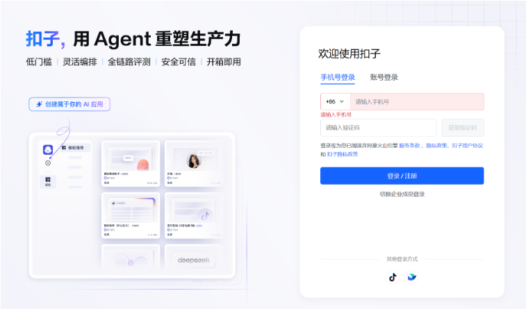

注册成功后我们就可以使用coze平台了。

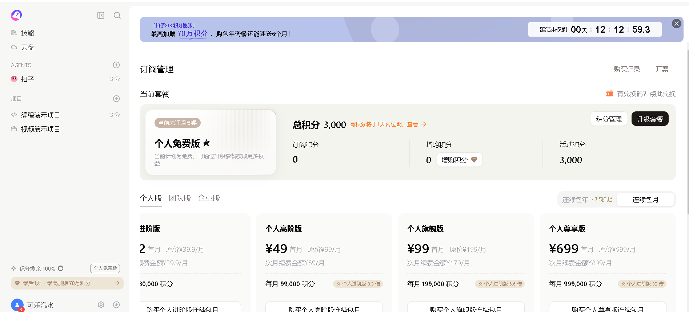

Coze平台在线版的主页如下：

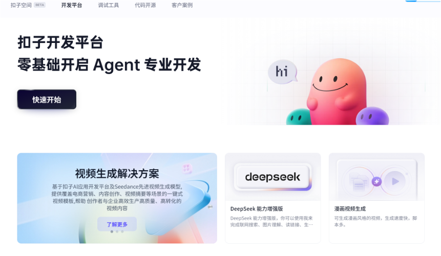

Coze平台的套餐有个人版团队版和企业：

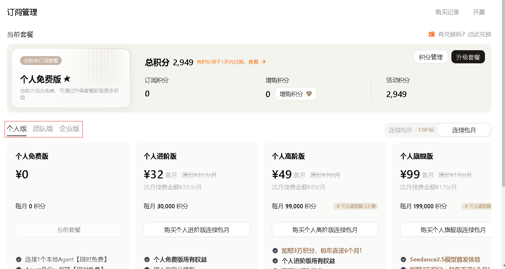


### 2.2 Coze平台开源版

因某些业务场景的数据安全要求较高，要求模型、数据不能暴露到公网。因此，私有化部署成为了部分业务场景的刚需。Coze针对私有化部署场景进行了开源，github地址：[Coze Studio](https://github.com/coze-dev/coze-studio) ，在2025年7月26日正式开源，允许免费商用和本地化部署。‌‌


[Coze Studio](https://www.coze.cn/home) 是一站式 AI Agent 开发工具。提供各类最新大模型和工具、多种开发模式和框架，从开发到部署，为你提供最便捷的 AI Agent 开发环境。

- **提供 AI Agent 开发所需的全部核心技术**：Prompt、RAG、Plugin、Workflow，使得开发者可以聚焦创造 AI 核心价值。
- **开箱即用，用最低的成本开发最专业的 AI Agent**：Coze Studio 为开发者提供了健全的应用模板和编排框架，你可以基于它们快速构建各种 AI Agent ，将创意变为现实。

因coze开源版在企业中应用较少，因此在这里我们主要介绍Coze在线版的使用。

私有化部署使用的话，一般使用Dify，原因有以下几点：

- dify是一个更早开源的平台，与coze功能类似，且社区成熟、功能对比coze更加强大，已经占据了较大的市场
- coze对比dify的优势在于丰富的插件库、应用型智能体、以及对于多模态的支持，在开源版这些功能被阉割比较严重

# Coze平台入门实战

## 学习目标

- 了解Coze平台中的基本功能
- 掌握工作流的搭建和常见节点的用法
- 掌握常见的工作流的使用
- 掌握完整的智能体的搭建

## 1、Coze平台的基本使用

### 1.1 功能简介

https://www.coze.cn/session 已经废弃

https://www.coze.cn/home 扣子编程

https://www.coze.cn/space 扣子工作空间

`code.coze.cn/w`（扣子编程） vs `www.coze.cn/space`（扣子空间）

> 同一个字节扣子账号，**账号互通，但两套完全不同产品**


| 对比项   | [code.coze.cn/w](https://link.wtturl.cn/?target=https%3A%2F%2Fcode.coze.cn%2Fw&scene=im&aid=582478&lang=zh) 扣子编程 | [www.coze.cn/space](https://link.wtturl.cn/?target=https%3A%2F%2Fwww.coze.cn%2Fspace&scene=im&aid=582478&lang=zh)（[space.coze.cn](https://link.wtturl.cn/?target=https%3A%2F%2Fspace.coze.cn&scene=im&aid=582478&lang=zh)）扣子空间 |
| :------- | :----------------------------------------------------------- | :----------------------------------------------------------- |
| 定位     | **开发者平台，做 AI 应用、Bot、网页、小程序**，偏向开发、搭建、发布扣子 | **AI 协同办公工作台，直接让 AI 干活**，偏向业务任务执行稀土掘金 |
| 面向人群 | 开发者、做工具 / Bot 的人；想把 AI 做成可对外发布的应用      | 普通职场人，直接交任务给 AI 同事，不需要开发调试             |
| 核心能力 | 搭建 Bot、可视化工作流、知识库、数据库、生成网页 / 小程序、API、发布到飞书 / 豆包渠道、代码项目管理扣子 | 自动拆解复杂任务、多 Agent 协作、生成 PPT / 表格 / 文档、文件处理、云电脑、项目任务管理、旁听会议纪要扣子 |
| 使用方式 | 手动拖拽配置节点、写提示词调试 Bot、开发完发布出去           | 直接给目标指令：“帮我做行业分析 PPT”，AI 自动拆分步骤执行，看任务进度 |
| 产出物   | Bot 机器人、工作流、网页应用、小程序、API 接口               | PPT、Markdown 报告、表格、文案、设计稿、项目成果文件         |
| 典型场景 | 做一个聊天机器人、搭建工作流、开发对外 AI 工具、调试插件     | 写报告、做 PPT、数据分析、多步骤复杂办公任务、多 AI 分工协作 |

简单一句话区分

1. **扣子编程 code.coze.cn/w**：**造 AI 工具**。你在这里搭建 Bot、写工作流，把 AI 能力做成成品工具给别人用扣子。
2. **扣子空间 /space**：**用 AI 工具干活**。你直接下达任务，多个 AI 自动分工帮你完成现实工作，不用做开发配置稀土掘金。

互相跳转关系

- 扣子空间里面可以调用扣子编程的代码能力，让 Agent 写代码；
- 扣子编程开发出来的 Bot，可以放到扣子空间里作为 AI 同事调用。

#### 1.1.1 工作空间

空间是资源组织的基础单元，不同空间内的资源和数据相互隔离。一个空间内可创建多个**智能体**和 **AI 应用**，并包含一个**资源库**。在资源库中创建的资源可以被相同空间内的智能体和 AI 应用使用。

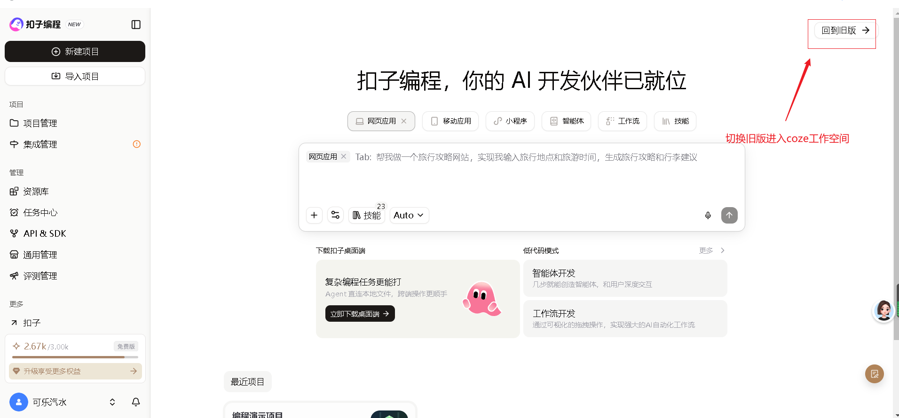

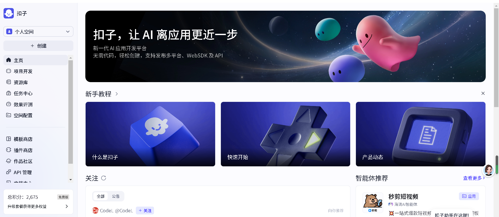

工作空间存在的意义是为了隔离不同的业务，比如某公司采购了一个企业版的Coze，公司有做打车业务的、有做金融业务的，这些业务团队之间只能访问自己业务团队的开发好的智能体和应用，团队之间应当互相隔离。

#### 1.1.2 项目

项目分为智能体和 AI 应用两种类型，AI 应用内可以创建多种应用专属资源，也可以和智能体共享空间资源库中的资源。

当我们创建一个项目时，如下图，有智能体和应用两种选择。

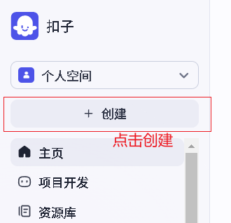

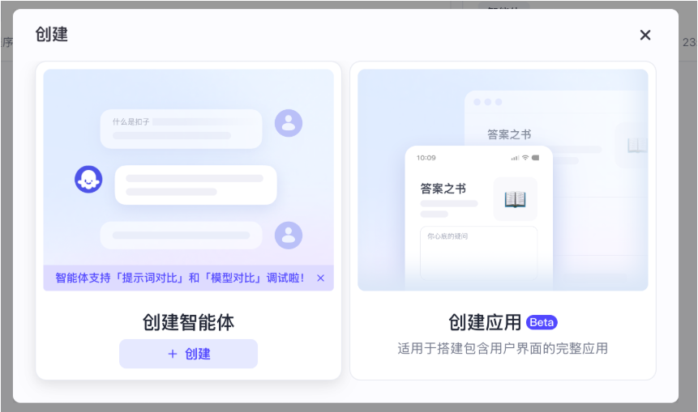

- **智能体**：智能体（Agent）通常指的是一个能够独立执行任务、做出决策并进行学习的一种自动化程序。智能体可以根据用户输入的指令，自主调用模型、知识库、插件等技能并完成编排，最终完成用户的指令。
- **AI 应用**：AI 应用是指利用大模型技术开发的应用程序，这些应用程序能够使用大模型，执行复杂任务，分析数据，并作出决策。

空间和项目以及资源库的关系图下图，可以看到：

- 一个空间中可以包含多个项目，包括智能体AI应用两种类型
- 智能体和AI应用的开发会引用资源库中的多种资源类型。

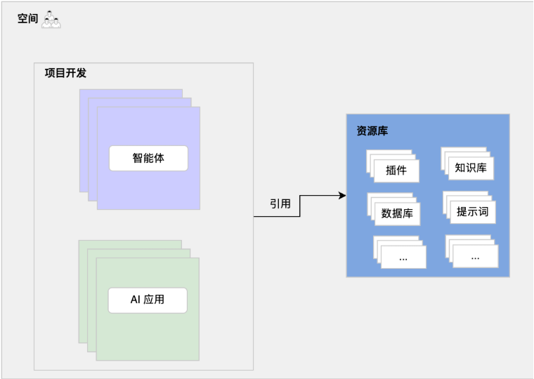

#### 1.1.3 资源库

**资源库**：你可以在资源库内创建、发布、管理共享资源，例如插件、知识库、数据库、提示词等。这些资源可以被同一空间内的智能体和应用使用。

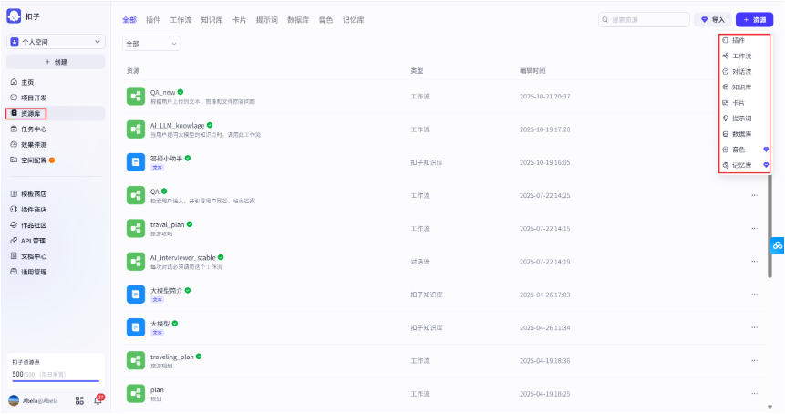

并非所有的资源类型都是常用的，在实际工作中，我们最常用的是**插件**、**工作流、对话流、知识库、数据库**。

#### 1.1.4 插件

扣子平台提供了一个多样化的插件库，这些插件涵盖了从基础的文本处理到高级的机器学习功能。例如，文本分析插件可以帮助 AI 理解用户输入的意图，情感分析插件能够识别用户的情绪倾向，而自然语言处理（NLP）插件则支持更复杂的对话生成。

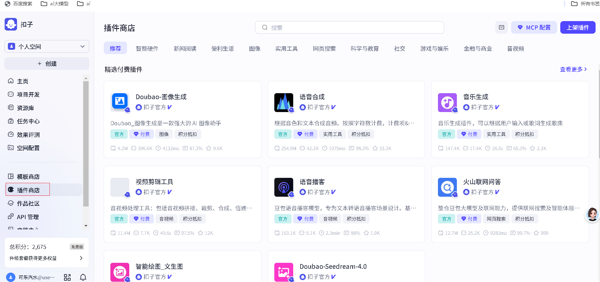

还有图像识别、语音识别、数据分析等插件，这些插件的数量和种类不断增加，以适应不断变化的技术趋势和市场需求。

#### 1.1.5 工作流和对话流

coze平台 **提供了灵活的工作流设计工具，开发者可以通过拖拽式界面轻松搭建复杂的对话流程** 。

工作流是coze平台最核心的功能，它是资源库中一种特殊的资源类型，我们在实际工作中，几乎所有的功能都需要基于工作流实现。 我们上文中提到的插件、知识库、数据库这些核心功能，在实际开发时，都是作为工作流中的节点进行使用。工作流本质是一个有向无环图，由边和节点构成， 边代表执行顺序，节点则表示一个具体的执行步骤。

工作流用于处理功能类的请求，可通过顺序执行一系列节点实现某个功能。适合数据的自动化处理场景，例如生成行业调研报告、生成一张海报、制作绘本等。

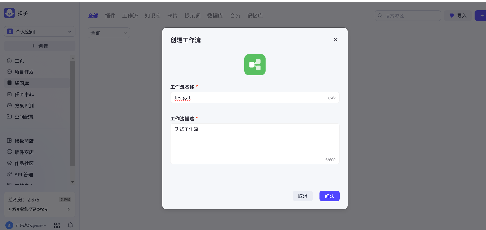

!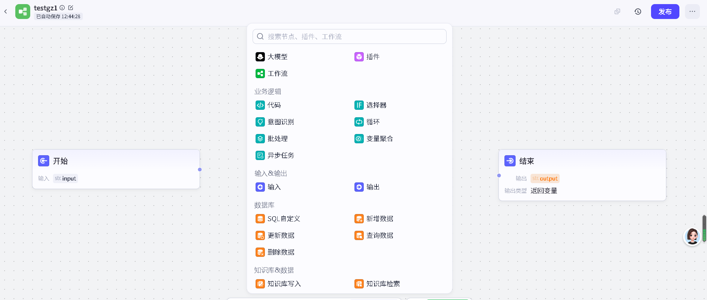

对话流是基于对话场景的特殊工作流，支持角色的设置，更适合处理对话类请求。对话流通过对话的方式和用户交互，并完成复杂的业务逻辑。对话流适用于 Chatbot 等需要在响应请求时进行复杂逻辑处理的对话式应用程序，例如个人助手、智能客服、虚拟伴侣等。

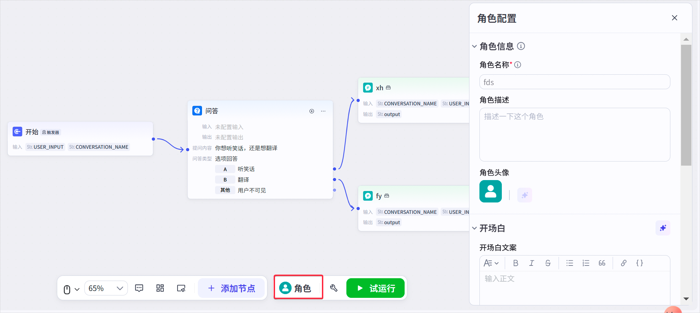

#### 1.1.6 知识库和数据库

扣子开发平台支持使用扣子官方知识库和火山知识库（更加专业版的知识库），两者均支持上传和存储外部知识内容，并提供了多种检索能力。扣子的知识能力可以解决大模型幻觉、专业领域知识不足的问题，提升大模型回复的准确率。

- 知识库中一般存放的是各类文档数据，比如专业书籍、说明书、产品介绍文档等文本类数据。
- 数据库存放的是各类业务记录，比如订单、流水、操作记录等结构化数据。

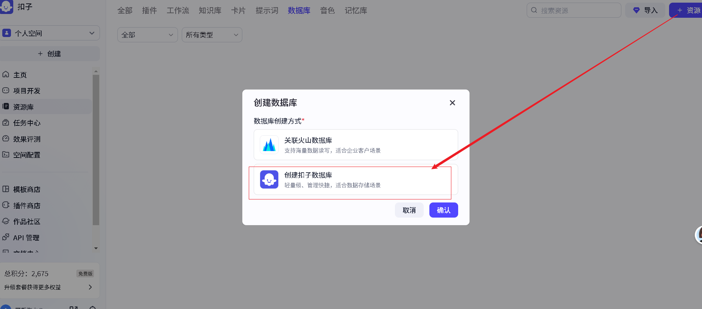

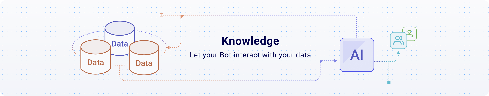

### 1.2 工作流的使用

智能体、AI应用和工作流的关系和前文中项目和资源库的关系类似， 一个项目（智能体、AI应用）可以引用多个工作流。但是在这里我们强调的是， 几乎所有的资源类型都是以智能体引入工作流的方式

接下来，我们将使用一个”旅游规划小助手“作为案例，帮助同学理解工作流的使用和

#### 1.2.1 创建一个工作流

- 进入资源库页面，点击右上角的”+资源“，即可完成工作流的创建

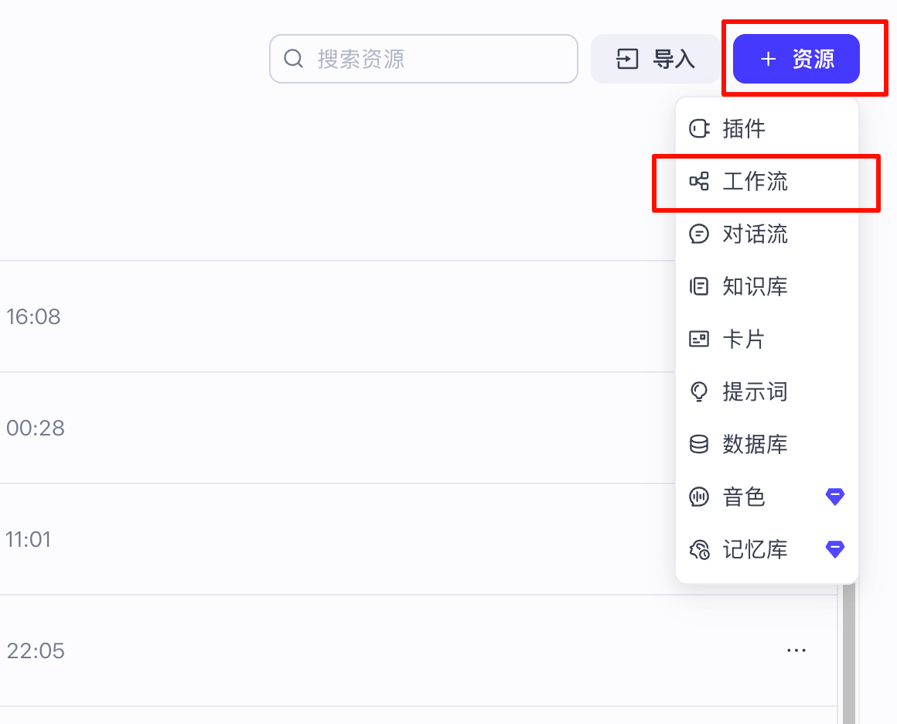

- 点击后，弹出如下页面：

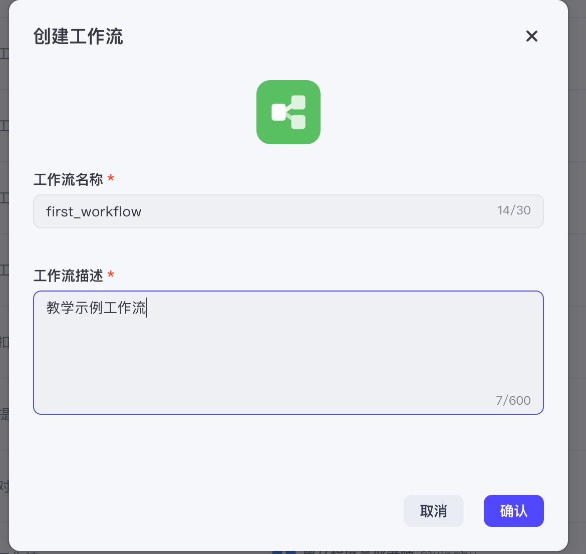

输入以下内容：

- 工作流名称：需要全英文+数字+下划线的方式输入， 长度不可超过30
- 工作流的描述：需要告诉大模型什么时候调用工作流。 **在一个智能体中添加多个工作流时， 大模型可以通过工作流描述，自动去调用工作流。**在后续的项目中，我们将使用这种方式实现一个智能体根据业务场景不同调用多个工作流。

点击创建后，进入如下页面。这个页面是一个可以拖动控件进行操作的画布，初始包含：开始和两个节点

- 开始：工作流的入口，接收信息并传递到后面的节点
- 结束：工作流的出口，返回工作流输出结果

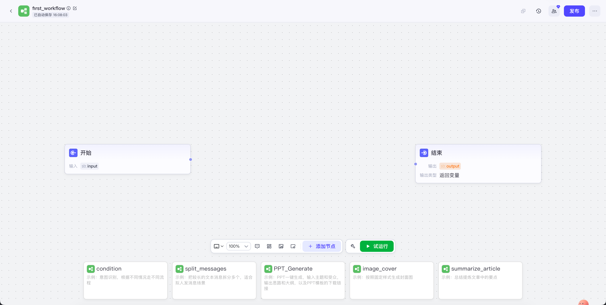

只有一个开始和一个结束节点是无法组成一个可执行的工作流的。

#### 1.2.2 大模型节点

大模型节点可以调用大型语言模型，根据输入参数和提示词生成回复，通常用于执行文本生成任务，例如文案制作、文本总结、文章扩写等。

**创建一个大模型节点：**

在画布中点击“+”按钮，添加大模型节点：

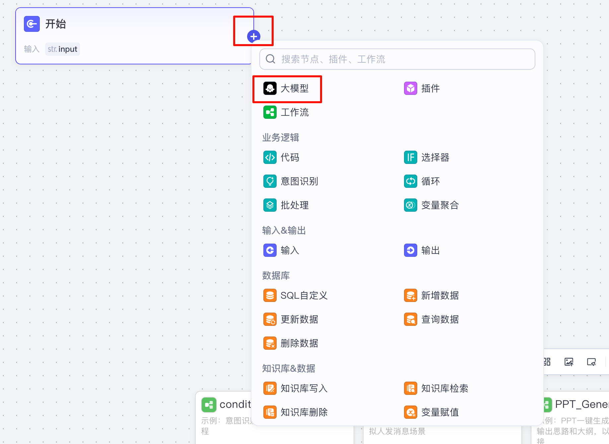

选择模型：选择要使用的模型。此节点的输出内容质量很大程度上受模型能力的影响，建议根据实际业务场景选择模型。可选的模型范围取决于当前的账号类型，个人免费版或个人进阶版用户可以使用默认的几类模型，且存在对话数量限制，团队版或企业版套餐用户可以使用火山引擎方舟平台的模型。

- 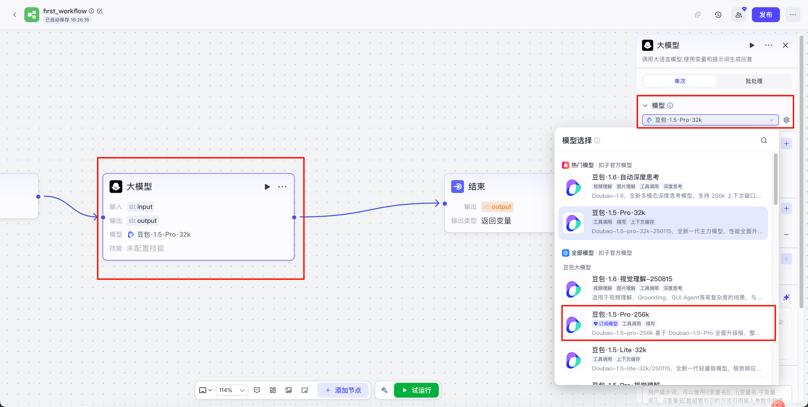

**设置模型的参数：**

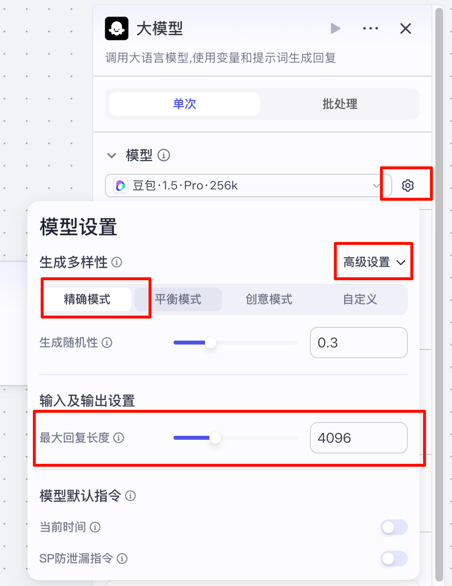

生成模式：

- 精确模式：模型的输出内容严格遵循指令要求，可能会反复讨论某个主题，或频繁出现相同词汇。
- 平衡模式：模型的输出内容更具随机性和准确性。
- 创意模式：模型的输出内容更具多样性和创新性，某些场景下可能会偏离主旨。

在基于事实的问答场景，你可以使用较低的回复随机性数值，以获得更真实和简洁的答案，例如售后客服场景；在创造性的任务例如小说创作，你可以适当调高回复随机性数值。

最大长度：模型每次生成的内容长度受限于最大输出长度（max_token），过长的内容会被截断，试运行时大模型节点同时提示“输出内容因超出模型最大输出长度被截断。”

**给大模型添加技能：**

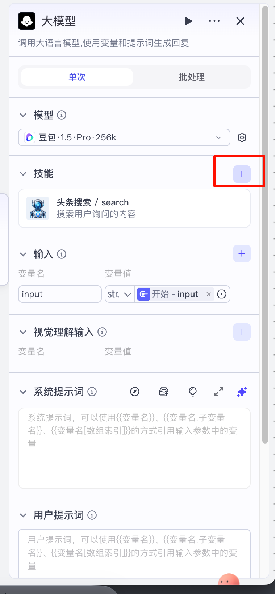

给大模型添加一个技能：头条搜索。 大模型在执行任务时，可以自动的把我们输入的提示词的一部分，调用技能中的”头条搜索“进行联网检索。

**给大模型输入prompt：**

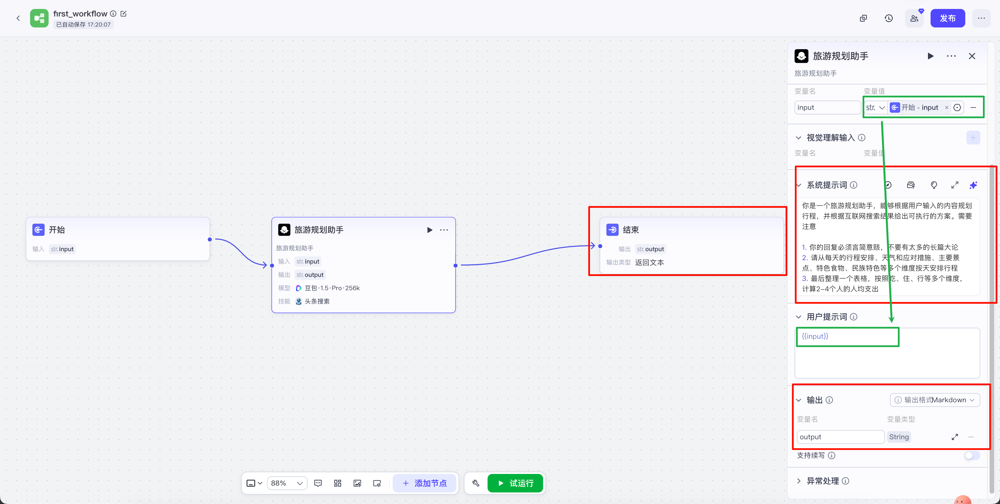

**输入** ：点击“+”，把开始节点的输入传过来作为大模型的输入

在prompt引入变量： 使用 {{变量名}}的方式引入和使用变量，系统提示词和用户提示词都可以使用。

**系统提示词** ：用于指定人设和回复风格。

```
你是一个旅游规划助手，能够根据用户输入的内容规划行程，并根据互联网搜索结果给出可执行的方案。需要注意

1. 你的回复必须言简意赅，不要有太多的长篇大论
2. 请从每天的行程安排、天气和应对措施、主要景点、特色食物、民族特色等多个维度按天安排行程
3. 最后整理一个表格，按照吃、住、行等多个维度，计算2-4个人的人均支出
```

**用户提示词** ：模型的用户提示词是用户在本轮对话中的输入，用于给模型下达最新的指令或问题。

```
{{input}}
```

**指定输出** ：指定模型的输出格式。

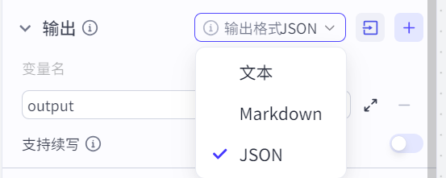

**设置输出节点**：

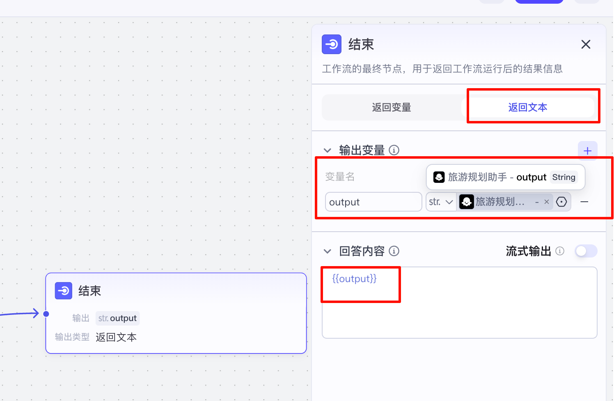

一般来讲，对于输出的内容是对话类型的，设置返回文本格式；需要格式化的输出（比如返回JSON的），设置返回变量。最后，使用{{变量名}}的方式，把上一步的输出返回给调用方。如果生成内容比较多，可以勾选“流式输出”，这样模型则会边生成内容，边返回

#### 1.2.3 试运行工作流

##### 1.2.3.1 调试工作流

- 点击试运行工作流，并给开始节点的所有输入变量赋值后，再点击右侧下方的试运行按钮，即可完成调试。

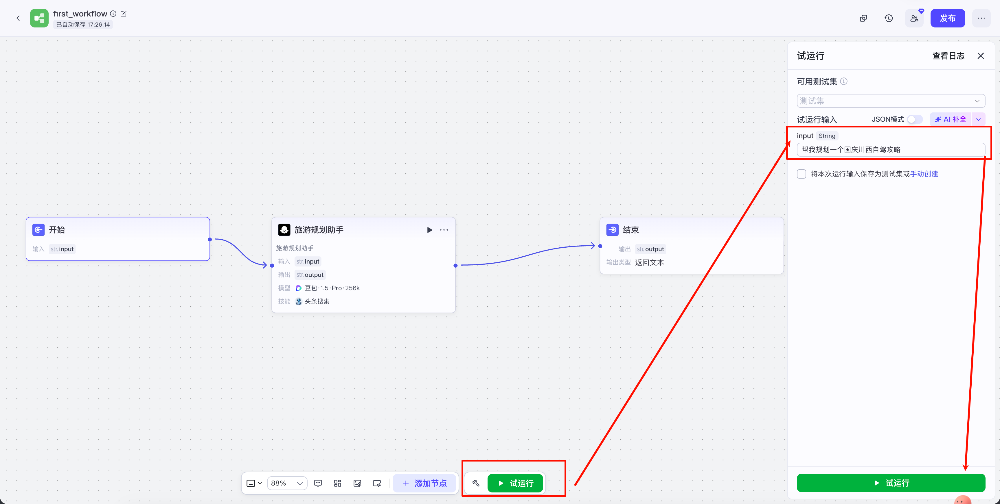

- 点击试运行后，效果如下：

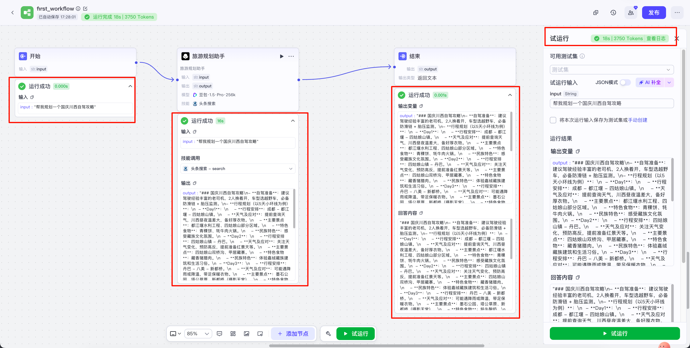

- 运行过程中，每个节点的执行结果都可以看到，方便我们进行调试。 也会展示整体的执行时间，以及token的消耗数。 可以看到，因为加入了头条搜索的功能，消费3750个token数，并不算少。

##### 1.2.3.2 查看工作流执行日志

如果想看到更加细节的信息，比如将具体每个节点的执行时间，输入/输出的token数分别是多少等信息，可以查看日志。

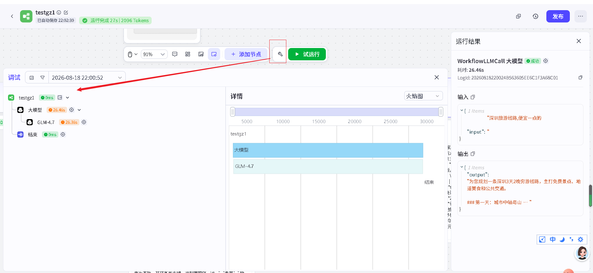

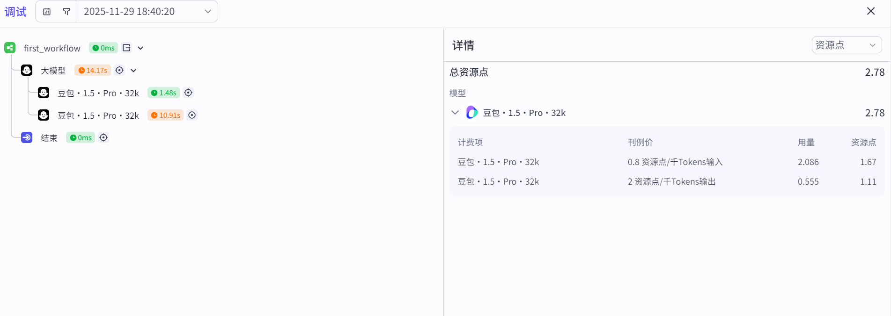

如上图，在“旅游规划助手”这个LLM节点，我们看到它分了两个阶段，第二个节点右侧可以看到这里调用了插件，并返回了对应的结果。同时也看到了这个阶段消耗的token数，包括输入/输出的token数细节。

在实际工作中，往往一个工作流会复杂的多，学会调试工作流、查看日志，是coze应用开发的基本功。基本功的好与坏影响开发一个应用的时间，希望同学们认真对待。

#### 1.2.4 其他常用节点

##### 1.2.4.1 选择器节点

该节点是一个 if-else 节点，用于设计工作流内的分支流程。当向该节点输入参数时，节点会判断是否符合**如果**区域的条件，符合则执行**如果**对应的工作流分支，否则执行**否则**对应的工作流分支。

接下来，我们在这个demo中增加一个选择器节点，用来判断用户输如是否为空，如果为空直接结束不调用大模型。如果不为空则执行后续的逻辑。

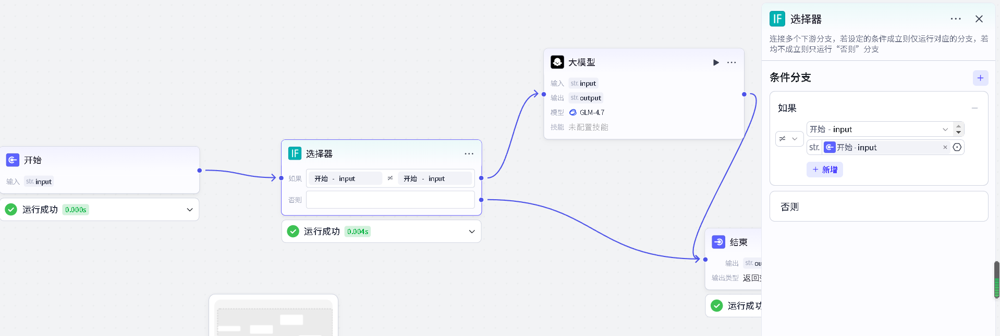

##### 1.2.4.2 意图识别节点

意图识别（Intent Recognition）指的是让智能体理解用户通过自然语言表达的意图或目的。意图识别是智能助手的典型能力，例如用户在对话中输入“我想查看今天的 AI 新闻”，其中“查看新闻”为用户意图，也就是用户希望智能体执行的操作。扣子工作流支持意图识别节点对用户意图进行归类，无需再通过大模型节点配合选择器节点实现意图识别，使工作流运行更加高效。

意图识别节点可用于以下场景：

- 客户服务：识别用户问题的类型，并转交各类知识库处理，对于知识库中未匹配的问题，转交人工客服处理。
- 医疗咨询：对用户咨询的医学问题进行归类，非医学问题的咨询则拒绝回复。
- 综合类智能体：对于功能多样的智能体，可以先由意图识别节点对用户咨询进行初步分类，转交各个 Agent 分支处理。

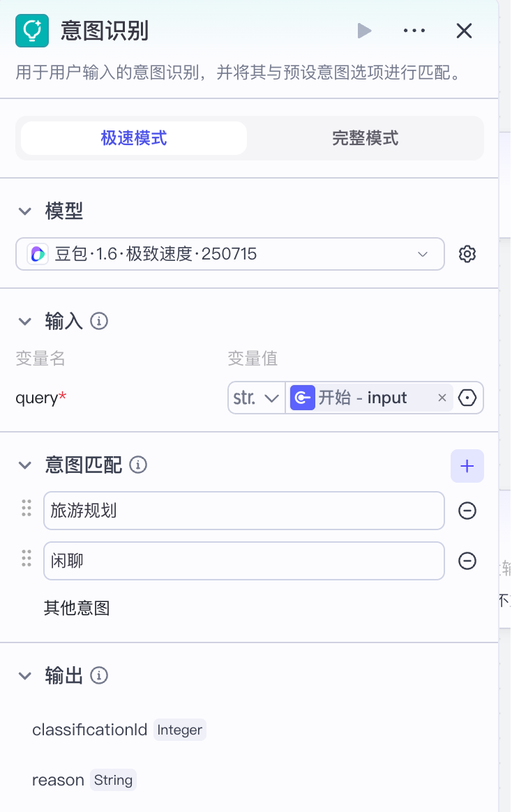

和选择器一样，意图识别节点也是一种分支选择节点，区别就是在于意图识别是基于大模型做场景分类，选择器是基于代码层面的逻辑判断。接下来，我们将结合意图识别、输入和输出节点，改造一下我们的旅游规划小助手。

**2.4.3 输入和输出节点**

**输入节点**：

在比较复杂的工作流场景中，某些节点的执行往往需要额外的用户输入。如果上游节点中没有获取到这些信息，你可以添加一个输入节点来主动收集信息。工作流执行到输入节点时会暂时中断，直到此节点收集到必要的用户输入。实际上，开始节点就是特殊的输入节点

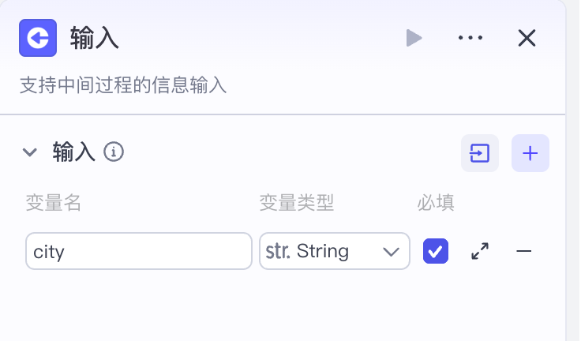

**输出节点：**

通常情况下，工作流会在执行完毕后通过结束节点输出最终的执行结果。当工作流处理流程较长、运行时间较久时，开发者可以在工作流中添加输出节点，临时输出一段消息，避免用户等待时间过长、放弃对话。例如提示用户任务正在执行中，建议用户耐心等待。

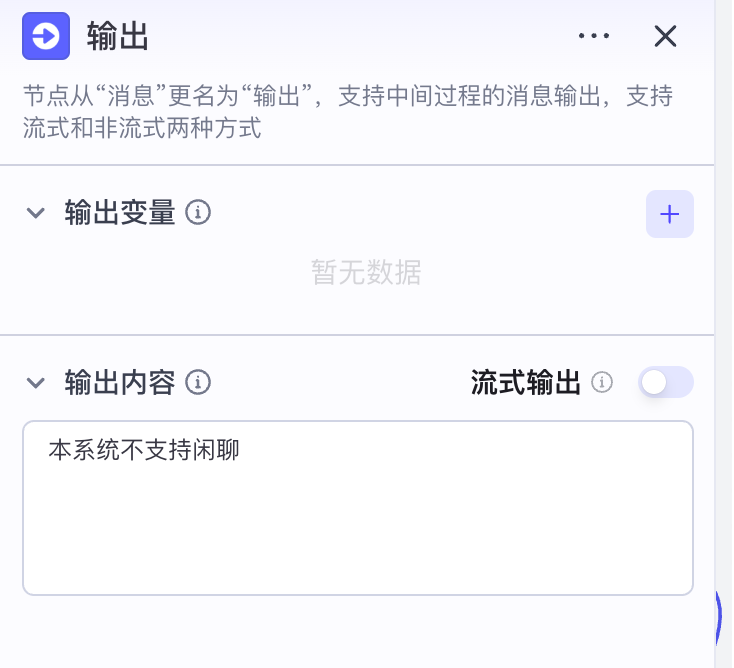

**改造小助手**

结合意图识别、输入和输出节点，改造一下我们的旅游规划小助手。首先，增加一个意图识别节点：

把开始节点的input作为query，判断意图： * 旅游规划：提示用户输入”城市“，然后把用户输入的城市作为旅游助手的输入。 * 其他意图：输出”本系统不支持闲聊“，然后退出

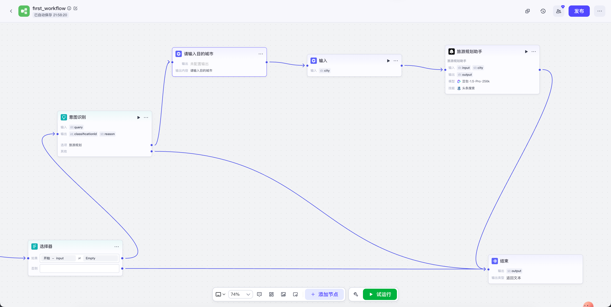

- 别忘了修改大模型中的变量：

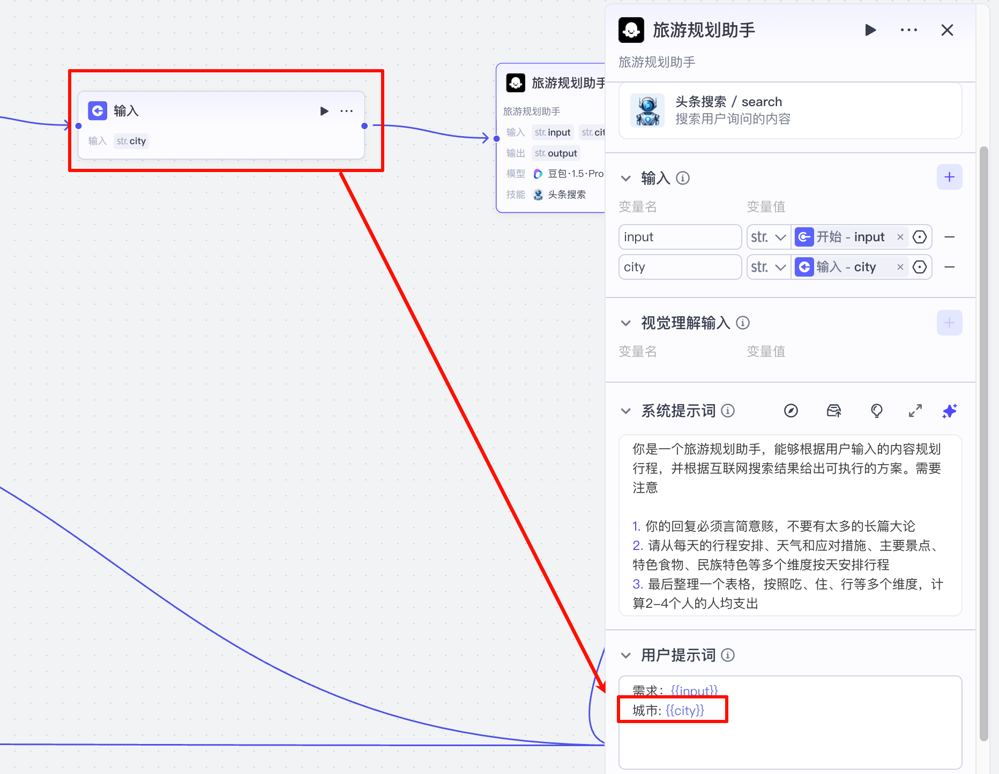

**编辑后，试运行模型：**

输入：

```
帮我规划一个7天的自驾游
```

点击执行后，如下图：

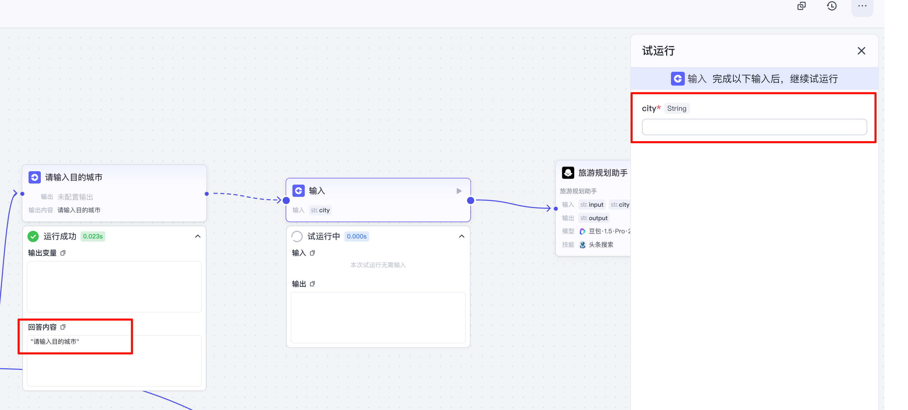

输入：

```
成都
```

然后继续执行，结果如下：

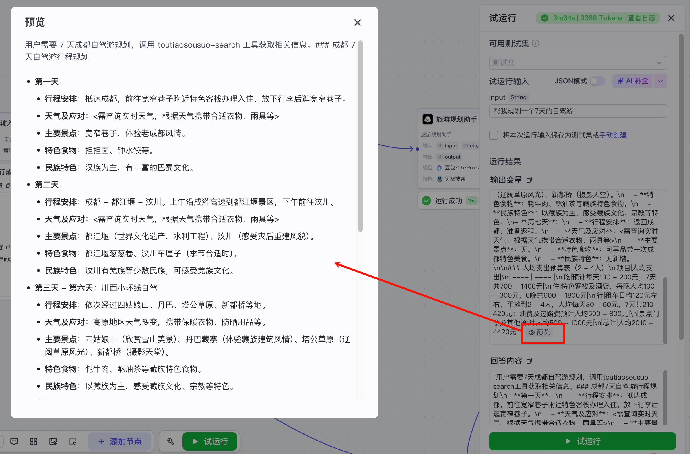

到这里，说明了意图识别、分支判断等功能都正确无误得到了执行。

### 1.3 在工作流中使用插件

插件节点用于在工作流中调用插件运行指定工具。插件是一系列工具的集合，每个工具都是一个可调用的 API。商店中的上架插件或已创建的个人或团队插件支持以节点形式被集成到工作流中，拓展智能体的能力边界。

#### 1.3.1 联网搜索插件

联网搜索插件包括头条、B站、懂车帝、百度、谷歌、豆瓣、微博、小红书等各种平台，具体使用哪个需要结合业务。

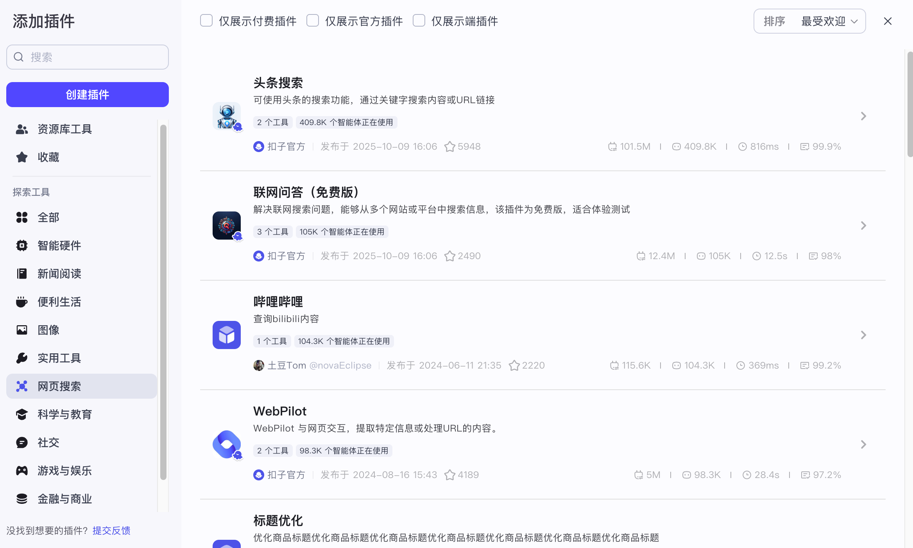

我们以头条搜索为例：

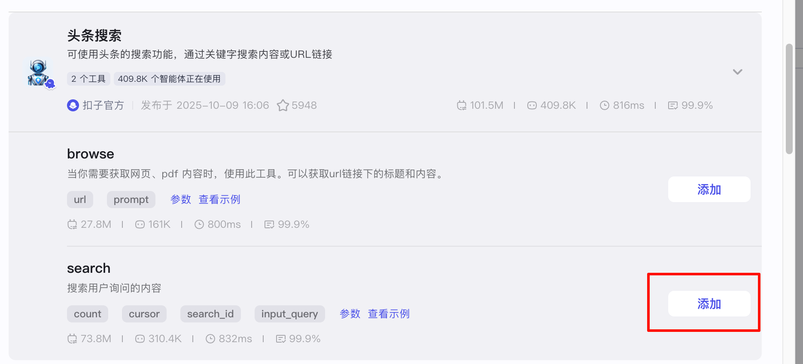

查看示例：

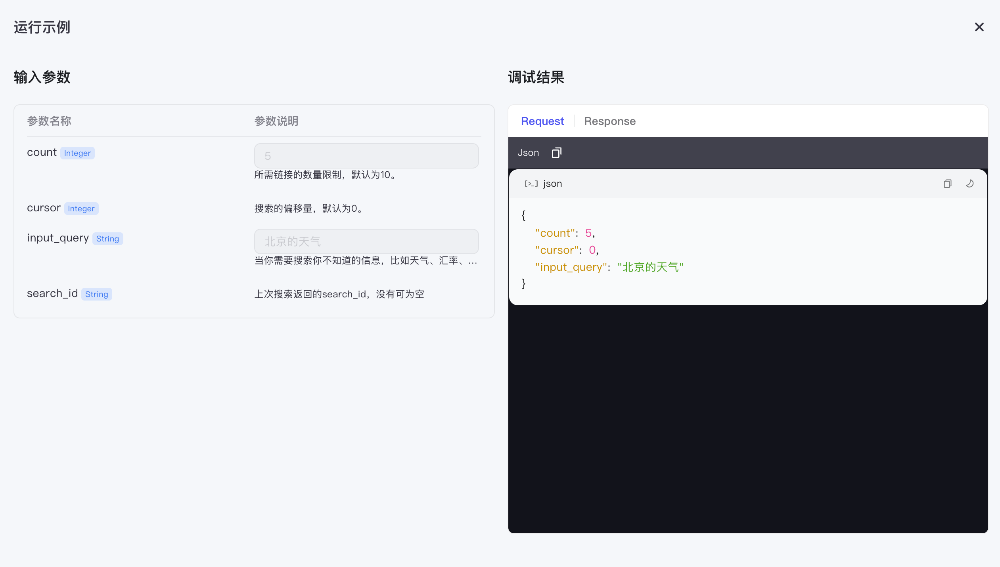

#### 1.3.2 图片理解插件

图片理解插件可以实现图片到文字的转化，需要依赖两部分的输入： 

* 图片 
* 用户提示词


接下来我们使用一个案例帮助大家理解如何使用图片理解插件，首先，我们准备好一张图片：教案素材中的 **01-编码器细节.jpg**，然后搭建一个简单的工作流。如下图：

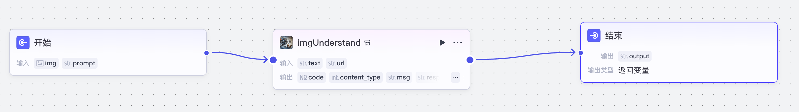

开始节点输入 

* img ：需要被理解的图片, image类型，支持常见的jpg、bmp、png等图片类型 
* prompt：用户提示词，str类型。就是用户要对图片问的问题

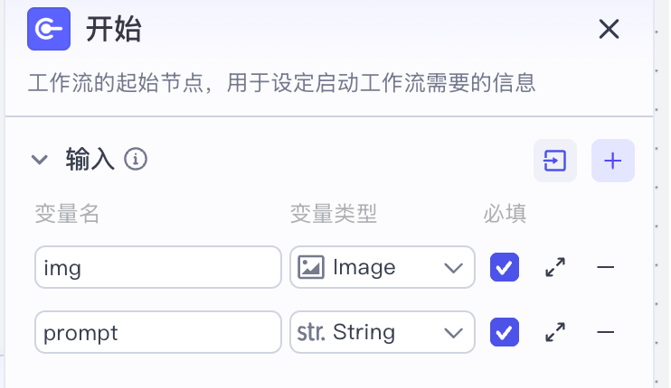

将输入部分的参数赋值给图片理解插件 * text：接收str类型，输入用户的提示词 * url：接收str图片地址。 这里需要注意：**如果是从输入节点上传过来的图片类型，这里会报红，但是可以正常执行、**

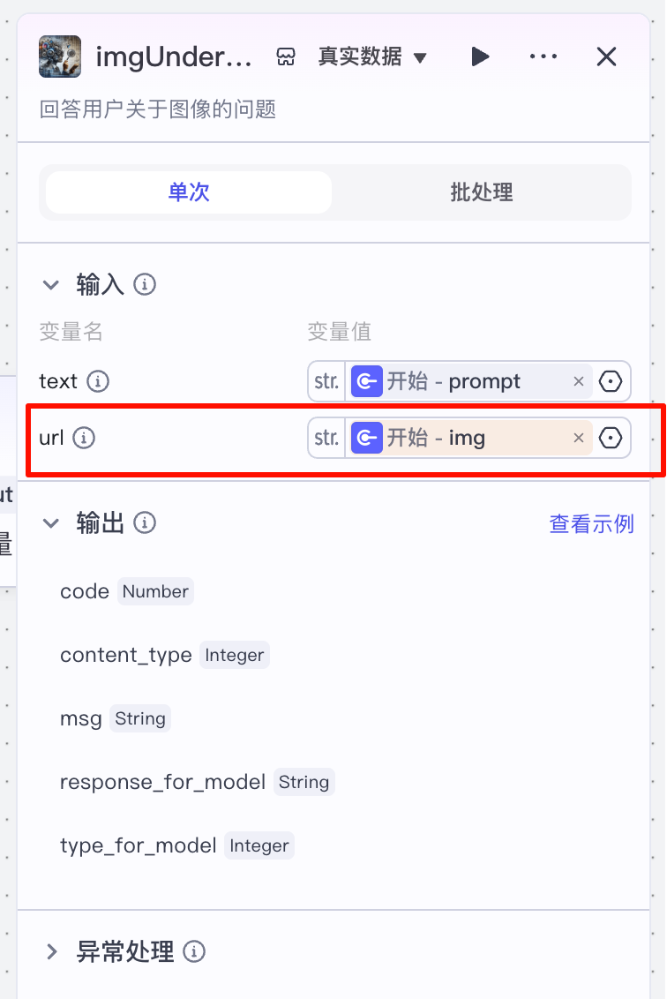

接下来，我们执行一下流水线：

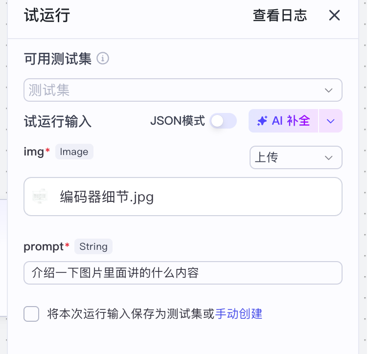

可以看到，输入的图片被转成了url，同时。在response_for_model字段中，返回了图片的内容，且内容是正确的。

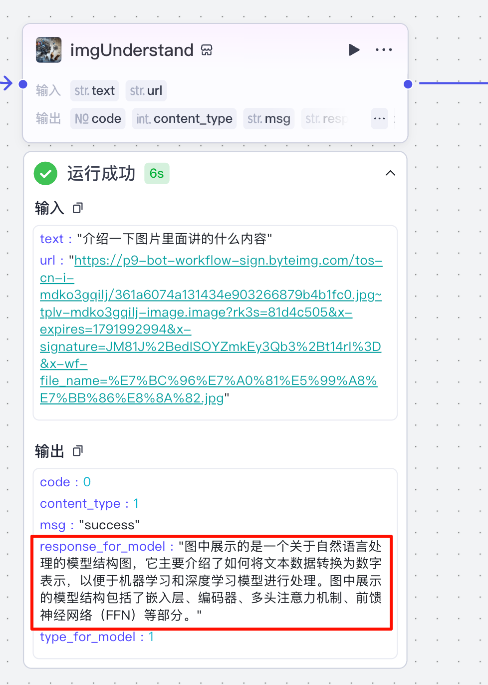

#### 1.3.3 链接读取插件

链接读取插件也是我们使用coze开发时常用的插件，它实际上是一个”文件阅读器“而不是一个”链接阅读器“，它主要包含两个功能： 

* 链接内容获取：当传入给插件的输入是一个html页面时，获取html页面中的文本内容 
* 文档内容提取：当传入的内容是doc、pdf时，提取文档中的文本内容

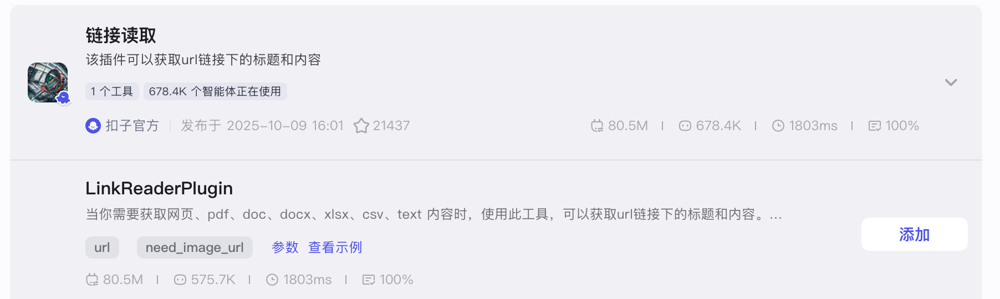

插件我们经常会用来处理用户上传的各类文档，效果还算可以。除此以外，还有一些其他官方或者非官方的类似功能的插件，但是毫无疑问，链接读取插件这个插件的使用量要多的多。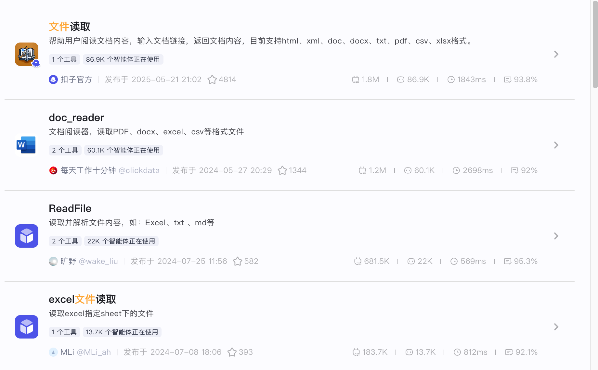

接下来，我们通过一个案例，让同学们理解这个插件如何使用。首先，我们先构建一个简单的流水线：


上传文件：素材 **02-简历.docx**，执行流水线。

查看日志，在插件输出的字段中，pdf_content字段有内容，并且正确识别了素材文件中的文字，而其他字段都是空的。这是因为我们给的链接是docx的文件，而不是html。


如果我们传入的是一个html的网页，比如:http://www.baidu.com。一些特殊的网站可能会屏蔽机器人访问.https://www.itheima.com/

开始节点修改为：


那执行结果则会如下：可以看到，数据出现在了data字段中。


所以，这个插件： 

* 如果给的docx、pdf文件地址，那么数据则会出现在pdf_content中 
* 如果我们传入的是html页面地址，那么数据则会出现在data中。

记住以上规律，对使用这个插件开发一个支持文件、网页内容获取能力智能体很重要。

#### 1.3.4 其他插件

新闻资讯 - 头条新闻

天气预报 - 墨迹天气

出行必备 - 飞常准 - 猫途鹰

生活便利 - 快递查询助手，国内快递查询 - 食物大师 - 懂车帝 - 幸福里 - 猎聘

## 2、搭建一个完整的智能体

我们将结合 **旅游规划工作流**和**文档内容读取工作流**实现一个简单，但是功能完整的智能体，可以通过：

1. 创建一个智能体
2. 编写提示词
3. 添加工作流
4. 发布智能体

以上4个步骤完成。

### 2.1 创建一个智能体

输入智能体名称和功能介绍，然后单击**图标**旁边的**生成**图标，自动生成一个头像。


### 2.2 编写提示词

- 在左侧**人设与回复逻辑**面板中描述智能体的身份和任务。
- 在中间**技能**面板为智能体配置各种扩展能力。
- 在右侧**预览与调试**面板中，实时调试智能体。

提示词：

```
# 角色 
你是一个多功能机器人，能够根据用户输入的提示词选择使用不同的工作流完成对应的工作。


## 工作步骤 
- 如果用户上传了文档，则识别文档中的文本内容
- 如果用户输入的内容和旅行相关，则进行旅游规划
```

如下图：


在这里我们保持默认的“单Agent(自助规划模式)”不动，把工作流调用的选择权交给模型。

### 2.3 添加和发布工作流

在添加工作流之前，我们要修改工作流的名称和描述，以便大模型去选择调用哪个

- 旅游助手工作流改为：
- 

文档内容读取工作流改为：


编辑完成后，还需要发布工作流。 这里需要注意： **只有发布过的工作流才能被智能体使用**。 因为我们之前已经调试过了，所以在这里发布时，点击”坚持发布“即可，实际工作中，如果工作流没有试运行过，不建议抱有侥幸心理直接发布。 这样会让BUG隐患带到智能体中，在实际生产中，我们建议尽量把风险前置，越早发现BUG，越早解决，这样最后整个工程的质量就越容易把控。


最后，我们把刚刚发布的两个工作流添加到编排内容中：


### 2.4 调试智能体

给智能体添加开场白和预置问题：


预览和调试：


- 试运行机器人：


可以看到，工作流被正常调用。输出正常

### 2.5 发布智能体

完成调试后，单击**发布**将智能体发布到各种渠道中，在终端应用中使用智能体。目前支持将智能体发布到飞书、微信、抖音、豆包等多个渠道中，你可以根据个人需求和业务场景选择合适的渠道。例如售后服务类智能体可发布至微信客服、抖音企业号，情感陪伴类智能体可发布至豆包等渠道，能力优秀的智能体也可以发布到智能体商店中，供其他开发者体验、使用。

1. 在智能体的编排页面右上角，单击**发布**。
2. 在发布页面输入发布记录，并选择发布渠道。
3. 单击**发布**。