# day02_Coze平台进阶使用

今日内容:

* 1- 多模态的插件 :  图片  音频  视频 【实操】
* 2- 工作流中循环结构 【实操】
* 3- 多智能体的构建 【实操】


## 1. 多模态插件				

​		在使用Coze实现Agent的时候，经常会处理一些文字以外的输入类型，比如图片、音频、视频。

​		在Coze中，图片、音频、视频处理的方式大多是通过自带的音视频数据处理节点或插件完成，这些插件大多数都是由各个大模型供应商企业提供，通过调用其他大模型实现。

多模态应用场景：

* 文案：基于产品介绍和LLM，生成风格化的文案（比如小红书文案）
* 商品图片：基于文生图、图生图等功能，生成商品图。还可结合一些图像编辑类的模型，一件替换模特衣服、首饰等，节省模特成本。
* 广告语音：基于文案生成广告配音
* 广告视频：基于文案，商品图片等生成广告视频，节省 广告拍摄成本

综上所述，接下来我们将通过一些案例介绍一些比较常用的多模态数据的处理工具。


### 1.1 图像类型

​		在Coze平台基础使用章节中，我们已经学习过了图片理解功能，但是在Coze平台中，图片类型相关的处理能力不仅只有这一种。还包括：文生图、图像画质提升功能。

#### 1.1.1 文生图

文生图就是根据文字描述生成图片。

例如输入：

帮我生成一张宠物狗的图片，品种是金毛，背景是在雪地里，正在玩雪，效果如下图所示：

>


文生图构建流程图

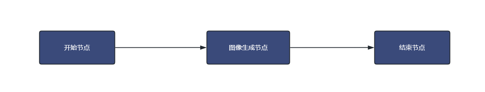

模型会根据提示词生成一张符合描述的图片。

它适合用在：

- 商品宣传图
- 课程封面图
- 海报配图
- 小红书配图
- 广告素材图


文生图工作流设计：

在流水线中添加图像生成节点，选择模型、设置好分辨率等信息，如图所示：

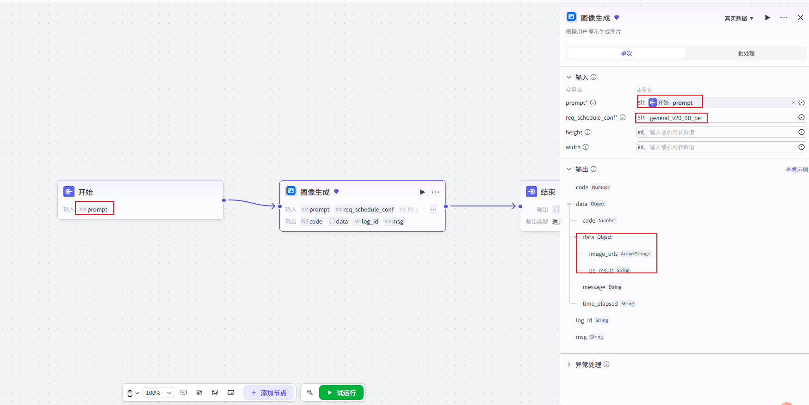

参数说明:

```properties
req_schedule_conf : 模型调度策略或风格优化器
    general_v20_9B_pe:
        	这是基础模型版本标识或提示词增强（Prompt Enhancement）配置。在 API 请求中，它通常用于指定调用具体的文生图模型内核（如 general_v2.0 系列），确保生成图像符合基础的质量标准和语义理解能力。
    general_v20_9B_rephraser:
    		这是文案重写与美感优化模块。它的主要作用是对用户输入的原始提示词（Prompt）进行语义润色和风格重构，以提升生成图像的美感和图文匹配度。当您需要生成更具艺术感或构图更精准的图片时，
```


输入提示词：

````properties
帮我生成一张宠物狗的图片，品种是金毛，背景是在雪地里，正在玩雪。
````

> 注意：文生图效果好不好，很大程度取决于提示词是否具体。一个好的图片提示词，通常要包含：主体 + 场景 + 风格 + 光线 + 构图 + 细节。

例如：

主体：金毛犬
场景：雪地
动作：玩雪
风格：真实摄影风
光线：自然光
细节：毛发清晰、背景有景深

---

以下是生成结果


**课堂练习：（8分钟）**

请创建一个 **文生图工作流**，根据提示词生成一张图片。

图片主题可以任选一个：

```powershell
1. 金毛犬雪地玩耍图
2. AI 大模型课程宣传图
3. 咖啡杯商品宣传图
4. 冲锋衣户外场景图
5. 智能机器人科技海报
```


#### 1.1.2 图像画质提升

​		本节课我们要学会使用图像画质提升能力，把低清图片处理得更清晰。它不是重新生成一张完全不同的图片，而是在原图基础上进行优化：

* 图片比较模糊时，可以提升清晰度；
* 图片分辨率较低时，可以增强画面细节；
* 商品图、老照片、宣传图质量不够好时，可以做基础优化。


一句话理解：

> 图像画质提升负责"优化原图质量"，不是"重新创作一张新图"。


图像提升工作流：

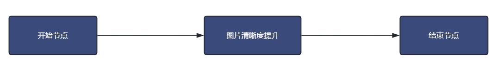

在工作流中添加一个画质提升节点，并把原图传入

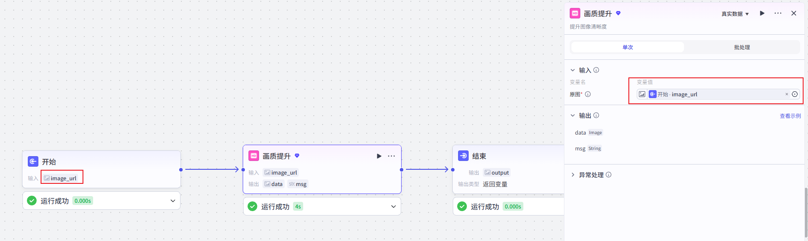

图片提升前（素材 **05-低分辨率图片.jpg**）：


提升后：


可以看到图像的分辨率得到了提升。


**课堂练习：（8分钟）**

使用 Coze 的图像画质提升能力，把一张低清图片处理得更清晰。


**说明: 图片来源地 网络 仅教学测试使用**

通过这个练习，理解：

> 图像画质提升是"优化原图质量"，不是"重新生成一张新图"。


### 1.2 音频类型

#### 1.2.1 语音识别(ASR)

本节课我们要学会使用语音识别能力，把音频内容转换成文字。

它不是让智能体"听懂所有业务逻辑"，而是先完成第一步：

\- 用户上传音频，系统可以识别其中的文字内容；
\- 课堂录音、会议录音、面试录音可以被转成文本；
\- 识别后的文本还可以继续交给大模型整理、总结和润色

应用场景：阿里的通义听悟就是基于ASR语音识别实现的

一句话理解：

>  音频识别负责"把声音转成文字"，大模型负责"把文字整理好"。


语音识别（ASR, Automatic Speech Recognition）就是把语音转化成文字的算法， 在coze中使用插件即可实现。 在插件商店中搜索 "语音识别"，包含两个版本。一个是小模型的语音识别，一个是大模型的语音识别。 区别在于识别准确率和资费上。

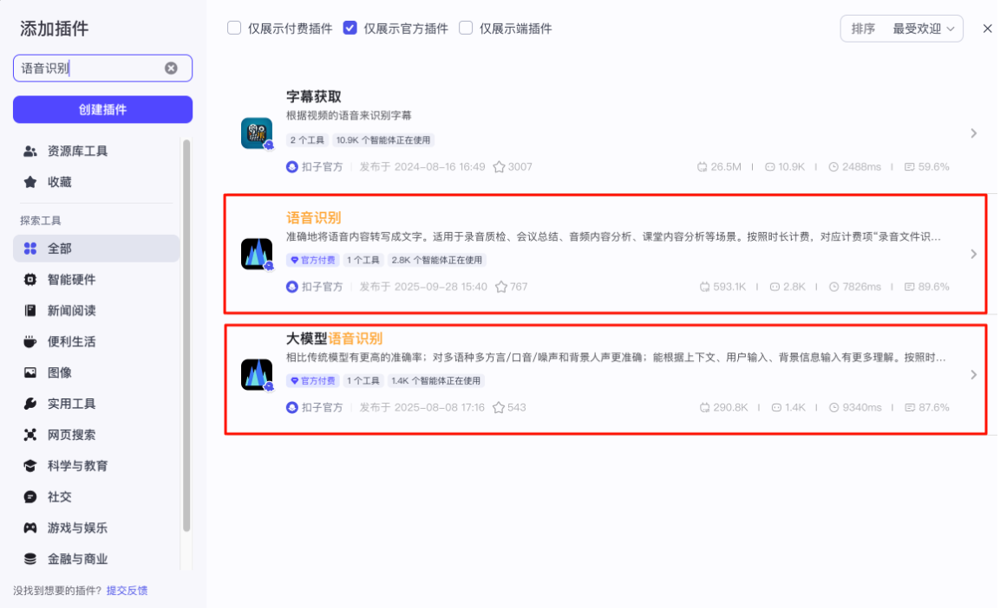

在工作流中添加一个"语音识别"节点：

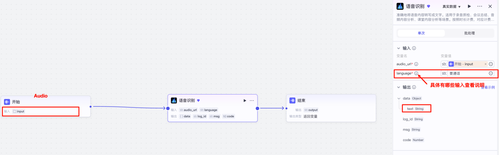


试运行，并上传我们的素材 **06-音频片段.MP3**：

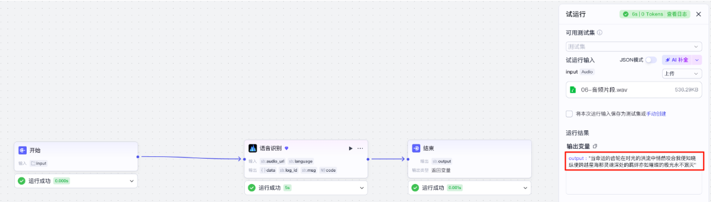

​		可以看到，这里输出了素材中的内容。文字识别都是对的，但是这里的问题在于没有标点符号，可以在语音识别节点后追加一个LLM节点，用于输出润色。过程略，同学们可自行优化。


**课堂练习：（8分钟）**

使用 Coze 的语音识别能力，把06-音频片段.MP3这个音频文件转换成文字。

通过这个练习，理解：

> ASR 负责把音频中的声音识别成文字。


#### 1.2.2 语音合成(TTS)

本节课我们要学会使用语音合成能力，把文字内容转换成语音。

它不是简单"把字读出来"，而是可以根据业务需要生成不同风格的声音：

\- 输入广告文案，可以生成广告配音；
\- 输入课程讲解词，可以生成课程旁白；
\- 输入客服回复话术，可以生成语音回复；
\- 输入短视频文案，可以生成解说音频。


语音合成（Text-to-Speech）是将文本信息转化为语音信息的人工智能技术，在Coze中同样可通过插件实现。在插件中搜索"语音合成"。分为两个版本

* 语音合成：使用扣子的模型实现语音合成
* 语音合成火山版：使用火山引擎上的更加专业的模型实现语音合成

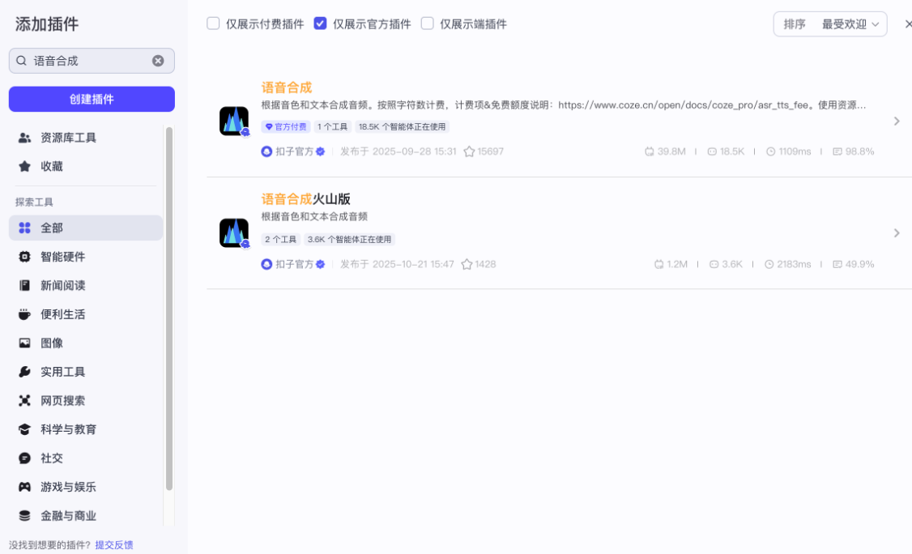


在工作流中创建一个语音合成节点：

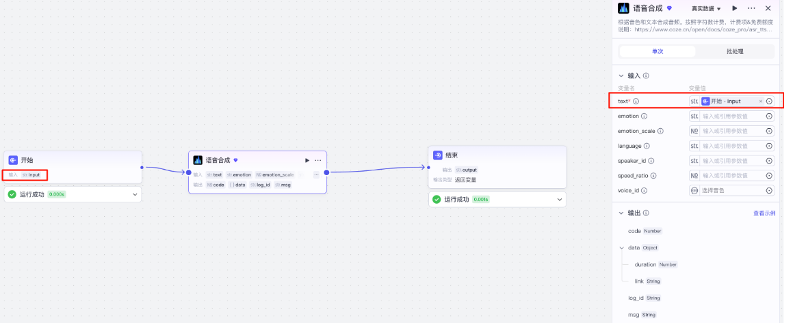


除了文本是必填项以外，其他的都是可选项。具体可根据coze官方手册使用。可以指定情绪、语种、播报人、音色等。 接下来，我们试运行工作流，输入以下提示词：

````properties
广袤的草原上，晨曦微露，成群的斑马在悠闲地散步，非洲狮正趴在巨石上享受阳光的沐浴，万物复苏，又到了动物们活跃的季节
````


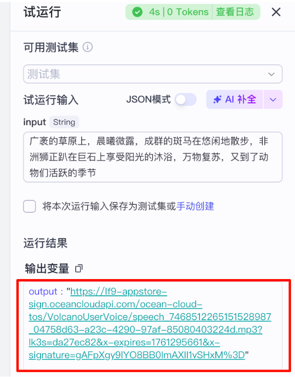

生成音频如下(词性解说男声)：

<audio src="../audio/speech_7468512265151528987_04758d63-a23c-4290-97af-85080403224d.mp3"></audio>

**课堂练习：（8分钟）**

使用 Coze 的语音合成能力，把一段文字文案（学IT，就来黑马程序员）转换成语音音频。

通过这个练习，理解：

> TTS 负责把文字转换成语音，让智能体具备语音输出能力。


### 1.3 视频类型

本节课我们要学会使用视频生成能力，把文字描述或图片素材生成短视频。

它不是简单"让 AI 随便生成视频"，而是要通过清晰的提示词告诉模型：

\- 视频主题是什么；
\- 画面中有什么主体；
\- 场景和背景是什么；
\- 镜头如何运动；
\- 视频整体是什么风格。

一句话理解：

> 视频生成负责"把创意变成动态画面"，让智能体具备生成短视频素材的能力。


视频类型的处理这里我们主要介绍视频生成。视频生成是多模态大模型近期比较新型的场景，能够根据用户输入的文字、图片，以及各类设置（如分辨率、时长等），生成视频。

在工作流中增加一个"视频生成节点"，传入数据，设置使用的模型，并设置参数，如下图：

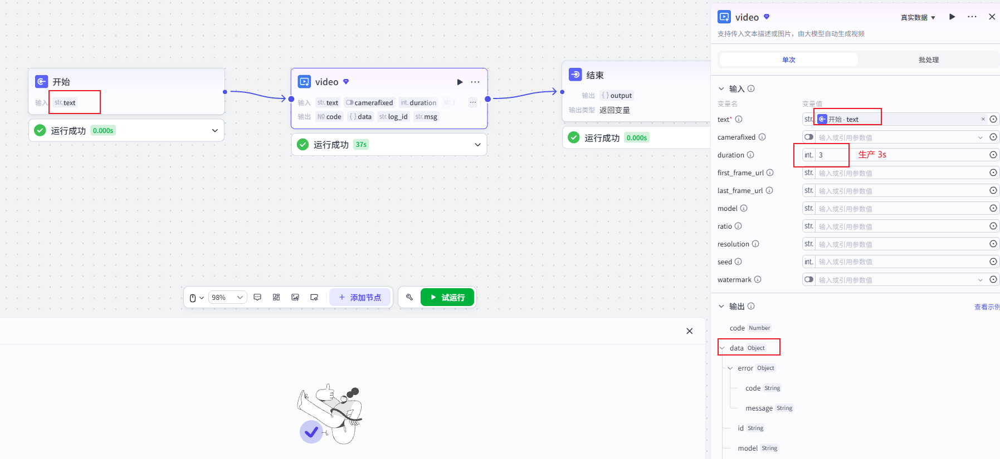


试运行工作流，传入提示词：

````properties
核心主题与风格：拍摄一个用于电商平台的、展现奢华与时尚感的足金手镯短视频。视频整体质感高级，凸显金手镯的精致工艺与佩戴时的优雅气质
。
场景与布景：
主场景：一个光线柔和、布置现代的室内空间，可能包含简约的梳妆台或铺有浅色丝绸的桌面
。背景简洁，以突出手镯本身。
细节：可有少量高端饰品（如香水瓶、珠宝盒）作为点缀，但遵循"少即是多"的原则，避免分散注意力
。
光线：利用从窗户透进的柔和自然光，或在影棚内使用扩散照明，确保手镯光泽得到最佳呈现，减少金属表面的强烈反光
。
主体与画面：
主角：一款设计精美的足金手镯。
关键画面：
开场特写：镜头对手镯进行极致特写，清晰展现其精细花纹、质感与璀璨光泽
。
佩戴展示：一只优雅的手缓缓拿起并佩戴上手镯，展示佩戴的便捷性与上手效果
。
动态光泽：手腕轻轻转动，展示手镯在不同角度下流动的光泽
。
组合搭配（可选）：可与其他简约手链或手表叠戴，展示其搭配可能性。
运镜与节奏：
镜头一（开场）：缓慢推近的特写镜头，聚焦于手镯最精美的雕刻或纹理部分，瞬间抓住眼球。
镜头二（展示）：平稳跟随镜头，从手镯被拿起至佩戴上手腕的过程，保持画面稳定。
镜头三（动态）：环绕运动或轻微旋转拍摄佩戴手镯的手腕，多角度展现手镯形态与光泽变化。
镜头四（收尾）：缓慢拉远，展示手镯作为整体造型一部分的完整效果，画面定格于优雅的姿势。
节奏：整体节奏舒缓，突出高级感和品质感。
情感与氛围：通过光影和运镜，传递金手镯所代表的"富贵象征"、"永恒承诺"或"圈住幸福"的美好寓意，营造轻奢、愉悦的情感氛围
。
````


点击运行，并等待。结果如下图。 这里在执行的时候时间会比较长，且消耗的token比较高。

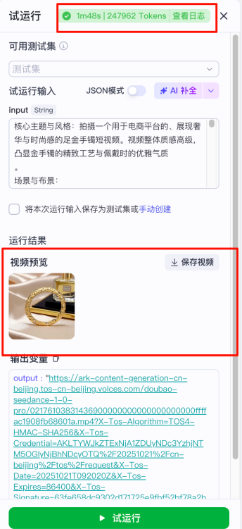

**课堂练习：（8分钟）**

请创建一个视频生成工作流，为一个商品生成短视频素材。

商品可以任选一个：

1. 足金手镯；
2. 运动鞋；
3. 冲锋衣；
4. 咖啡杯；
5. AI 大模型课程宣传海报。


操作要求

工作流至少包含以下节点：

1. 开始节点：接收用户输入的视频提示词；
2. 视频生成节点：根据提示词生成视频；
3. 输出节点：输出生成的视频结果。


## 2. 循环结构的使用

接下来我们将通过一个"**小红书电商营销文案批量生成工作流**"案例来学习如何使用循环结构。

输入内容：请我帮我生成：始祖鸟Alpha SV冲锋衣、凯乐石Mont-X冲锋衣、拓路者雪鹰2.0冲锋衣的文案

输出结果：

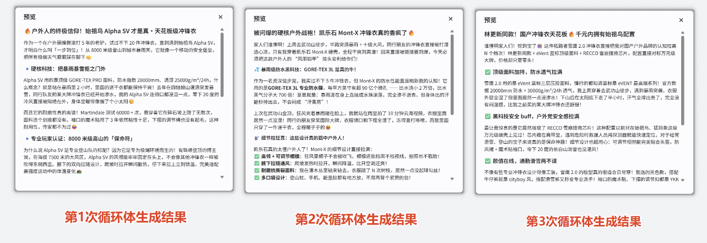


流程图解：

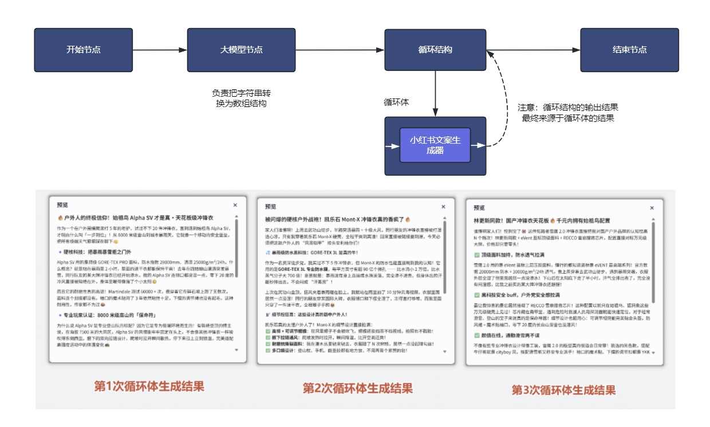

完整的工作流如下图

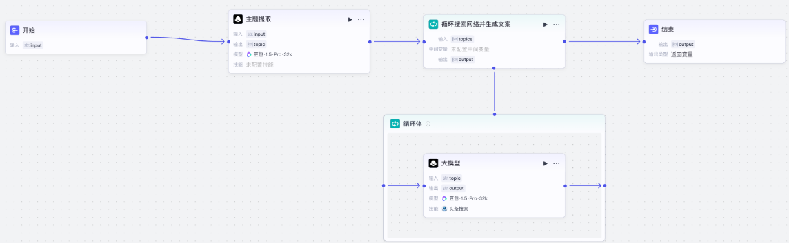


首先，用户输入一个自然语言语句，描述一下要生成哪些主体的营销文案。接下来，使用大模型提取出来主题，并生成数组格式返回

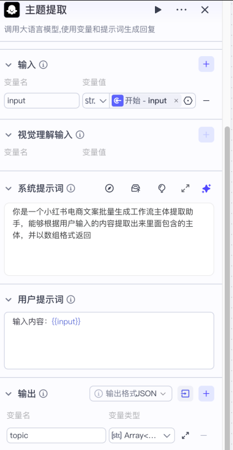

对应提示词如下：

````properties
你是一个小红书电商文案批量生成工作流主体提取助手，能够根据用户输入的内容提取出来里面包含的主体，并以数组格式返回
````


接下来，通过循环结构对每个主题进行逐个处理：基于LLM+联网搜索功能生成对应主体的文案。首先设置循环节点

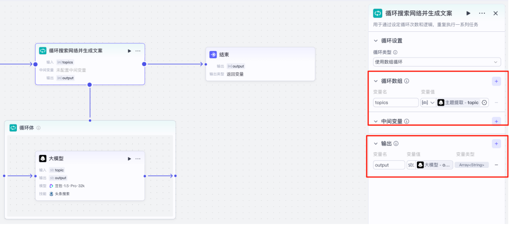


循环体中设置大模型的输入与输出， 这里输入需要选择：item(in topics)。

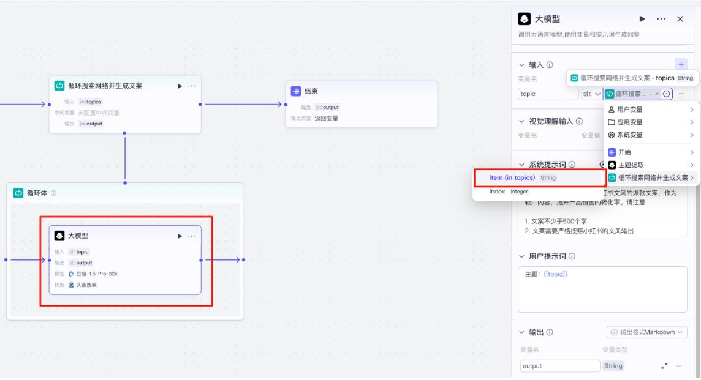


大模型的提示词如下

````properties
你是一个小红书文案生成专家，能够根据用输入的主题进行互联网检索，并生成小红书文风的爆款文案，作为软广内容，提升产品销售的转化率。请注意

1. 文案不少于500个字
2. 文案需要严格按照小红书的文风输出
````


接下来，试运行流水线，并输入内容：

````properties
请我帮我生成：始祖鸟Alpha SV冲锋衣、凯乐石Mont-X冲锋衣、拓路者雪鹰2.0冲锋衣的文案
````


调用过程略，我们查看循环体的执行结果，如下图。可以看到，这里根据输入的3个主题，生成了3个对应的内容

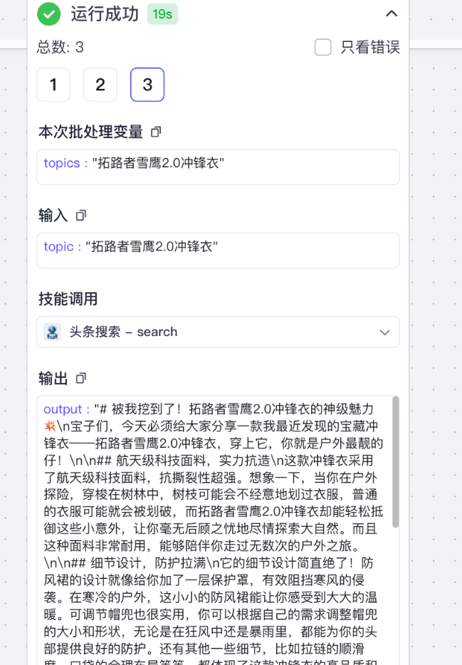


最终，我们预览一下生成的文案内容，可以看到，它的文案遵从了小红书常见的：

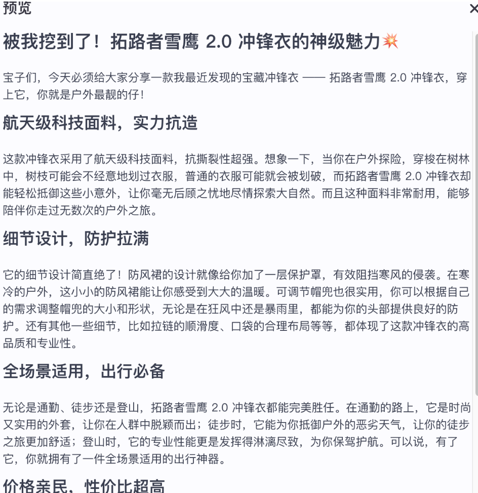

**课堂练习：（8分钟）**

案例：批量生成 AI 岗位介绍：批量生成多个岗位的介绍内容。

用户一次输入多个岗位名称，工作流需要自动拆分岗位，并逐个生成岗位介绍。

例如：请帮我介绍一下：AI大模型开发工程师、NLP算法工程师、Agent应用开发工程师。


大模型提示词：

```powershell
你是一个岗位名称提取助手。

请从用户输入中提取所有岗位名称，并以 JSON 数组格式返回。

要求：
1. 只返回岗位名称数组；
2. 不要输出解释；
3. 不要输出多余内容；
4. 如果没有识别到岗位名称，请返回空数组 []。

示例输出：
["岗位1", "岗位2", "岗位3"]
```

循环体中生成岗位介绍:

```powershell
你是一个 AI 大模型就业指导老师。

请根据当前岗位名称，生成一份适合零基础学生理解的岗位介绍。

要求：
1. 先用一句话说明这个岗位是做什么的；
2. 说明该岗位的主要工作内容；
3. 说明需要掌握的核心技能；
4. 说明适合什么类型的学生学习；
5. 最后给出一条学习建议；
6. 表达要通俗易懂，不要堆砌术语。

当前岗位：
{{item}}
```


## 3. Multi-Agent多智能体

### 3.1 什么是Multi-Agent

在单 Agent 模式下，所有任务都交给一个智能体处理。

如果任务越来越多，智能体就会变得越来越复杂：

```powershell
一个 Agent
  ├── 处理旅游规划
  ├── 处理文档读取
  ├── 处理翻译
  ├── 处理知识库问答
  ├── 处理数据库查询
  └── 处理用户闲聊
```

这样会带来一个问题：一个智能体什么都管，提示词会越来越长，调试会越来越难。

为了解决上述问题，Coze提供了多 Agent 模式（也就是multi-agent），该模式下你可以为智能体添加多个 Agent，并连接、配置各个 Agent 节点，通过多节点之间的分工协作来高效解复杂的用户任务。 

这就是一个经典的**主从模式**或者**父子模式**的多agent结构。

### 3.2 多语言翻译智能体

接下来我们将通过一个"多语言翻译"案例来演示如何创建一个Multi-Agent智能体。


#### 3.2.1 创建一个Multi-Agent智能体

首先，我们创建一个智能体，命名和介绍如下：

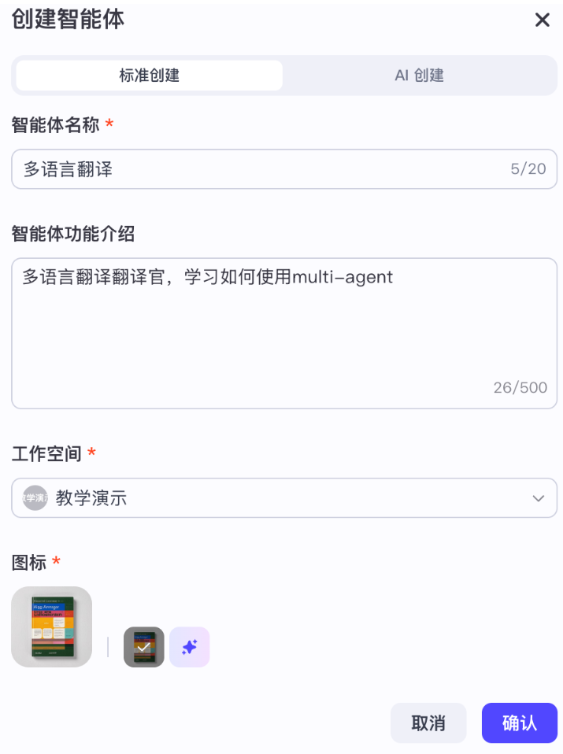

在这里，我们需要切换到多Agents模式。

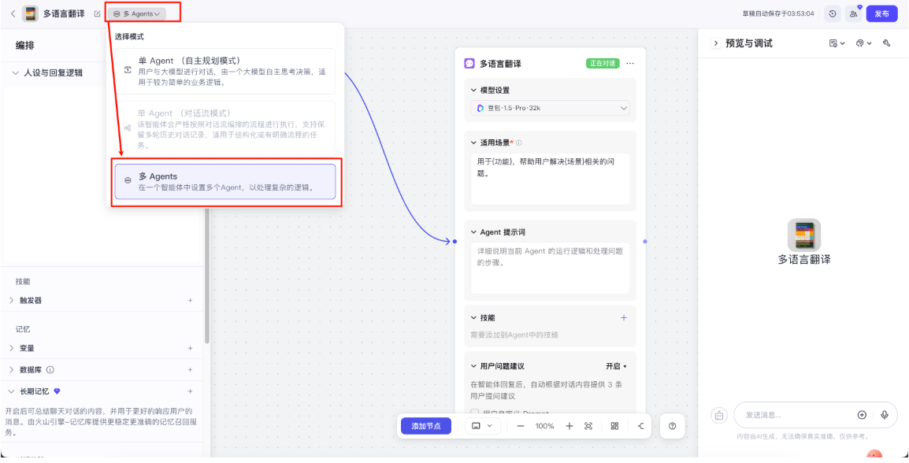

可以看到，多Agent的执行过程有点类似于工作流，接下来我们查看一下在多Agents模式下支持哪些节点类型，添加"添加节点"

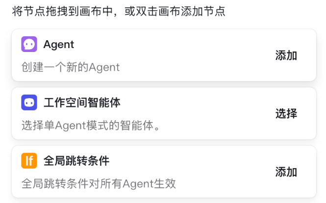

分为一下3类节点：

1. Agent：Agent 节点是可以独立执行任务的智能实体。默认情况下，智能体内添加了使用智能体名称的 Agent。功能相对比较简单，仅支持提示词和技能两个功能。没法实现类似工作流的功能，较难实现比较复杂的业务流程，因此更适合用在对话类的业务上。
2. 工作空间智能体：将已发布的、可以执行特定任务的单 Agent 智能体添加为节点。 我们可以把已经集成了各类插件、业务逻辑的复杂工作流的智能体作为其中一个Agent。在实际工作中，需要使用到多Agents的时候往往是功能非常复杂的时候， 将已经发布到工作空间的多个复杂功能Agent结合一个父Agent做路由，往往是更常见的做法。
3. 全局跳转条件：适用于所有 Agent 的全局条件。只要用户输入满足该节点的条件，则会立即跳转到 Agent。用于实现复杂Agent的流程控制。


#### 3.2.2 拆分Agent和实现Agent

在思考如何规划和拆分Agent之前，我们先需要知道当前的业务场景是怎么样的，对于"多语言翻译"，它的业务逻辑如下： 用输入一段文本，并指定要翻译的目标语言，智能体最终返回用户要求的目标语言的译文，支持中文、汉语、日语三种。

案例业务逻辑比较简单，单LLM+提示词即可实现较好效果，达不到需要使用multi-agent的场景。这里不必纠结，我们的目的是基于这个案例，学会如何使用multi-agent功能。


我们可以通过父子结构拆分，父Agent负责分发翻译任务，每个语言的翻译都有一个对应的Agent进行翻译：

* 父Agent：分发翻译任务，将用户输入翻译为目标语言，
* 中文Agent：如果目标语言是中文，则调用此Agent实现翻译

* 韩语Agent：如果目标语言是韩语，则调用此Agent实现翻译
* 日语Agent：如果目标语言是日语，则调用此Agent实现翻译

如下图：

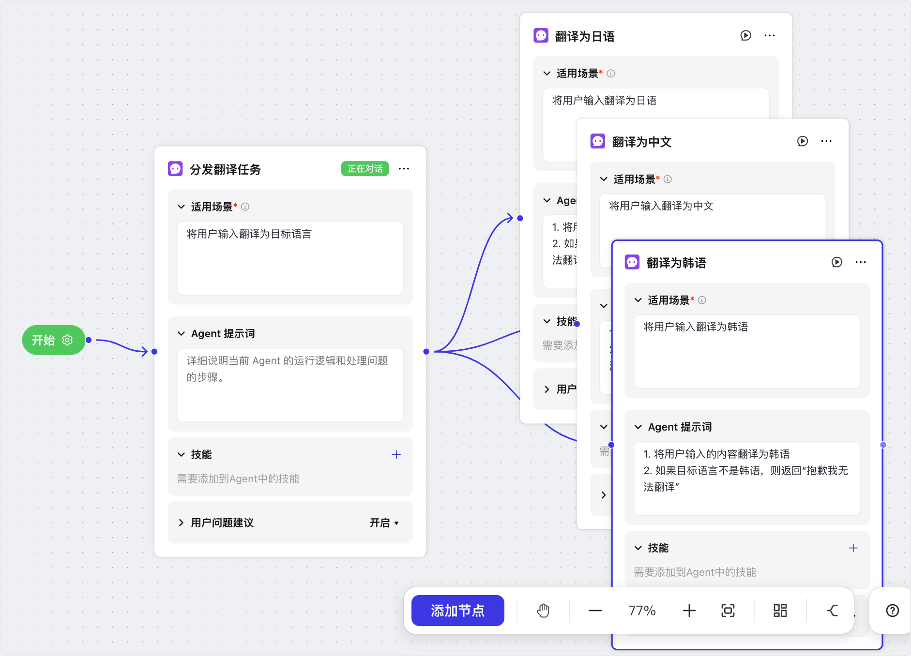

适用场景 和 Agent提示词：

父Agent：

```powershell
当用户输入一段需要翻译的文本，并指定目标语言时，调用该 Agent 判断用户要翻译成哪种语言，并将任务分发给对应的翻译 Agent。
```

父Agent提示词

父 Agent 不负责具体翻译，重点负责"判断 + 分发"。

```powershell
你是一个翻译任务分发助手。

你的任务是根据用户输入，判断用户希望将内容翻译成哪种目标语言，并调用对应的翻译 Agent。

分发规则：
1. 如果用户要求翻译成中文，调用"翻译为中文"Agent。
2. 如果用户要求翻译成日语，调用"翻译为日语"Agent。
3. 如果用户要求翻译成韩语，调用"翻译为韩语"Agent。
4. 如果用户没有说明目标语言，请先询问用户希望翻译成哪种语言。
5. 你只负责判断和分发任务，不需要自己完成翻译。
```

子 Agent：翻译为中文

适用场景

```
当用户希望将输入内容翻译成中文时，调用该 Agent。
```

Agent 提示词

```powershell
你是一个中文翻译助手。

你的任务是将用户输入的内容翻译成自然、准确、通顺的中文。

要求：
1. 只输出中文译文。
2. 不要输出解释。
3. 不要添加无关内容。
4. 如果原文中有专有名词，请尽量保留其准确含义。
```


调试Agent，输入以下内容：

````properties
"Good morning" in Chinese
````


执行结果如下图：

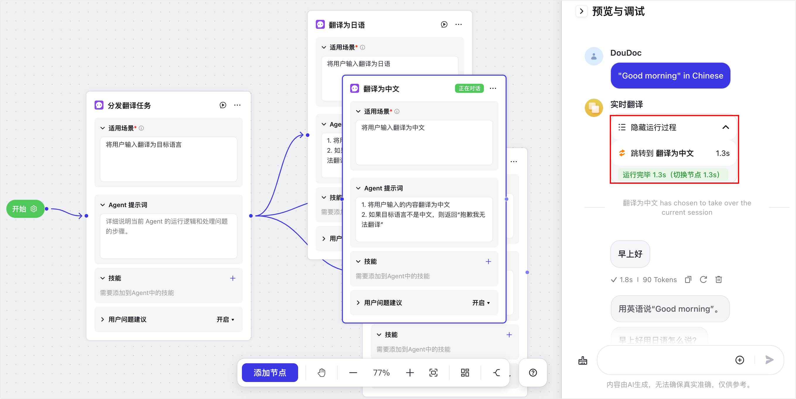

**课堂练习：（8分钟）**

设计一个多语言翻译 Multi-Agent

本练习要完成一个 **多语言翻译智能体**。

用户输入一段文本，并说明要翻译成哪种语言，系统需要自动判断目标语言，并调用对应的翻译 Agent。

一句话理解：

> 父 Agent 负责判断要翻译成哪种语言，子 Agent 负责完成具体翻译。

请创建一个 Multi-Agent 智能体，支持以下 3 种翻译能力：

1. 翻译为中文
2. 翻译为日语
3. 翻译为韩语


发布之后 嵌入网站中