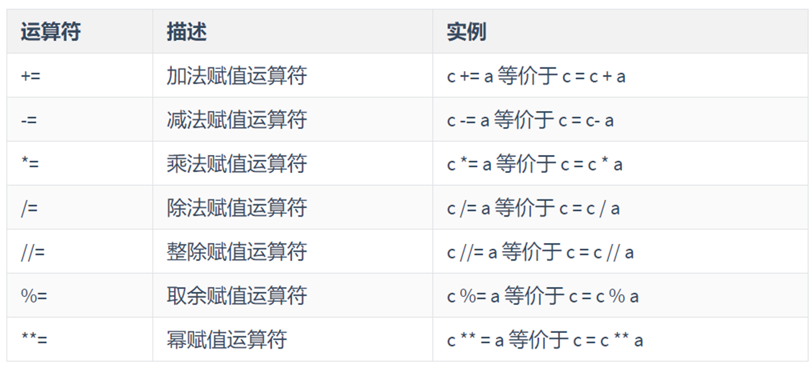
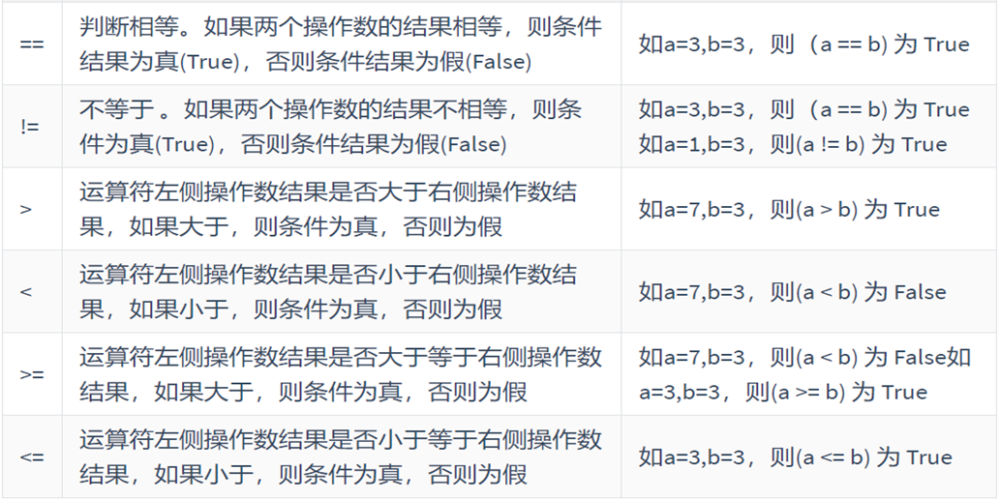
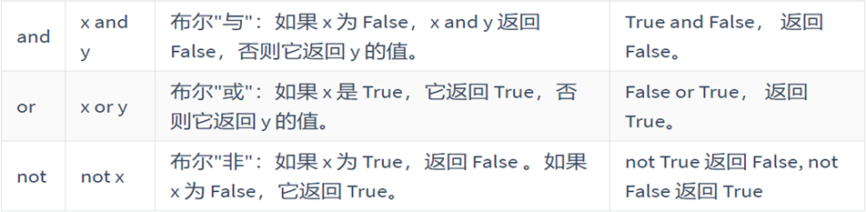
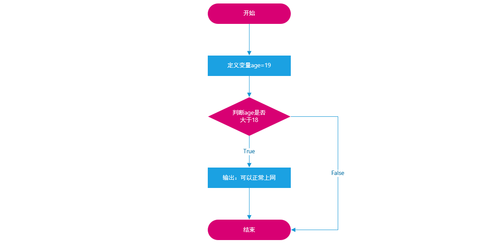
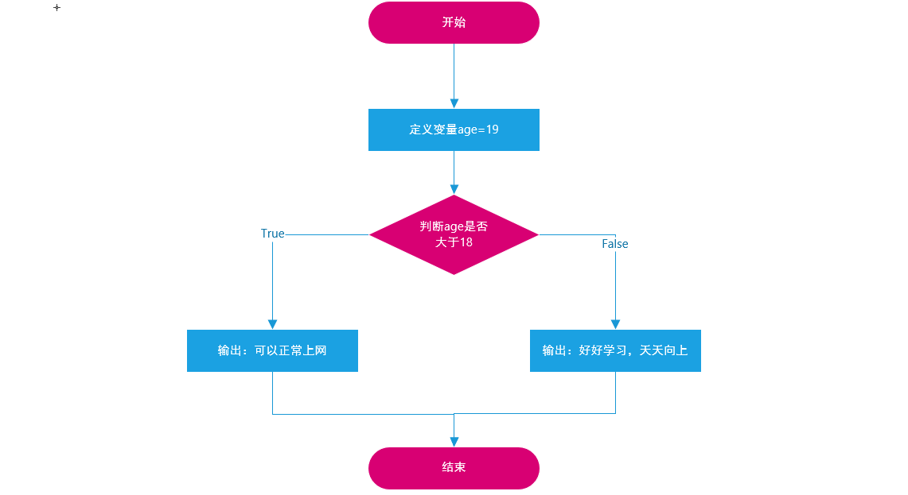
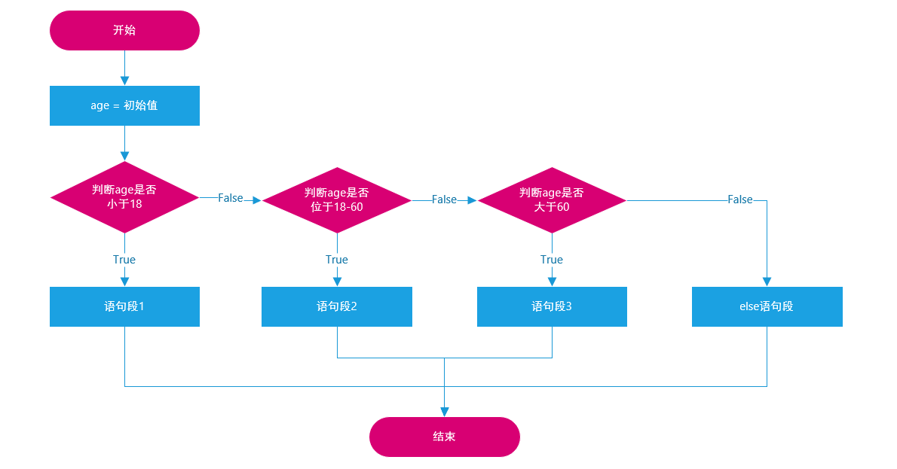
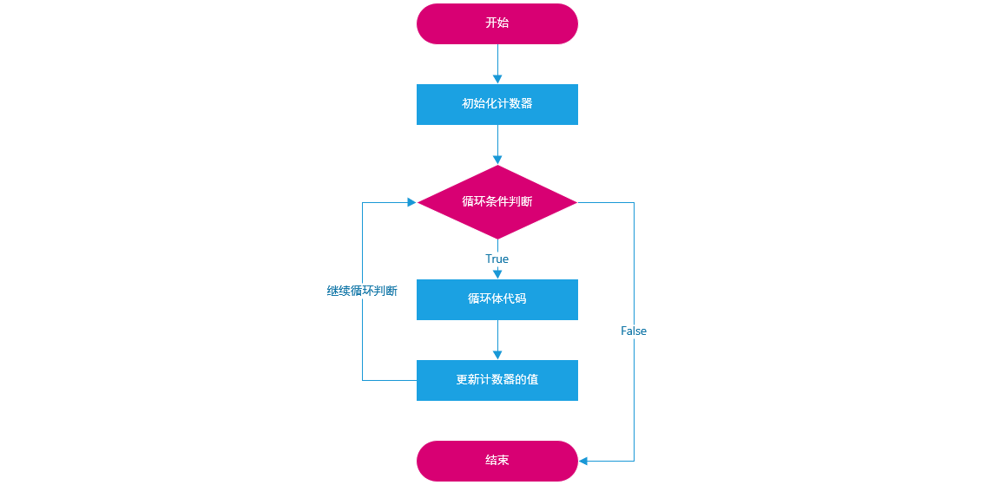

## day04_Python基础_判断语句和循环语句

今日内容:

* 1- Python的运算符 【实操】
* 2- Python的 if 选择判断结构 【实操】
* 3- Python的循环操作: 【实操】
  * 3.1 Python的 while循环
  * 3.2 Python的 for 循环


## 1.【掌握】Python运算符

### 1.1 算术运算符

所谓的算数运算符就是我们日常生活中的加减乘除等。

| **运算符** | **描述**     | **实例**                                                 |
| ---------- | ------------ | -------------------------------------------------------- |
| +          | 加           | 1 +  1 输出结果为  2                                     |
| -          | 减           | 1 -  1 输出结果为  0                                     |
| *          | 乘           | 2 *  2 输出结果为  4                                     |
| /          | 除           | 10  / 2 输出结果为  5                                    |
| //         | 整除         | 9  // 4 输出结果为  2                                    |
| %          | 取余（取模） | 9 %  4 输出结果为  1                                     |
| **         | 幂指数       | 2  ** 4 输出结果为  16，即2的4次方，2  * 2 * 2 * 2       |
| ()         | 小括号       | 小括号用来提高运算优先级，即  (1  + 2) * 3 输出结果为  9 |

```python
# 演示 算术运算符
"""
    相关的运算符:
        +
        -
        *
        /
        // : 整除  表示 获取二个数相除后的商的位置
        %  : 取余  表示 获取二个数相除后的余数的位置
        ** : 幂次方  获取 几次方结果
        () :  提高运算的优先级

"""

# 演示:
a = 5
b = 3

# 运算符:
c = a + b
print(c)
print(a - b)
print(a * b)
print(a / b)
print(a // b)
print(a % b)
print(a ** b)

print((a + b) / a)

```


### 1.2 赋值运算符

| **运算符** | **描述** | **实例**                          |
| ---------- | -------- | --------------------------------- |
| =          | 赋值     | 将=右侧的结果赋值给等号左侧的变量 |

```python
# 演示 赋值运算符
"""
    赋值运算符:
        = :  指的将 等号 右侧的值 赋值给左侧的变量

"""
# 演示操作:
a = 3
b = 5
# 一次性定义多个变量
# a, b = 3, 5

# 需求: 请帮我 将 a 和 b的变量的值进行互换操作
# 引入第三个中间临时变量
# c = a
# a = b
# b = c
#
# print(a)
# print(b)

# 以上操作有简化方案: 元组自动拆包思想
a, b = b, a

print(a)
print(b)
```


### 1.3 复合赋值运算符

复合赋值运算符 = 算术运算符 结合 赋值运算符

```
当两个变量(a,b)计算后, 需要将结果赋值给其中左侧变量(a)的时候, 可以写成:  a 复合赋值运算符 b

a = a + b
```



> 复合赋值运算符的计算顺序 = 先执行算术运算符，执行完毕后，把结果在赋值给左边的变量。

```python
# 演示: 复合赋值运算符
"""
    复合赋值运算符:
        += -= *= /= //= %= **=

    以  += 为例, 等同于:  b = b + a

    什么时候可以使用复合赋值运算符:
        当二个变量进行算术计算的时候, 需要将计算的结果赋值给运算中左侧的变量 此时就可以使用复合赋值运算符
        
    计算的流程:  先进行算术计算, 计算完成后, 执行赋值操作
"""

# 演示操作:
a = 3
b = 5

# 复合赋值运算符
# a = a + b
a += b
print(a)
```


案例：AA制餐厅

> 需求: 假设你是一位很棒的AA制餐厅的服务员，你的任务是计算每位顾客的应付金额。
> 输入顾客人数，并赋值给total_friends变量。
> 输入总账单数值，并赋值配给 total_bill 变量。
> 在账单费用上加上20%的税，并计算最终账单总额均摊给顾客金额，然后打印

```python
# 演示 复合赋值运算符
"""
需求: 假设你是一位很棒的AA制餐厅的服务员，你的任务是计算每位顾客的应付金额。
输入顾客人数，并赋值给total_friends变量。
输入总账单数值，并赋值配给 total_bill 变量。
在账单费用上加上20%的税，并计算最终账单总额均摊给顾客金额，然后打印
"""

# 1- 键盘录入操作:  顾客人数   总账单数值
total_friends = int(input('请输入您的顾客人数:'))
total_bill = float(input('请输入您的总账单金额:'))

# 2- 针对总账单金额 增加 20% 值:
# 2.1 账单金额 进行 数据类型转换操作 : 浮点类型
# total_bill = float(total_bill)
# 2.2 增加 20%
total_bill = total_bill * 1.2
# 3- 计算每个顾客 平均支付费用
# 3.1 对 顾客人数也需要转换为数值类型: int   [直接在键盘录入的时候转换了]

# 3.2 计算每个顾客:
avg_price = total_bill / total_friends
# 4- 打印结果:
print(f"每个顾客应支付的金额为:{avg_price:.2f}")
```


### 1.4 比较运算符



> 特别注意：当我们使用比较运算符对两个变量进行比较时，其返回一个布尔类型的值。

案例：两个数大小的比较

```python
# 演示 比较运算符:
"""
    比较运算符:
        == :  判断是否相等
        != : 判断是否不相等
        > : 判断左边是否大于右边
        < : 判断左边是否小于右边
        >=: 判断左边是否大于等于右边
        <=: 判断左边是否小于等于右边

    结果: 只会有二种情况, 要不就成立, 要不就不成立 所以 比较运算符的返回值为布尔类型的数据 True 和 False

"""

a = 3
b = 5
c = 3

# 比较运算符
print(a == c)  # True
print(a > b)  # False
print(a >= b)  # False
print(a < b)  # True
print(a <= b)  # True
print(a <= c)  # True
print(a >= c)  # True
print(a != b)  # True

```


### 1.5 逻辑运算符



> not就是取反，只有一个表达式`not 表达式`，如果表达式为True，则not以后就返回False。反之，则返回True。

and ：逻辑与，只有当两边的表达式全部为真，则最终结果返回为真，否则返回为假。

x  ：False

y  ：False

result = x and y

or ：逻辑或，只要有一方为真，则整个表达式的返回结果就为真。除非两边的表达式都为假，则整个结果返回为假。

result = x  or  y

讲个非诚勿扰的小故事：

① 女孩子要求比较高，要求男孩子必须要有房且有车

```python
表达式1 and 表达式2
当表达式1为True且表达式2为True时，则整个表达式返回结果为True
当表达式1或表达式2中有一个表达式为假，则整个表达式返回结果为False


有房 and 有车  则  牵手成功
有房 and 没车  则  牵手失败
没房 and 有车  则  牵手失败
```

② 女孩子要求一般，要求男孩子有房或者有车即可

```python
表达式1 or 表达式2
当表达式1为True或表达式2为True时，则整个表达式返回结果为True
当表达式1与表达式2都为False时，则整个表达式才会返回False


有房 or 有车  则  牵手成功
有房 or 没车  则  牵手成功
没房 or 有车  则  牵手成功
没房 or 没车  则  牵手失败
```

逻辑与、或、非，其最终的返回结果也是一个布尔类型的值，True或False。另外在实际工作中，逻辑运算符也主要和if分支结构相结合。

案例：

```python
# 演示 逻辑运算符
"""
    逻辑运算符:
        and:  并且关系
            格式: 条件 1 and 条件2 and 条件3 ....
            作用: 当所有的条件都成立的时候, 整个表达式的结果才成立 True, 否则不成立 False
        or : 或者关系
            格式: 条件 1 or 条件2 or 条件3 ....
            作用: 只要有一个条件成立, 其结果就为True, 除非所有的条件都不成立, 结果为False
        not: 非
            格式: not 表达式
            作用: not 是用于进行取反操作, 如果表达式的结果为True  使用 not 结果就为False

"""

# 演示:
a = 3
b = 5
c = 3
d = 8

# 逻辑表达式:
print(a >= c and b <= d)  # True 所有的条件都成立
print(a > c and b <= d)  # False 只要有一个条件不成立, 其结果就为False

print(a < b or a > d or a == c)  # True 只要有一个条件成立, 其结果就为True
print(a > b or a > d or a != c)  # False  只要当所有的条件都不成立的时候, 结果为False

print(not (a > b or a > d or a != c))  # True
print(not (a > c and b >= d))  # True

# 复杂的
print((a == c and a < b) or d < b) # True
```


## 2.【掌握】if选择判断结构

### 2.1 if选择判断结构作用

在日常开发中，只要有需要进行条件判断的语句基本上都是选择判断结构。

应用场景：

如果年龄大于等于18岁，则可以正常上网。

如果升级考试成绩大于60分，则可以顺利升级就业班。

### 2.2 if基础结构

if基本语法：

```python
if 条件判断:
    则执行某段代码... 

print()
```

案例代码：

```python
# 演示 if条件判断语句
"""
    语法：
        if 条件 :
            当条件满足的时候, 需要执行的代码片段

    说明: 当条件满足的时候, 执行 条件里面的代码
    注意: 条件的返回值为 应该为布尔类型的数据
"""

# 需求1: 要求键盘录入一个年龄, 判断年龄是否大于等于18岁, 如果大于等于18岁, 告知用户可以上网

# 1- 键盘录入一个年龄:  将年龄转换为整数类型
age = int(input('请输入您的年龄:'))

# 2- 通过if 判断 年龄是否大于等于 18, 如果条件成立, print打印: 你已经成年了, 可以上网
if age >= 18:
    print("你已经成年了, 可以上网~~~")


print("if语句执行完成了....")
```


if选择原理图：学编程除了会写代码还不行，还要回画图（流程图）




### 2.3 if...else...结构

基本语法：

```python
if 条件判断:
    当条件判断为True时，则执行这个语句段
else:
    当条件判断为False时，则执行这个语句段
```

案例2：上网吧案例升级升级版，引入else

```python
# 演示 if else条件判断语句
"""
    语法：
        if 条件 :
            当条件满足的时候, 需要执行的代码片段
        else:
            当条件不满足的时候， 需要执行的代码片段

    说明: 当条件满足的时候, 执行 条件里面的代码 当条件不满足执行else里面的内容
    注意: 条件的返回值为 应该为布尔类型的数据
"""

# 需求2: 要求键盘录入一个年龄, 判断年龄是否大于等于18岁, 如果大于等于18岁, 告知用户可以上网 如果小于18岁, 告知用户, 回家好好学习
# 1- 键盘录入一个年龄:  将年龄转换为整数类型
age = int(input('请输入您的年龄:'))

# 2- 通过if 判断 年龄是否大于等于 18, 如果条件成立, print打印: 你已经成年了, 可以上网  如果不成立， print打印  回家好好学习
if age >= 18:
    print("你已经成年了, 可以上网")
else:
    print("回家好好学习")
```

if...else...结构原理图：



### 2.4 if...elif...else结构

如果条件1成立，则执行语句段1

如果条件2成立，则执行语句段2

...

当所有条件都不成立时，则执行else语句段中的内容

```
if 条件判断1:
    如果此条件为True，则执行这个语句段
elif 条件判断2:
    如果此条件为True，则执行这个语句段
elif ...:
    ...
else:
    如果以上所有条件判断都不满足时，则执行这个语句段
```

if多重条件判断原理图：



```python
# 演示 if的多重判断操作
"""
    语法结构:
    if 条件1:
        当条件1成立, 需要执行的代码片段
    elif 条件2:
        当条件2成立, 需要执行的代码片段
    elif 条件3:
        当条件3成立, 需要执行的代码片段
    ....
    else:
        当以上条件都不成立, 需要执行的代码片段

"""

# 需求:
"""
    要求键盘录入一个成绩,请进行以下处理:
        当用户的成绩 >= 90 分的时候, 告知用户成绩优秀
        当用户的成绩 在75分 ~ 89分  告知用户 成绩良好
        当用户的成绩在 60~74分 告知用户 成绩及格
        当用户的成绩在 60分以下的时候, 告知用户 成绩不及格
"""

# 1- 键盘录入一个学生成绩
score = int(input('请输入您的成绩:'))

# 2- 执行判断逻辑:
if score >= 90:
    print("优秀")
elif score >= 75:
    print("良好")
elif score >= 60:
    print("及格")
else:
    print("不及格")
```

### 2.5 if嵌套结构（难点）

基本语法：

```
if 外层条件判断:
    # 如果条件为True，则执行以下语句段
    if 内层条件判断:
        # 如果内层条件为True，则执行以下语句段
else:
    # 如果条件为False，则执行以下语句段
```

嵌套结构看起来异常复杂，但是我们在编写时要遵循一个原则：**先编写外层判断，所有语句编写完成后，在编写内层条件判断结构**。

案例：法律规定，车辆驾驶员的血液酒精含量小于 20mg/100ml 不构成酒驾；酒精含量大于或等于 20mg/100ml 为酒驾；酒精含量大于或等于 80mg/100ml 为醉驾。编写 Python 程序判断是否为酒后驾车。

```python
# 案例：法律规定，车辆驾驶员的血液酒精含量小于 20mg/100ml 不构成酒驾；
#       酒精含量大于或等于 20mg/100ml 为酒驾；酒精含量大于或等于 80mg/100ml 为醉驾。
# 编写 Python 程序判断是否为酒后驾车。

# 1- 输入驾驶员的血液每百毫升的酒精含量:
mg = int(input("请输入血液酒精含量(mg):"))

# 2- 判断操作:
if mg >= 20:

    if mg >= 80:
        print("构成醉驾")
    else:
        print("构成酒后驾车")
    
else:
    print("不构成酒驾~~~")
```

额外需求:

```python
# 需求:
"""
    要求键盘录入一个成绩,请进行以下处理:
        判断用户输入的成绩是否及格:
            如果及格:
                当用户的成绩 >= 90 分的时候, 告知用户成绩优秀
                当用户的成绩 在75分 ~ 89分  告知用户 成绩良好
                当用户的成绩在 60~74分 告知用户 成绩及格
            如果不及格:
                当用户成绩低于50分, 请加班学习
                否则, 提示不及格, 仍需努力

"""

# 1- 键盘录入一个成绩
score = int(input('请输入成绩:'))

# 2- 判断:
if score >= 60:
    # 只要能进入里面的if 说明 成绩一定是大于等于60分的
    if score >= 90:
        print("优秀")
    elif score >= 75:
        print("成绩良好")
    else:
        print("成绩及格")

else:
    # 能进来 说明 成绩一定是小于60分
    if score < 50:
        print("请加班学习")
    else:
        print('不及格,仍需努力')

```


## 3. 【实操】综合案例：猜数字游戏

### 3.1 需求分析

随机生成1个 1 ~ 100之间的数字, 让用户来猜.判断用户是否猜对了, 并提示. 猜对, 猜大, 猜小.

> 未知知识点：如何让计算机随机生成数字=> 补充random模块
>
> num = random.randint(0, 3)
>
> #print(random.randint(0, 3)) # 输入 起始和结束值, 包头包尾的随机生成整数

### 3.2 代码实现

```python
# 猜数字小游戏
# 测试 随机数
import random

rand_num = random.randint(0,3) # 随机生成  0 ~ 3之间的随机数
print(rand_num)

# 随机生成1个 1 ~ 100之间的数字, 让用户来猜.判断用户是否猜对了, 并提示. 猜对, 猜大, 猜小.
# 1- 由计算机出一个随机数
computer_rand_num = random.randint(1,100)
print(f"计算机出的随机数是:{computer_rand_num}")
# 2- 由用户进行猜数字:
user_rand_num = int(input("请输入一个1~100之间的数字, 判断你是否猜对:"))

# 3- 比较:
if user_rand_num == computer_rand_num:
    print("恭喜您, 您猜对了~~~")
elif user_rand_num > computer_rand_num:
    print("您猜大了~~~")
else:
    print("您猜小了~~~")

```


## 4.【了解】Python中循环的介绍

### 4.1 什么是循环

现实生活中，也有很多循环的应用场景：

（1）食堂阿姨打菜：接过顾客的餐盘→询问菜品→打菜→递回餐盘，重复以上过程，直到所有顾客的菜都打完了

（2）快递员送快递：查看送件地址→赶往目的地→电话告知收件人→收件人签收→交快递件，重复以上过程，直到所有需要送的快递都处理完了。

（3）公交司机……

（4）作业流程……

以上场景都有一个共同的特点：有**条件**地**重复**地做一件事，每一次做的事情不同但类似。

程序是为了解决实际问题的，实际问题中存在着重复动作，那么程序中也应该有相应的描述，这就是**循环**。

### 4.2 循环的作用

循环的作用是什么？

答：让代码高效的重复执行

### 4.3 循环的种类

在Python中，循环一共分为两大类：while循环与for循环

思考问题：while循环和for循环如何选择呢？

​	①：对于循环次数固定的（已知）情况下，建议使用for循环, 例如: 1~100循环

​	②：对于循环次数未知（不确定）的情况下，建议使用while循环, 例如: 猜数字游戏


 

## 5.【掌握】while循环语法及其应用

### 5.1 while循环的基本语法

~~~python
# Step1: 定义一个计数器（初始化一个计数器）
i = 0或1
# Step2: 编写while循环结构
while 循环条件(判断 计数器 是否达到了目标位置):
	循环体1
	循环体2
	...
	# Step3: 在循环内部更新计数器
	i = i + 1 或 i += 1
~~~

> 普及小知识：在计算机程序中，计数器大部分都是从0开始的。

总结：while循环三步走

① 初始化计数器

② 编写循环条件（判断计数器是否达到了目标位置）

③ 在循环内部更新计数器

while循环入门案例：使用while循环，循环输出5遍“Hello World”

```python
# 演示 while循环

"""
    语法结构:
    定义计数器:
    i = 0
    while 循环判断条件:
        需要循环执行的代码片段

        # 更新计数器
        i += 1

    循环判断条件: 当成立, 就执行循环体 当不成立 就结束循环
"""


# 需求: 请帮我打印10次 黑马程序员
# 没有循环:
print('黑马程序员')
print('黑马程序员')
print('黑马程序员')
print('黑马程序员')
print('黑马程序员')
print('黑马程序员')
print('黑马程序员')
print('黑马程序员')
print('黑马程序员')
print('黑马程序员')

print("--------循环实现-----------")
# 第一步: 定义计数器:
i = 0

# 第二步: 编写循环操作
while i < 10:
    # 执行循环体: 打印黑马程序员
    print('黑马程序员')

    # 第三步: 更新计数器
    i = i + 1
```

while循环流程图：



### 5.2 while循环案例

> 案例1：使用while循环求1..100的和

分析：定义一个while循环，让其可以帮助我们计算 1 + 2 + 3 + 4 + 5 ... + 100，结果：5050

```python
# 案例1：使用while循环求1..100的和
# 1- 定义计数器：
i = 1

# 2- 定义循环操作
# 定义一个临时求和结果的变量
sum = 0

while i <= 100:
    # 循环体
    sum += i

    # 3- 更新计数器
    # i = i + 1
    i += 1

# 打印求和结果 : 循环结束后打印
print(sum)
```


> 案例2：求1~100之间，所有偶数的和

什么是偶数：所谓的偶数，就是能被2整除的数字就是偶数，数学中可以使用2n来表示偶数。(Python代码 => if  数值 % 2  0 代表它是一个偶数)

知识点：在while循环中，我们还可以结合if进行判断。

```python
# 案例2：求1~100之间，所有偶数的和
# 1- 定义计数器：
i = 1

# 2- 定义循环操作
# 定义一个临时求和结果的变量
sum = 0

while i <= 100:
    # 循环体: 只能累加偶数
    if i % 2 == 0:
        # 说明 当前 i 是偶数
        sum += i

    # 3- 更新计数器
    # i = i + 1
    i += 1

# 打印求和结果 : 循环结束后打印
print(sum)

```


## 6.【熟练】循环中的两大关键词

### 6.1 两大关键词

在Python循环中，经常会遇到两个常见的关键词：break 与 continue

break：代表终止整个循环结构

continue：代表中止当前本次循环，继续下一次循环

* 举个栗子

```properties
举例：一共吃5个苹果，吃完第一个，吃第二个…，这里"吃苹果"的动作是不是重复执行？

场景一：如果吃的过程中，吃完第三个吃饱了，则不需要再吃第4个和第5个苹果，即是吃苹果的动作停止，这里就是break控制循环流程，即终止此循环。

场景二：如果吃的过程中，吃到第三个吃出一个大虫子...,是不是这个苹果就不吃了，开始吃第四个苹果，这里就是continue控制循环流程，即退出当前一次循环继而执行下一次循环代码。
```

#### 6.1.1 break关键字

场景一：如果吃的过程中，吃完第三个吃饱了，则不需要再吃第4个和第5个苹果，即是吃苹果的动作停止，这里就是break控制循环流程，即终止此循环。

```python
# 演示 循环中二个关键词

```

#### 6.1.2 continue关键字

场景二：如果吃的过程中，吃到第三个吃出一个大虫子...,是不是这个苹果就不吃了，开始吃第四个苹果，这里就是continue控制循环流程，即退出当前一次循环继而执行下一次循环代码。

```python
# 场景二：如果吃的过程中，吃到第三个吃出一个大虫子...,是不是这个苹果就不吃了，开始吃第四个苹果，这里就是continue控制循环流程，即退出当前一次循环继而执行下一次循环代码。

```

如果在使用continue的时候，不手工更新计数器会有什么后果呢？

答：会出现死循环，建议使用Debug调试工具观看


相关的演示操作:

```python
# 演示循环中二个关键词
"""
    break  和 continue:
        break : 中止当前循环操作,后续的循环不在执行
        continue: 跳出本次循环, 进入下一次循环操作

"""

# 场景一：如果吃的过程中，吃完第三个吃饱了，则不需要再吃第4个和第5个苹果，即是吃苹果的动作停止，这里就是break控制循环流程，即终止此循环。
i = 1

while i <= 5:
    # 执行循环体
    print(f"正在吃第{i}个苹果")
    # 吃完了后, 要判断是不是吃的第三个, 如果是, 后面不要在吃了
    if i == 3:
        break

    # 更新计数器
    i += 1

# 场景二：如果吃的过程中，吃到第三个吃出一个大虫子...,是不是这个苹果就不吃了，开始吃第四个苹果，这里就是continue控制循环流程，即退出当前一次循环继而执行下一次循环代码。
# 在使用continue的时候, 一定要注意 记得提前先更新计数器, 否则会导致无法更新计数器 出现 一直处于跳出的状态不断地循环(无休止)
print('---------------')
j = 1

while j <= 5:
    # 执行循环体
    # 当吃到第三个苹果的时候, 应该直接跳过, 吃第四个苹果
    if j == 3:
        # 更新计数器
        j += 1 # 直接进入第四个苹果
        continue

    print(f"正在吃第{j}个苹果")

    # 更新计数器
    j += 1
```


### 6.2 死循环概念

在编程中一个靠自身控制无法终止的程序称为“死循环”。

在Python中，我们也可以使用while True来模拟死循环：

```python
# 注意 如果条件永久成立, 那么这个循环也被成为 死循环
while True:
    print("这是一个死循环")
```

## 7. while循环案例：猜数字

#### 7.1 案例需求

编写一个Python程序，随机生成一个1到100之间的整数，用户通过输入猜测的数字，程序会根据用户的输入提示“猜大了”、“猜小了”或“猜对了”。用户可以无限次猜测，直到猜对为止。猜对后，程序会提示用户并结束游戏。

#### 7.2 实现思路

① 编写一个循环，满足条件后停止。

② 要从1 ~ 100之间选择一个随机数 

③ if分支判断

#### 7.3 代码实现

```python
# 编写一个Python程序，
#   随机生成一个1到100之间的整数，用户通过输入猜测的数字，
#       程序会根据用户的输入提示“猜大了”、“猜小了”或“猜对了”。
#       用户可以无限次猜测，直到猜对为止。猜对后，程序会提示用户并结束游戏。
import random

# 1- 让计算机随机出一个随机数 (1~100之间)
computer_random_num = random.randint(1,100)

# 2- 让用户猜数字:
# 2.1 定义循环操作[猜多少次?]: 无限次
while True:
    # 2.2 让用户输入猜的数字
    user_random_num = int(input("请输入您要猜的数字(1~100):"))

    # 2.3 判断 用户是否猜对了 还是猜大了或者猜小了
    if user_random_num == computer_random_num:
        print("恭喜您, 您猜对了~~~")
        # 猜对了, 退出循环
        break
    else:
        if user_random_num > computer_random_num:
            print("不好意思, 您猜的有点大了~~~")
        else:
            print("不好意思, 您猜的有点小了~~~")
```

## 8.【掌握】for循环基本语法及其应用

### 8.1 for循环基本语法

for循环结构主要用于（序列 => 字符串、列表、元组、集合以及字典）类型数据的遍历（循环）操作。

> for循环主要用于序列类型数据的循环操作（遍历操作）

另外当循环次数未知的情况，建议使用for循环。

```python
for 临时变量 in 序列:
    重复执行的代码1
    重复执行的代码2
```

案例：使用for循环遍历字符串"itheima"

```python
# 演示 for循环
"""
    语法格式: 
    for 临时变量 in 容器:
        需要循环执行的代码块
    
    临时变量: 变量名字可以任意定义 只需要满足变量的定义规范即可,其值为容器中每一个元素
        每一次循环执行, 会将容器中数据依次拿出来赋值给临时变量, 并且执行一次循环体内容
"""

# 演示: 打印 itheima 字符串
for item in 'itheima':
    print(item)
```

​		使用Debug调试以上代码可知：for循环功能非常强大，可以自动判断序列的长度，长度为多少，则for循环就循环多少次。每次循环时，系统会自动将序列中的每个元素赋值给变量item，赋值完成后，for循环内部会自动更新计数器，向后移动一位，继续循环，直至元素全部循环结束。

### 8.2 range方法（函数）

​		在Python3中 range() 函数返回的是一个可迭代对象（类型是对象）（由于我们还未学习面向对象，为了方便大家理解，你可以简单的将其理解为一个序列结构）

主要作用：用于生成一段连续的内容，从0到9

基本语法：

```python
range(stop)
range(start, stop[, step])

start: 计数从 start 开始。默认是从 0 开始。例如range（5）等价于range（0， 5）;
stop: 计数到 stop 结束，但不包括 stop。例如：range（0，5） 是 [0, 1, 2, 3, 4] 没有 5
step：步长，默认为1。例如：range（0，5） 等价于 range(0, 5, 1)
```

案例：for循环与range方法，使用for循环，循环5次: 0~5

```python
# range函数
# 作用： 是用于生成一段连续的序列
"""
    range(start,stop[,step])
    
    start: 从什么位置开始, 默认为 0
    stop : 到什么位置结束(不含结束值)
    step: 步长, 生成的序列两两之间相差多少, 默认为 1
"""
# 案例：for循环与range方法，使用for循环，循环5次: 0~5
for i in range(0,5):
    print(i)
```

### 8.3 for循环案例

案例: 使用for循环，求1 ~ 100之间所有偶数的和

```python
# 案例: 使用for循环，求1 ~ 100之间所有偶数的和
# 临时变量
sum = 0
# 循环操作： 循环出 1~100
for i in range(1, 101):
    if i % 2 == 0:  # 判断是否是偶数
        sum += i  # 累加求和操作

# 打印结果
print(sum)

# 另一种思路： 利用步长思路
sum = 0
for i in range(0,101,2):
    sum += i

print(sum)
```

### 8.4 综合案例：使用for循环实现用户名+密码认证-作业

案例：用for循环实现用户登录

① 输入用户名和密码

② 判断用户名和密码是否正确（username='admin'，password='admin888'） 

③ 登录仅有三次机会，超过3次会报错 


分析：用户登陆情况有3种:

① 用户名错误(此时便无需判断密码是否正确)  -- 登陆失败 

② 用户名正确 密码错误 --登陆失败 

③ 用户名正确 密码正确 --登陆成功 break

```python
"""
案例：用for循环实现用户登录

① 输入用户名和密码

② 判断用户名和密码是否正确（username='admin'，password='admin888'）

③ 登录仅有三次机会，超过3次会报错

"""

# 给定三次机会
for i in range(0,3):
    # 1- 键盘录入 用户名和密码
    userName = input('请输入您的用户名:')
    password = input('请输入您的密码:')

    # 2- 判断:
    if userName == 'admin':
        # 此时用户名是写对了, 我们还需要判断密码是否正确
        if password == 'admin888':
            print("恭喜您 登录成功啦~~~")
            # 当登录成功, 要退出循环
            break
        else:
            print("不好意思, 您输入的密码有误, 请重新输入")

    else:
        print("您输入的用户名错误, 请重新输入~~~")

```


进阶版本: 要求当用户输入错误的时候, 提示用户还剩余几次机会

```python
"""
案例：用for循环实现用户登录

① 输入用户名和密码

② 判断用户名和密码是否正确（username='admin'，password='admin888'）

③ 登录仅有三次机会，超过3次会报错
"""

```


## 9. 【熟悉】for循环中的else结构

### 9.1 为什么需要在for循环中添加else结构

循环可以和else配合使用，else下方缩进的代码指的是当**循环正常结束**之后要执行的代码。

强调：'正常结束'，非正常结束，其else中的代码时不会执行的。（如遇到break的情况）

### 9.2 for循环结构中的else结构

基本语法：

```python
for 临时变量 in 序列:
    循环体
else:
    当for循环正常结束后，返回的代码
```

### 9.3 break关键字对for...else结构的影响

```python
str1 = 'itheima'
for i in str1:
    if i == 'e':
        print('遇e不打印')
        break
    print(i)
else:
    print('循环正常结束之后执行的代码')
```

### 9.4 continue关键字对for...else结构的影响

```python
str1 = 'itheima'
for i in str1:
    if i == 'e':
        print('遇e不打印')
        continue
    print(i)
else:
    print('循环正常结束之后执行的代码')
```


代码演示操作:

```python
# 演示 for循环和else的组合
"""
    语法结构:
    for 临时变量 in 序列:
        循环体
    else:
        当循环正常结束的时候, 触发执行的代码块

    注意:
        如果 for循环是因为 break来退出的, 此时 else是不会触发执行, 程序会认为for循环是非正常结束
        如果for循环中有continue, 并不会影响循环操作, 只是会跳过本次循环, 但是循环依然会完整的循环结束, 所以else会触发执行
"""

# 需求: 当循环正常结束, 提示用户 循环已经完整的结束了
# break对其的影响
for i in range(1,6):
    print(f"正在循环的值为:{i}")

    if i == 3:
        break

else:
    print("循环正常结束啦~~~~~")

print("------------")
# continue影响
for i in range(1, 6):
    if i == 3:
        continue

    print(f"正在循环的值为:{i}")
else:
    print("循环正常结束啦~~~~~")
```


