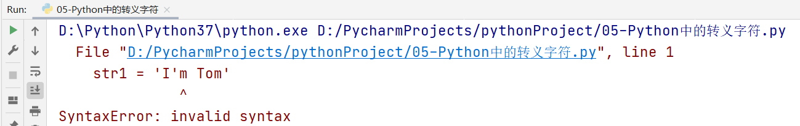
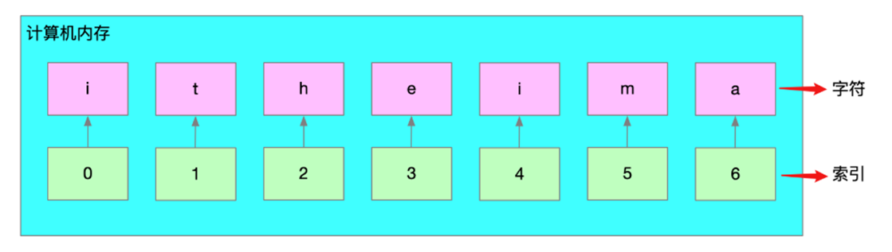
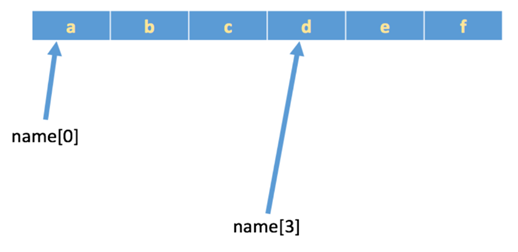
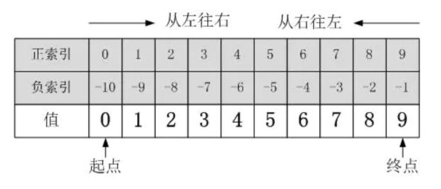

# day05_Python基础_五大容器

今日内容:

* 1- 字符串相关内容: 【实操】
* 2- 列表的相关内容: 【实操】
* 3- 元组的相关内容: 【实操】
* 4- 集合的相关内容: 【实操】
* 5- 字典的相关内容: 【实操】


## 1.【掌握】字符串定义和切片

### 1.1 字符串的定义

字符串是 Python 中最常用的数据类型。我们一般使用引号来创建字符串。创建字符串很简单，只要为变量分配一个值即可。

案例1：使用单引号或双引号定义字符串变量

```python

```

案例2：使用3个引号定义字符串变量

```python

```

> 注意：三引号形式的字符串支持换行操作

案例3：思考如何使用字符串定义"I'm Tom"

使用单引号情况

```python
str1 = 'I'm Tom'
```

运行结果：



出现以上问题的主要原因在于，以上字符串的定义代码出现了(syntax)语法错误。单引号在字符串定义中必须成对出现，而且Python解析器在解析代码时，会自动认为第一个单引号和最近的一个单引号是一对！

如果一定要在单引号中在放入一个单引号，必须使用反斜杠进行转义。

```python
str1 = 'I\'am Tom'
```

使用双引号情况

```python
str2 = "I'm Tom"
```

> 注：在Python中，如果存在多个引号，建议① 单引号放在双引号中 ② 双引号放在单引号中。


相关操作:

```python
# 演示 如何 定义字符串
# 方式一: 可以使用单引号 或 双引号 构建字符串
name = '张三'
address = "湖南省长沙市"

print(name)
print(address)

# 查看类型
print(type(name))
print(type(address))

# 方式二: 可以使用三引号(可以单引 也可以 双引) 来构建字符串
# 对字符串中内容 进行原样输出  支持 多行书写
title1 = '''
        标题1
        标题2
        标题3
'''

title2 = """
        标题4
        标题5
        标题6
"""

print(title1)
print(type(title1))

print(title2)
print(type(title2))

# 注意: 在字符串定义的时候, 如果字符串本身就是有双引号的, 那么 在构建这个字符串的时候, 要使用单引号, 如果字符串本身有单引号, 那么外部就要使用双引号
str1 = '在"字符串"定义的时候'
str2 = "在'字符串'定义的时候"

print(str1)
print(str2)

# 假设, 如果我就想立马是单引号的时候, 外面定义字符串的也使用单引号, 或者 里面是双引 外面定义也想使用双引
# 转义符: \   让转义符后面的内容 正常的输出
str3 = "在\"字符串\"定义的时候"

print(str3)

# 思考: 如果字符串中既有单引号 又有双引号
# 方式一: 使用转义符
# 方式二: 使用 三引号
str4 = """在'字符串'定义"的"时候"""
print(str4)

```


### 1.2 字符串在计算机底层的存储形式

在计算机中，Python中的字符串属于序列结构。所以其底层存储占用一段**连续的内存空**间。

```python
str1 = 'itheima'

字符串: 是有一个个的字符组成的
```

结构原理图：

索引的最大值 = len(字符串) - 1

7个字符，则索引下标的最大值为7-1 = 6



> 注意：索引下标从0开始。

### 1.3 聊聊索引下标

`索引下标`，就是编号。比如火车座位号，座位号的作用：按照编号快速找到对应的座位。同理，下标的作用即是通过下标快速找到对应的数据。


举个例子：

```python
name = 'abcdef'
print(name[0])  # a
print(name[3])  # d
```



索引的相关演示:

```python
# 2- 索引下标
# 正索引: 从 左往右  从 0开始
# 负索引: 从 右往左  从 -1开始
s5 = 'abcdefg'

# 2.1 获取第三个元素
print(s5[2])

# 2.2 获取 索引为5的元素
print(s5[5])

# 2.3 获取 倒数第一个元素
print(s5[6])
print(s5[-1])

# 2.3 获取 倒数第二个元素
print(s5[-2])
```


### 1.4 什么是字符串切片

所谓的切片是指对操作的对象**截取**其中一部分的操作。字符串、列表、元组都支持切片操作。

### 1.5 字符串切片基本语法

顾头不顾尾：

```python
序列名称[开始位置下标:结束位置下标:步长(步阶)]
三个参数都有默认值: 
    开始位置默认值: 第一个字符
    结束位置默认值: -1 (最后一个)
    步长 :  1

numstr = '0123456789'
numstr[0:3:1]  # 012 => range方法非常类似，步长：每次前进1步
numstr[0:3:2]  # 02 => 每次前进2步
步长可以为负数，正数代表从左向右截取，负数代表从右向左截取
```

① 不包含结束位置下标对应的数据， 正负整数均可；

② 步长是选取间隔，正负整数均可，正数从左向右，负数从右向左。默认步长为1。

还是有点陌生，没关系，给你举个栗子：

```python
numstr = '0123456789'
```

如果想对numstr字符串进行切片，如下图所示：



### 1.6 字符串切片案例

* 案例1

  ```python
  # 演示 字符串切片
  """
      切片的格式:
          序列名称[起始值:结束值:步长]
  
          起始值 : 从什么位置开始截取, 默认为 0
          结束值 : 到什么位置结束,默认为序列的最后
          步长:  表示截取的上, 每一个元素和下一个元素中间相差几个索引值  默认为 1
  
          索引: 支持 正索引 也支持 负索引
              正索引: 从左往右   0   左边的第一个
              负索引: 从右往左   -1  右边的最后一个
  """
  # 案例一:
  numstr = '0123456789'
  # 1、从2到5开始切片，步长为1
  print(numstr[2:5])  # 2 3 4
  # 2、只有结尾的字符串切片：代表从索引为0开始，截取到索引为5的位置（不包含索引为5的数据）
  print(numstr[:5])
  # 3、只有开头的字符串切片：代表从起始位置开始(例如 1)，已知截取到字符串的结尾
  print(numstr[1:])  # 注意 一定要带上 :  否则 会认为获取指定索引下的数据
  
  # 4、获取或拷贝整个字符串
  print(numstr[:])  # 表示复制了一个新的字符串
  
  # 5、调整步阶：类似求偶数
  print(numstr[::2])
  
  # 6、把步阶设置为负整数：类似字符串翻转
  print(numstr[::-1])  # 从右往左
  # 7、起始位置与结束位置都是负数
  print(numstr[-2:-5:-1]) # 默认是从左往右获取数据, 如果 步长为负数 表示 从右往左获取
  # 8、结束字符为负数，如截取012345678
  print(numstr[0:-1])
  
  
  ```
  
* 案例2: 给定一个图片的名称为"avatar.png"，代码实现获取这个图片的名称(avatar)以及这个图片的后缀(.png)。

  * 分析：

    * ① 建议先获取点号的位置（目前还未学习，只能一个一个数）
    * ② 从开头切片到点号位置，得到的就是文件的名称
    * ③ 从点号开始切片，一直到文件的结尾，则得到的就是文件的后缀

  * 代码

    ```python
    """
    案例2: 给定一个图片的名称为"avatar.png"，代码实现获取这个图片的名称(avatar)以及这个图片的后缀(.png)。
    
     分析：
    
      * ① 建议先获取点号的位置（目前还未学习，只能一个一个数）
      * ② 从开头切片到点号位置，得到的就是文件的名称
      * ③ 从点号开始切片，一直到文件的结尾，则得到的就是文件的后缀
    
    """
    image_str = 'avatar.png'
    
    # 获取字符串的名称
    # 注意: 索引 从0
    print(image_str[:6])
    
    # 获取 后缀
    print(image_str[6:])
    
    ```


## 2.【掌握】字符串的操作方法（内置）

### 2.1 字符串中的查找方法

所谓字符串查找方法即是查找子串在字符串中的位置或出现的次数。

基本语法：

```python
字符串.find(要查找的字符或者子串)
```

| **编号** | **函数** | **作用**                                                     |
| -------- | -------- | ------------------------------------------------------------ |
| 1        | find()   | 检测某个子串是否包含在这个字符串中，如果在返回这个子串开始的位置下标，否则则返回-1。 |
| 2        | index()  | 检测某个子串是否包含在这个字符串中，如果在返回这个子串开始的位置下标，否则则报异常。 |

### ☆ find()方法

作用：检测某个子串是否包含在这个字符串中，如果在返回这个子串开始的位置下标，否则则返回-1。

```python

```

案例：使用input方法输入任意一个文件名称(名称+后缀 录入 a.txt)，求点号的索引下标

```python
# 案例：使用input方法输入任意一个文件名称(名称+后缀 录入 a.txt)，求点号的索引下标
# 1- 键盘录入
user_file_name = input('请输入一个文件名称:')

# 2- 判断 用户输入的内容中  . 位置
index = user_file_name.find('.')
print(f"您输入的文件名:{user_file_name},对应的点出现的索引的位置:{index}")

```

### ☆ index()方法

index()方法其功能与find()方法完全一致，唯一的区别在于当要查找的子串没有出现在字符串中时，find()方法返回-1，而index()方法则直接报错。

```python
# 案例2
str1 = 'apple, banana, orange'
# 判断apple是否出现在字符串str1中: index方法
index = str1.index('apple')
print(index)
```


相关演示:

```python
# 演示 字符串的API
image_str = 'avatar.png'

# 1- 查找的相关API
"""
    字符串变量.find(要查询的字符或子串) : 查询字符或子串在字符串的索引下标, 如果没有找到 返回 -1
    字符串变量.index(要查询的字符或子串): 查询字符或子串在字符串的索引下标, 如果没有找到  直接报错
"""

# 需求: 查找 . 位置
index = image_str.find('z')  # 找不到时候 返回 -1
print(index)

index = image_str.index('z')  # 找不到直接报错:  ValueError 错误
print(index)


```


### 2.2 字符串的修改方法

所谓修改字符串，指的就是通过函数（方法）的形式修改字符串中的数据。

| **编号** | **函数**  | **作用**                                              |
| -------- | --------- | ----------------------------------------------------- |
| 1        | replace() | 返回替换后的字符串                                    |
| 2        | split()   | 返回切割后的列表序列                                  |
| 3        | join()    | 和split()方法正好相反，其主要功能是把序列拼接为字符串 |

#### ☆ replace()方法

基本语法：

```python
字符串.replace(要替换的内容, 替换后的内容, 替换的次数-可以省略)
```

案例：编写一个字符串，然后把字符串中的linux替换为python

```python
# replace('需要替换字符','替换后的字符',替换次数):  默认替换次数为全部的内容, 如果写了对应的N个数值, 只替换前N个
# 案例1:
str1 = 'hello linux and hello linux'
# 把字符串中所有linux字符替换为python: replace

# 把字符串中的第一个linux进行替换为python

# 把and字符串替换为&&

```

目前在工作中，replace主要用于实现关键字替换或过滤功能。北京 > BJ，论坛关键字过滤

#### ☆ split()方法

作用：对字符串进行切割操作，返回一个list()列表类型的数据

```python
# 案例2:
str2 = 'apple-banana-orange'

# 需求1: 根据字符串的 - 对字符串进行切割操作


# 需求2: 针对案例1的字符串, 请按照空格进行切割


# 案例3:
# 需求: 请将str2中每一个单词的首字符变更为大写

```

#### ☆ join()方法

作用：和split()方法正好相反，其主要功能是把序列拼接为字符串

```python
字符串.join(数据序列)
```

案例：把水果列表['apple', 'banana', 'orange']拼接成'apple-banana-orange'

```python

```


相关的演示:

```python
# 演示 字符串的修改的API
"""
    相关的API：
        replace(): 对字符串的数据进行替换操作
        split(): 对字符串数据执行切割操作,结果可能是多个值
        join(): 对一个序列按照指定的分隔符号拼接为一个字符串
        	'-'.join(new_list):  对 列表中每一个元素 使用 - 拼接为一个新字符串
        title(): 可以对字符串中每一个单词的首字符变更为大写
       
    操作的格式: 
    	字符串.API()
    注意:
        对字符串的修改, 会返回一个新的字符串,并不会改变字符串原有的内容

    结论:
        字符串这个容器 是 不可变类型
"""

# replace('需要替换字符','替换后的字符',替换次数):  默认替换次数为全部的内容, 如果写了对应的N个数值, 只替换前N个
# 案例1:
str1 = 'hello linux and hello linux'
# 把字符串中所有linux字符替换为python: replace
new_str = str1.replace('linux', 'python')
print(new_str)

# 把字符串中的第一个linux进行替换为python
new_str = str1.replace('linux', 'python', 1)
print(new_str)
# 把and字符串替换为&&
new_str = str1.replace('and','&&')
print(new_str)

print(str1)

# split('分割的字符') 返回的是多个内容, 通过一个新的序列方式(列表类型)返回

# 案例2:
str2 = 'apple-banana-orange'

# 需求1: 根据字符串的 - 对字符串进行切割操作
new_list = str2.split('-')
print(new_list)
print(new_list[0])
print(new_list[1])
print(new_list[2])

# 需求2: 针对案例1的字符串, 请按照空格进行切割
new_list = str1.split(' ')
print(new_list)


# 案例3:
# 需求: 请将str2中每一个单词的首字符变更为大写
new_str = str2.title()
print(new_str)

# 案例：把水果列表['apple', 'banana', 'orange'] new_list 拼接成'apple-banana-orange'
new_list = str2.split('-')
print(new_list)

# join 使用
print('-'.join(new_list)) # 用  -  作为 列表中每一个元素的拼接符号, 将其拼接为一个字符串

```

### 2.3 字符串案例

#### 案例需求

将字符串向右旋转n位，例如“abcdef”向右旋转2位得到“efabcd”


“abcdef” ==> "efabcd"

#### 实现思路

利用切片操作，将字符串分为两部分并交换位置。

#### 代码实现

~~~shell
# 将字符串向右旋转n位，例如“abcdef”向右旋转2位得到“efabcd”

# 1- 定义一个字符串
str = 'abcdef'

# 2- 键盘录入, 要求用户输入需要右旋的位数
n = int(input('请输入需要右旋N为:'))

# 3- 执行右旋操作
# len(str): 获取 字符串的长度
# 发现如果用户输入的比字符长度都长,此时无法右旋, 解决方案: 可以采用 取余方案解决
n = n % len(str)

# 思路: 需要右旋几位, 就将字符串的后几位截取出来放置到字符串的最前面
# 3.1 根据右旋的N位 拆分为前后的内容 方便后续调换位置
# 假设N为2:  abcdef
first = str[:-n]  # abcd
last = str[-n:]  # ef

# 3.2 后面的放置到前面 前面的放置到后面
# efabcd
new_str = last + first # 直接使用 + 拼接两个字符串

print(new_str)

~~~

## 3.【掌握】列表及其应用场景

### 3.1 为什么需要列表

思考：有一个人的姓名(TOM)怎么书写存储程序？

答：变量。

思考：如果一个班级100位学生，每个人的姓名都要存储，应该如何书写程序？声明100个变量吗？

答：No，我们使用列表就可以了， 列表一次可以存储多个数据。

> 在Python中，我们把这种数据类型称之为列表。但是在其他的编程语言中，如Java、PHP、Go等等中其被称之为数组。

### 3.2 列表的定义

```python
列表序列名称 = [列表中的元素1, 列表中的元素2, 列表中的元素3, ...]


注意: 列表是可变的
```

案例演示：定义一个列表，用于保存苹果、香蕉以及菠萝

```python
list1 = ['apple', 'banana', 'pineapple']
# list列表类型支持直接打印
print(list1)
# 打印列表的数据类型
print(type(list1))  # <class 'list'>
```

> 注意：列表可以一次存储多个数据且可以为不同的数据类型


基本使用

```python
# 演示 列表的基本使用
"""
    列表的定义:
        变量名 = [元素1,元素2,元素3...]
    注意:
        每一个列表都可以将不同的类型的数据存储在一起, 一般都是存储的同一类型的数据
"""
# 1- 定义列表：
list1 = ['张三', '李四', '王五', 0, 1, 2, True, False]


# 2- 如何获取列表中数据:
# 2.1 支持 索引的方式  : 与字符串一致
# 获取 第三个元素
print(list1[2])

# 获取 第六个元素
print(list1[5])

# 2.2 支持 索引切片 : 与字符串一致
# 获取 索引从2~6的数据
print(list1[2:6])

print("---------")
# 2.3 如何获取列表中每一个元素
# 建议使用 for循环
for item in list1:
    print(item)

# while循环:
print("---------")
# 获取 列表的长度
print(len(list1))
# 遍历操作
i = 0

while i < len(list1):
    print(list1[i])

    # 更新计数器
    i += 1

```


### 3.3 列表的相关操作

列表的作用是一次性存储多个数据，程序员可以对这些数据进行的操作有：

增、删、改、查。

#### ☆ 查操作

列表在计算机中的底层存储形式，列表和字符串一样，在计算机内存中都占用一段连续的内存地址，我们向访问列表中的每个元素，都可以通过"索引下标"的方式进行获取。


如果我们想获取列表中的某个元素，非常简单，直接使用索引下标：

```python
list1 = ['apple', 'banana', 'pineapple']
# 获取列表中的banana
print(list1[1])
```

查操作的相关方法：

| **编号** | **函数** | **作用**                                                     |
| -------- | -------- | ------------------------------------------------------------ |
| 1        | index()  | 指定数据所在位置的下标                                       |
| 2        | count()  | 统计指定数据在当前列表中出现的次数                           |
| 3        | in       | 判断指定数据在某个列表序列，如果在返回True，否则返回False    |
| 4        | not in   | 判断指定数据不在某个列表序列，如果不在返回True，否则返回False |

```python
# 演示： 查询的列表API
"""
    相关API:
        index(): 获取某个元素在列表的索引位置,如果找不到 直接报错
        count(): 统计某一个元素在列表中出现了多少次
        in 和 not in : 判断元素是否在或者不在这个列表中  返回 布尔类型的数据
"""
# 1- 定义一个列表
list1 = [1, 2, 3, 1, 3, 'a', 'b', 2, 'b', 1]

print(list1)

# 1.1 查询 某个元素在列表中位置:  a元素
print(list1.index('a'))  # 5

# 1.2 统计 列表中 出现 1的次数
print(list1.count(1))

# 1.3 判断  3元素是否在列表中, 如果在 查询其第一次出现的索引位置
if 3 in list1:
    print(list1.index(3))
else:
    print("该元素不存在")

print(4 not in list1)
```


#### ☆ 增操作

| **编号** | **函数** | **作用**                                                     |
| -------- | -------- | ------------------------------------------------------------ |
| 1        | append() | 增加指定数据到列表中                                         |
| 2        | extend() | 列表结尾追加数据，如果数据是一个序列，则将这个序列的数据逐一添加到列表 |
| 3        | insert() | 指定位置新增数据                                             |

```python
# 演示 列表的增加API:
"""
    增加API:
        append() :  向列表的尾部添加数据
        extend() :  实现将列表中每一个元素依次的添加到另一个列表中
        insert() :  向列表中指定位置添加元素
    
"""

# 1- 定义一个列表
list1 = ['张三','李四','王五','赵六']

# 2- 相关API使用
print(list1)
# 2.1 向列表的尾部添加一个 田七
list1.append('田七')  # 只能追加元素, 如果是列表 会直接将列表当做一个单一的元素添加到列表中

print(list1)

# 2.2 定义一个新的列表 列表中有 周八和李九  帮我添加到list1中
list2 = ['周八','李九']

list1.extend(list2)

print(list1)

# 2.3 请帮我在列表的头部 和 列表的第三个位置添加数据
list1.insert(0,'老张')

print(list1)

list1.insert(2,'老李')

print(list1)
```


#### ☆ 删操作

| **编号** | **函数**       | **作用**                                         |
| -------- | -------------- | ------------------------------------------------ |
| 1        | del 列表[索引] | 删除列表中的某个元素                             |
| 2        | pop()          | 删除指定下标的数据(默认为最后一个)，并返回该数据 |
| 3        | remove()       | 移除列表中某个数据的第一个匹配项。               |


#### ☆ 改操作

| **编号** | **函数**                | **作用**               |
| -------- | ----------------------- | ---------------------- |
| 1        | 列表[索引] = 修改后的值 | 修改列表中的某个元素   |
| 2        | reverse()               | 将数据序列进行倒叙排列 |
| 3        | sort()                  | 对列表序列进行排序     |


相关功能的演示:

```python
# 演示 列表的删除与修改的API
"""
    删除的API:
        del 列表[索引] :  删除指定索引的元素
        pop()  : 弹出元素  默认删除的列表尾部的元素, 并且会将删除的元素进行返回
        remove(元素):  用于删除指定的元素数据
"""

list1 = ['老张', '张三', '老李', '李四', '王五', '赵六', '田七', '周八', '李九']

# 删除元素:
# 1- 删除 索引为 5的数据
del list1[5]
print(list1)

# 2- 通过 pop 删除指定的索引的数据
item = list1.pop()
print(item)
print(list1)

item = list1.pop(3)
print(item)
print(list1)

# 3- 根据元素删除: 删除 田七
list1.remove('田七')  # 当该元素不存在的时候, 会直接报错
print(list1)

# 修改的API:
"""
    修改值:  列表变量[索引值] =  新的值
    
    反转列表:  reverse()
    
    对列表数据排序:  sort()
"""
print("-----------------")
list2 = ['老张', '张三', '老李', '王五', '周八']

# 修改值: 将索引2的数据, 修改为 李四
list2[2] = '李四'
print(list2)

# 反转列表
list2.reverse()
print(list2)
# list3 = list2[::-1]
# print(list3)

# 排序:
list4 = [1, 5, 7, 2, 3, 9, 10, 15, 3]

list4.sort(reverse=True)   # 默认为升序, 如果需要倒序排序 设置 reverse参数为True

print(list4)
```


### 3.4 列表的循环遍历 

什么是循环遍历？答：循环遍历就是使用while或for循环对列表中的每个数据进行打印输出

while循环：

```python
list1 = ['貂蝉', '大乔', '小乔']


```

for循环（个人比较推荐）：

```python
list1 = ['貂蝉', '大乔', '小乔']

```

### 3.5 列表的嵌套

列表的嵌套：列表中又有一个列表，我们把这种情况就称之为列表嵌套

> 在其他编程语言中，称之为叫做二维数组或多维数组

应用场景：要存储班级一、二、三  => 三个班级学生姓名，且每个班级的学生姓名在一个列表。

```python
classes = ['第一个班级','第二个班级','第三个班级']

一班：['张三', '李四']
二班：['王五', '赵六']
三班：['田七', '钱八']

把班级和学员信息合并在一起，组成一个嵌套列表
students = [['张三', '李四'],['王五', '赵六'],['田七', '钱八']]

students = [x,y,z]
students[0] == ['张三', '李四']
students[0][1]
```

问题：嵌套后的列表，我们应该如何访问呢？

```python
# 访问李四
print(students[0][1])
# 嵌套列表进行遍历，获取每个班级的学员信息
for i in students:
    print(i)
```


相关的操作:

```python
# 演示列表的嵌套:
# 说明: 所谓嵌套 指的就是在列表中元素, 依然是一个列表
# 有那些班级:
llm_1 = ['张三', '李四', '王五']

java_1 = ['赵六', '田七', '周八']

java_2 = ['李九', '老王', '老刘']

# 校区
cs_school = [llm_1, java_1, java_2]
"""
[
    ['张三', '李四', '王五'], 
    ['赵六', '田七', '周八'], 
    ['李九', '老王', '老刘']
]

"""
print(cs_school)

# 思考: 如果获取里面的数据  比如 获取 田七
print(cs_school[1][1])

print("----------------")
# 如何获取每一个姓名:
for class_list in cs_school:
    for name in class_list:
        print(name)

```


### 3.6 列表案例

**案例需求**

求相邻元素最大值.编写一个程序，求一个正整数数组中每对相邻元素的最大值。
 例如, 输入: [7 8 9 5 6 7 2 3] 输出: [8, 9, 9, 6, 7, 7, 3]

**实现思路**

① 定义一个正整数数组

② 初始化一个空列表用于存储相邻元素的最大值

③ 使用 for 循环遍历数组中的每对相邻元素

④ 获取当前元素和下一个元素

⑤ 计算当前元素和下一个元素的最大值

⑥ 将最大值添加到 max_values 列表中

⑦ 打印相邻元素的最大值列表

**代码实现**

```python
"""
求相邻元素最大值.编写一个程序，求一个正整数数组中每对相邻元素的最大值。
 例如, 输入: [7 8 9 5 6 7 2 3] 输出: [8, 9, 9, 6, 7, 7, 3]

"""
# 1- 定义一个列表
list1 = [7, 8, 9, 5, 6, 7, 2, 3]

# 2- 定义一个空列表, 用于保存结果数据
result_list = []

# 3- 对列表进行变量: 从第一个 遍历到 倒数第二个
# IndexError: list index out of range  数组越界异常,   获取的 索引值 大于了 列表中索引的最大值
for i in range(0, len(list1)-1):
    # 当前元素和 下一个元素进行比较:
    if list1[i] > list1[i+1]:
        # 当前比下一个要大
        result_list.append(list1[i])
    else:
        # 下一个比当前要大或者等于
        result_list.append(list1[i+1])

# 4- 输出结果
print(result_list)

```


## 4.【掌握】元组的定义与使用

### 4.1 为什么需要元组

思考：如果想要存储多个数据，但是这些数据是不能修改的数据，怎么做？

答：列表？列表可以一次性存储多个数据，但是列表中的数据允许更改。

```python
num_list = [10, 20, 30]
num_list[0] = 100
```


那这种情况下，我们想要存储多个数据且数据不允许更改，应该怎么办呢？

答：使用元组，元组可以存储多个数据且元组内的数据是不能修改的。

### 4.2 元组的定义

元组特点：定义元组使用小括号，且使用逗号隔开各个数据，数据可以是不同的数据类型。

基本语法：

```python
# 多个数据元组
tuple1 = (10, 20, 30)

# 单个数据元组
tuple2 = (10,)
```

> 注意：如果定义的元组只有一个数据，那么这个数据后面也要添加逗号，否则数据类型为唯一的这个数据的数据类型。

### 4.3 元组的相关操作方法

由于元组中的数据不允许直接修改，所以其操作方法大部分为查询方法。

| **编号** | **函数**   | **作用**                                                     |
| -------- | ---------- | ------------------------------------------------------------ |
| 1        | 元组[索引] | 根据索引下标查找元素                                         |
| 2        | index()    | 查找某个数据，如果数据存在返回对应的下标，否则报错，语法和列表、字符串的index方法相同 |
| 3        | count()    | 统计某个数据在当前元组出现的次数                             |
| 4        | len()      | 统计元组中数据的个数                                         |

```python
# 演示 元组的操作
"""
    定义:
        变量 = (元素1,元素2,元素3....)

        特殊元组: 仅有一个元素
        变量 = (元素1,)

    相关操作:
        元组变量[索引] : 获取指定索引的值
        index() : 查询某个元素的索引位置
        count() : 统计某一个元素出现了多少次
        len() : 统计元组的长度
"""
# 1- 定义一个元组
tuple1 = ('张三','李四','王五')
print(tuple1)
print(type(tuple1))

tuple2 = (10,)
print(tuple2)
print(type(tuple2))

# 相关的使用
# 2- 获取元组的某一个元素
print(tuple1[1])
print(tuple1[0:2])

# 3 - 获取某个元素的位置
print(tuple1.index('王五'))

print('王五' not in tuple1)

# 4- 获取长度
print(len(tuple1))

```

### 4.4 元组案例

案例需求1

编写一个程序来提取嵌套元组中的唯一元素。
例如: 在嵌套元组((1,2,3),(2,4,6),(2,3,5))中, 2重复出现了3次，3重复出现了2次，但我们的输出列表只会包含2、3一次。
即：[1, 2, 3, 4, 5, 6]


**代码实现**

```python
"""
    案例需求1

    编写一个程序来提取嵌套元组中的唯一元素。
    例如: 在嵌套元组((1,2,3),(2,4,6),(2,3,5))中, 2重复出现了3次，3重复出现了2次，但我们的输出列表只会包含2、3一次。
    即：[1, 2, 3, 4, 5, 6]
"""

# 1- 定义元组
tuple1 = ((1, 2, 3), (2, 4, 6), (2, 3, 5))

# 2- 定义一个空的列表
list1 = []

# 3- 对元组进行遍历操作
for item_tuple in tuple1:
    for item in item_tuple:
        if item not in list1:
            list1.append(item)


# 4- 打印结果
print(list1)

```


案例需求2:

给定一个元组my_tuple，里面包含1, 2, 3, 4, 5, 6, 7, 8, 9元素，要求统计数字元组中, 奇数的个数

~~~python
"""
案例需求2:

给定一个元组my_tuple，里面包含1, 2, 3, 4, 5, 6, 7, 8, 9元素，要求统计数字元组中, 奇数的个数
"""

# 1- 创建一个元组
my_tuple = (1, 2, 3, 4, 5, 6, 7, 8, 9)

# 2- 判断每一个元素是否是一个奇数
count = 0
for item in my_tuple:
    # 判断元素是否是一个奇数
    if item % 2 == 1:
        count += 1

# 3- 打印统计结果
print(count)
~~~


