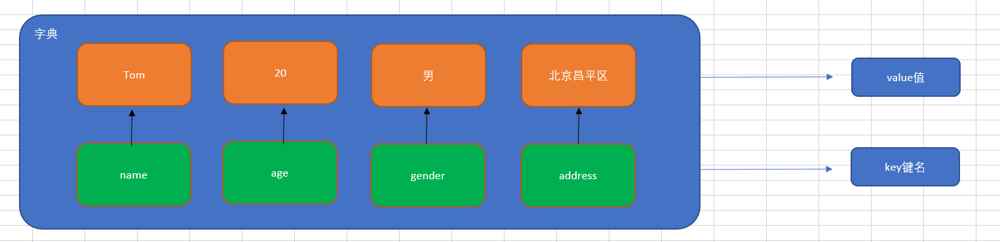
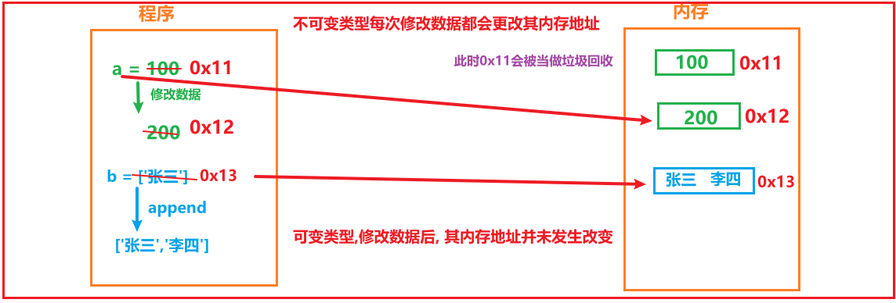

# day06_Python基础_五大容器与函数

今日内容:

* 1- Python的中五大容器: 【实操】
  * 集合
  * 字典
* 2- Python的容器拆包: 【实操】
* 3- Python的推导式: 【实操】
* 4- Python中函数的基本定义和使用 : 【实操】
* 5- Python中函数的嵌套使用 : 【知道】
* 6- Python中函数变量的作用范围 : 【知道】


## 1.【熟悉】集合的定义与使用

### 1.1 什么是集合

集合（set）是一个**无序**的**不重复**元素序列。

① 天生去重

② 无序

### 1.2 集合的定义

在Python中，我们可以使用一对花括号{}或者set()方法来定义集合，但是如果你定义的集合是一个空集合，则只能使用set()方法。

```python

```

### 1.3 集合操作的相关方法（增删查）

#### ☆ 集合的增操作

add()方法：向集合中增加一个元素（单一）

```python

```

#### ☆ 集合的删操作

remove()方法：删除集合中的指定数据，如果数据不存在则报错。

```python

```

#### ☆ 集合中的查操作

① in ：判断某个元素是否在集合中，如果在，则返回True，否则返回False

② not in ：判断某个元素不在集合中，如果不在，则返回True，否则返回False

```python

```

③ 集合的遍历操作

```python

```


相关的操作:

```python
# 演示： 集合的相关操作
"""
    如何定义集合:
        空集合:  变量名称 = set()
        有数据的集合:  变量名称 = {元素1,元素2,元素3......}

    集合特性:  无序  去重

    集合是一个可变的数据类型

"""

# 1- 定义一个集合:
set1 = {'张三','李四','王五','赵六','田七','李四','王五'}
print(set1)
print(type(set1))
print("---------")
set2 = set()
print(set2)
print(type(set2))

print("---------------")
# 2- 相关的操作:
# 2.1 遍历: for循环
for item in set1:
    print(item)

# 2.2 判断某个元素是否在集合中
# in 和 not in
if '周八' not in set1:
    # 如果该元素不存在, 请将其添加到集合中
    print("不存在,正在添加~~~~")
    # 添加元素的操作: add
    set1.add('周八')
else:
    print("存在~~")

# 打印添加后的数据
print(set1)

# 2.3 删除: 判断 如果 赵六在集合中, 请将其删除
if '赵六' in set1:
    # 执行删除: remove
    set1.remove('赵六')

print(set1)

```


### 1.4 集合案例

**需求**

​		编写一个程序来统计缺失的数字并返回它们的总和。缺失的数字是指给定列表中两个极端（最大和最小数字）之间没有出现的数字。
例如，在集合{2, 5, 3, 7, 5, 7}中，两个极端（即2和7）之间缺失的数字是4和6。

~~~python
"""
编写一个程序来统计缺失的数字并返回它们的总和。缺失的数字是指给定列表中两个极端（最大和最小数字）之间没有出现的数字。
例如，在集合{2, 5, 3, 7, 5, 7}中，两个极端（即2和7）之间缺失的数字是4和6。
"""
# 1- 定义一个集合
set1 = {2, 5, 3, 7, 5, 7}

# 2- 从集合中获取最小值 和 最大值
# 方式一: 通过 max 和 min 直接获取
# max_value = max(set1)
# min_value = min(set1)

# 方式二: 通过遍历集合 获取 最小和最大
value = set1.pop() # 随机弹出一个元素
# 将容器中任意一个值作为最小和最大的初始值
max_value = value
min_value = value

# 处理完成后, 记得将弹出元素放回
set1.add(value)
for item in set1:
    # 寻找最小值:
    if item < min_value:
        min_value = item

    # 寻找最大值
    if item > max_value:
        max_value = item

# 打印最小和最大
print(max_value)
print(min_value)


#3- 遍历 最小 ~ 最大值, 判断每一个值是否在集合中存在, 如果不存在, 说明该值就是缺失值
# 定义一个保存求和结果的临时变量
sum = 0
for i in range(min_value,max_value):
    # 3.1 判断每一个值 是否在 集合中不存在
    if i not in set1:
        # 说明 i不在这个集合中,所以当前这个i就是缺失值
        # 3.2 输出缺失值
        print(f"缺失值为:{i}")
        # 3.3 将缺失值进行累加在一起, 求和操作
        sum += i

#
# 4- 打印求和结果
print(f"缺失值的求和结果为:{sum}")
~~~


## 2.【掌握】字典的定义与使用

### 2.1 为什么需要字典(dict)

思考1：比如我们要存储一个人的信息，姓名：Tom，年龄：20周岁，性别：男，家庭住址：北京市昌平区，如何快速存储。

```python
person = ['Tom', 20, '男', '北京市昌平区']

person = [('name','tom'),('sex','男'),('address','北京市昌平区')]

# 一对一对的数据 称为 KV键值对的数据
```

思考2：在日常生活中，姓名、年龄以及性别同属于一个人的基本特征。但是如果使用列表对其进行存储，则分散为3个元素，这显然不合逻辑。我们有没有办法，将其保存在同一个元素中，姓名、年龄以及性别都作为这个元素的3个属性。

答：使用Python中的字典

### 2.2 Python中字典(dict)的概念

 特点：

① 符号为大括号（花括号） =>  {}

② 数据为键值对形式出现   =>  {key:value}，key：键名，value：值，在同一个字典中，key必须是唯一（类似于索引下标）

③ 各个键值对之间用逗号隔开



> 在字典中，键名除了可以使用字符串的形式，还可以使用数值的形式来进行表示

定义：

```python
# 有数据字典
dict1 = {'name': 'Tom', 'age': 20, 'gender': '男'}

# 上述的字典中有3个元素， 每一个元素都是一个键值对的形式

# 空字典
dict2 = {}

dict3 = dict()
```

> 在Python代码中，字典中的key必须使用引号引起来


python相关操作:

```python
# 演示 字典的基本使用
"""
    定义语法结构:
        字典变量名称 = {key1:value1 ,key2:value2 ,key3:value3 ........}

        定义空字典:
            字典变量名称 = {}
            字典变量名称 = dict()
    注意: 其中key值是唯一的, value值无所谓, 而且一般key值都是字符串类型

    字典是一个可变的数据类型
"""

# 定义字典:
person = {'name': '张三', 'age': 20, 'address': '湖南省长沙市岳麓区'}

print(person)
print(type(person))  # <class 'dict'>

dict1 = {}
dict2 = dict()

print(dict1)
print(type(dict1))
print(dict2)
print(type(dict2))

# 如何获取里面的数据呢?
# 方式一: 通过 key 获取 value
# 语法格式:  value = 字典变量名称[key]
name = person['name']
print(name)

age = person['age']
print(age)

# 方式二: 如何获取 所有的 key 和 所有的value
# keys()  values()
# 获取所有的key
print(person.keys())
# 获取所有的value
print(person.values())

# 方式三: 如何遍历所有的数据
# 根据key获取value
for key in person.keys():
    # 根据key 获取 value
    value = person[key]
    print(f"key:{key},value:{value}")

print("--------------")
# 直接获取 KV数据:
# person.items() : 获取每一个KV类型的元素 [('name', '张三'), ('age', 20), ('address', '湖南省长沙市岳麓区')]
print(person.items()) 
for kv_tuple in person.items():
    print(f"key:{kv_tuple[0]},value:{kv_tuple[1]}")


```


### 2.3 字典的增操作（重点）

基本语法：

```python
字典名称[key] = value
注：如果key存在则修改这个key对应的值；如果key不存在则新增此键值对。
```


### 2.4 字典的删操作

① del 字典名称[key]：删除指定元素

```python

```

② clear()方法：清空字典中的所有key

```python

```

### 2.5 字典的改操作

基本语法：

```python
字典名称[key] = value
注：如果key存在则修改这个key对应的值；如果key不存在则新增此键值对。
```

案例：定义一个字典，里面有name、age以及address，修改address这个key的value值

```python

```

### 2.6 字典的查操作

① 查询方法：使用具体的某个key查询数据，如果未找到，则直接报错。

```python
字典序列[key]
```

② 字典的相关查询方法

| **编号** | **函数** | **作用**                            |
| -------- | -------- | ----------------------------------- |
| 1        | keys()   | 以列表返回一个字典所有的键          |
| 2        | values() | 以列表返回字典中的所有值            |
| 3        | items()  | 以列表返回可遍历的(键, 值) 元组数据 |

案例1：提取person字典中的所有key

```python

```

案例2：提取person字典中的所有value值

```python

```

案例3：使用items()方法提取数据

```python

```


相关的操作:

```python
# 演示 字典的基本使用
"""
    定义语法结构:
        字典变量名称 = {key1:value1 ,key2:value2 ,key3:value3 ........}

        定义空字典:
            字典变量名称 = {}
            字典变量名称 = dict()
    注意: 其中key值是唯一的, value值无所谓, 而且一般key值都是字符串类型

    字典是一个可变的数据类型
"""

# 定义字典:
person = {'name': '张三', 'age': 20, 'address': '湖南省长沙市岳麓区'}

print(person)
print(type(person))  # <class 'dict'>

dict1 = {}
dict2 = dict()

print(dict1)
print(type(dict1))
print(dict2)
print(type(dict2))

# 如何获取里面的数据呢?
# 方式一: 通过 key 获取 value
# 语法格式:  value = 字典变量名称[key]
name = person['name']
print(name)

age = person['age']
print(age)

# 方式二: 如何获取 所有的 key 和 所有的value
# keys()  values()
# 获取所有的key
print(person.keys())
# 获取所有的value
print(person.values())

# 方式三: 如何遍历所有的数据
# 根据key获取value
for key in person.keys():
    # 根据key 获取 value
    value = person[key]
    print(f"key:{key},value:{value}")

print("--------------")
# 直接获取 KV数据:
# person.items() : 获取每一个KV类型的元素 [('name', '张三'), ('age', 20), ('address', '湖南省长沙市岳麓区')]
print(person.items())
for kv_tuple in person.items():
    print(f"key:{kv_tuple[0]},value:{kv_tuple[1]}")

print("--------------------")
# 如何添加和修改数据
# 字典变量名称[key] =  值
# 如果key存在就是修改操作, 如果key不存在 增加操作
print(person)
# 添加一个 生日  2006年03月05日
person['birthday'] = '2006年03月05日'
print(person)

# 修改 address, 将其地址更改为 上海市浦东新区
person['address'] = '上海市浦东新区'

print(person)

# 删除操作:
# 根据key 删除指定的键值对元素:
# del 字典变量名称[key]
# 删除 age
del person['age']

print(person)

# 清空字典数据
person.clear()
print(person)
```


### 2.7 字典案例

#### 2.7.1 案例需求

给定一个字符串my_string，现在要求统计每个字符出现的次数: 形成结果: {'字符':出现次数,'字符2':次数}

例如: 'abceacf' ==> {'a':2,'b':1,'c':2,'e':1,'f':1}


**实现思路**

①定义一个字符串

②初始化空字典，来存储对应字符和出现次数

③循环遍历字符串中每个字符

④如果字符串已经在字典中，计数加1，如果不在，初始化计数1:  字典['key'] += 1

⑤输出统计每个字符出现的次数


**代码实现**

```python
# 字典的综合案例
"""
给定一个字符串my_string，现在要求统计每个字符出现的次数: 形成结果: {'字符':出现次数,'字符2':次数}

例如: 'abceacf' ==> {'a':2,'b':1,'c':2,'e':1,'f':1}
"""

# 1- 定义一个字符串
my_string = 'acbeacf'

# 2- 定义一个空字典, 用于保存最终统计后的结果
my_dict = {}

# 3- 对字符串进行遍历, 获取每一个字符
for c in my_string:
    # 3.1 判断当前这个遍历的字符是否在字典中
    if c in my_dict:
        # 说明 该字符在字典中
        # 根据key获取value 给valye + 1操作, 将结果保存回到字典中
        # my_dict[c] = my_dict[c] + 1
        my_dict[c] += 1
    else:
        # 说明 该字符串不在字典中
        # 将 字符作为KEY  value直接赋初始值 1
        my_dict[c] = 1

# 4- 打印结果
print(my_dict)
```


#### 2.7.2 巩固练习

需求: 编写一个程序将字符串转换为字典  例如:输入: '5=Five 6=Six 7=Seven'   输出: {'5': 'Five', '6': 'Six', '7': 'Seven'}

~~~python
# 需求: 编写一个程序将字符串转换为字典  例如:输入: '5=Five 6=Six 7=Seven'   输出: {'5': 'Five', '6': 'Six', '7': 'Seven'}
# 1- 初始化字符串
my_string = '5=Five 6=Six 7=Seven'

# 2- 定义一个结果的字典
my_dict = {}

# 3- 生成字典
# 3.1 按照空格切割, 拿到每一个元素
kv_str_list = my_string.split(' ')
print(kv_str_list)

# 3.2 遍历分割好的列表
for kv_str in kv_str_list:
    print(kv_str)
    # 获取  key 和value
    # key = kv_str.split('=')[0]
    # value = kv_str.split('=')[1]
    key, value = kv_str.split('=')  # 自动拆包的思想

    # 添加到字典
    my_dict[key] = value

# 4- 打印结果
print(my_dict)
~~~

## 3. 容器拆包

### 3.1 什么是拆包？

简单来说就是把一个元组中的数据一个一个拆解出来的过程，就称之为叫做拆包操作。

### 3.2 基本语法

```python
tuple1 = (10, 20)
# 拆包
num1, num2 = tuple1

以上代码可以简写为
num1, num2 = (10, 20)

还可以进一步简写
num1, num2 = 10, 20

```

### 3.3 拆包典型案例

实现两个变量值的交换：

```python
c1 = '可乐'
c2 = '牛奶'
```

分别演示基于第三方变量和通过元组拆包方案实现交换

```python
c1,c2 = c2,c1
```


相关操作:

```python
# 演示容器拆包
# 当容器中有多个数据的时候, 可以直接使用多个变量挨个接收容器中数据, 需要注意的是, 容器中有几个数据就需要使用几个变量来接收
# 1- 定义一个容器: 列表 或者 元组
my_tuple1 = ('张三', '李四', '王五')

# 需求: 将元组中三个数据, 分别赋值给三个变量
name1 = my_tuple1[0]
name2 = my_tuple1[1]
name3 = my_tuple1[2]

print(name1)
print(name2)
print(name3)

# 拆包思想:
# name1,name2,name3 = '张三','李四','王五'
# name1, name2, name3 = ('张三', '李四', '王五')
name1, name2, name3 = my_tuple1


print(name1)
print(name2)
print(name3)

```


## 4. 【扩展】推导式

### 4.1 什么是推导式

​		推导式comprehensions（又称解析式），是Python的一种独有特性。推导式是可以从一个数据序列构建另一个新的数据序列（一个有规律的列表或控制一个有规律列表）的结构体。 共有三种推导：`列表推导式`、`集合推导式`、`字典推导式`。

​		大白话： 从一个容器 生成一个新的容器的操作  可以尝试使用推导式 【建议：从旧 到 新转换的过程中不要太复杂 如果比较复杂不推荐使用推导式】

### 4.2 为什么需要推导式

案例：创建一个0-9的列表

while循环：

```python
# 初始化计数器
i = 0
list1 = []
# 编写循环条件
while i <= 9:
    list1.append(i)
 	# 更新计数器
    i += 1
print(list1)
```

for循环：

```python
list1 = []
# 编写for循环
for i in range(0, 10):
    list1.append(i)
print(list1)
```

思考：我们能不能把以上代码简化为一行代码搞定这个程序呢？

答：可以，使用推导式


什么时候可以使用推导式:  

当需要遍历一个容器, 然后遍历后需要返回一个新容器的场景


```python
# 演示 推导式的方式
# 生成一个 1~9的列表

# 1- 定义一个空的列表
my_list = []

# 2- 遍历从 1~9
for i in range(1,10):
    my_list.append(i)

# 3- 打印结果
print(my_list)

# ---------推导式----------------
my_list = [i for i in range(1,10)]

print(my_list)
```


### 4.3 列表推导式

基本语法：

```python
变量名 = [表达式 for 变量 in 列表]
变量名 = [表达式 for 变量 in 列表 if 条件]
变量名 = [表达式 for 变量 in 列表 for 变量 in 列表]
```

案例：定义0-9之间的列表

```python
list1 = []
for i in range(10):
    list1.append(i)
print(list1)
```

列表推导式

```python
# 演示 推导式

# 案例：定义0-9之间的列表
# ---------推导式----------------
my_list = [i for i in range(1,10)]

print(my_list)
```

执行原理：[i for i in range(10)]

```powershell
列表推导式先运行表达式右边的内容：

当第一次遍历时：i = 0，其得到变量i的结果后，会放入最左侧的变量i中，这个时候列表中就是[0]
当第二次遍历时：i = 1，其得到变量i的结果后，会追加最左侧的变量i中，这个时候列表中就是[0, 1]
...
当最后一次遍历时：i = 9，其得到变量i的结果后，会追加最左侧的变量i中，这个时候列表中就是[0, 1, 2, 3, 4, 5, 6, 7, 8, 9]
```

### 4.4 列表推导式 + if条件判断

在使用列表推导式时候，我们除了可以使用for循环，其实我们还可以在其遍历的过程中，引入if条件判断。

```python
变量 = [表达式 for 临时变量 in 序列 if 条件判断]

等价于

for 临时变量 in 序列:
    if 条件判断
```

案例：生成0-9之间的偶数（i%2  0）序列

```python
# for + if 推导式
# 案例：生成0-9之间的偶数（i%2  0）序列
# 正常的写法
my_list = []

for i in range(0, 10):
    if i % 2 == 0:
        my_list.append(i)

print(my_list)

# 推导式
my_list = [i for i in range(0, 10) if i % 2 == 0]
print(my_list)
```

### 4.5 for循环嵌套列表推导式

```python
for 临时变量 in range(n):
    for 临时变量 in range(n):
```

基本语法：

```python
变量 = [表达式 for 临时变量 in 序列 for 临时变量 in 序列]
```

案例：创建列表 => [(1, 0), (1, 1), (1, 2), (2, 0), (2, 1), (2, 2)]

(1,0)    (1, 0-2)

(1,1)    (1, 0-2)

(1,2)    (1, 0-2)

-------------------

(2,0)    (2, 0-2)

(2,1)    (2, 0-2)

(2,2)    (2, 0-2)

原生代码：for循环嵌套

```python
list1 = []
# 外层循环
for i in range(1, 3):
    # 内层循环
    for j in range(0, 3):
        tuple1 = (i, j)
        list1.append(tuple1)
print(list1)
```

列表推导式：

```python
# 嵌套for
# 案例：创建列表 => [(1, 0), (1, 1), (1, 2), (2, 0), (2, 1), (2, 2)]

# 正常写法
my_list = []

for i in range(1, 3):
    for j in range(0, 3):
        my_list.append((i, j))

print(my_list)

# 推导式
my_list = [(i, j) for i in range(1, 3) for j in range(0, 3)]
print(my_list)
```

### 4.6 推导式案例

案例：使用列表推导式生成平方数集合

例如, 用户输入10, 表示要生成 1~10的每一个数字的2平方的集合

~~~python
# 综合案例: 例如, 用户输入10, 表示要生成 1~10的每一个数字的2平方的集合
num = int(input("请输入一个数字, 帮您生成从1~N每个数的平方值:"))

# 正常的玩法
# 1- 定义一个集合
my_list = set()

# 2- 循环操作
for i in range(1,num+1):
    my_list.add(i**2)

print(my_list)

# 推导式
my_list = {i**2 for i in range(1,num+1)}
print(my_list)
~~~

## 5. Python中函数的作用与使用步骤

### 5.1 为什么需要函数

在Python实际开发中，我们使用函数的目的只有一个“让我们的代码可以被重复使用”

函数的作用有两个：

① 代码重用（代码重复使用）

② 模块化编程（模块化编程的核心就是函数，一般是把一个系统分解为若干个功能，每个功能就是一个函数）

> 在编程领域，编程可以分为两大类：① 模块化编程 ② 面向对象编程

### 5.2 什么是函数

所谓的函数就是一个被命名的、独立的、完成特定功能的代码段（一段连续的代码），并可能给调用它的程序一个返回值。

​	

被命名的：在Python中，函数大多数是有名函数（普通函数）。当然Python中也存在没有名字的函数叫做匿名函数(lambda表达式)。

独立的、完成特定功能的代码段：在实际项目开发中，定义函数前一定要先思考一下，这个函数是为了完成某个操作或某个功能而定义的。（函数的功能一定要专一）

返回值：很多函数在执行完毕后，会通过return关键字返回一个结果给调用它的位置。

### 5.3 函数的定义

基本语法：

```python
def 函数名称([参数1, 参数2, ...]):
    函数体
    ...
    [return 返回值]


注意: 语法中的中括号表示的可选的意思
```

### 5.4 函数的调用

在Python中，函数和变量一样，都是先定义后使用。

```python
# 定义函数
def 函数名称([参数1, 参数2, ...]):
    函数体
    ...
    [return 返回值]

# 调用函数
函数名称(参数1, 参数2, ...)
```

### 5.5 通过一个栗子引入函数

通过购票方案分别演示: 不使用函数、有函数、带参数、有返回值几种玩法

```python
# 演示： 函数
"""
    定义语法格式:
    def 函数名称([参数1,参数2,参数3...]):
        函数体,对应功能代码块

        [return 返回值]

    函数不调用不执行, 先定义后使用

"""

# 需求: 火车站卖票的案例:

# 非函数方案:
print("用户来了, 执行卖票操作, 获取用户信息, 收款 卖票...")
print("用户来了, 执行卖票操作, 获取用户信息, 收款 卖票...")
print("用户来了, 执行卖票操作, 获取用户信息, 收款 卖票...")
print("用户来了, 执行卖票操作, 获取用户信息, 收款 卖票...")

print("-------------------")


# 定义函数: 卖票的函数
def pay_ticket1():
    print("用户来了, 执行卖票操作, 获取用户信息, 收款 卖票...")


# 如何调用卖票的逻辑呢?  调用函数
pay_ticket1()
pay_ticket1()
pay_ticket1()
pay_ticket1()

print("-------2222----------")
# 卖票的时候, 我们得指定用户是谁:  是否可以在调用卖票的函数时候, 传入用户名字呢? 甚至用户身份证号码
def pay_ticket2(name,user_id):
    print(f"{name}用户来了,身份证号码为:{user_id},执行卖票操作, 获取用户信息, 收款 卖票...")


# 调用:
pay_ticket2('张三','12352142')

print("-----333-------")
# 在进行卖票的时候, 执行完卖票逻辑后, 能不能告知用户, 已经购买成功了~~~
def pay_ticket3(name,user_id):
    print(f"{name}用户来了,身份证号码为:{user_id},执行卖票操作, 获取用户信息, 收款 卖票...")

    return '恭喜您, 您购买成功了'


# 调用:
result = pay_ticket3('张三','12352142')

print(result)
```


### 5.6 聊聊return返回值

思考1：如果一个函数如些两个return (如下所示)，程序如何执行？

```python
def return_num():
    return 1
    return 2


result = return_num()
print(result)  # 1
```

答：只执行了第一个return，原因是因为return可以退出当前函数，导致return下方的代码不执行。


思考2：如果一个函数要有多个返回值，该如何书写代码？

答：在Python中，理论上一个函数只能返回一个结果。但是如果我们向让一个函数可以同时返回多个结果，我们可以使用`return 元组`的形式。

```python
def return_num():
    return 1, 2


result = return_num()
print(result)
print(type(result))  # <class 'tuple'>
```


思考3：封装一个函数，参数有两个num1，num2，求两个数的四则运算结果

四则运算：加、减、乘、除

```python
def size(num1, num2):
    jia = num1 + num2
    jian = num1 - num2
    cheng = num1 * num2
    chu = num1 / num2
    return jia, jian, cheng, chu


# 调用size方法
print(size(20, 5))
```


### 5.7 案例需求

```python
"""
请定义一个函数, 在函数中3 + 5的计算操作, 并且将累加后的结果直接打印出来即可

请定义一个函数, 要求函数传入二个任意的数字, 在函数体中完成这二个数字的累加计算操作, 并且将累加后的结果直接打印出来即可

请定义一个函数, 要求函数传入二个任意的数字, 在函数体中完成这二个数字的累加计算操作, 并且将累加后的结果 返回 然后调用函数 接收返回值, 并且将返回值输出打印
"""


# 需求1： 请定义一个函数, 在函数中完成3 + 5的计算操作, 并且将计算后的结果直接打印出来即可

def sum1():
    he = 3 + 5
    print(he)


# 函数是不调用不执行: 函数名称()
sum1()


# 需求2 请定义一个函数, 要求函数传入二个任意的数字, 在函数体中完成这二个数字的累加计算操作, 并且将累加后的结果直接打印出来即可
# 定义函数
def sum2(a,b):
    print(a + b)

# 调用函数
sum2(5,15)

# 需求3: 请定义一个函数, 要求函数传入二个任意的数字, 在函数体中完成这二个数字的累加计算操作, 并且将累加后的结果 返回 然后调用函数 接收返回值, 并且将返回值输出打印
def sum3(num1,num2):
    return num1 + num2


# 调用函数
he = sum3(5,15)
print(he)
```


## 6. 函数的嵌套

### 6.1 什么是函数的嵌套

所谓函数嵌套调用指的是一个函数里面又调用了另外一个函数。

### 6.2 函数嵌套的基本语法


嵌套函数的执行流程：

第一步：Python代码遵循一个“顺序原则”，从上往下，从左往右一行一行执行

当代码执行到第1行时，则在计算机内存中定义一个funcB函数。但是其内部的代码并没有真正的执行，跳过第2行继续向下运行。

第二步：执行到第5行，发现又声明了一个funcA的函数，根据函数的定义原则，定义就是在内存中声明有这样一个函数，但是没有真正的调用和执行。

第三步：代码继续向下执行，到第14行， 发现funcA()，函数体()就代表调用funcA函数并执行其内部的代码。程序返回到第6行，然后一步一步向下执行，输出40个横杠，然后打印这是funcA函数的函数体部分...，然后继续向下执行，遇到funcB函数，后边有一个圆括号代表执行funcB函数，原程序处于等待状态。

第四步：进入funcB函数，执行输出这是funcB函数的函数体部分...，当代码完毕后，返回funcA函数中funcB()的位置，继续向下执行，打印40个横杠。

最终程序就执行结束了。

## 7. 函数的应用案例

> 案例：奇偶求和

```python
"""
需求: 奇偶求和.
    编写一个程序，求出一个列表中偶数和奇数的和。

    定义函数calculate_sum()，参数为一个数字列表numbers_list, 分别求出偶数和奇数的和。
    最后，返回一个列表(元组)，第一个元素为偶数的和，第二个元素为奇数的和。
"""


# 定义函数:
def calculate_sum(nums_list):
    # 需求: 求列表中奇数的和  和 偶数的和
    j_sum = 0
    o_sum = 0
    for i in nums_list:
        if i % 2 == 0:
            # 说明是偶数
            o_sum += i
        else:
            # 说明是奇数
            j_sum += i

    # 返回结果
    return o_sum, j_sum


# 假设有以下一个列表
numbers_list = [1, 2, 3, 4, 5, 6, 7, 8, 9]

# 调用函数:
o_sum, j_sum = calculate_sum(numbers_list)  # 利用自动拆包的思想

print(f"偶数和为:{o_sum}")
print(f"奇数和为:{j_sum}")

```


## 8. 变量的作用域

### 8.1 什么是变量的作用域

变量作用域指的是变量的作用范围（变量在哪里可用，在哪里不可用），主要分为两类：全局作用域与局部作用域。

其实作用域的划分比较简单，在函数内部定义范围就称之为局部作用域，在函数外部（全局）定义范围就是全局作用域

```python
# 全局作用域
def func():
    # 局部作用域
```

### 8.2 局部变量与全局变量

在Python中，定义在函数外部的变量就称之为全局变量；定义在函数内部变量就称之为局部变量。

```python
# 定义在函数外部的变量（全局变量）
num = 10
# 定义一个函数
def func():
    # 函数体代码
    # 定义在函数内部的变量（局部变量）
    num = 100
```


### 8.3 变量作用域的作用范围

全局变量：在整个程序范围内都可以直接使用

```python
str1 = 'hello'
# 定义一个函数
def func():
    # 在函数内部调用全局变量str1
    print(f'在局部作用域中调用str1变量：{str1}')

# 直接调用全局变量str1
print(f'在全局作用域中调用str1变量：{str1}')
# 调用func函数
func()
```

局部变量：在函数的调用过程中，开始定义，函数运行过程中生效，函数执行完毕后，销毁

```python
# 定义一个函数
def func():
    # 在函数内部定义一个局部变量
    num = 10
    print(f'在局部作用域中调用num局部变量：{num}')

# 调用func函数
func()
# 在全局作用域中调用num局部变量
print(f'在全局作用域中调用num局部变量：{num}')
```

运行结果：


> 普及小知识：计算机的垃圾回收机制


相关的操作:

```python
# 变量的作用范围
"""
    作用域: 全局作用域  和 局部作用域

    如何区分: 定义在 函数内部的变量 称为定义在局部作用域, 如果在def外部, 称为全局作用域

    作用: 变量只能在自己的作用域范围内使用, 超出了就无法使用了

    全局变量 和 局部变量:

    如何区分: 定义在全局作用域的变量 称为 全局变量  定义在局部作用域范围的变量 称为 局部变量
    
    定义在全局范围内变量在局部中依然可以使用这个变量的值, 但是定义在局部范围的变量, 是无法在全局的范围内使用
    
    发现一个非常重要的情况: 全局的变量 在全局的位置中可以对其进行修改, 但是在局部范围内无法直接修改全局变量的值
"""

# 假设有 100张票
ticket = 100  #


# 构建卖票逻辑
def pay_ticket():
    name = '张三'  # 局部变量 仅能在当前函数内使用, 一旦函数执行完成后, 该变量就会被销毁 [底层: 垃圾回收机制]
    # 执行一次卖票, 就应该将票数 - 1
    # ticket -= 1

    print(f"{name}执行卖票操作,目前剩余的票数为{ticket}~~~")


# 调用函数
pay_ticket()

# 打印还剩余多少票:
# ticket -= 1
print(f"剩余的票数:{ticket}")
# print(f"用户名为:{name}") 无法使用

```


### 8.4 global关键字的应用场景

思考一个问题：我们能不能在局部作用域中对全局变量进行修改呢？

```python
# 定义全局变量num = 10
num = 10
# 定义一个函数func
def func():
    # 尝试在局部作用域中修改全局变量
    num = 20

# 调用函数func
func()
# 尝试访问全局变量num: 10
print(num)
```

最终结果：弹出10，所以由运行结果可知，在函数体内部理论上是没有办法对全局变量进行修改的，所以一定要进行修改，必须使用`global`关键字。

```python
# 定义全局变量num = 10
num = 10
# 定义一个函数func
def func():
    # 尝试在局部作用域中修改全局变量
    global num
    num = 20

# 调用函数func
func()
# 尝试访问全局变量num
print(num)
```

> 记住：global关键字只是针对不可变数据类型的变量进行修改操作（数值、字符串、布尔类型、元组类型），可变类型当仅仅修改容器中的数据是可以不加global关键字。




