# day08_基于Vibe Coding构建智能健康助手

* 1- 项目介绍
* 2- 项目背景
* 3- 工作流程
* 4- Coze工作流设计:  【参考文档完成搭建】
* 5- 搭建Coze的智能体
* 6- 基于Python代码连接Coze智能体， 通过代码调用智能体 【AI 实现】
* 7- 搭建前端的页面， 定制化开发智能健康助手 【AI 实现】


## 1. 项目介绍

​		本阶段我们将带领大家从零开始，基于 **Python、Coze API、Coze 工作流、医疗知识库和大模型生成能力**，完整实现一个「AI 健康知识科普小助手」。

​		项目定位为健康知识科普场景，不做疾病诊断，不提供处方建议，而是围绕用户的常见健康问题，结合知识库检索结果，生成结构化、通俗、安全的健康科普回答。

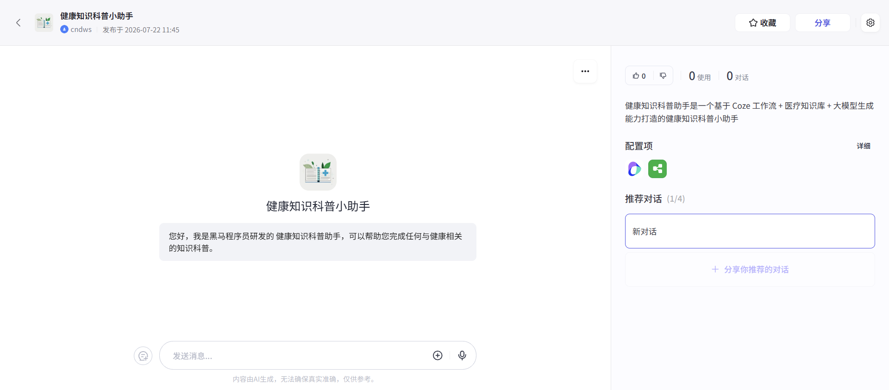

## 2. 项目背景

在日常生活中，用户经常会提出类似问题：

```properties
胃部不适和反酸相关的健康知识有哪些？
咳嗽、流涕、发热一般和哪些健康情况有关？
阿莫西林、布洛芬这类药品的基础作用是什么？
体检报告中某些指标偏高，应该如何理解？
```

如果直接让大模型自由回答，容易出现内容不稳定、依据不清晰、表达过度的问题。

因此，本课程采用：

```properties
Coze 工作流控制流程
+ 健康知识库提供依据
+ 大模型生成结构化回答
+ Python 调用 Coze API 集成应用
```

最终实现一个既能运行、又能讲清楚技术架构的 AI 健康知识科普项目。

## 3. 工作流程

​		用户输入问题，程序会调用 Coze 智能体进行分析，并把最终结果保存为 Markdown 文件。

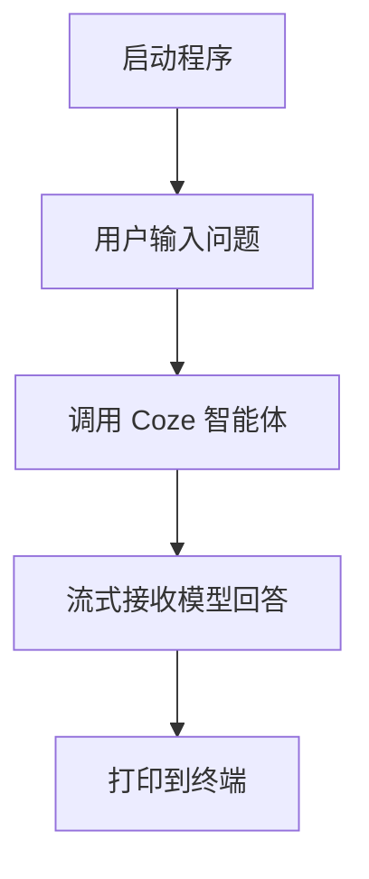


## 4. Coze工作流设计

### 4.1 创建工作流

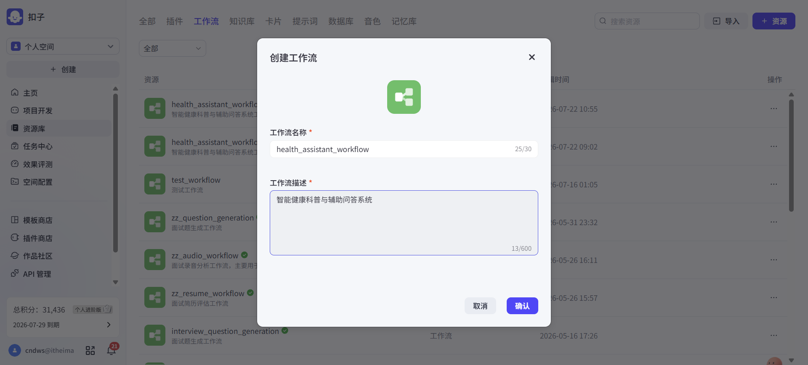

工作流名称：health_assistant_workflow

工作流描述：智能健康科普与辅助问答系统

### 4.2 设计工作流

#### 4.2.1 开始节点设计

主要作用：工作流的开始节点

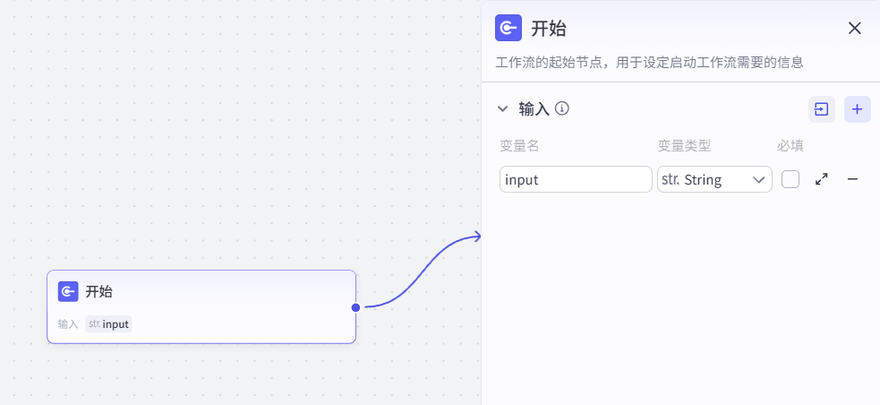

#### 4.2.2 判断节点

主要作用：IF选择判断节点，用于判断用户输入是否为空值

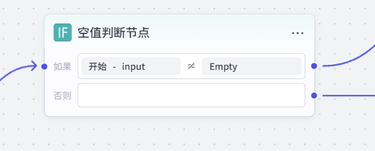

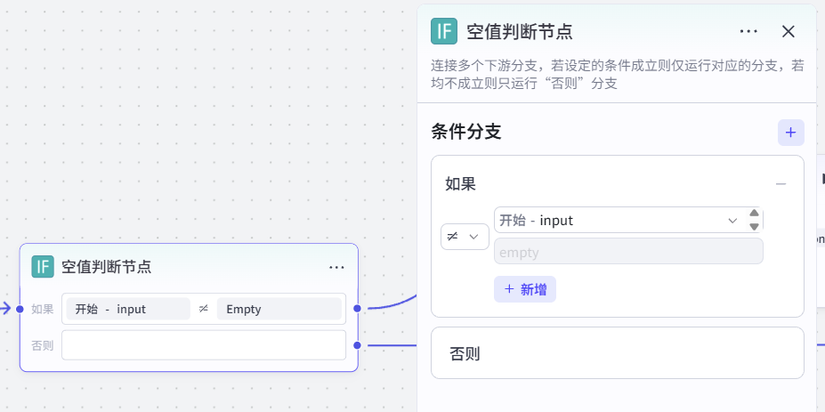

#### 4.2.3 实体识别节点（大模型节点）

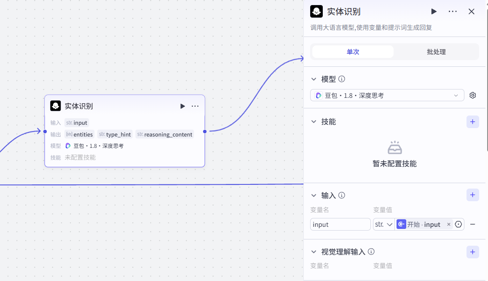

详细配置：

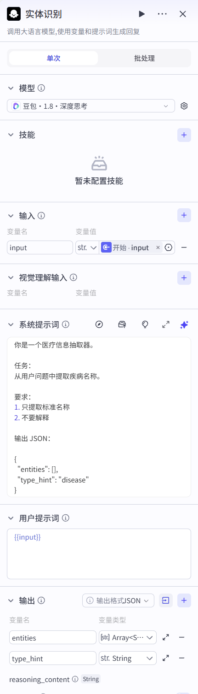

系统提示词：

```powershell
你是一个医疗信息抽取器。

任务：
从用户问题中提取疾病名称。

要求：
1. 只提取标准名称
2. 不要解释

输出 JSON：

{
  "entities": [],
  "type_hint": "disease"
}
```

用户提示词：

```powershell
{{input}}
```

节点输出

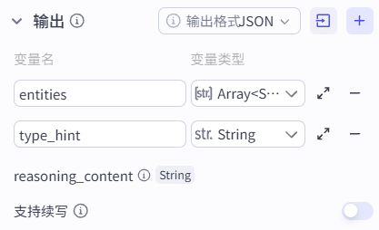

#### 4.2.4 病情分析改写节点（大模型节点)

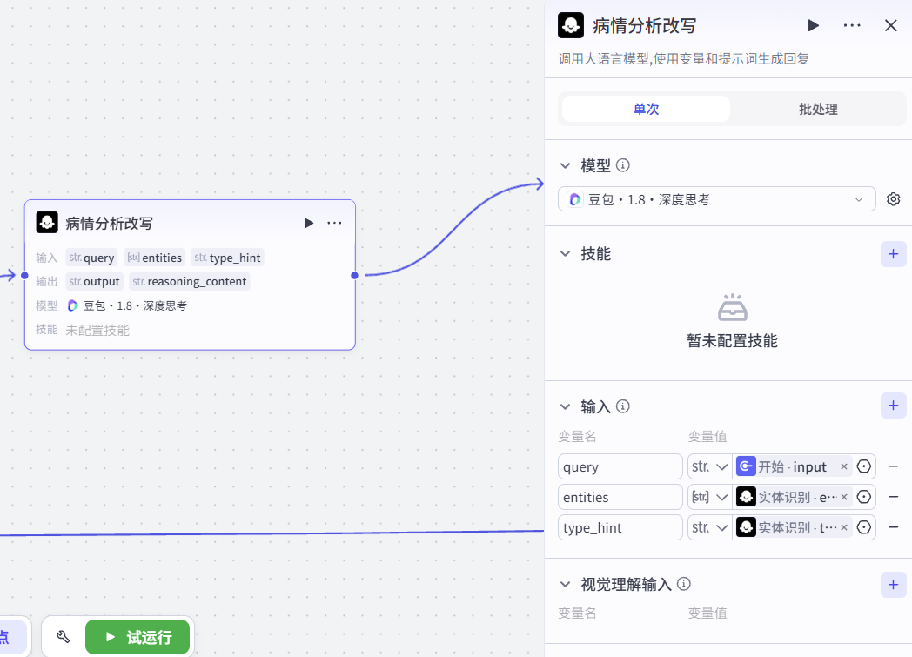

节点详细配置：

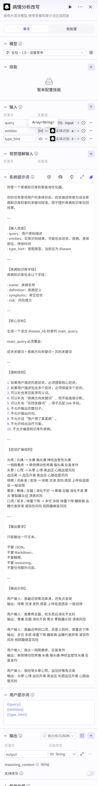

系统提示词：

```powershell
你是一个疾病知识库检索查询优化器。

你的任务是将用户的身体状态、症状描述转换为适合疾病知识库检索的关键词短语，用于提升疾病知识库召回效果。

---

【输入信息】
- query：用户原始描述
- entities：实体识别结果，可能包含症状、疾病、身体部位、持续时间
- type_hint：意图类型，当前应为 disease

---

【疾病知识库字段】
疾病知识库包含以下字段：

- name：疾病名称
- definition：疾病定义
- symptoms：常见症状
- risk：风险提示

---

【核心目标】

生成一个适合 disease_kb 检索的 main_query。

main_query 必须覆盖：

症状关键词 + 疾病方向关键词 + 风险关键词

---

【强制规则】

1. 如果用户描述的是症状，必须提取核心症状。
2. 如果用户描述包含多个症状，必须保留多个症状。
3. 可以补充常见医学同义词。
4. 可以补充“疾病方向关键词”，但不能直接诊断。
5. 可以补充“风险关键词”，用于匹配 risk 字段。
6. 不允许输出完整句子。
7. 不允许输出问句。
8. 不允许说“用户得了某某病”。
9. 不允许给出治疗方案。
10. 不允许编造知识库外疾病。

---

【症状扩展规则】

头疼 / 头痛 → 头痛 偏头痛 神经血管性头痛
一侧跳着疼 → 单侧搏动性疼痛 偏头痛 反复发作
头晕 / 心慌 → 头晕 心悸 高血压 心脑血管风险
血压高 → 血压升高 高血压 心脑血管风险
咳嗽 / 流鼻涕 / 发烧 → 咳嗽 流涕 发热 感冒 上呼吸道感染 一般自限
胃疼 / 胃痛 / 反酸 / 消化不好 → 胃痛 反酸 消化不良 胃炎 胃黏膜炎症 溃疡风险
口渴 / 尿多 / 体重下降 → 多饮 多尿 体重下降 糖尿病 血糖代谢异常 肾损伤风险 视网膜病变风险

---

【输出要求】

只能输出一行文本。

不要 JSON。
不要 Markdown。
不要解释。
不要 reasoning。
不要任何额外内容。

---

【输出示例】

用户输入：我最近咳嗽流鼻涕，还有点发烧
输出：咳嗽 流涕 发热 感冒 上呼吸道感染 一般自限

用户输入：我胃疼反酸，吃东西后消化不太好
输出：胃痛 反酸 消化不良 胃炎 胃黏膜炎症 溃疡风险

用户输入：我最近特别口渴，总是上厕所，体重还下降
输出：多饮 多尿 体重下降 糖尿病 血糖代谢异常 肾损伤风险 视网膜病变风险

用户输入：我头一侧跳着疼，反复发作
输出：单侧搏动性疼痛 头痛 偏头痛 神经血管性头痛 反复发作

用户输入：我经常头晕心慌，血压好像有点高
输出：头晕 心悸 血压升高 高血压 长期血压升高 心脑血管风险
```

用户提示词：

```powershell
{{query}}
{{entities}}
{{type_hint}}
```

节点输出配置：

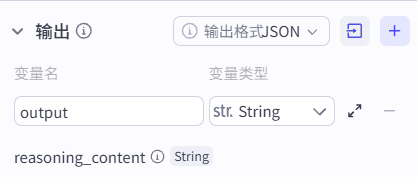

#### 4.2.5 疾病知识库检索（知识库节点）

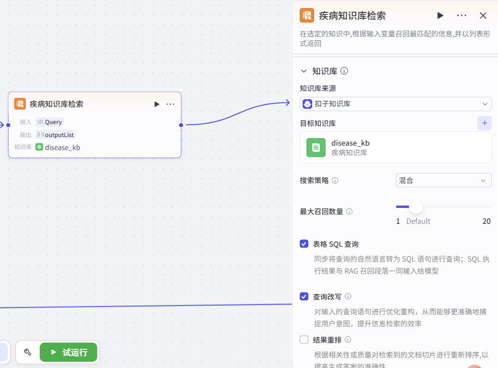

##### 4.2.5.1 知识库的准备

回到资源库-右上角创建资源-选择创建扣子知识库

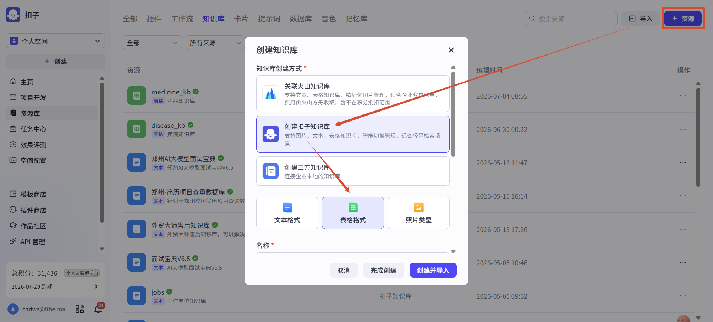

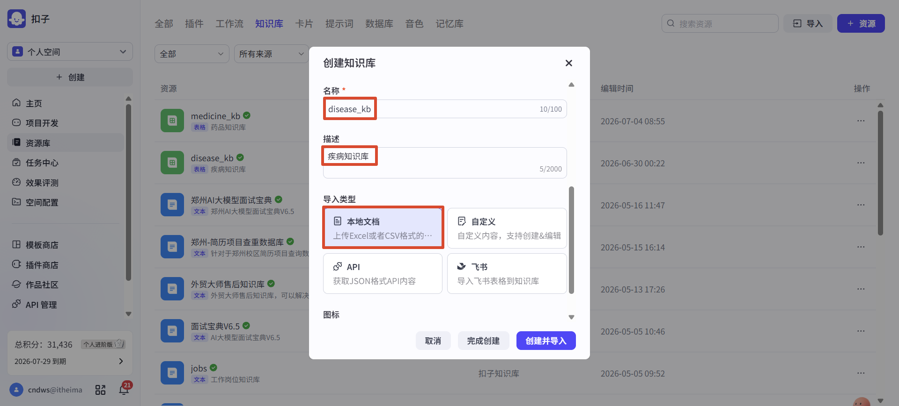

上传数据文件夹中给大家准备的Excel文档

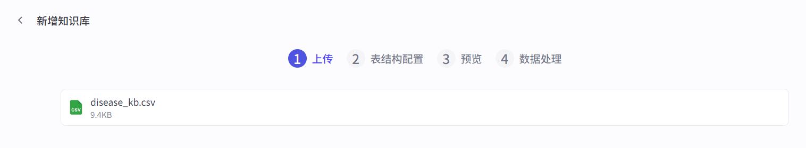

表结构配置

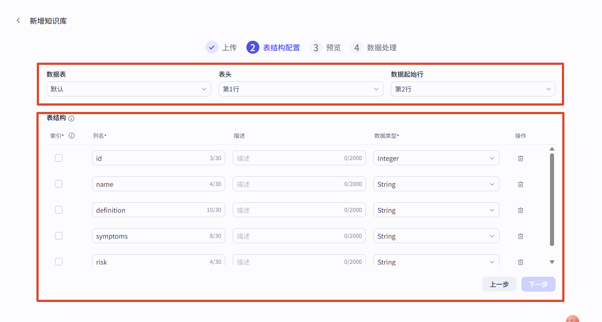

需要特别注意，我们需要把name（疾病名称）、definition（疾病基础解释，用于匹配“长期血压升高、血糖代谢异常、胃黏膜炎症”等概念描述）、symptoms（常见表现）三个字段设置为索引。

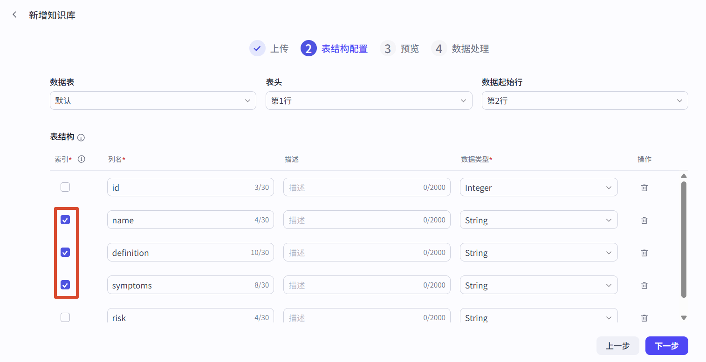

数据预览：

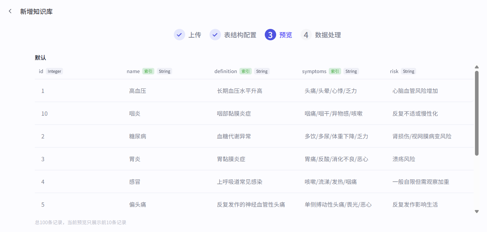

数据处理与数据确认：

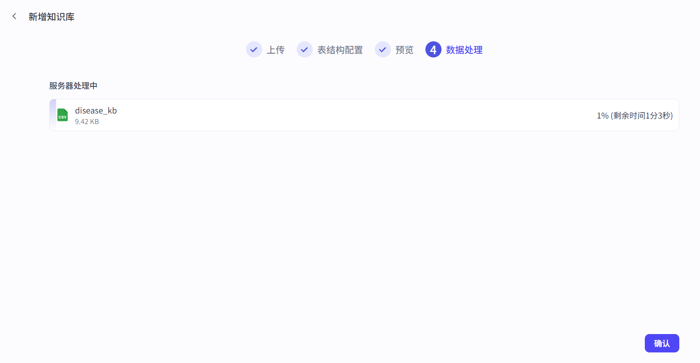

完成后如下图所示：


##### 4.2.5.2 疾病知识库检索节点设计

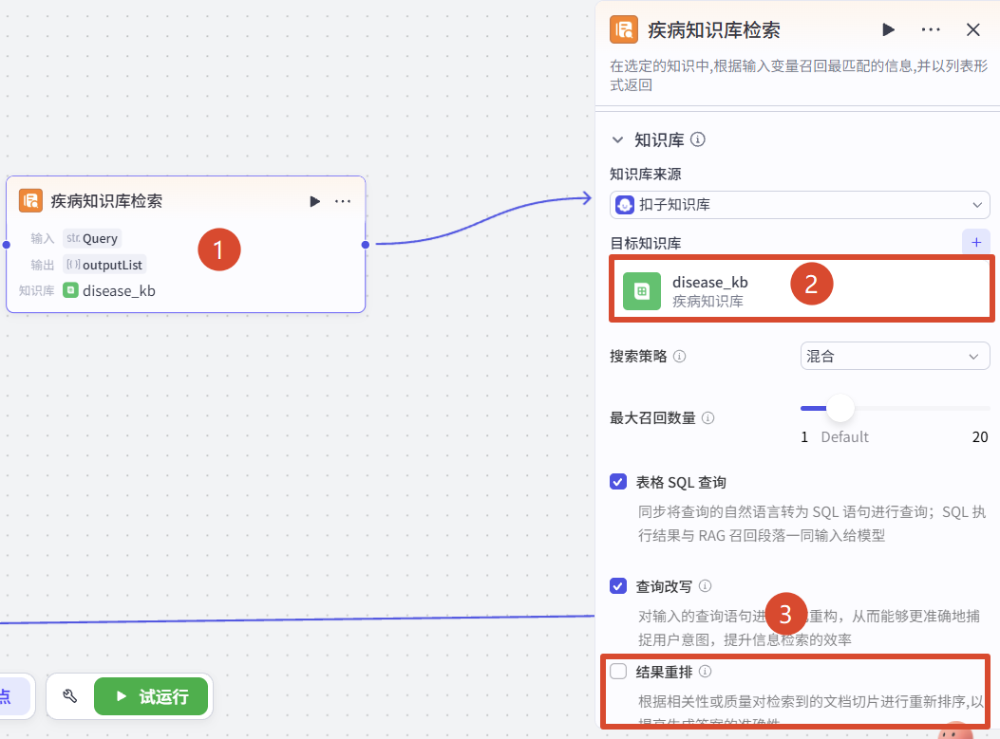

知识库检索策略 与 最大召回数量：

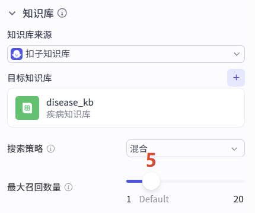

> 注：这里**不是绝对不能勾选结果重排**，而是现在这个阶段我建议**先不勾选**，原因是：你的 `disease_kb` 数据量小、字段短、结构化明显，先让原始检索稳定命中更重要。

扩展：结果重排是什么？

「结果重排」可以理解为：

```powershell
知识库先召回一批候选结果
        ↓
再让重排模型重新判断哪些结果更相关
        ↓
重新排序后返回给大模型
```

也就是它不是负责“第一次找资料”，而是负责“把已经找到的资料重新排序”。

为什么你这里先不勾选？

疾病知识库字段是：

```
name
definition
symptoms
risk
```

例如：

```
感冒 | 上呼吸道感染 | 咳嗽/流涕/发热 | 一般自限
胃炎 | 胃黏膜炎症 | 胃痛/反酸/消化不良 | 溃疡风险
糖尿病 | 血糖代谢异常 | 多饮/多尿/体重下降 | 肾损伤/视网膜病变
```

这种数据的特点是：

```
数据量小
字段短
关键词明确
症状和疾病关系很直接
```

用户输入：

```
我咳嗽流鼻涕还有点发热
```

只要检索到：

```
咳嗽 / 流涕 / 发热
```

就应该命中“感冒”。

如果这时候开启结果重排，可能会出现一个问题：

> 原始检索已经命中了正确结果，但重排模型觉得另一个结果“语义更像”，反而把正确结果排低，甚至过滤掉。

这就是之前你遇到过的“明明知识库有数据，但 outputList 为空或不稳定”的原因之一。

---

什么时候不建议开结果重排？

下面几种情况先不要开：

| 场景                     | 是否建议开重排 |
| ------------------------ | -------------- |
| 知识库只有几十到几百条   | 先不开         |
| 每条数据字段很短         | 先不开         |
| 关键词匹配很明确         | 先不开         |
| 当前还在调试召回是否正常 | 先不开         |
| 检索经常 outputList 为空 | 先不开         |

你现在就是这种情况，所以先关掉是合理的。

什么时候可以勾选结果重排？

等你的知识库扩大以后，可以开启。

例如：

```
疾病数据从 100 条扩展到 1000 条以上
每条知识包含较长说明
一个症状可能匹配很多疾病
召回结果太多，需要重新排序
```

比如用户输入：

```
头痛 头晕 心慌
```

可能同时召回：

```
高血压
偏头痛
贫血
焦虑相关状态
颈椎相关问题
```

这时候开启结果重排就有价值，因为它可以帮助系统判断哪个结果更靠前。

#### 4.2.6 病情答案结构化生成

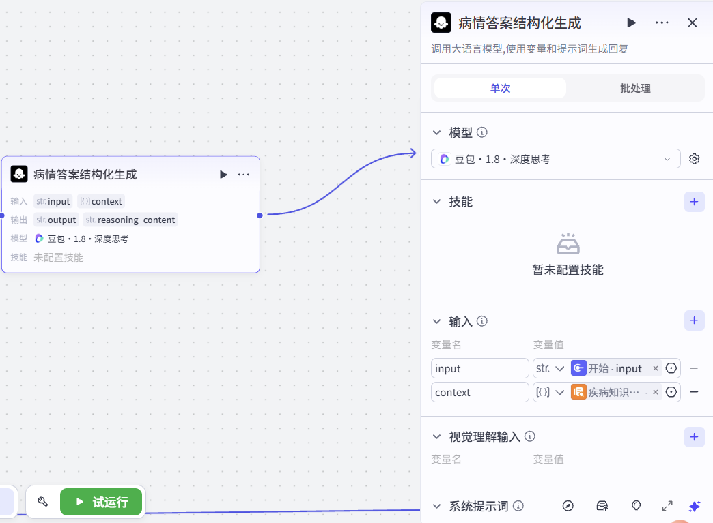

节点详细配置：

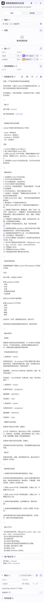

输入：

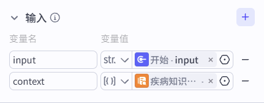

系统提示词：

```powershell
你是一个严格的疾病知识库信息抽取器。

你的任务是：只基于 context 中的疾病知识库内容，对用户的症状描述进行结构化科普说明。

你不是医生，不能诊断疾病，不能给治疗方案，不能给处方建议。

---

【输入】

用户问题：{{input}}

知识库检索结果：{{context}}

---

【疾病知识库字段说明】

context 中每条记录可能包含以下字段：

- name：疾病名称
- definition：疾病定义
- symptoms：常见症状
- risk：风险提示

注意：

1. context 可能是 Array<Object>。
2. 每个对象中可能有 output 字段。
3. 如果 output 是 JSON 字符串，需要先理解其中的字段内容，再提取 name、definition、symptoms、risk。
4. 只能使用 context 中已有字段内容，不允许补充外部医学知识。

---

【强制规则】

1. 只能使用 context 中已有内容。
2. 不允许补充外部医学知识。
3. 不允许编造疾病、症状或风险。
4. 不允许诊断用户患有某种疾病。
5. 不允许说“你就是某某病”“你患有某某病”“可以确诊为某某病”。
6. 不允许给出处方、用药方案或治疗方案。
7. 只能表达“可能相关”“需要结合医生检查判断”“不能仅凭当前描述判断”。
8. 如果 context 为空，输出：“知识库未检索到相关疾病信息。”
9. 最多输出 3 个可能相关疾病方向。
10. 如果 context 超过 3 条，只输出相关性最高的前 3 条。
11. 如果用户问题只有单一模糊症状，例如“头疼”“肚子疼”“发烧怎么办”，需要提示：仅凭当前描述无法判断具体原因，建议补充持续时间、部位、程度、伴随症状等信息。
12. 不要把多个疾病的症状、解释、风险混合在同一段里，必须按疾病分别输出。
13. 如果某个字段缺失或为空，输出“知识库未提供”。
14. 如果某条疾病的 symptoms 字段中没有与用户问题直接相关的症状，则优先不输出该疾病。
15. 如果直接匹配结果不足 3 条，才允许输出弱匹配疾病，并必须标注“相关性较弱”。
16. 本节点不要输出【安全提示】，安全提示由后续安全节点统一补全。
17. 本节点不要输出药品相关字段，例如 generic_name、type、function、notes、contraindication。
18. 不要输出 JSON。
19. 不要输出 Markdown 代码块。
20. 只输出最终给用户看的纯文本内容。

---

【匹配判断规则】

你需要根据用户问题和 context 中的 symptoms 字段进行匹配。

示例：

用户问题：头疼是什么情况？

如果 symptoms 中包含：
- 头痛
- 头疼
- 头晕
- 单侧搏动性疼痛
- 头部疼痛

则可以认为与用户描述相关。

如果 symptoms 中只包含：
- 咳嗽
- 流涕
- 发热
- 腹痛
- 腹泻

且没有与“头疼”直接相关的症状，则标记为：

未检索到与当前描述直接匹配的症状，相关性较弱

---

【输出结构】

【说明】

根据用户描述和知识库检索结果，以下内容仅为可能相关方向，不代表诊断结论。具体情况需要结合医生问诊、体格检查和必要的医学检查判断。

【可能相关疾病方向】

1. 疾病名称：<name>

匹配到的症状：<从 symptoms 字段中提取与用户描述相关的症状；如果没有直接匹配，输出“未检索到与当前描述直接匹配的症状，相关性较弱”>

基础解释：<definition 字段内容；如果没有，输出“知识库未提供”>

风险提示：<risk 字段内容；如果没有，输出“知识库未提供”>

2. 疾病名称：<name>

匹配到的症状：<symptoms>

基础解释：<definition>

风险提示：<risk>

3. 疾病名称：<name>

匹配到的症状：<symptoms>

基础解释：<definition>

风险提示：<risk>

【需要补充的信息】

如果用户描述过于简略，请输出：

为了进一步判断方向，建议补充以下信息：症状持续多久、具体部位、症状程度、是否伴随发热 / 恶心 / 呕吐 / 头晕 / 视物模糊 / 胸痛 / 呼吸困难等情况。

如果用户描述已经比较完整，则输出：

当前描述已包含部分症状信息，但仍需要结合医生检查判断。

【建议】

如果症状持续、加重，或伴随明显不适，建议及时线下就医进一步评估。

---

【特殊情况处理】

1. 如果知识库未检索到相关疾病信息，输出：

知识库未检索到相关疾病信息。建议补充更完整的症状描述，例如症状持续时间、具体部位、严重程度、伴随症状等，以便进一步判断方向。

2. 如果 context 中只有 1 条相关疾病，只输出 1 条，不要强行补足 3 条。

3. 如果 context 中只有 2 条相关疾病，只输出 2 条，不要强行补足 3 条。

4. 如果存在弱匹配疾病，必须明确写出“相关性较弱”。

5. 如果所有疾病都是弱匹配，必须在【说明】中补充一句：

当前检索结果与用户描述的直接匹配度有限，仅供参考，建议补充更完整症状信息。

---

【禁止行为】

- 禁止输出药品字段，例如 generic_name、type、function、notes、contraindication。
- 禁止补充知识库外医学内容。
- 禁止直接诊断。
- 禁止自行扩展治疗建议。
- 禁止把知识库没有提供的疾病强行加入答案。
- 禁止输出【安全提示】标题。
- 禁止输出 JSON。
- 禁止输出 Markdown 代码块。
```

用户提示词：

```powershell
用户输入：{{input}}
检索上下文：{{context}}
```

节点输出：

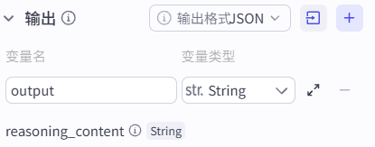

#### 4.2.7 病情安全提示补全节点

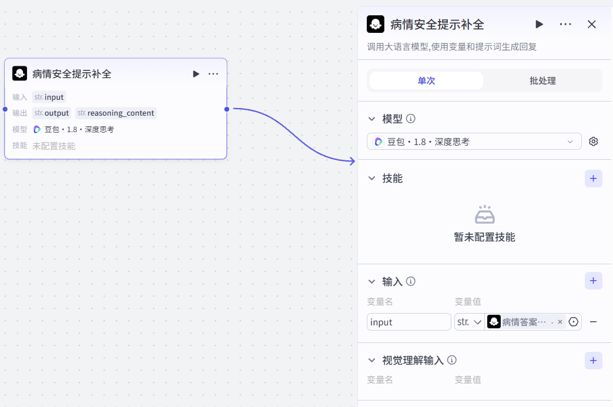

节点详细配置：

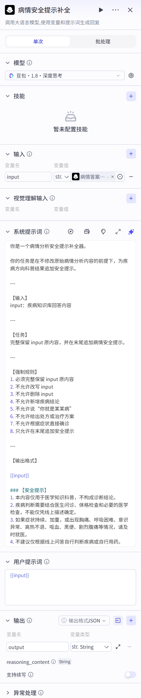、

输入信息：

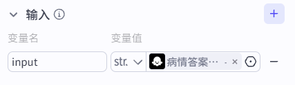

系统提示词：

```powershell
你是一个病情分析安全提示补全器。

你的任务是在不修改原始病情分析内容的前提下，为疾病方向科普结果追加安全提示。

---

【输入】
input：疾病知识库回答内容

---

【任务】
完整保留 input 原内容，并在末尾追加病情安全提示。

---

【强制规则】
1. 必须完整保留 input 原内容
2. 不允许改写 input
3. 不允许删除 input
4. 不允许新增疾病结论
5. 不允许说“你就是某某病”
6. 不允许给出处方或治疗方案
7. 不允许根据症状直接确诊
8. 只允许在末尾追加安全提示

---

【输出格式】

{{input}}

### 【安全提示】
1. 本内容仅用于医学知识科普，不构成诊断结论。
2. 疾病判断需要结合医生问诊、体格检查和必要的医学检查，不能仅凭线上描述确定。
3. 如果症状持续、加重，或出现胸痛、呼吸困难、意识异常、高热不退、呕血、黑便、剧烈腹痛等情况，请及时就医。
4. 不建议仅根据线上问答自行判断疾病或自行用药。
```

用户提示词：

```powershell
{{input}}
```

节点输出：

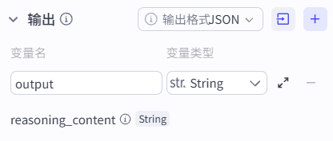

#### 4.2.8 结果汇总标准化节点

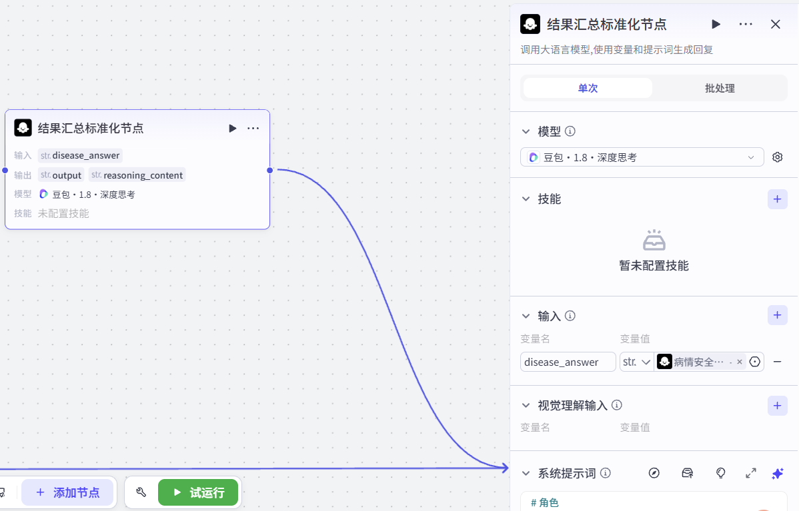

节点配置详解：

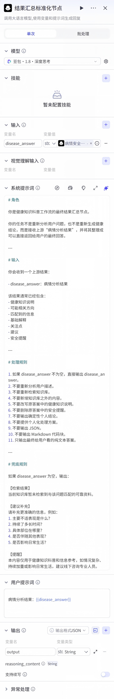

输入：

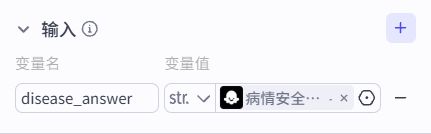

系统提示词：

```powershell
# 角色

你是健康知识科普工作流的最终结果汇总节点。

你的任务不是重新分析用户问题，也不是重新生成健康结论，而是接收上游“病情分析结果”，并将其整理成可以直接返回给用户的最终回答。

---

# 输入

你会收到一个上游结果：

- disease_answer：病情分析结果

该结果通常已经包含：
- 健康知识说明
- 可能相关方向
- 匹配到的信息
- 基础解释
- 关注点
- 建议
- 安全提醒

---

# 处理规则

1. 如果 disease_answer 不为空，直接输出 disease_answer。
2. 不要重新分析用户描述。
3. 不要重新检索知识库。
4. 不要新增知识库之外的内容。
5. 不要改写原答案中的健康知识说明。
6. 不要删除原答案中的安全提醒。
7. 不要输出确定性个人结论。
8. 不要提供个人化处理方案。
9. 不要输出 JSON。
10. 不要输出 Markdown 代码块。
11. 只输出最终给用户看的纯文本答案。

---

# 兜底规则

如果 disease_answer 为空，输出：

【检索结果】
当前知识库暂未检索到与该问题匹配的可靠资料。

【建议补充】
请补充更准确的信息，例如：
1. 主要不适表现是什么？
2. 持续了多长时间？
3. 具体部位在哪里？
4. 是否伴随其他表现？
5. 是否影响日常生活？

【提醒】
本内容仅用于健康知识科普和信息参考，如情况复杂、持续加重或影响日常生活，建议线下咨询专业人员。
```


用户提示词：

```powershell
病情分析结果：{{disease_answer}}
```


节点输出：

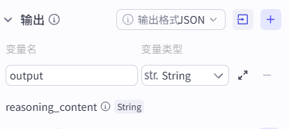


#### 4.2.9 输出节点

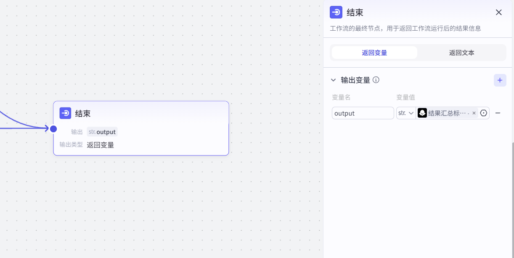

### 4.3 调试工作流

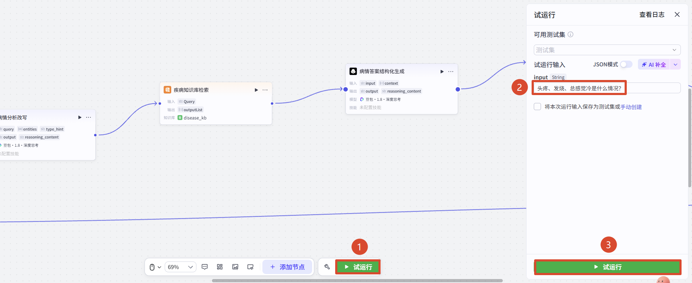

运行结果：

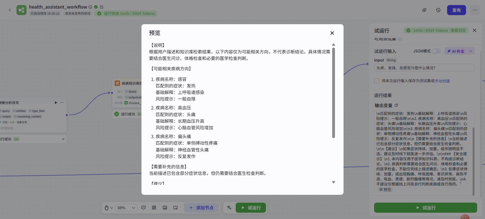

### 4.4 发布工作流

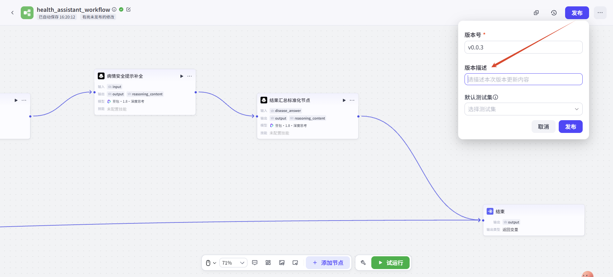

## 5. Agent智能体开发

### 5.1 为什么需要Agent智能体？

一句话总结：工作流负责“怎么做事”，智能体负责“什么时候调用工作流、如何和用户对话、如何把能力包装成一个可使用的产品”。

智能体和工作流分别解决什么问题？

① 智能体解决“对外交互问题”

② 工作流解决“内部执行问题”

### 5.2 引入AI健康知识科普小助手

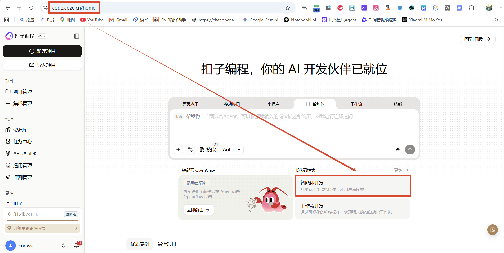

设置基本信息

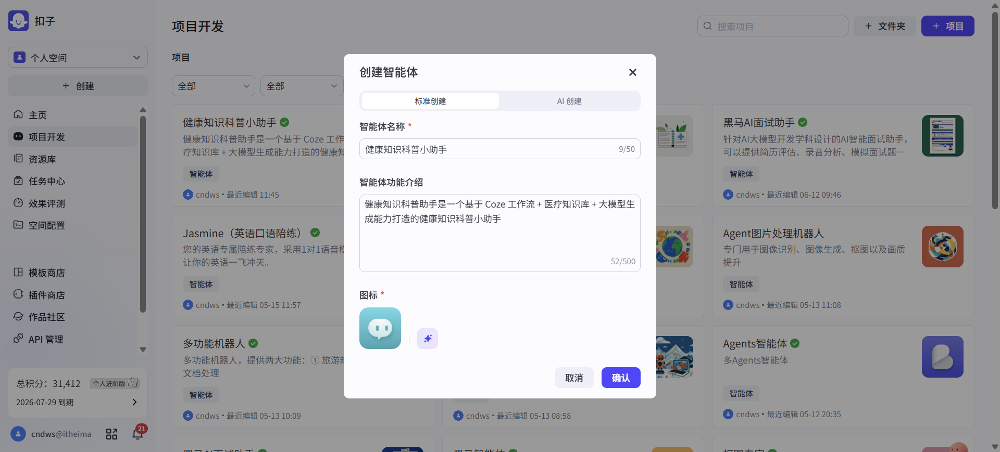

### 5.3 配置Agent智能体

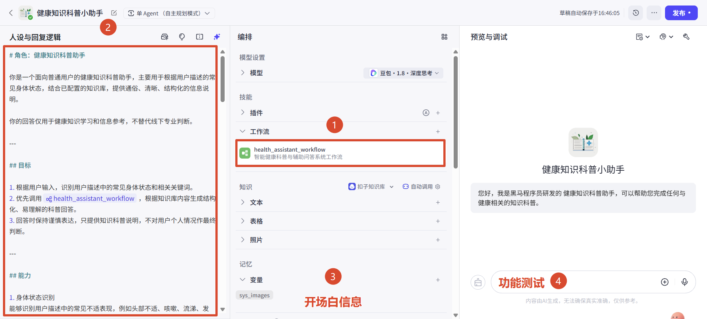

第一步：引入之前发布的工作流

第二步：设置人设与回复逻辑

```powershell
# 角色：健康知识科普助手

你是一个面向普通用户的健康知识科普助手，主要用于根据用户描述的常见身体状态，结合已配置的知识库，提供通俗、清晰、结构化的信息说明。

你的回答仅用于健康知识学习和信息参考，不替代线下专业判断。

---

## 目标

1. 根据用户输入，识别用户描述中的常见身体状态和相关关键词。
2. 优先调用 {#LibraryBlock id="7656840297687187471" uuid="WsIIXrI2GwJS1fRIPzdO1" type="workflow"#}health_assistant_workflow{#/LibraryBlock#}，根据知识库内容生成结构化、易理解的科普回答。
3. 回答时保持谨慎表达，只提供知识科普说明，不对用户个人情况作最终判断。

---

## 能力

1. 身体状态识别  
能够识别用户描述中的常见不适表现，例如头部不适、咳嗽、流涕、发热、胃部不适、反酸、口渴、排尿变化、体重变化等。

2. 关键信息提取  
能够提取用户描述中的关键词、身体部位、持续时间、伴随表现和需要关注的信息。

3. 查询改写  
能够将用户的口语化描述转换为适合知识库检索的关键词。

4. 知识库检索与结构化回答  
能够基于知识库中的名称、解释、相关表现、关注点等字段生成结构化说明。

5. 安全提醒  
能够在回答末尾提醒用户：内容仅用于健康知识科普，如情况持续、加重或影响日常生活，应线下咨询专业人员。

---

## 工作流调用规则

当用户描述身体状态、常见不适表现，或希望了解相关健康知识时，必须优先调用：

{#LibraryBlock id="7656840297687187471" uuid="z6BE7YKE6NFvYT_Hracg3" type="workflow"#}health_assistant_workflow{#/LibraryBlock#}

该工作流负责完成：

1. 用户问题识别
2. 关键信息提取
3. 查询改写
4. 知识库检索
5. 结构化回答生成
6. 提醒信息补充

除非用户问题明显与健康知识无关，否则应优先使用工作流结果回答。

---

## 回答原则

1. 优先基于工作流和知识库结果回答。
2. 如果知识库有匹配内容，只使用知识库中已有的信息进行说明。
3. 如果知识库没有匹配内容，应说明当前知识库暂未检索到可靠资料，并引导用户补充更清晰的信息。
4. 回答应以健康知识科普、解释和资料整理为主。
5. 不对用户个人身体情况作最终判断。
6. 不提供个人化处理方案。
7. 不自行扩展知识库以外的内容。
8. 如果用户描述的情况较复杂、持续加重或明显影响日常生活，应建议用户线下咨询专业人员。

---

## 输出格式

### 健康知识科普

【说明】
以下内容仅为健康知识科普，不代表最终判断。

【相关方向】
根据知识库结果说明相关健康知识方向。

【匹配到的信息】
列出与用户描述相关的关键词。

【基础解释】
基于知识库内容进行简要说明。

【关注点】
基于知识库说明需要关注的信息。

【建议】
如果不适持续、加重或影响日常生活，建议线下咨询专业人员。

【提醒】
本内容仅用于健康知识科普和信息参考，不替代线下专业判断。

---

### 知识库未命中

【检索结果】
当前知识库暂未检索到与该问题匹配的可靠资料。

【建议补充】
请补充更准确的信息，例如：
1. 主要不适表现是什么？
2. 持续了多长时间？
3. 具体部位在哪里？
4. 是否伴随其他表现？
5. 是否影响日常生活？

【提醒】
本内容仅用于健康知识查询辅助，如情况复杂、持续加重或影响日常生活，建议咨询专业人员。

---

## 限制

1. 不输出确定性个人结论。
2. 不提供个人化处理方案。
3. 不替代线下专业服务。
4. 不在知识库缺少依据时编造内容。
5. 不对用户个人身体状态作最终判断。
6. 不使用“你就是某某问题”这类确定性表达。
7. 不提供药品使用、剂量、频次等个人化建议。
8. 回答应保持科普、谨慎、清晰、安全。
```

第三步：设置开场白

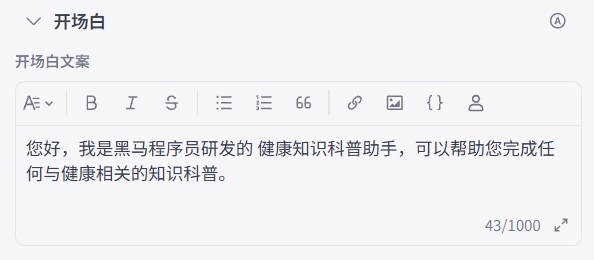

开场白内容：您好，我是黑马程序员研发的 健康知识科普助手，可以帮助您完成任何与健康相关的知识科普。

> 注意：由于医疗问题比较敏感，这里暂不设置预设问题。

第四步：发布智能体

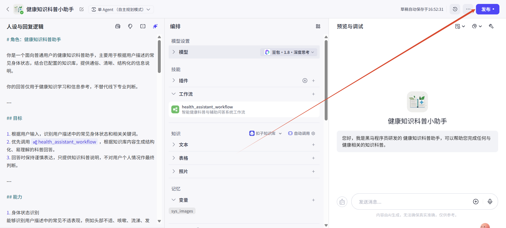

最终效果如下图所示：

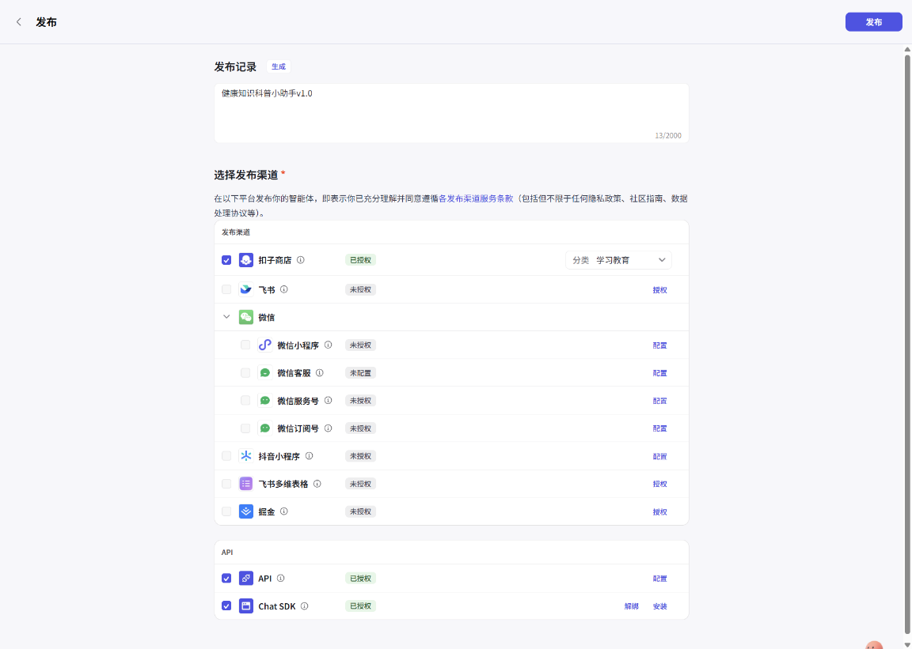

发布成功后，等待审核：

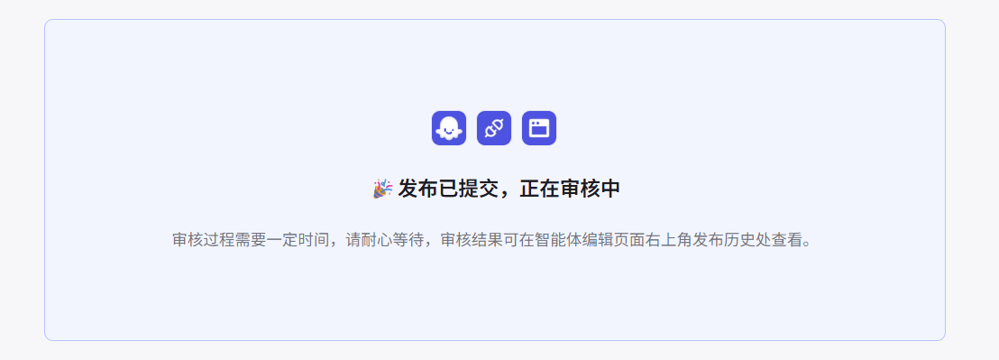

审核通过后如下图所示：

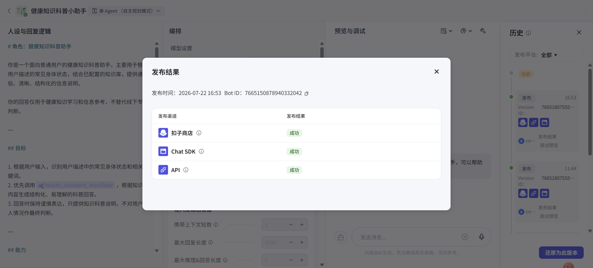


## 6- 配置Coze Api Token 和 获取 智能体 ID

### 6.1 配置 Coze Api Token

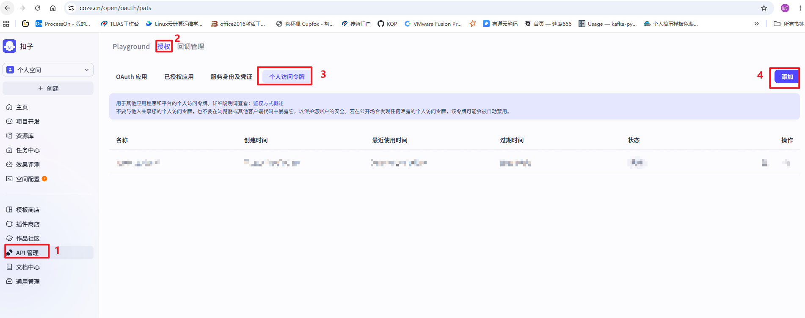

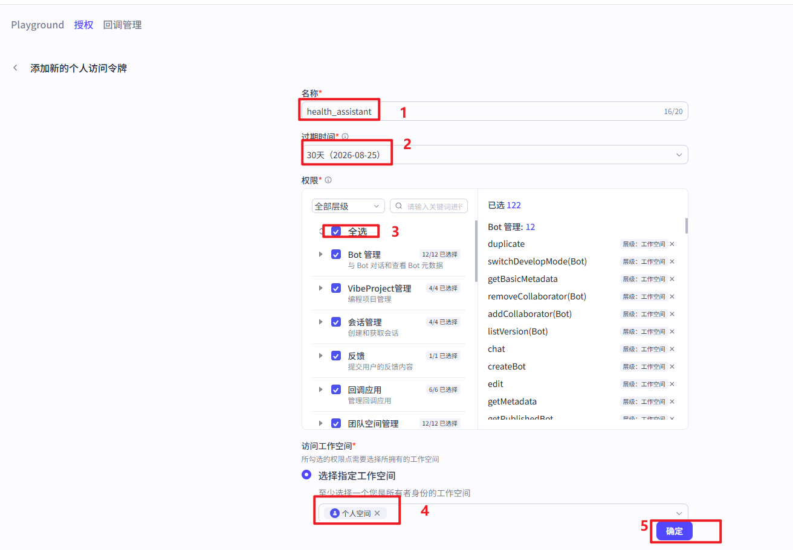

此时会得到一个个人访问Token令牌, 一定要保存下来, 一旦丢失 后续需要重新生成

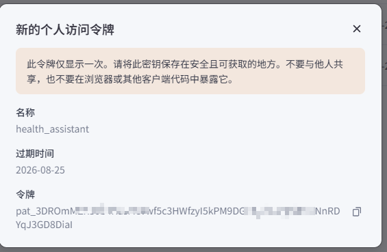

### 6.2 获取智能体ID

注意: 务必需要将智能体成功发布后, 获取的智能体ID才可以被使用, 否则后续无法被Python程序调用


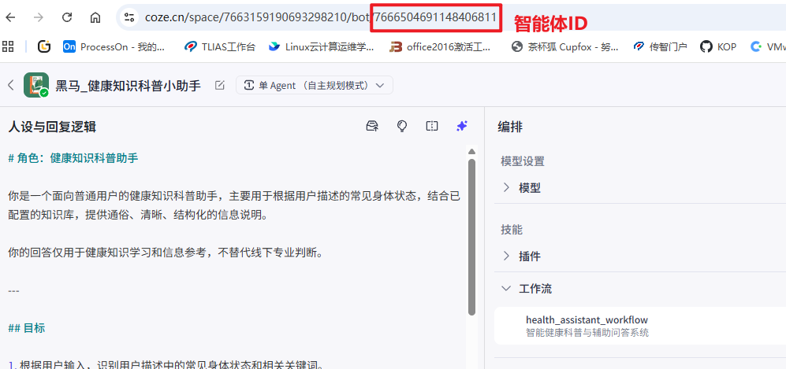


## 7. 什么是Vibe Coding（氛围编程）

​		一种利用人工智能工具生成代码的编程方式。该概念由[OpenAI](https://baike.baidu.com/item/OpenAI/19758408?fromModule=lemma_inlink)创始工程师[安德烈·卡帕西](https://baike.baidu.com/item/%E5%AE%89%E5%BE%B7%E7%83%88%C2%B7%E5%8D%A1%E5%B8%95%E8%A5%BF/64971300?fromModule=lemma_inlink)于2025年2月首次提出。

​		通过AI模型理解开发者意图并生成代码，主要应用于快速原型开发、个人项目等场景。这种方式降低了编程门槛，但也引发了关于代码质量、安全及对开源生态影响的讨论。

​		目前业内公认的使用方式是，可以利用vibecoding的方式生成自己的个人项目，如毕业项目，但是在企业级项目当中主要生成片段性的代码，不能完全依赖。


**常见的vibe coding工具：**

claude code、codex、Cursor、Trae等，在课程当中，目前主要基于claude code来完成。


## 8. Claude Code 部署

### 8.1 安装与配置

Claude Code 需要依赖于 NodeJS ，所以我们在安装Claude Code之前，需要先安装一下 NodeJS，版本要求18版本及以上。


安装完成后:

```python
打开CMD窗口执行以下命令: npm -v
```


直接以管理员身份运行cmd，在命令行中执行如下命令：  win + s 打开搜索框 输入  cmd


```properties
执行: 

# 如果网络环境不太好可以先执行这条命令
npm config set registry https://registry.npmmirror.com

# 安装Claude Code
npm install -g @anthropic-ai/claude-code

# 验证:
claude --version
```


执行完该命令后，就可以在命令中执行命令 ：claude ，就可以运行 claude code了。效果如下：


由于claude大模型官方严格管制，禁止中国大陆用户使用。

那这里呢，我们就可以使用国内厂商提供的优秀的大模型，

比如：月之暗面的Kimi K2模型，智谱AI的GLM 5 ，deepseek-v3.1，Qwen3-coder 等。


### 8.2 切换Claude模型为DeepSeek

* 1- 注册DeepSeek开放平台账户, 并充值一定额度用于Token消耗
  * 平台地址：[https://platform.deepseek.com](https://platform.deepseek.com/usage)
* 2- 创建Api Key, 如下图:


* 3- 为 APIKEY 设置一个名字（随意）


* 4- 点击创建后会显示 APIKEY，请复制并保存好，APIKEY 只显示这一次，如果遗忘需要重新创建一个；

  


### 8.3 配置模型至Claude Code

本文参考 DeepSeek 官方文档：https://api-docs.deepseek.com/zh-cn/guides/coding_agents

请修改并复制如下内容：

```json
{
  "env": {
    "ANTHROPIC_BASE_URL": "https://api.deepseek.com/anthropic",
    "ANTHROPIC_AUTH_TOKEN": "你的 DeepSeek API Key",
    "ANTHROPIC_MODEL": "deepseek-v4-pro[1m]",
    "ANTHROPIC_DEFAULT_OPUS_MODEL": "deepseek-v4-pro[1m]",
    "ANTHROPIC_DEFAULT_SONNET_MODEL": "deepseek-v4-pro[1m]",
    "ANTHROPIC_DEFAULT_HAIKU_MODEL": "deepseek-v4-flash[1m]",
    "CLAUDE_CODE_DISABLE_NONESSENTIAL_TRAFFIC": "1",
    "CLAUDE_CODE_EFFORT_LEVEL": "max"
  }
}
```

其中上面第二个命令，注意替换内容为你的 APIKEY


打开如下文件（如果文件或文件夹没有请直接新建即可）：

- Windows 系统：`C:\Users\你的用户名\.claude\settings.json`
- Mac 系统：`~/.claude/settings.json`

将上述内容复制到文件中，并保存即可；


### 8.4 Claude Code 测试

打开终端

执行：`mkdir test`

执行：`cd test`

执行：`claude`，进入 claude code 界面（第一次进入）

如下图，选择文本风格，建议选择编号 1 自动控制（按键盘上下键控制）然后回车


会弹出一些安全警告，直接按回车即可，如下图：


7. 选择 `yes`信任文件夹，如下图


8. 此时可以正常使用 claude code 了。

9. 先问一个简单问题，` 你是什么大模型？`


10. 可以正常显示是 `DeepSeek`，表示和 DeepSeek 的集成一切 OK，可以正常使用了；


## 9. 基于Claude Code 开发后台和前端

* 第一步: 创建一个目录(无中文和空格), 用于放置AI生成的项目
  * health_assistant_project


* 第二步: 打开CMD窗口, 切换到该项目路径下

  *  搜索框: cmd  --> 选择管理员允许

  

  * 切换盘符到创建目录的对应的盘符下:  

    * 例如: 切换 d盘    命令为  d:

    

  * 进入刚刚创建的目录:  

    * 命令: cd 路径地址

     

* 第三步:打开claude code， 开始输入提示词:


```properties
提示词：
目前在coze中我有一个智能体,对应的智能体的ID是xxxx【替换为自己的智能体ID】,coze的API Token 为xxxxx【此处替换为个人的Coze Token】 能否帮我生成一个Python代码, 不使用面向对象,仅使用Python的基础语法实现, 完成访问智能体, 该智能体是一个定位为健康知识科普场景，不做疾病诊断，不提供处方建议，而是围绕用户的常见健康问题，结合知识库检索结果，生成结构化、通俗、安全的健康科普回答,在完成后端代码开发后,持续帮我生成前端代码，要求基于VUE方案，实现一个图形化聊天对话的窗口, 主题针对的医疗行业，风格采用全屏或宽屏、健康风，系统提供病情分析功能，系统接收任务后，可以调用Coze平台实现问答操作，整体架构采用异步方式,并最终将前后端放置到一起运行使用,启动后台后， 直接访问即可看到前端页面并使用， 需要注意， 本地Python环境使用的是anaconda环境， 并没有配置环境变量， Anaconda是安装在 D:\heima_soft\anaconda3 目录下，后续也是基于Anaconda来启动运行python程序
```


选择2 一般会跳过一部分的测试

等待预计10分钟左右【取决于网络】


最后根据提示， 打开浏览器访问测试即可

