# mysql入门

任何程序安装的时候 不要装在C盘  C盘是系统盘 , 建议不要装在中文目录下

## 数据库概述

```properties
数据库概念: 存储数据的仓库,本质是一个文件系统

数据库分类: 关系型数据和非关系型数据库

关系型数据库: 必须遵循SQL规范,强调以二维表格的形式存储数据
		举例: MySQL  ORACLE  DB2  SqlServer SQLite

非关系型数据: NoSQL不仅仅是SQL,强调以key-value形式存储数据  Not noly sql
		举例: HBase Redis  MongoDB
```

## MySQL数据库连接

>MySQL是最好的 RDMS (Relational Database Management System，关系数据库管理系统) 应用软件，目前属于 Oracle 旗下产品，MySQL 是最流行的关系型数据库管理系统中的一个
>
>本次课程使用MySQL8.0版本， MySQL Community Server进行学习

### 配置环境变量

以后只要需要配置环境变量 按如下步骤操作

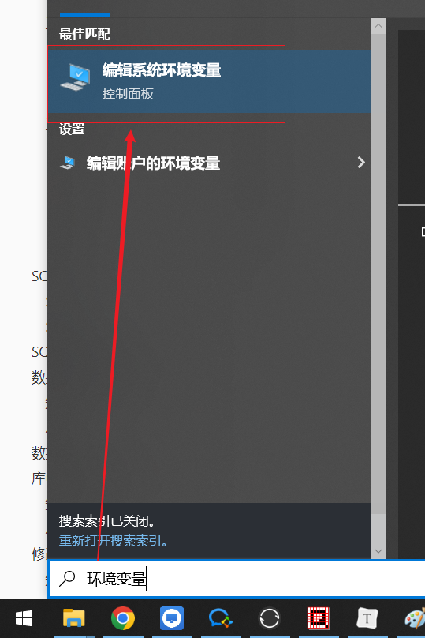

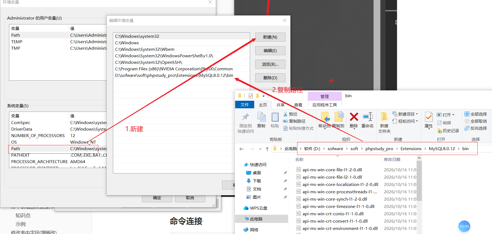

### 命令连接

```properties
u username  用户名
p password  密码
h host      主机
localhost 本机 可以省略不写  或者可以书写 127.0.0.1
登录:
	方式1: mysql -u用户名 -p密码
	方式2: mysql -u用户名 -p 回车后再输入密码
	方式3: mysql -h主机地址 -p 回车后再输入密码
	注意: localhost默认代表本地主机,或者127.0.0.1也代表本机
	
登出: 
	方式1: exit
	方式2: quit
	方式3: \q
	注意: 在mac/linux中使用ctrl+d/ctrl+c也能退出
	
查看ip地址
	window: ipconfig
	mac/linux: ifconfig
```

### 工具连接

sql yog   DataGrip  navicat pycharm....


#### 创建项目

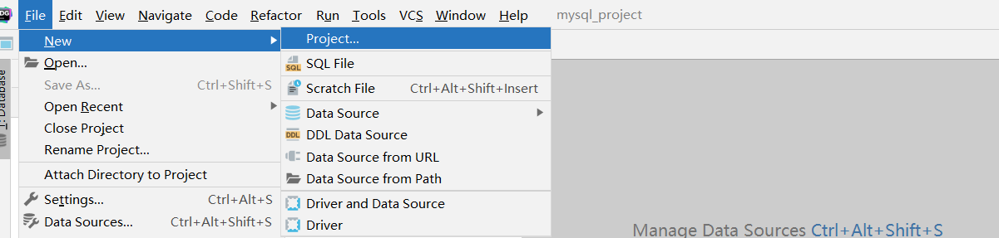

#### 连接mysql服务

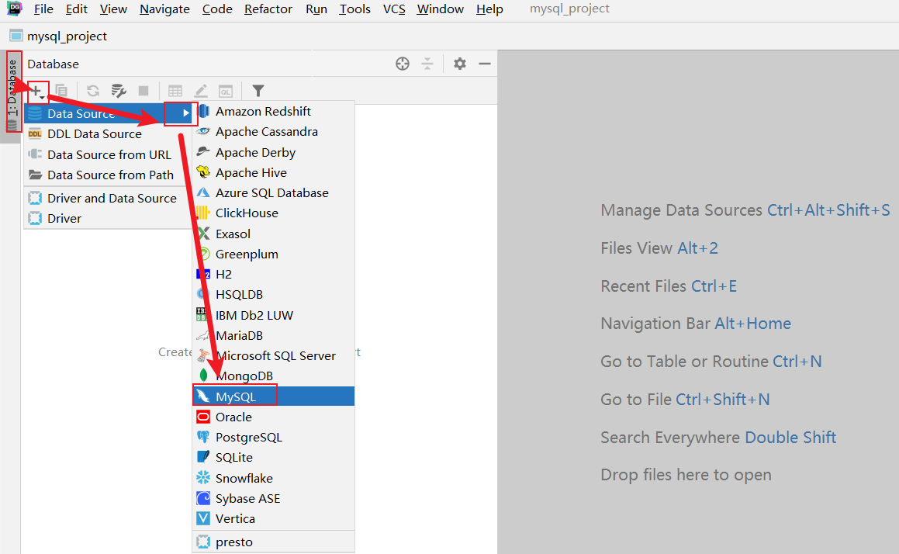

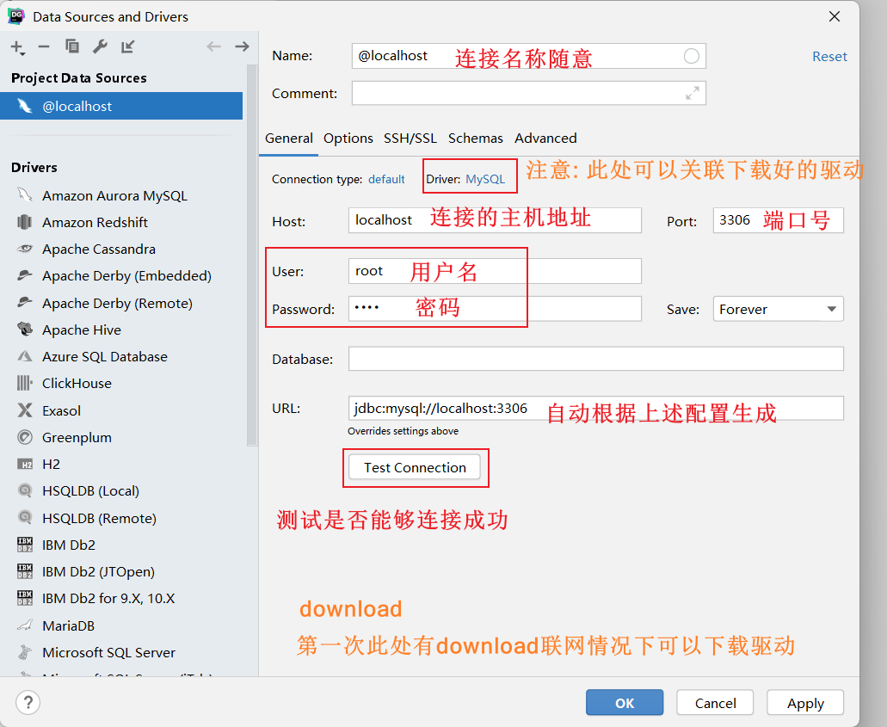

#### 关联驱动

直接点击 download下载即可


下面操作是没有网的时候使用

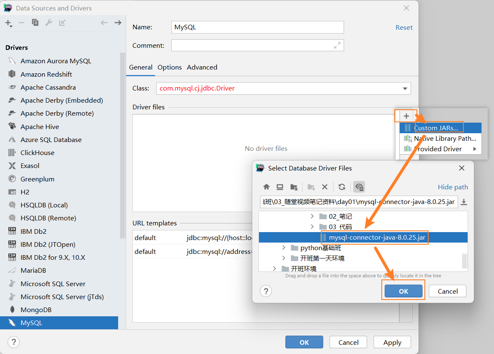

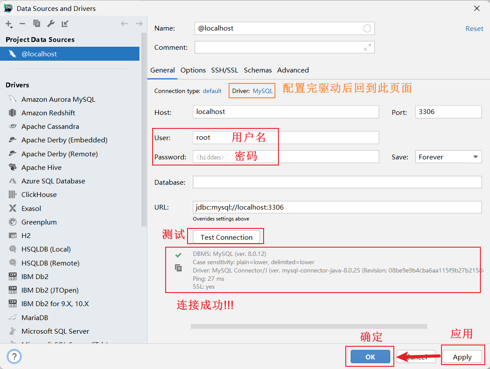

### 工具设置

#### 字体

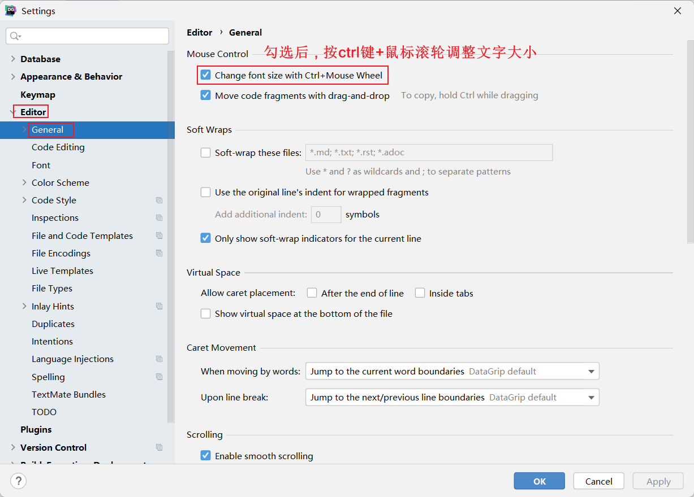

#### 主题

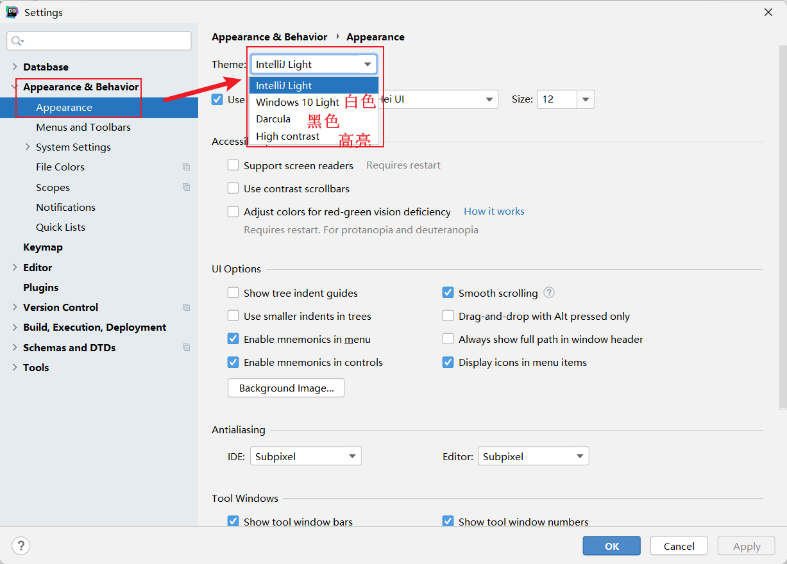

#### mysql相关

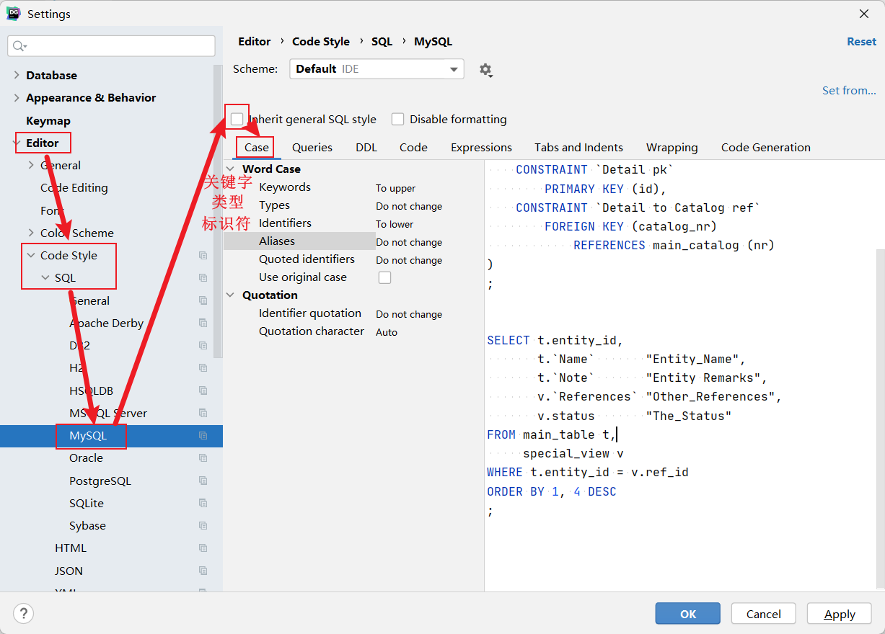

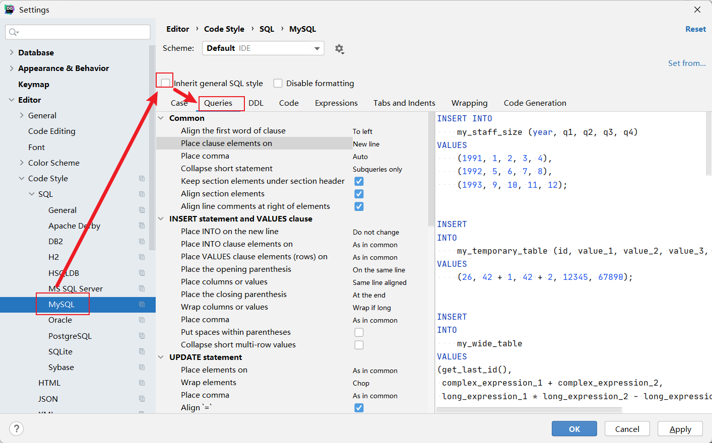

#### 插件

不要使用汉化包！！！！！！！！！！！！！！！！！

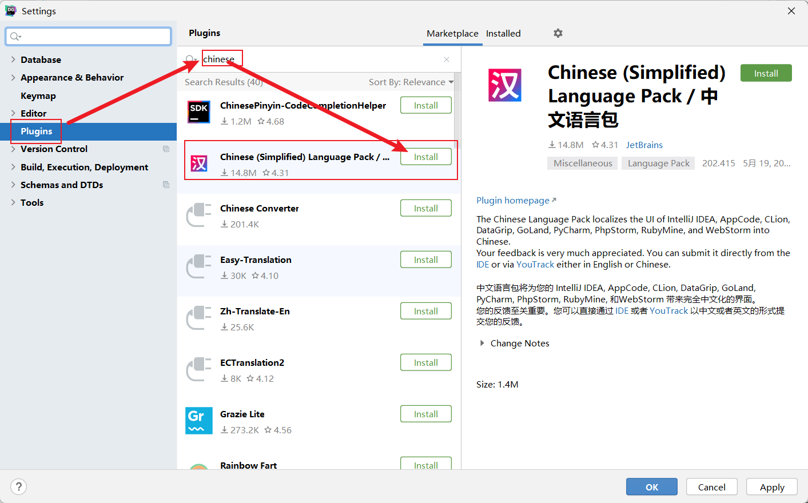

#### 方言

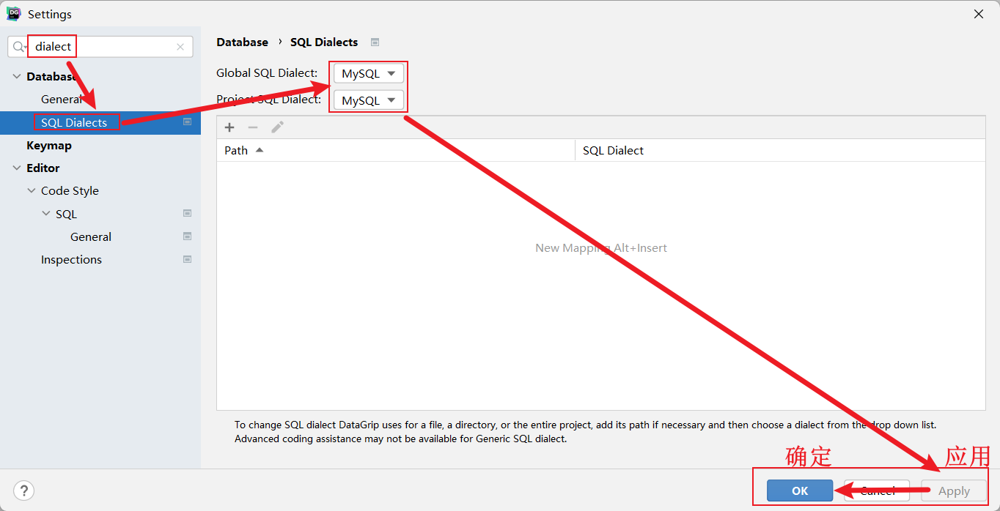


## SQL规范

### SQL简介

```properties
SQL: 结构化查询语言, 是所有关系型数据库都要遵循的规范

大白话解释: 可以理解成sql是普通话,mysql,oracle等是方言
方言: 每个数据库独有的一些内容
99% 都是通用型Sql  1%方言
```

### SQL分类

Sql的分类 大致分为四类(官方定义只有四种) 或者  五类(官方认可四种 另一种程序员自己归类)

```properties
DDL: 数据定义语言:简称DDL(Data Definition Language)
		作用: 用来定义数据库对象：数据库，表，列/字段等。
		关键字: create 创建，drop 删除，alter 修改等
		
DML: 数据操作语言:简称DML(Data Manipulation Language)
		作用:用来对数据库中表的记录进行更新。
		关键字: insert 增，delete 删，update 改等
		

DCL: 数据控制语言：简称DCL(Data Control Language)
		用来定义数据库的访问权限和安全级别，及创建用户。
TCL : 数据事务语言, 专门操作数据库事务的 ( 特殊操作 例如:银行转账等等 .. ) 一般用于多个操作批量进行
		
		
		
DQL: 数据查询语言:简称DQL(Data Query Language) DQL不是官方定义的语言
		作用:用来查询数据库中表的记录。
		关键字: select，from，where等

database 数据库 table 表
```

## SQL通用语法

```properties
1、SQL语句可以单行或多行书写，以分号结尾  允许多个空格或者回车缩进。  
		举例: select *  from 表名 where 条件;
2、可使用空格和缩进来增强语句的可读性
        select *  
        from 表名 
        where 条件;
3、MySQL数据库的SQL语句不区分大小写，关键字建议使用大写
 		例如:select *  from 表名 where 条件; SELECT * FROM 表名 WHERE 条件;
 		大小写切换快捷键: ctrl+shift+u
4、可以使用 /**/，--，# 的方式完成注释
		/**/：多行注释，在注释区域内可以随意换行
		-- 和# ：单行注释，写在语句开头，换行后注释截止。注意: -- 后面必须有一个空格
		单行注释快捷键: ctrl+/         
		多行注释快捷键: ctrl+shift+/

常用
 ctrl + / 单行注释
 ctrl +shift + / 多行注释
 shift +  往前缩进
 table 往后缩进
 ctrl + z 表示撤销
 ctrl +d 复制一行
 ctrl + c 复制
 ctrl + v 粘贴
非常用
 ctrl + shift + z  表示反撤销
 ctrl + x 剪切
 ctrl + a  全选
 shift + end 从当前光标选择到最后结束
 
 
 windows的 
 windows + d 回到桌面
 windows + E 打开我的电脑
 ctrl + w  关闭当前窗口
```

## 数据库增删改查操作

>==数据库英文单词: database==

### 知识点:

```properties
创建数据库: create database [if not exists] 数据库名;  注意: 默认字符集就是utf8

删除数据库: drop database [if exists] 数据库名;

使用/切换数据库: use 数据库名;

查看所有的数据库名: show databases;
查看当前使用的数据库: select database();
查看指定库的建库语句: show create database 数据库名;
```

### 示例:

```sql
# 1.创建数据库:
# 2.删除数据库:
# 3.切换数据库:
# 4.1查看所有库:
# 4.2查看当前库:
# 4.3查看建库语句:
```


```mysql
# 1.创建数据库: ctrl + shift + u
CREATE DATABASE day03;
CREATE DATABASE if not exists day03 CHAR SET  utf8;
# 2.删除数据库:
drop database day03;
# 3.切换数据库:
# 4.1查看所有库:
show databases;
# 使用库
use kettle_demo;
# 4.2查看当前库:
select database();
# 4.3查看建库语句:
show create database kettle_demo;
```

## 数据类型

```properties
字符串类型: varchar(字符长度) 可变长字符 char(字符长度) 固长字符
varchar(10)  -> 12345 -> 不满足十个字符的时候 默认就是字符串本身的长度
char(10)     -> 12345 -> 不足十个十个字符的时候 默认使用空格补齐十个字符

整数类型: int    注意: 默认长度是11,如果int不够用就用bigint

浮点类型: float(python默认) 或者 double(java默认) 有精度问题   decimal(11,0) =(默认是有效位数是11,小数后位数是0)
decimal(11,2) = 十一个数字 但是有两个小数位
日期时间: date  datetime  year
date 只有年月日
datetime 年月日时分秒
timestamp 时间戳(了解)
```

## 库中表增删改查操作

>==表的英文单词: table==

### 知识点:

```properties
创建表: create table [if not exists] 表名(字段1名 字段1类型 [字段1约束] , 字段2名 字段2类型 [字段2约束] ...);

create table 数据库表名称(
 字段名称 类型 [约束],
 字段名称 类型 [约束],
 字段名称 类型 [约束],
 字段名称 类型 [约束]
)
字段名称  任意


删除表: drop table [if exists] 表名;

修改表名: rename table 旧表名 to 新表名;  
	注意: 修改表中字段本质都是修改表,咱们后面演示此处略

查看所有表: show tables;
查看指定表的建表语句: show create table 表名;
```

### 示例:

```sql
# 创建day01_db数据库
# 使用day01_db库
# 操作表的前提: 先创建库,并使用它
# 需求:创建学生表,用于存储学生的姓名,年龄,身高,生日信息
# 删除表
# 修改表名
# 查看所有表
# 查看建表语句
```


```mysql
# 创建day01_db数据库
create database day01_db;
# 使用day01_db库
use day01_db;
# 操作表的前提: 先创建库,并使用它
# 需求:创建学生表,用于存储学生的姓名,年龄,身高,生日信息
create table student(
    id int,
    name VARCHAR(100),
    age int,
    height float,
    birthday date
);
create table test1(
    id int
);
create table IF NOT EXISTS test1(
    id int
);
# 删除表
drop table test1;
drop table IF EXISTS  test1;
# 修改表名
rename TABLE student to stu;
# 查看所有表
show tables;
# 查看建表语句
/*
1.表名字段名都自动加了反引号``,注意: 关键字的会忽略
2.int加了默认长度11
3.所有字段值设置了默认值null
4.如果是字符串类型还设置了默认编码
5.默认选择了存储引擎,有的版本默认myisam,有的版本默认innodb
6.整个表也都设置了默认编码
*/
show create table stu;

```

## 修改表中字段(增删改)

>==列/纵队的英文单词:column==

### 知识点:

```properties
注意: 操作字段本质就是在修改表

添加字段:  alter table 表名 add [column] 字段名 字段类型 [字段约束];

删除字段:  alter table 表名 drop [column] 字段名;

修改字段名和字段类型:  alter table 表名 change [column] 旧字段名 新字段名 字段类型 [字段约束];
modify只修改字段类型: alter table 表名 modify [column]  字段名 字段类型 [字段约束];

查看字段信息: desc 表名;
```

### 示例:

```sql
# 添加字段
# 删除字段
# 修改字段
# 查看字段信息
```


```mysql
# 三.表中字段的增删改查
# 注意: 修改表中字段本质都是在修改表!!!
# 添加字段
alter table stu add weight double ;
# 注意: 如果字段名是关键字,需要用反引号引起来!!!
alter table stu add `desc` VARCHAR(100) ;

# 删除字段
alter table stu drop weight;
alter table stu drop `desc`;

# 修改字段
alter table stu change birthday bir DATETIME;
alter table stu change bir birthday DATETIME;
alter table stu change birthday birthday date;
# 注意: 了解modify,因为只能改类型,所以大家以后直接记change即可
alter table stu MODIFY height DOUBLE;

# 查看字段信息
desc stu;
```

## ==表中记录操作==

### 知识点:

```properties
插入数据记录: insert into 表名 (字段名...) values (具体值...) , (具体值...);   
			注意1: 具体值要和前面的字段名以及顺序一一对应上
			注意2: 如果要插入的是所有字段,那么字段名可以省略(默认代表所有列都要插入数据)
			注意3: 如果要插入多条记录,values后多条数据使用 逗号 分隔
			
修改数据记录: update 表名 set 字段名=值 [where 条件];
			注意: 如果没有加条件就是修改对应字段的所有数据

删除数据记录: delete from 表名 [where 条件];
			注意: 如果没有加条件就是删除所有数据
			
清空所有数据:
    方式1: delete from 表名;   注意:此方式有警告
    方式2: truncate [table] 表名;  注意: 此方式没有警告 
```

### 示例:

```sql
# 创建库
# 使用库
# 创建表
# 插入数据
# 指定字段插入一条数据
# 指定字段插入多条数据
# 不指定字段插入一条数据
# 不指定字段插入多条数据

# 修改数据
# 修改李四的年龄为28
# 修改王五和赵六的年龄为39
# 修改赵六的id为4,年龄为40
# 注意: 如果没有加条件,修改的是所有数据(慎用!!!)


# 删除数据
# 删除id为1的记录
# 删除id为1,以及id为3的记录
# 注意: 如果不加条件删除的是所有数据(慎用!!!)

# 为了演示truncate删除数据,重新插入多条
```


```mysql
/*
操作库的前提: 先启动mysql服务,并连接它
操作表的前提: 先有库,并使用它
操作数据的前提: 先有表,并有对应字段
*/
# 创建库
create database day02_db;
# 使用库
use day02_db;
# 创建表
create table student(
    id int,
    name VARCHAR(100),
    age int
);
# 插入数据
# 指定字段插入一条数据
insert into student(name) values ('张三');
# 指定字段插入多条数据
insert into student(name) values ('李四'),('王五'),('赵六');
# 注意: 不指定字段本质代表指定所有字段
# 不指定字段插入一条数据
insert into student values (1,'张三',18);
# 不指定字段插入多条数据
insert into student values (1,'张三',18),(2,'李四',18),(3,'王五',18);


# 修改数据
# 修改李四的年龄为28
update student set age = 28 where name = '李四';
# 修改王五和赵六的年龄为39
update student set age = 39 where name = '王五' or name = '赵六';
# 修改赵六的id为4,年龄为40
update student set id = 4,age = 40 where name = '赵六';
# 注意: 如果没有加条件,修改的是所有数据(慎用!!!)
update student set age = 12; # 报黄警告!然后弹窗警告,如果非要执行,选择execute


# 删除数据
# 删除id为1的记录
delete from student where id = 1;
# 删除id为1,以及id为3的记录
delete from student where id = 2 or id = 3;
# 注意: 如果不加条件删除的是所有数据(慎用!!!)
delete from student; # 报黄警告!然后弹窗警告,如果非要执行,选择execute

# 为了演示truncate删除数据,重新插入多条
insert into student values (1,'张三',18),(2,'李四',18),(3,'王五',18);
# truncate也能删除所有数据
truncate table student; # 不会警告,官方推荐使用truncate清空数据,为什么? 后面讲解
```


## 表中约束

>==约束作用: 限制数据的插入和删除==

### 主键约束

#### 知识点:

```properties
主键约束关键字: primary key

主键约束特点: 限制主键插入的数据不能为空,不能重复

建表的时候添加主键约束:  create table 表名(主键名 主键类型 primary key , 其他字段...);

注意: 一个表中只能有一个主键
```

#### 示例:

```sql
# 演示各类约束
# 注意: 所有的约束都建议建表的时候添加
# 比如: 如果stu表中已经有重复数据,再去添加主键限制不能重复,添加失败!!!
# 主键约束: 关键字: primary key  特点: 限制值非空唯一
# 添加主键约束方式1: 建表时候添加
# 查看表结构
# 添加主键约束方式2: 建表后添加
# 添加主键约束
# 查看表结构
# 了解删除主键约束
# 删除非空约束
# 注意: 使用change直接删除主键,非空和唯一约束都没有删除
# 查看表结构
# 注意: 使用drop直接删除主键,只是把唯一键删除,不能为空的约束保留
# 查看表结构
# 再使用change删除非空约束
# 查看表结构
# 了解主键约束的特点: 限制值不能为空,不能重复
```


```mysql
/*
没有做任何约束的情况下  允许往数据库插入多条一样的数据 只是无法区分数据
没有约束的时候 数据容易出现错误的情况 (无效数据 冗余数据)
id: 程序中身份标识 必须是唯一 主要用于 区分数据
开发中需要对数据进行一定的约束 管理 : 限制数据的插入和删除
约束有如下几种:
    主键约束          唯一约束     非空约束      默认值约束       外键约束(多表)
    primary key      unique    not null     default
约束的特点:
    主键约束: 主键=唯一+非空    唯一+非空 != 主键  主键有自己的特殊作用
    唯一约束: 表示该列的值必须是唯一 例如: 用户名 身份证 手机号....
    非空约束: 表示该列的值 不能为空 例如: 用户名 密码 ...
    默认值约束: 如果我们没有书写 自己使用默认值 例如 性别 , 日期
添加约束的方式有好几种 : 1.创建表的时候添加约束 2.修改表的时候添加约束 3.创建约束添加到表中
*/
#案例: 插入多条一样的数据
insert into stu(id,name,age,weight,birthday) values(8,'tom',20,188,'2011-01-01');
insert into stu(id,name,age,weight,birthday) values(8,null,20,188,'2011-01-01');


#主键约束  唯一 非空
create table stu2(
    id int primary key,
    name varchar(32),
    age int ,
    height double,
    birthday date
);
#添加数据
#Duplicate entry '1' for key 'PRIMARY' 执行多次,报错. 主键冲突   主键必须是唯一的
insert into stu2(id,name,age,height,birthday) values(2,'jack',18,170,now());
#添加主键为null  Column 'id' cannot be null    主键不能为空
insert into stu2(id,name,age,height,birthday) values(null,'jack',18,170,now());


#主键允许加入 自动增长序列 auto_increment 好处: 保证主键是有值且唯一的
create table stu3(
    id int primary key auto_increment,
    name varchar(32),
    age int ,
    height double,
    birthday date
);
#添加数据 如果有主键自增 我们不需要关心主键
insert into stu3(name,age,height,birthday) values('jack',18,170,now());
#如果有添加自增长序列 主键的位置允许写 0或者null表示让序列自增
insert into stu3(id,name,age,height,birthday) values(null,'jack',18,170,now());
insert into stu3(id,name,age,height,birthday) values(0,'jack',18,170,now());
select * from stu3;
```

#### 图解:

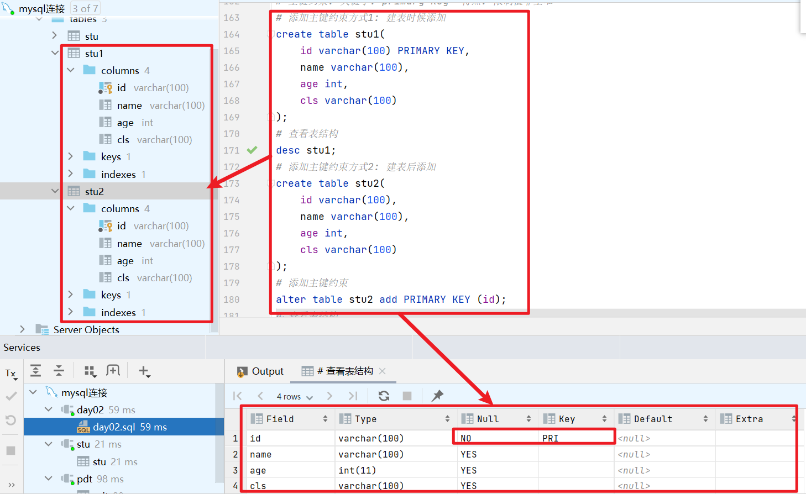

### 主键自增

#### 知识点:

```properties
自增关键字: auto_increment

自增特点: 默认从1开始,每次自动加1  
注意: 如果插入数据的时候指定了id字段,可以使用null或者0占位表示自动使用自增

建表的时候添加主键自增约束:  create table 表名(主键名 主键类型 primary key auto_increment , 其他字段...);
```

#### 示例:

```sql
# 主键自增
# 添加主键自增方式1: 建表后添加
# 注意: 如果要设置主键自增,字段类型需要是整数类型
# 可以同时添加主键和自增,但是前提是表中没有主键
# 注意: 可以单独添加自增,但是前提是表中已经有主键
# 添加主键方式2: 建表时候添加
# 查看表结构
# 了解主键自增的特点: 每次自增1
# 如果设置了主键后,null或者0代表使用主键自增
# 了解自增的删除
# 删除stu2表的自增,主键保留
# 删除stu1表的自增,主键保留
# 删除stu3的主键和自增
```


```mysql
# 主键自增
# 添加主键自增方式1: 建表后添加
# 注意: 如果要设置主键自增,字段类型需要是整数类型
# 可以同时添加主键和自增,但是前提是表中没有主键
alter table stu2 change id id int PRIMARY KEY auto_increment;
# 注意: 可以单独添加自增,但是前提是表中已经有主键
alter table stu1 change id id int auto_increment;

# 添加主键方式2: 建表时候添加
create table stu3(
    id int PRIMARY KEY auto_increment,
    name varchar(100),
    age int,
    cls varchar(100)
);
# 查看表结构
desc stu3;

# 了解主键自增的特点: 每次自增1
# 如果设置了主键后,null或者0代表使用主键自增
insert into stu3(id,name) values (null,'张三'); # 成功 默认第一次编号自动生成了1
insert into stu3(id,name) values (0,'张三'); # 成功
insert into stu3(id,name) values (1,'李四'); # 报错 Duplicate entry '1' for key 'PRIMARY'
insert into stu3(name) values ('王五');


# 了解自增的删除
# 删除stu2表的自增,主键保留
alter table stu2 change id id int ;
# 删除stu1表的自增,主键保留
alter table stu1 change id id int ;

/*
结论: 如果想要删除主键和自增
1.先用change删除自增
2.再用drop删除主键中的唯一约束
3.最后用change删除非空约束
*/
# 删除stu3的主键和自增
alter table stu3 change id id int ;
alter table stu3 drop PRIMARY KEY ;
alter table stu3 change id id int ;
```

#### 图解:

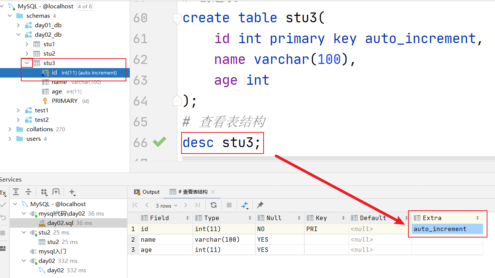


### delete和truncate区别

#### 知识点:

```properties
delete和truncate的区别?
    共同点: 都能删除表中所有数据
    不同点:
        delete删除所有数据: 自增顺序保留,下次再插入的时候继续自增
        truncate删除所有数据: 自增顺序重置,下次再插入数据的时候从1重新开始自增
```

#### 示例:

```mysql
# delete删除所有数据: 自增顺序保留,下次再插入的时候继续自增
delete from stu3; -- 警告2次(慎用)
# 如果再次插入数据,自增顺序按照删除前最后值继续
insert into stu3(name, age) VALUES ('王五',38);
insert into stu3(name, age) VALUES ('王五',38);
insert into stu3(name, age) VALUES ('王五',38);

# truncate删除所有数据: 自增顺序重置,下次再插入数据的时候从1重新开始自增
truncate stu3; -- 没有警告(慎用)如果真要清空所有数据建议用truncate
# 如果再次插入数据,自增重新从1开始自增
insert into stu3(name, age) VALUES ('王五',38);
insert into stu3(name, age) VALUES ('王五',38);
insert into stu3(name, age) VALUES ('王五',38);
```

### 非空约束

#### 知识点:

```properties
非空约束关键字: not null

非空约束特点: 限制对应数据不能为空null

建表的时候添加非空约束:  create table 表名(主键名 主键类型 primary key ,字段名 字段类型 not null , 其他字段...);

注意: 一个表中可以有多个非空约束
```

#### 示例:

```mysql
# 3.非空约束
# 创建表
create table stu4(
    id int not null,
    name varchar(100) not null,
    age int
);

# 查看表结构
desc stu4;

# 演示非空约束特点: 限制数据不能为空null
insert into stu4 (id, name, age) VALUES (1,'张三',18); # 成功
insert into stu4 (id, name, age) VALUES (null,null,null); # 报错,因为id和name不能为空


# 了解建表后添加和删除非空约束
# 添加非空约束
alter table stu4 change age age int not null;
# 删除非空约束
alter table stu4 change age age int;
```

#### 图解

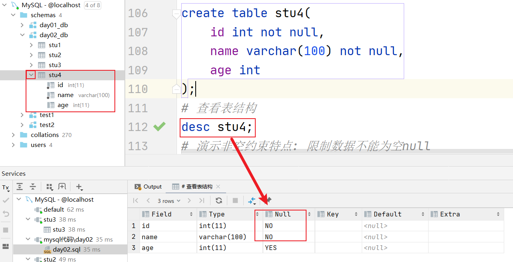


### 唯一约束

#### 知识点

```properties
唯一约束关键字: unique

唯一约束特点: 限制对应的数据不能重复

建表的时候添加唯一约束:  create table 表名(主键名 主键类型 primary key ,字段名 字段类型 unique, 其他字段...);

注意: 一个表中可以有多个唯一约束
```

#### 示例

```mysql
# 4.唯一约束
# 创建表
# 查看表结构
# 演示唯一约束特点: 限制数据不能重复


# 了解建表后添加和删除唯一约束
# 添加唯一约束(自动添加唯一索引,索引名就是字段名)
alter table stu5 change age age int unique ;
# 删除唯一约束(本质就是删除唯一索引)
drop index age on stu5;

# 添加唯一索引(手动添加唯一索引,自定义索引名称)
create unique index age_index on stu5 (age);
# 删除唯一约束(本质就是删除唯一索引)
drop index age_index on stu5;
# 查看表结构
desc stu5;
```


```mysql
# 4.唯一约束
# 创建表
create table stu5(
    id int not null unique ,
    name varchar(100) unique ,
    age int
);
# 查看表结构
desc stu5;
# 演示唯一约束特点: 限制数据不能重复
insert into stu5 (id, name, age) VALUES (1,'张三',18); # 成功
insert into stu5 (id, name, age) VALUES (1,'李四',28); # 报错,因为id不能重复
insert into stu5 (id, name, age) VALUES (null,'王五',null); # 报错,因为id设置唯一约束同时也设置了非空约束


# 了解建表后添加和删除唯一约束
# 添加唯一约束(自动添加唯一索引,索引名就是字段名)
alter table stu5 change age age int unique ;
# 删除唯一约束(本质就是删除唯一索引)
drop index age on stu5;

# 添加唯一索引(手动添加唯一索引,自定义索引名称)
create unique index age_index on stu5 (age);
# 删除唯一约束(本质就是删除唯一索引)
drop index age_index on stu5;
# 查看表结构
desc stu5;
```

#### 图解

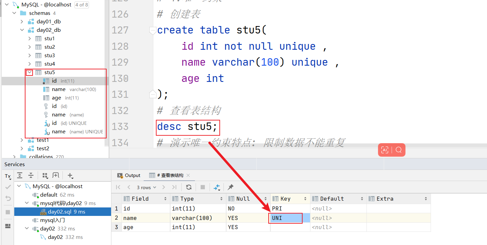


### 默认约束

#### 知识点:

```properties
默认约束关键字: default

默认约束特点: 可以提前给字段设置默认值

建表的时候添加默认约束:  create table 表名(主键名 主键类型 primary key ,字段名 字段类型 default 默认值, 其他字段...);

注意: 一个表中可以有多个默认约束
```

#### 示例:

```mysql
# 5.默认约束
# 创建表
# 查看表结构
# 演示默认约束特点: 如果用户没有指定字段值,可以使用提前设置好的默认值
# 了解建表后添加和删除默认约束
# 添加默认约束

# 删除默认约束


```


```mysql
# 5.默认约束
# 创建表
create table stu6(
    id int primary key auto_increment,
    name varchar(100) default 'admin',
    pwd varchar(100) default '123456'
);
# 查看表结构
desc stu6;

# 演示默认约束特点: 如果用户没有指定字段值,可以使用提前设置好的默认值
insert into stu6(id) values (1);
insert into stu6(name) values ('张三');
insert into stu6(name,pwd) values ('李四','abcde');


# 了解建表后添加和删除默认约束
create table stu7(
    id int primary key auto_increment,
    name varchar(100) ,
    pwd varchar(100)
);
# 添加默认约束
alter table stu7 change name name varchar(100) default 'admin';
alter table stu7 change pwd pwd varchar(100) default '123456';
# 删除默认约束
alter table stu7 change name name varchar(100);
alter table stu7 change pwd pwd varchar(100);

```

#### 图解

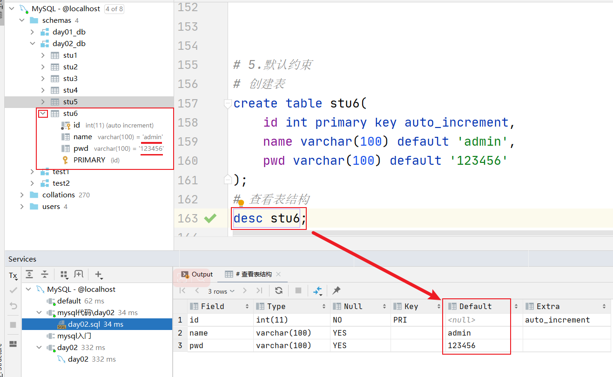


