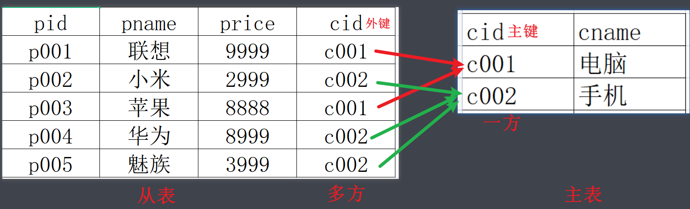
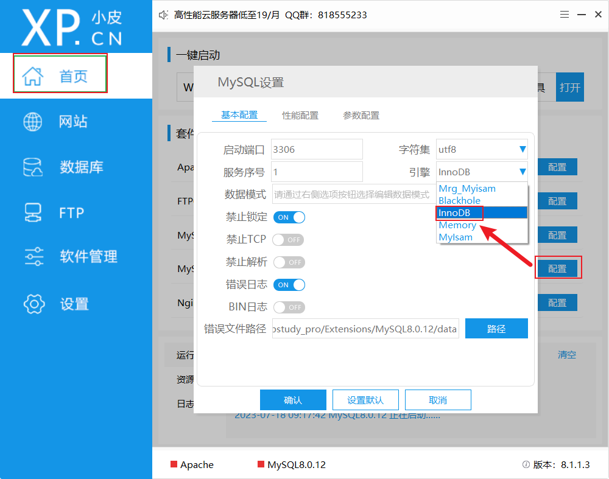
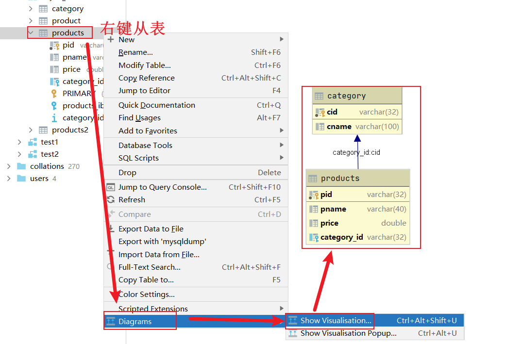
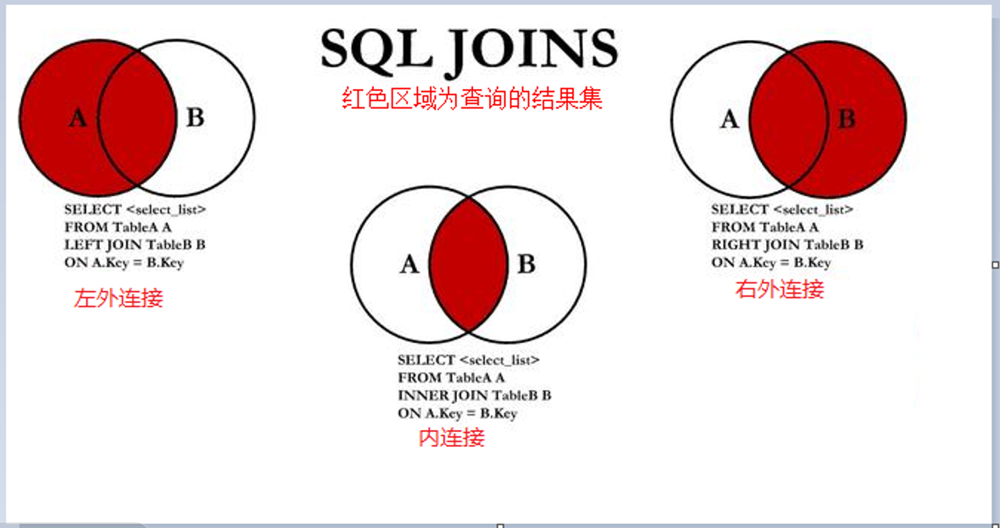
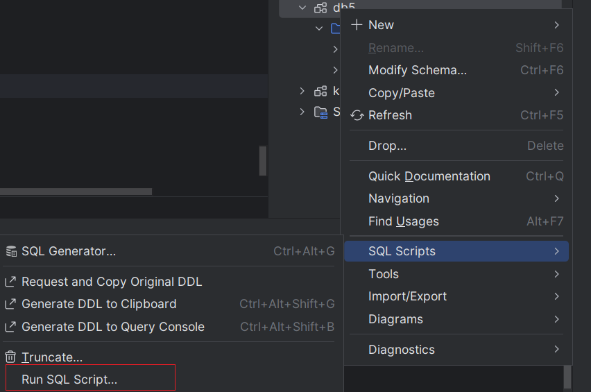

# 多表查询

>==本质: 把多个表通过主外键关联关系连接(join)合并成一个大表,再去查询==

## 外键



```properties
外键概念: 在从表(多方)创建一个字段，引用主表(一方)的主键,对应的这个字段就是外键。

外键特点：
	1:从表外键的值是对主表主键的引用。
	2:从表外键类型，必须与主表主键类型一致。
表关系: 一对多  多对多 一对一
```

## 外键约束[了解]

### 存储引擎

==注意: 只有innodb存储引擎支持外键约束和事务!!!==

**注意1: 关闭mysql服务,再去修改!!!**

**注意2:  修改存储引擎后,只对后面新建的表有效!!!**

>如果是直接安装官方版本的同学,默认已经是innodb,无需修改
>
>如果想知道修改位置,可以告诉你就是你自己mysql安装路径中的my.ini文件



>注意: 修改只对之后建表生效!!!
>
>```sql
># 创建分类表
>CREATE TABLE category1
>(
>    cid   VARCHAR(32) PRIMARY KEY, # 分类id
>    cname VARCHAR(100)             # 分类名称
>);
>
># 商品表
>CREATE TABLE products1
>(
>    pid         VARCHAR(32) PRIMARY KEY,
>    pname       VARCHAR(40),
>    price       DOUBLE,
>    category_id VARCHAR(32),
>    -- 建表时添加外键约束   CONSTRAINT 约束  REFERENCES 引用
>    CONSTRAINT FOREIGN KEY (category_id) REFERENCES category1 (cid) 
>);
>
>-- 删除外键约束
>alter table products1 drop FOREIGN KEY products1_ibfk_1;
>-- 建表后添加外键约束
>alter table products1 add CONSTRAINT wj FOREIGN KEY (category_id)  REFERENCES category1 (cid) ;
>```

### 查看依赖图




### 演示外键约束

```properties
外键约束关键字: foreign key

外键约束语法: [CONSTRAINT 约束名] FOREIGN KEY (外键字段) REFERENCES 主表名(主键字段);

外键约束作用: 
		限制从表插入数据: 如果从表插入的外键值,在主表中不存在,就插入失败
		限制主表删除数据: 如果主表的主键值已经被从表引用,在主表删除该数据的时候,就删除失败
		
外键约束好处: 保证数据的准确性和完整性
```

```sql
create database day05;
use day05;
# 创建分类表
CREATE TABLE category1
(
cid   VARCHAR(32) PRIMARY KEY, # 分类id
cname VARCHAR(100)             # 分类名称
);

# 商品表
CREATE TABLE products1
(
pid         VARCHAR(32) PRIMARY KEY,
pname       VARCHAR(40),
price       DOUBLE,
category_id VARCHAR(32)
);
# 约束: 约束数据不可以随便书写  外键约束: 约束外键字段 保证数据有效性 和 完整性
# 没有约束的时候 数据演示
# 添加数据 主
insert into category1 values('1' , '手机');
insert into category1 values('2' , '电脑');
# 添加数据 从
insert into products1 values('1','华为 mate x20',14999, '1');
insert into products1 values('2','华为 荣耀',8999, '1');
insert into products1 values('3','联想y7000',7999, '2');

#添加一个 主表中不存在的记录
insert into products1 values('4','联想y7000',7999, '3');
insert into products1 values('5','联想y7000',7999, null);


# 删除数据
#主
delete from category1;
#从
delete from products1;
# 没有外键约束的时候 两个表的增加和删除 不会互相影响的


# 有约束的时候 数据演示
# 添加外键约束
# alter table products1 add [constraint] foreign key (从表的字段) references 主表(主键)
# foreign key 外键   references指向   添加外键约束的语法 不要被  会抄即可
alter table products1 add foreign key (category_id) references category1(cid);
#alter table 表名 drop FOREIGN KEY  约束名称(fk_products1)


# 添加数据 先主后从
# 添加数据 主
insert into category1 values('1' , '手机');
insert into category1 values('2' , '电脑');
# 添加数据 从
insert into products1 values('1','华为 mate x20',14999, '1');
insert into products1 values('2','华为 荣耀',8999, '1');
insert into products1 values('3','联想y7000',7999, '2');

#添加一个 主表中不存在的记录  主从表  父子表
# Cannot add or update a child row:  不能添加或者修改子表的数据
insert into products1 values('4','联想y7000',7999, '3');

# 有约束的情况下 允许外键字段为空的  所以开发中有时候 需要将外键字段设置非空
insert into products1 values('5','联想y7000',7999, null);


# 删除数据
#主
# Cannot delete or update a parent row: 不能添加或者修改父表的数据
delete from category1 where cid = 1;
#从
delete from products1 where category_id= 1;

# 外键约束:
# 添加的时候: 先添加主表的数据  再添加从表数据
# 删除的时候: 先删除从表的数据  再删除主表数据
# 开发中不建议使用外键约束 一般使用程序的自己维护数据和数据之间的关系
```


## 连接查询




### 数据准备

```sql
# 使用库
use db3;
# 建测试表
CREATE TABLE products
(
    id          INT PRIMARY KEY AUTO_INCREMENT, -- 商品ID
    name        VARCHAR(24)    NOT NULL,        -- 商品名称
    price       DECIMAL(10, 2) NOT NULL,        -- 商品价格
    score       DECIMAL(5, 2),                  -- 商品评分，可以为空
    is_self     VARCHAR(8),                     -- 是否自营
    category_id INT                             -- 商品类别ID
);

CREATE TABLE category
(
    id   INT PRIMARY KEY AUTO_INCREMENT, -- 商品类别ID
    name VARCHAR(24) NOT NULL            -- 类别名称
);

# 添加测试数据
INSERT INTO category
VALUES (1, '手机'),
       (2, '电脑'),
       (3, '美妆'),
       (4, '家居');

INSERT INTO products
VALUES (1, '华为Mate50', 5499.00, 9.70, '自营', 1),
       (2, '荣耀80', 2399.00, 9.50, '自营', 1),
       (3, '荣耀80', 2199.00, 9.30, '非自营', 1),
       (4, '红米note 11', 999.00, 9.00, '非自营', 1),
       (5, '联想小新14', 4199.00, 9.20, '自营', 2),
       (6, '惠普战66', 4499.90, 9.30, '自营', 2),
       (7, '苹果Air13', 6198.00, 9.10, '非自营', 2),
       (8, '华为MateBook14', 5599.00, 9.30, '非自营', 2),
       (9, '兰蔻小黑瓶', 1100.00, 9.60, '自营', 3),
       (10, '雅诗兰黛粉底液', 920.00, 9.40, '自营', 3),
       (11, '阿玛尼红管405', 350.00, NULL, '非自营', 3),
       (12, '迪奥996', 330.00, 9.70, '非自营', 3);
```


### 交叉连接[慎用]

```properties
交叉连接关键字: cross join

显式交叉连接格式: select * from 左表 cross join 右表;

隐式交叉连接格式: select * from 左表,右表;

注意: 交叉连接了解即可,因为它本质就是一个错误,又叫笛卡尔积(两个表记录数的乘积)

注意: 左表和右表没有特殊含义,只是在前面是左表,在后面的是右表
```

```mysql
# 隐式交叉连接格式: select 字段名 from 左表,右表;
# 显式交叉连接格式: select 字段名 from 左表 cross join右表;


-- 1.交叉连接(笛卡尔积): 是一个错误!!!工作中慎用!!!
# 关键字: cross join
# 隐式交叉连接格式: select 字段名 from 左表,右表;
SELECT *
FROM
    products,
    category;
# 显式交叉连接格式: select 字段名 from 左表 cross join右表;
SELECT *
FROM
    products
        CROSS JOIN category;
```


### 内连接(常用)

```properties
内连接关键字: inner join ... on

显式内连接格式: select * from 左表 inner join 右表 on 关联条件;

隐式内连接格式:  select * from 左表 , 右表 where 关联条件;

注意: 左表和右表没有特殊含义,只是在前面是左表,在后面的是右表
```

```mysql
-- 2.内连接: 两个表的交集
# 隐式内连接格式: select 字段名 from 左表,右表 where 条件;
# 显式内连接格式: select 字段名 from 左表 inner join 右表;


# 关键字: inner join on
# 隐式内连接格式: select 字段名 from 左表,右表 where 条件;
SELECT
    c.id   cid,
    c.name cname,
    p.id   pid,
    p.name pname
FROM
    products p,
    category c
WHERE
    p.category_id = c.id;
# 显式内连接格式: select 字段名 from 左表 cross join右表;
SELECT
    c.id   cid,
    c.name cname,
    p.id   pid,
    p.name pname
FROM
    products p
        INNER JOIN category c ON p.category_id = c.id;
```


### 左外连接

```properties
内连接关键字: left outer join ... on

左外连接格式: select * from 左表 left outer join 右表 on 关联条件;

注意: 左表和右表没有特殊含义,只是在前面是左表,在后面的是右表
```

### 右外连接

```properties
内连接关键字: right outer join ... on

左外连接格式: select * from 左表 right outer join 右表 on 关联条件;

注意: 左表和右表没有特殊含义,只是在前面是左表,在后面的是右表
```

```mysql
-- 需求: 分别使用左右连接查询每个分类下的所有商品,即使没有商品的分类要展示
-- 需求: 分别使用左右连接查询每个分类下的所有商品,即使没有商品的分类要展示


-- 3.外连接
-- 需求: 分别使用左右连接查询每个分类下的所有商品,即使没有商品的分类要展示
-- 为了方便演示插入一条数据
INSERT INTO
    products(name, price, category_id)
VALUES
    ('百草味紫皮腰果', 9, 5);

-- 需求: 分别使用左右连接查询每个分类下的所有商品,即使没有商品的分类要展示
-- 分析: 必须以分类表为主
-- 左外连接: left outer join
SELECT
    c.id   cid,
    c.name cname,
    p.id   pid,
    p.name pname
FROM
    category c
        LEFT OUTER JOIN products p ON p.category_id = c.id;
-- 右外连接: right outer join
SELECT
    c.id   cid,
    c.name cname,
    p.id   pid,
    p.name pname
FROM
    products p
        RIGHT OUTER JOIN category c ON p.category_id = c.id;
```


### 全外连接

```properties
注意: mysql中没有full outer join on这个关键字,所以不能用它来完成全外连接!
所以只能先查询左外连接和右外连接的结果,然后用union或者union all来实现!!!
  union : 默认去重   
  union all: 不去重
  union : 合并,并集
  查询语句 union 查询语句
  查询语句 union all 查询语句
```

```sql
-- 全外连接
# union : 默认去重
SELECT *
FROM
    products p
        LEFT JOIN category c ON p.category_id = c.id
UNION
SELECT *
FROM
    products p
        RIGHT JOIN category c ON p.category_id = c.id;

# union all: 不去重
SELECT *
FROM
    products p
        LEFT JOIN category c ON p.category_id = c.id
UNION ALL
SELECT *
FROM
    products p
        RIGHT JOIN category c ON p.category_id = c.id;
```


## 自连接查询

执行资料中 areas.sql文件



```properties
解释: 两个表进行关联时，如果左表和右边是同一张表，这就是自关联。

注意: 自连接必须起别名!

-- 查询'江苏省'下所有城市
-- 查询'宿迁市'下所有的区县
-- 查询'安徽省'下所有的市,以及市下面的区县信息
-- 需求1: 求每个月和上月的差额
-- 需求2: 求截止到当月累计销售额
```

```sql

-- 查询'江苏省'下所有城市
-- 查询'宿迁市'下所有的区县
-- 查询'安徽省'下所有的市,以及市下面的区县信息
-- 需求1: 求每个月和上月的差额
-- 需求2: 求截止到当月累计销售额


-- 自连接查询
-- 查询'江苏省'下所有城市
SELECT
    shi.id,
    shi.title,
    sheng.id,
    sheng.title
FROM
    areas sheng
        JOIN areas shi ON shi.pid = sheng.id
WHERE
    sheng.title = '江苏省';

-- 查询'宿迁市'下所有的区县
SELECT
    quxian.id,
    quxian.title,
    shi.id,
    shi.title
FROM
    areas shi
        JOIN areas quxian ON quxian.pid = shi.id
WHERE
    shi.title = '宿迁市';

-- 查询'安徽省'下所有的市,以及市下面的区县信息
SELECT
    quxian.id,
    quxian.title,
    shi.id,
    shi.title,
    sheng.id,
    sheng.title
FROM
    areas sheng
        JOIN areas shi ON shi.pid = sheng.id
        JOIN areas quxian ON quxian.pid = shi.id

WHERE
    sheng.title = '江苏省';


-- 自连接的妙用
-- 需求1: 求每个月和上月的差额
SELECT
    c.month,
    c.revenue,
    c.revenue-u.revenue as diff
FROM
    sales c
        JOIN sales u ON c.month = u.month + 1;

-- 需求2: 求截止到当月累计销售额
SELECT
    c.month,
    SUM(u.revenue)
FROM
    sales c
        JOIN sales u ON c.month >= u.month
GROUP BY
    c.month;
```


## 子查询

```properties
子查询:在一个 SELECT 语句中，嵌入了另外一个 SELECT 语句，那么被嵌入的 SELECT 语句称之为子查询语句，外部那个SELECT 语句则称为主查询。


作用: 子查询是辅助主查询的。
    子查询的结果充当主查询的条件
    子查询的结果充当主查询的数据源(临时表)
    子查询的结果充当主查询的查询字段
```

```
-- 1.子查询作为条件使用
-- 需求: 求商品价格大于平均价的商品信息
-- 需求: 求商品价格最高的商品信息(考虑并列情况)
--  查询'河北省'下所有城市
--  查询'邯郸市'下所有区县
-- 需求: 查询'电脑'分类中商品的平均价格,要求结果中包含分类名称
-- 需求: 查询各个分类中商品的平均价格,要求结果中包含分类名称
-- 需求: 计算每个学生的分数和整体平均分的差值
```


```sql
-- 子查询
-- 1.子查询作为条件使用
-- 需求: 求商品价格大于平均价的商品信息
SELECT *
FROM
    products
WHERE
    price > (SELECT AVG(price) FROM products);

-- 需求: 求商品价格最高的商品信息(考虑并列情况)
select *
from products
where price = (select max(price) from products);


--  查询'河北省'下所有城市
select * from areas where pid = (select id from areas where title = '河北省');
--  查询'邯郸市'下所有区县
select * from areas where pid = (select id from areas where title = '邯郸市');


-- 注意:子查询作为表使用必须加括号,同时起别名!!!
-- 需求: 查询'电脑'分类中商品的平均价格,要求结果中包含分类名称
# 思路1: 先合并商品表和分类表,再分组聚合
select c.name,avg(p.price)
from products p JOIN category c ON c.id = p.category_id
group by c.name having c.name = '电脑';

# 思路2: 子查询作为表使用,调优角度: join之前能提前过滤就提前过滤
select c.name,avg(p.price)
from products p JOIN (select * from category where name = '电脑') c ON c.id = p.category_id
group by c.name ;


-- 需求: 查询各个分类中商品的平均价格,要求结果中包含分类名称
# 思路1: 先合并商品表和分类表,再分组聚合
select c.name,avg(p.price)
from products p JOIN category c ON c.id = p.category_id
group by c.name ;
# 思路2: 直接查询商品表中各个分类平均价格,先不考虑名称,最后再去连接查询
select c.name,avg_price
from (select category_id,avg(price) as avg_price from products group by category_id) t
    join category c on t.category_id = c.id;


-- 需求: 计算每个学生的分数和整体平均分的差值
-- 1.既作为字段又作为表
select
    id,
    name,
    gender,
    score,
    avg_score,
    score-avg_score as diff
from students s
    join (select round(avg(score),2) as avg_score from students) t;

-- 2.直接作为字段用
select
    id,
    name,
    gender,
    score,
    (select round(avg(score),2) as avg_score from students) avg_score,
    score-(select round(avg(score),2) as avg_score from students) as diff
from students;
```


## 快速建表复制数据

蠕虫复制: 将一张表的数据 快速复制给另一张表

```sql
-- 快速复制表
# 方式1: 快速建表,再快速插入数据
-- 快速建表
create table db3.product2 like db2.products;
-- 快速插入数据
insert into db3.product2 select * from db2.products where 条件;
# 方式2: 复制表和复制数据一步到位
-- 快速建表
create table db3.product3 as select * from db2.products;

-- 需求: 把db3中的products商品表根据分类拆分成多个表
create table c1 as select * from products where category_id = 1;
create table c2 as select * from products where category_id = 2;
create table c3 as select * from products where category_id = 3;
create table c5 as select * from products where category_id = 5;

```


