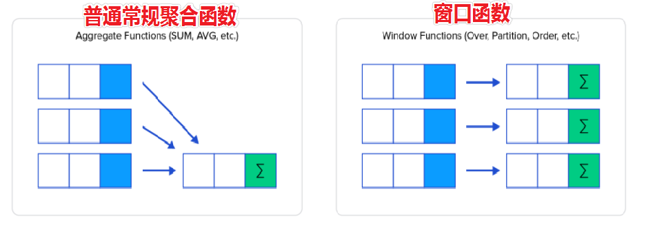

# MySQL函数

所谓的函数 其实就是一个单词加上()   , 这些函数都可以直接使用 是提前定义好的

max() min() sum() avg() count() ifnull()

## 内置函数简介

>在MySQL中有很多内置函数，除了之前学习的聚合函数之外，还有很多其他内置函数：数值函数、字符串函数、时间日期函数、流程控制函数、加解密函数、开窗函数等。
>
>问题：内置函数该如何学习？
>熟悉常用的内置函数，其他用到再查帮助文档
>官网文档：https://dev.mysql.com/doc/refman/8.0/en/functions.html
>在mysql命令行或DataGrip软件中通过 HELP '函数名' 查看指定函数的帮助文档
>    示例: help ‘count’;

## 数值函数

>数值函数分类：
>小数位数处理
>ROUND、FORMAT、TRUNCATE、FLOOR、CEIL
>求余数、求幂、随机数
>MOD、POW、RAND
>
>```sql
>-- 1. 小数位数处理
>
>-- ROUND(X, n)：对 X 进行四舍五入，保留 n 位小数，默认n为0
>SELECT ROUND(1.6);
>SELECT ROUND(1.333, 2);
>SELECT ROUND(2.689, 2);
>
>-- FORMAT(X, n)：对 X 进行四舍五入，保留 n 位小数，以##,###,###.###格式显示
>SELECT FORMAT(1001.6, 2);
>SELECT FORMAT(1123456.333, 2);
>SELECT FORMAT(1234567.689, 2);
>
>-- FLOOR(x)：向下取整
>SELECT FLOOR(-1.5); -- 返回小于这个数的最大整数
>
>-- CEIL(X)：向上取整
>SELECT CEIL(2.1); -- 返回大于这个数的最小整数
>
>
>
>-- 2. 求余数、求幂、随机数
>-- MOD(X, Y)：求 X 除以 Y 的余数
>SELECT MOD(5, 3);
>SELECT MOD(10, 2);
>
>-- POW(X, Y)：X的Y次方
>SELECT POW(2, 3);
>SELECT POW(10, 2);
>
>-- RAND()：返回一个0-1之间的随机数，包含0，不包含1
>SELECT RAND();
>SELECT RAND(5); -- 5是随机数种子，随机数种子一样，生成的随机数就固定不变
>
>
>-- 需求：计算每个月的销量占所有月份销量之和百分比(保留2位小数)
>-- 查询结果字段：
>-- month、sales、sum(所有月份销售之和)、ratio(每月销量占所有月份销量之和的百分比)
>-- 数据准备
>CREATE TABLE `tb_sales` (
>  `month` int(2) NOT NULL,
>  `sales` int(11) NOT NULL
>) ENGINE=InnoDB DEFAULT CHARSET=utf8;
>
>INSERT INTO `tb_sales` VALUES (1,10),(2,23),(3,14),(4,5),(5,32),(6,22),(7,52),(8,12),(9,19),(10,36),(11,33),(12,69);
>-- 查询结果
>SELECT
>    month,
>    sales,
>    (select sum(sales) from tb_sales) as `sum`,
>    round(sales / (select sum(sales) from tb_sales) * 100,2) as ratio
>FROM
>    tb_sales;
>
>```

## 字符串函数

>字符串函数分类：
>大小写转换、反转
>LOWER、UPPER
>字符串反转、拼接、局部替换
>REPEAT、CONCAT、CONCAT_WS、REPLACE
>字符串截取，字符串的字符个数以及存储长度
>SUBSTR、SUBSTRING、LEFT、RIGHT
>字符串长度
>CHAR_LENGTH、LENGTH
>
>```sql
>-- 1. 大小写转换
>-- 转换为小写
>SELECT LOWER('Hello World!');
>
>-- 转换为大写
>SELECT UPPER('Hello World!');
>
>-- 2. 字符串反转、拼接、具体替换
>SELECT REVERSE('123456'); -- '654321'
>
>-- 多个相同字符串拼接
>SELECT REPEAT('象飞田', 3);
>
>-- 字符串拼接
>SELECT CONCAT('马走日', '象飞田');
>SELECT CONCAT(10.15, '%');
>
>-- 指定分隔符拼接字符串
>SELECT CONCAT_WS('^_^', '马走日', '象飞田');
>
>-- 字符串替换
>SELECT REPLACE('赢赢赢士角炮巡河车赢', '赢', '');
>SELECT REPLACE('赢赢赢士角炮巡河车赢', '赢', '输');
>
>-- 3. 字符串截取
>-- SUBSTR(str, n, m)：从 str 字符串的第 n 个字符(注意：n不是下标)往后截取 m 个字符，返回子串；m可省略，表示截取到末尾。
>SELECT SUBSTR('五七炮屏风马', 3, 1);
>
>SELECT SUBSTR('五七炮屏风马', 4);
>SELECT SUBSTRING('五七炮屏风马', 4, 3); -- SUBSTRING与SUBSTR相同
>
>-- 从左或右截取n个字符
>SELECT LEFT('仙人指路，急进中兵', 4);
>SELECT RIGHT('仙人指路，急进中兵', 4);
>
>-- 4. 字符串长度和存储长度
>SELECT CHAR_LENGTH('仙人指路，急进中兵');
>
># 1GB=1024MB
># 1MB=1024KB
># 1KB=1024bytes
>SELECT LENGTH('仙人指路，急进中兵'); -- utf8编码格式一个中文占3个字节
>
>
>-- 示例：编写一个 SQL 查询来修复名字，使得只有第一个字符是大写的，其余都是小写的。
>-- 查询结果字段：
>--  user_id、name（修复后的名字）
>-- 建表
>CREATE TABLE `users` (
>  `user_id` int(11) DEFAULT NULL,
>  `name` varchar(40) DEFAULT NULL
>) ENGINE=InnoDB DEFAULT CHARSET=utf8;
>-- 插入数据
>INSERT INTO `users` VALUES (1,'aLice'),(2,'bOB');
>-- 查询结果
>select concat(upper(left(name,1)),lower(substr(name,2))) from users;
>```

## 时间日期函数

>时间日期函数分类：
>获取当前时间的函数，比如当前的年月日
>NOW、CURRENT_DATE、CURRENT_TIME
>计算时间差的函数，比如两个日期之间相差多少天，一个日期90天后是几月几号
>DATE_ADD、DATE_SUB、DATEDIFF、TIMESTAMPDIFF
>获取年月日的函数，从一个时间中提取具体的年份、月份等
>YEAR、MONTH、DAY、HOUR、MINUTE、SECOND、WEEKDAY
>时间转换的函数，比如将2021-10-05转换为时间戳
>字符串和时间的转换： DATE_FORMAT、STR_TO_DATE
>时间戳和时间的转换： UNIX_TIMESTAMP、FROM_UNIXTIME
>时间戳（数字）：某个时间距离UTC时区的1970-01-01 00:00:00 过去了多久（通常以秒或毫妙为单位）。
>比如：东八区的2023-06-01 17:20:44距离UTC时区的1970-01-01 00:00:00 已经过去了 1685611244 秒
>
>```sql
>-- 1. 获取当前时间
>
>-- 获取当前datetime类型的时间
>SELECT NOW();
>
>-- 获取当前date类型的时间
>SELECT CURRENT_DATE();
>
>-- 获取当前time类型的时间
>SELECT CURRENT_TIME();
>
>-- 2. 计算时间差
>
>-- 计算指定间隔的时间日期
>SELECT DATE_ADD('2024-9-27', INTERVAL 90 DAY); -- INTERVAL 数字 单位
>SELECT DATE_ADD('2024-9-27', INTERVAL -90 DAY);
>SELECT DATE_SUB('2024-9-27', INTERVAL 90 DAY);
>
>-- 示例：获取当前时间3个小时以前的时间
>SELECT DATE_ADD(NOW(), INTERVAL -3 HOUR);
>
>-- 计算两个时间日期之间的天数差
>SELECT DATEDIFF('2024-03-22 09:00:00', '2018-03-20 07:00:00');
>
>-- 计算两个时间日期之间的时间差(自定义时间单位)
>SELECT TIMESTAMPDIFF(MONTH, '2024-03-22 09:00:00', '2018-03-20 07:00:00');
>
>-- 示例：使用TIMESTAMPDIFF函数计算当前时间距离1988年10月24日有多少天
>SELECT TIMESTAMPDIFF(DAY, '1988-10-24', NOW());
>
>-- 3. 提取时间日期中的年月日
>
>-- 获取当前日期中的年份
>SELECT YEAR(NOW());
>
>-- 获取2021-10-02 09:00中月份
>SELECT MONTH('2024-10-02 09:00');
>
>-- 获取时间日期中的日
>SELECT DAY('2024-10-02 09:00');
>
>-- 提取时间日期中的时分秒
>-- 分别运行下面的SQL语句
>SELECT HOUR('2024-10-02 09:01:30');
>SELECT MINUTE('2024-10-02 09:01:30');
>SELECT SECOND('2024-10-02 09:01:30');
>
>-- 计算时间日期是星期几(0是周一，1是周二，依次类推)'
>SELECT WEEKDAY('2024-10-18');
>
>
>-- 4. 时间日期转换
>-- 时间格式化(时间转字符串)
>-- DATE_FORMAT(时间, '转换格式')
>SELECT DATE_FORMAT(NOW(),'%Y-%m-%d %H:%i:%s');
>
>SELECT DATE_FORMAT(NOW(),'%Y-%m-%d %H:%i');
>SELECT DATE_FORMAT(NOW(),'%Y年%m月%d日 %H时%i分%s秒');
>
>-- 字符串转时间
>SELECT STR_TO_DATE('2024-10-20 16:01:45', '%Y-%m-%d %H:%i:%s');
>SELECT STR_TO_DATE('2024-10-20 16:01:45', '%Y-%m-%d');
>
>-- 时间或字符串转时间戳
>-- 时间戳（数字）：某个时间距离UTC时区的1970-01-01 00:00:00 过去了多久（通常以秒或毫妙为单位）。
>SELECT UNIX_TIMESTAMP(NOW()); -- 以秒为单位
>select UNIX_TIMESTAMP('2024-10-20 00:00:00');
>
>-- 时间戳转字符串
>select FROM_UNIXTIME(1729353600, '%Y-%m-%d %H:%i:%s');
>
>select FROM_UNIXTIME(0, '%Y-%m-%d %H:%i:%s'); -- 东八区
>
>
>
>
>
>-- 示例1：查询2020年的登录记录中，每个用户的最后一次登录时间。
>-- 查询结果字段
>--  user_id、last_stamp（2020年最后一次登录时间）
>-- 数据准备
>CREATE TABLE `logins` (
>  `user_id` int(11) DEFAULT NULL,
>  `time_stamp` datetime DEFAULT NULL
>) ENGINE=InnoDB DEFAULT CHARSET=utf8;
>
>
>INSERT INTO `logins` VALUES (6,'2020-06-30 15:06:07'),(6,'2021-04-21 14:06:06'),(6,'2019-03-07 00:18:15'),
>                         (8,'2020-02-01 05:10:53'),(8,'2020-12-30 00:46:50'),(2,'2020-01-16 02:49:50'),
>                         (2,'2019-08-25 07:59:08'),(14,'2019-07-14 09:00:00'),(14,'2021-01-06 11:59:59');
>-- 查询结果
>SELECT
>    user_id,
>    MAX(time_stamp) AS last_time
>FROM
>    logins
>WHERE
>    YEAR(time_stamp) = 2020
>GROUP BY
>    user_id;
>
>-- 示例2：查询温度比前一天（昨天）温度高的记录id
>-- 查询结果字段：id
>-- 数据准备
>CREATE TABLE `weather` (
>  `id` int(11) DEFAULT NULL,
>  `recordDate` date DEFAULT NULL,
>  `temperature` int(11) DEFAULT NULL
>) ENGINE=InnoDB DEFAULT CHARSET=utf8;
>
>INSERT INTO `weather` VALUES (1,'2015-01-01',10),(2,'2015-01-02',25),(3,'2015-01-03',20),(4,'2015-01-04',30);
>-- 查询结果
>SELECT
>    a.id
>FROM
>    weather a
>        JOIN weather b
>             ON DATEDIFF(a.recorddate, b.recorddate) = 1
>WHERE
>    a.temperature > b.temperature;
>```
>
>

## 条件判断

>**case**
>
>​	 **when 条件1 then 值1**
>
>​         **when 条件2 then 值2**
>
>​	**....**
>
>​	**else 值n** 
>
>**end**
>
>
>
>**IF(条件, 值1, 值2)：条件成立，IF的结果就是值1，否则结果就是值2**
>
>
>
>==注意：CASE...END中只有两种条件选择时，可以使用IF函数替代==
>
>```sql
>-- CASE WHEN基本使用
>
>-- 示例1
>-- 需求：查询所有学生的成绩信息，并将学生的成绩分成5个等级，查询结果中需要有一个学生的成绩等级列，
>-- 成绩等级如下：
>-- 优秀：90分及以上
>-- 良好：80-90，包含80
>-- 中等：70-80，包含70
>-- 及格：60-70，包含60
>-- 不及格：60分以下
>-- 查询结果字段：
>--  name(姓名)、course(科目)、score(成绩)、grade(成绩等级)
>-- 数据准备
>CREATE TABLE `tb_score` (
>`name` varchar(24) NOT NULL,
>`course` varchar(24) NOT NULL,
>`score` decimal(5,2) NOT NULL
>) ENGINE=InnoDB DEFAULT CHARSET=utf8;
>
>INSERT INTO `tb_score` VALUES ('张三','语文',81.00),('张三','数学',75.00),('李四','语文',76.00),
>                      ('李四','数学',90.00),('王五','语文',81.00),('王五','数学',100.00);
>-- 查询结果
>SELECT *,
>  CASE
>      WHEN score >= 90 THEN '优秀'
>      WHEN score >= 80 THEN '良好'
>      WHEN score >= 70 THEN '中等'
>      WHEN score >= 60 THEN '及格'
>      ELSE '不及格'
>      END AS grade
>FROM
>tb_score;
>
>
>-- 分组条件计数
>-- 示例1：统计不同科目中，成绩在90分以上(包含90)和90分以下的人数各有多少
>-- 查询结果字段：
>-- course(科目)、gte_90(该科目90分以上是学生人数)、lt_90(该科目90分以下的学生人数)
># 方式1
>SELECT
>course,
>COUNT(
>       CASE WHEN score >= 90 THEN 1 ELSE NULL END
>   ) AS gte_90,
>COUNT(
>       CASE WHEN score < 90 THEN 1 ELSE NULL END
>   ) AS lt_90
>FROM
>tb_score
>GROUP BY
>course;
>
># 方式2
>SELECT
>course,
>sum(
>       CASE WHEN score >= 90 THEN 1 ELSE 0 END
>   ) AS gte_90,
>sum(
>       CASE WHEN score < 90 THEN 1 ELSE 0 END
>   ) AS lt_90
>FROM
>tb_score
>GROUP BY
>course;
>
>
>
>
>
>-- 扩展：面试题
>-- 条件更新
>-- 语法：UPDATE 表名 SET 列名=值 [WHERE 条件];
>
>-- 示例1：实现一条update更新商品的价格，要求价格高于3000（包含）的降价10%，低于3000的上涨20%
>-- 使用：product数据表
>-- 数据准备
>CREATE TABLE `product` (
>`Product` varchar(100) DEFAULT NULL,
>`Price` decimal(10,2) DEFAULT NULL
>) ENGINE=InnoDB DEFAULT CHARSET=utf8;
>
>
>INSERT INTO `product` VALUES ('笔记本',3050.00),('手机',2800.00),('台式电脑',2050.00);
>-- 查询
>-- 方式1:两条语句
>update product set price = price*0.9 where price >=3000;
>update product set price = price*1.2 where price < 3000;
>-- 方式2:一条语句
>UPDATE product
>SET price = CASE
>           WHEN price >= 3000 THEN price * 0.9
>           ELSE price * 1.2
>       END;
>
>-- IF(条件, 值1, 值2)：条件成立，IF的结果就是值1，否则结果就是值2
>-- 注意：CASE...END中只有两种条件选择时，才可以使用IF函数替代
>UPDATE product
>SET price = IF(Price>=3000,Price*0.9,Price*1.2);
>
>-- 示例2：多行变一行（行转列）
>-- 注意：只要是多行变一行，首先要想到的就是分组聚合操作。
>-- 使用：score数据表
>CREATE TABLE `score` (
>`学号` varchar(24) DEFAULT NULL,
>`科目` varchar(24) DEFAULT NULL,
>`成绩` int(11) DEFAULT NULL
>) ENGINE=InnoDB DEFAULT CHARSET=utf8;
>
>INSERT INTO `score` VALUES ('s001','语文',90),('s001','数学',100),('s001','英语',93),('s002','语文',98),('s002','数学',99),('s002','英语',96);
>-- 查询
>select 学号,
>max(if(科目='语文',成绩,NULL)) as `语文`,
>max(if(科目='数学',成绩,NULL)) as `数学`,
>max(if(科目='英语',成绩,NULL)) as `英语`
>from score
>group by 学号;
>
>
>-- 示例3：一行变多行（列转行）
>-- 使用：w_score数据表
>CREATE TABLE `w_score` (
>`学号` varchar(24) DEFAULT NULL,
>`语文` bigint(11) DEFAULT NULL,
>`数学` bigint(11) DEFAULT NULL,
>`英语` bigint(11) DEFAULT NULL
>) ENGINE=InnoDB DEFAULT CHARSET=utf8;
>
>INSERT INTO `w_score` VALUES ('s001',90,100,93),('s002',98,99,96);
>-- 查询
>select 学号,'语文' as 科目,语文 as 成绩 from w_score
>union
>select 学号,'数学' as 科目,数学 as 成绩 from w_score
>union
>select 学号,'英语' as 科目,英语 as 成绩 from w_score
>order by 学号,field(科目, '语文', '数学','英语');
>```
>
>


## 开窗函数

>==作用：查询每一行数据时，使用指定的窗口函数对每行关联的一组数据进行处理。==
>
>
>
>基本语法：<ranking function> OVER (ORDER BY 列名, ...)
>OVER(...)的作用就是设置每一行数据关联的一组数据范围，OVER()时，每行关联的数据范围都是整张表的数据。
><window function>表示使用的窗口函数，窗口函数可以使用之前已经学过的聚合函数，比如COUNT、SUM、AVG、MAX、MIN等，也可以ROW_NUMBER、RANK、DENSE_RANK等，后面会依次介绍。
>
>常用排序函数:
>
>**RANK()**：产生的排名序号 ，有并列的情况出现时序号不连续
>**DENSE_RANK()** ：产生的排序序号是连续的，有并列的情况出现时序号会重复
>**ROW_NUMBER()** ：返回连续唯一的行号，排名序号不会重复
>
>其他函数:
>
>**NTILE(X)**：将每个分区的数据均匀的分成X组，返回每行对应的组号
>**LAG(字段, [N], [M])**：返回分区中当前行前第N行的指定字段的内容，如果没有，默认返回M
>**LEAD(字段, [N], [M])**：返回分区中当前行后第N行的指定字段的内容，如果没有，默认返回M
>...

```properties
开窗函数控制范围: rows between
                    - x preceding:往前x行
                    - x following:往后x行
                    - current row:当前行
                    - unbounded: 起点
                    - unbounded preceding :表示从前面的起点  第一行
                    - unbounded following :表示到后面的终点  最后一行    
                    
                    默认第一行到当前行: unbounded preceding and current row
```


>```sql
># ----------------------------------- 1. 窗口函数简介 -----------------------------------
>
>-- 窗口函数是 MySQL8.0 以后加入的功能，之前需要通过定义临时变量和大量的子查询才能完成的工作，使用窗口函数实现起来更加简洁高效
>
>-- 示例1：针对 students 表的数据，计算每个同学的Score分数和整体平均分数的差值
>-- 数据准备
>CREATE TABLE `students`
>(
>`ID`     INT(11)       NOT NULL AUTO_INCREMENT,
>`Name`   VARCHAR(24)   NOT NULL,
>`Gender` VARCHAR(8)    NOT NULL,
>`Score`  DECIMAL(5, 2) NOT NULL,
>PRIMARY KEY (`ID`)
>);
>
>
>INSERT INTO
>`students`
>VALUES
>(1, 'smart', 'Male', 90.00),
>(2, 'linda', 'Female', 81.00),
>(3, 'lucy', 'Female', 83.00),
>(4, 'david', 'Male', 94.00),
>(5, 'Tom', 'Male', 92.00),
>(6, 'Jack', 'Male', 88.00);
>-- 查询
>SELECT *,
>  AVG(score) OVER ()         AS `avg`,
>  score - AVG(score) OVER () AS `difference`
>    FROM
>    students;
>    
>    
>    # ------------------------------------ 2. 窗口函数基础用法 -----------------------------------
>-- 窗口函数的作用是在处理每行数据时，针对每一行关联的一组数据进行处理。
>
>-- 基础语法：<window function> OVER(...)
>-- <window function> 表示使用的窗口函数，窗口函数可以使用之前已经学过的聚合函数，比如COUNT()、SUM()、AVG()等，也可以是其他函数，比如 ranking 排序函数等，后面的课程中会介绍
>    -- OVER(...)的作用就是设置每行数据关联的窗口数据范围，OVER()时，每行关联的数据范围都是整张表的数据。
>
>    -- SQL示例
>    
>    SELECT
>    id,
>    name,
>    gender,
>score,
>-- OVER()：表示每行关联的窗口数据范围都是整张表的数据
>     -- AVG(Score)：表示处理每行数据时，应用 AVG 对每行关联的窗口数据中的 Score 求平均
>     AVG(score) OVER () AS `AVG_Score`
>FROM
>    students;
>
>
>
>-- 典型应用场景1：计算每个值和整体平均值的差值
>
>-- 示例1
># 需求：计算每个学生的 Score 分数和所有学生整体平均分的差值。
># 查询结果字段：
>#   ID、Name、Gender、Score、AVG_Score(学生整体平均分)、difference(每位学生分数和整体平均分的差值)
>SELECT *,
>  AVG(score) OVER ()         AS avg_score,
>  score - AVG(score) OVER () AS diff
>    FROM
>    students;
>    
>    
>    -- 典型应用场景2：计算每个值占整体之和的占比
>    
>    # 需求：计算每个学生的Score分数占所有学生分数之和的百分比
># 查询结果字段：
>    #   ID、Name、Gender、Score、sum(所有学生分数之和)、ratio(每位学生分数占所有学生分数之和的百分比)
>SELECT *,
>  SUM(score) OVER () AS sum_score,
>  score / SUM(score) OVER () * 100
>FROM
>students;
>
>
># ----------------------------------- 3. PARTITION BY分区 -----------------------------------
>
>-- 基本语法：<window function> OVER(PARTITION BY 列名, ...)
>     -- PARTITION BY 列名, ...的作用是按照指定的列对整张表的数据进行分区
>     -- 分区之后，在处理每行数据时，<window function>是作用在该行数据关联的分区上，不再是整张表上
>
>    -- SQL 示例
>
>SELECT
>id,
>name,
>gender,
>score,
>-- PARTITION BY Gender：按照性别对整张表的数据进行分区，此处会分成2个区
>-- AVG(Score)：处理每行数据时，应用 AVG 对该行关联分区数据中的 Score 求平均
>     AVG(score) OVER (PARTITION BY gender) AS `Avg`
>     FROM
>students;
>    
>-- 应用示例
>
>-- 示例1
>-- 需求：计算每个学生的 Score 分数和同性别学生平均分的差值
>-- 查询结果字段：
>--  ID、Name、Gender、Score、Avg(同性别学生的平均分)、difference(每位学生分数和同性别学生平均分的差值)
>SELECT *,
>  AVG(score) OVER (PARTITION BY gender)         AS gender_score,
>  score - AVG(score) OVER (PARTITION BY gender) AS diff
>FROM
>students;
>    
>    
>    -- 示例2  参考tb_score表
>    -- 需求：计算每人各科分数与对应科目最高分的占比
>    -- 查询结果字段：
>    --  name、course、score、max(对应科目最高分数)、ratio(每人各科分数与对应科目最高分的占比)
>    SELECT *,
>  MAX(score) OVER (PARTITION BY course) AS max_score,
>      score / MAX(score) OVER (PARTITION BY course) * 100 as ratio
>FROM
>tb_score;
>
>
>
>-- 补充：PARTITION BY 和 GROUP BY的区别
>-- 使用场景不同
>-- PARTITION BY用在窗口函数中，结果是：一进一出
>     -- GROUP BY用在分组聚合中，结果是：多进一出
>     
>-- 分组聚合：统计每个科目的最高分
>    SELECT
>course,
>MAX(score) AS `max`
>FROM
>tb_score
>GROUP BY
>course;
>
>     -- 窗口函数：查询每行数据时，都对这行所属科目求了一个最高分
>     SELECT
>name,
>    course,
>score,
>MAX(score) OVER (PARTITION BY course) AS `max`
>FROM
>tb_score;
>
>
># ----------------------------------- 4. 排名函数 -----------------------------------
>
>-- 基本语法：<ranking function> OVER (ORDER BY 列名, ...)
>-- OVER() 中可以指定 ORDER BY 按照指定列对每一行关联的分区数据进行排序，然后使用排序函数对分区内的每行数据产生一个排名序号
>    
>    -- SQL 示例
>SELECT
>    name,
>course,
>    score,
>-- 此处 OVER() 中没有 PARTITION BY，所以整张表就是一个分区
>-- ORDER BY score DESC：按照 score 对每个分区内的数据降序排序
>-- RANK() 窗口函数的作用是对每个分区内的每一行产生一个排名序号
>    RANK() OVER (ORDER BY score DESC) AS `rank`
>    FROM
>    tb_score;
>    
>-- 排名函数
>    -- RANK()：产生的排名序号 ，有并列的情况出现时序号不连续
>-- DENSE_RANK() ：产生的排序序号是连续的，有并列的情况出现时序号会重复
>-- ROW_NUMBER() ：返回连续唯一的行号，排名序号不会重复
>
>
>-- PARTITION BY和排序函数配合
>
>-- 示例1：
>-- 需求：按照不同科目，对学生的分数从高到低进行排名(要求：连续可重复)
>-- 查询结果字段：
>    --  name、course、score、dense_rank(排名序号)
>    SELECT *,
>      DENSE_RANK() OVER (PARTITION BY course ORDER BY score DESC) as dr
>    FROM
>    tb_score;
>    
>    
>
>    -- 典型应用：获取指定排名的数据
>
>-- 示例2
>-- 需求：获取每个科目，排名第二的学生信息
>-- 查询结果字段：
>--  name、course、score
>SELECT *
>FROM
>(SELECT *,
>       DENSE_RANK() OVER (PARTITION BY course ORDER BY score DESC) AS dr
>FROM
>    tb_score) t
>WHERE
>dr = 2;
>
>     
>
>    
>
>
>
>
>-- CTE(公用表表达式)
>-- CTE(公用表表达式)：Common Table Expresssion，类似于子查询，相当于一张临时表，可以在 CTE 结果的基础上，进行进一步的查询操作。
>-- 基础语法
>/*
>WITH tmp1 AS (
>-- 查询语句
>), tmp2 AS (
>    -- 查询语句
>     ), tmp3 AS (
>     -- 查询语句
>     )
>SELECT
>    字段名
>FROM 表名;
>*/
>
>-- 示例1
>-- 需求：获取每个科目，排名第二的学生信息
>-- 查询结果字段：
>--  name、course、score
>WITH
>temp AS (SELECT *,
>               DENSE_RANK() OVER (PARTITION BY course ORDER BY score DESC) AS dr
>        FROM
>            tb_score
>)
>    
>SELECT *
>    FROM
>temp
>    WHERE
>dr = 2;
>
>    
>
>
>
>
>-- NTILE(X)窗口函数：将每个分区的数据均匀的分成X组，返回每行对应的组号
>
>-- 示例1：将所有的拍卖信息按照浏览次数排序，并均匀分成4组，添加组号
>-- 查询结果字段：
>    --  id、views(浏览次数)、quartile(分组序号)
>     -- 数据准备
>     CREATE TABLE `auction` (
>     `id` int(11) NOT NULL,
>    `category_id` int(11) DEFAULT NULL,
>`asking_price` decimal(10,2) DEFAULT NULL,
>`final_price` decimal(10,2) DEFAULT NULL,
>`views` int(11) DEFAULT NULL,
>    `participants` int(11) DEFAULT NULL,
>`country` varchar(50) DEFAULT NULL,
>    `ended` date DEFAULT NULL,
>PRIMARY KEY (`id`) USING BTREE
>) ;
>
>
>INSERT INTO `auction` VALUES (1,1,190.07,219.66,93,16,'Spain','2017-01-05'),(2,4,34.70,54.70,187,31,'Spain','2017-01-05'),
>                     (3,5,124.85,155.95,237,59,'Spain','2017-01-05'),(4,3,141.42,205.73,289,58,'Spain','2017-01-06'),
>                     (5,2,31.11,66.45,165,83,'Spain','2017-01-09'),(6,3,106.18,125.07,27,3,'Spain','2017-01-06'),
>                     (7,2,124.83,150.93,266,53,'Spain','2017-01-06'),(8,1,151.71,164.54,158,53,'Spain','2017-01-08'),
>                     (9,4,51.44,87.02,235,59,'France','2017-01-05'),(10,2,118.97,178.21,191,38,'France','2017-01-05'),
>                     (11,5,38.50,69.61,44,7,'France','2017-01-06'),(12,4,20.87,35.57,298,37,'France','2017-01-08'),
>                     (13,2,56.45,112.42,267,45,'Germany','2017-01-05'),(14,3,189.20,242.16,234,33,'Germany','2017-01-06'),
>                     (15,2,43.15,88.01,92,12,'Germany','2017-01-06'),(16,5,158.92,179.18,17,2,'Germany','2017-01-06'),
>                     (17,1,64.55,129.46,155,78,'UK','2017-01-05'),(18,4,196.07,237.86,63,21,'UK','2017-01-05'),
>                       (19,2,171.26,190.57,194,39,'UK','2017-01-06'),(20,3,157.81,206.63,218,31,'Italy','2017-01-05'),
>                       (21,2,135.16,197.43,47,12,'Italy','2017-01-07'),(22,4,172.98,197.07,297,42,'Italy','2017-01-06'),
>                       (23,5,163.89,218.99,90,18,'Italy','2017-01-09'),(24,3,115.76,137.49,136,19,'Italy','2017-01-06'),
>                       (25,3,149.89,208.09,25,3,'Italy','2017-01-07');
>  -- 查询
>  SELECT
>  id,
>  views,
>  -- 按照浏览量降序，然后把分区数据划分为4组，产生每一行对应的组序号
>NTILE(4) OVER (ORDER BY views DESC) AS `quartile`
>FROM
>auction;
>
>     -- 示例2：获取浏览次数前四份之一的拍卖信息。
>     -- 查询结果字段
>     --  id、views(浏览次数)
>     WITH
>     temp AS (
>        SELECT
>            id,
>            views,
>            -- 按照浏览量降序，然后把分区数据划分为4组，产生每一行对应的组序号
>            NTILE(4) OVER (ORDER BY views DESC) AS `quartile`
>        FROM
>            auction
>)
>SELECT id,views
>    FROM
>    temp
>    WHERE
>    quartile = 1;
>
>    
>
>
>
>
>
>    
>     
>     -- LAG(字段, [N], [M])：返回分区中当前行前第N行的指定字段的内容，如果没有，默认返回M
>     -- 注意：M和N可以省略，N默认为1，M默认为NULL。
>     SELECT *,
>       -- 等效于：LAG(sales) OVER(ORDER BY month) AS `next_sales`
>       LAG(sales) OVER (ORDER BY month) AS `pre_sales`
>     FROM
>    tb_sales;
>
>-- LEAD(字段, [N], [M])：返回分区中当前行后第N行的指定字段的内容，如果没有，默认返回M
>    SELECT *,
>  -- 等效于：LEAD(sales) OVER(ORDER BY month) AS `next_sales`
>      LEAD(sales, 1, NULL) OVER (ORDER BY month) AS `next_sales`
>FROM
>tb_sales;
>
>-- 示例1：计算每个月销量和上个月销量的差值
>-- month、sales(当前销量)、pre_sales(上月销量)、difference(当月销量和上月销量的差值）
>SELECT *,
>#     lag(sales,1,null) OVER (order by month) as pre_sales,
>  LAG(sales) OVER (ORDER BY month) AS      pre_sales,
>  sales - LAG(sales) OVER (ORDER BY month) diff
>FROM
>tb_sales;
>
>     -- 示例2：计算每个月销量和下一个月销量的差值
>     -- month、sales(当前销量)、next_sales(下月销量)、difference(当月销量和下月销量的差值）
>SELECT *,
>    #     lead(sales,1,null) OVER (order by month) as pre_sales,
>  LEAD(sales) OVER (ORDER BY month) AS      pre_sales,
>  sales - LEAD(sales) OVER (ORDER BY month) diff
>FROM
>     tb_sales;
>     ```
>
>    

