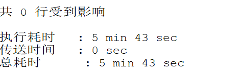
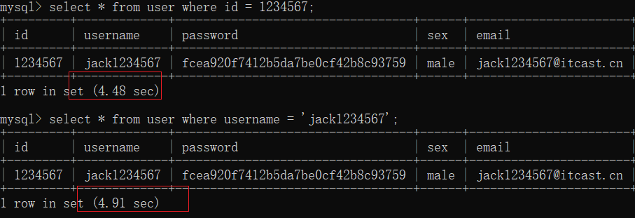
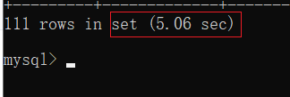
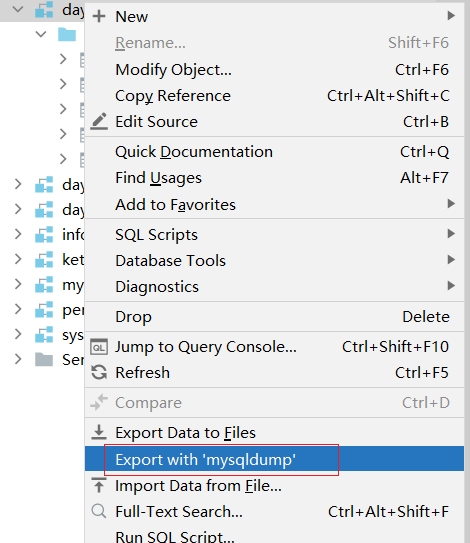
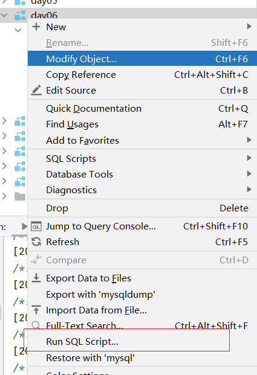

# MySQL索引

到快毕业 快面试的时候 回来再看一次

**今日目标**

```markdown
1. MySQL索引：查询效率
```


## 查看mysql中语句执行效率

随着数据库的数据缓慢增加 ， 查询速度会越来越慢 ， 演示查询效率慢的问题

数据准备

```sql
CREATE DATABASE day07;
USE day07;


-- 1. 准备表
CREATE TABLE `user`(
	id INT,
	username VARCHAR(32),
	`password` VARCHAR(32),
	sex VARCHAR(6),
	email VARCHAR(50)
);

-- 2. 创建存储过程，实现批量插入记录
DELIMITER $$ -- 声明存储过程的结束符号为$$
CREATE PROCEDURE auto_insert()
BEGIN
    DECLARE i INT DEFAULT 1;
	START TRANSACTION; -- 开启事务
    WHILE(i<=10000000)DO
        INSERT INTO `user` VALUES(i,CONCAT('jack',i),MD5(i),'male',CONCAT('jack',i,'@itcast.cn'));
        SET i=i+1;
    END WHILE;
	COMMIT; -- 提交
END$$ -- 声明结束
DELIMITER ; -- 重新声明分号为结束符号

-- 3. 查看存储过程
SHOW CREATE PROCEDURE auto_insert;

-- 4. 调用存储过程
CALL auto_insert();
```


通过cmd 执行 select * from user 读取时间太长的 情况 ctrl + c 强制退出

日志未打开状态 (show variables like '%query%')


set global slow_query_log =1; 打开 慢日志查询  

set long_query_time = 1; 设置记录的时间


快速记录查询效率不高的 sql语句 帮助我们快速定位问题


## MySQL索引【理解】

### 1.1 什么是索引

在现实生活中，我们经常去图书馆查阅图书。

现在我们将所有图书杂乱无章的摆放在一起，那么找一本书就像大海捞针一样效率非常低。

如果我们按分类整理排序后，根据类别去找对应的图书那么效率就很高了。其实这个整理排序的过程就是**索引**。


MySQL索引的建立对于MySQL的高效运行是很重要的，索引可以大大提高MySQL的检索速度。

如果合理的设计且使用索引的MySQL是一辆兰博基尼的话，那么没有设计和使用索引的MySQL就是一个人力三轮车。


### 1.2 索引的优势与劣势

#### 1.2.1 优势

①  类似大学图书馆建书目索引，提高数据检索的效率，降低数据库的  IO(读-从硬盘读取到内存,写-内存写入硬盘)   成本。
②  通过索引列对数据进行排序，降低数据排序的成本，降低 CPU 的消耗。

#### 1.2.2 劣势

① 实际上索引也是一张表，该表保存了主键与索引字段，并指向实体表的记录，所以索引列也是要占用空间的

② 虽然索引大大提高了查询速度，同时却会降低更新表的速度，如对表进行INSERT、UPDATE和DELETE。因为更新表时，MySQL不仅要保存数据，还要保存一下索引文件每次更新添加了索引列的字段，都会调整因为更新所带来的键值变化后的索引信息。

建立科学合理的规范索引


### 1.3 索引分类和语法

**单列索引（给一列字段增加索引）  id**

组合索引（给多列字段增加索引）  id +name


#### 1.3.1 分类

- 普通索引：仅加速查询 index
- 唯一索引：加速查询 + 列值唯一（可以有null） 唯一约束  unique
- 主键索引：加速查询 + 列值唯一（不可以有null）+ 表中只有一个 , 主键约束  primary key
- 组合（联合）索引：多列值组成一个索引 index，注意：最左匹配原则(一会演示)


#### 1.3.2 创建索引

##### ① 直接创建（普通、唯一）

```sql
-- 创建普通索引
create index 索引名 on 表名(列名);
-- 创建唯一索引
create unique index 索引名 on 表名(列名);
-- 创建普通组合索引
create index 索引名 on 表名(列名1,列名2....);
-- 创建唯一组合索引
create unique index 索引名 on 表名(列名1,列名2...);
```


##### ==② 修改表时指定==

```sql
-- 添加一个主键，这意味着索引值必须是唯一的，且不能为NULL
alter table 表名 add primary key(id);
-- 添加唯一索引（除了NULL外，NULL可能会出现多次）
alter table 表名 add unique(列名); -- 索引名就是列名
-- 添加普通索引，索引值可以出现多次。
alter table 表名 add index(列名)；-- 索引名就是列名
```


##### ==③ 创建表时指定【掌握】==

```sql
create table student(
 id int,
 username varchar(32),
 age int,
 primary key(id) , -- 主键
 unique(username), -- 唯一
 index(age) -- 普通
);
```


#### 1.3.3 删除索引(了解)

开发中不用

```sql
-- 直接删除
drop index 索引名 on 表名;
-- 修改表时删除 【掌握】
alter table 表名 drop index 索引名；
```


```sql
CREATE DATABASE web04;
USE web04;
-- 创建表指定索引
CREATE TABLE student(
 id INT,
 username VARCHAR(32),
 age INT,
 PRIMARY KEY(id),
 UNIQUE(username),
 INDEX(age)
);
-- 删除age索引
ALTER TABLE student DROP INDEX age;

```


#### 1.3.2 索引创建原则

```markdown
1. 在经常需要 搜索 的列上建索引，这样会大大加快查找速度、 

2. 在经常需要 连接 的列上建索引，可以加快连接的速度。(多表 笛卡尔积查询 2个表的乘积 外键上加入索引 - 一般都有 index索引 )  

3. 在经常需要 排序 的列上建索引，因为索引已经是排过序的，这样一来可以利用索引的排序，加快排序查询速度。 

* 注意:
	那是不是在数据库表字段中尽量多建索引呢?肯定是不是的。因为索引的建立和维护都是需要耗时的 
	
	创建表时需要通过数据库去维护索引，添加记录、更新、修改时，也需要更新索引，会间接影响数据库的效率。
```


### 1.4 效果演示

**1）准备千万记录**



```sql
-- 1. 准备表
CREATE TABLE `user`(
	id INT,
	username VARCHAR(32),
	`password` VARCHAR(32),
	sex VARCHAR(6),
	email VARCHAR(50)
);

-- 2. 创建存储过程，实现批量插入记录
DELIMITER $$ -- 声明存储过程的结束符号为$$
CREATE PROCEDURE auto_insert()
BEGIN
    DECLARE i INT DEFAULT 1;
	START TRANSACTION; -- 开启事务
    WHILE(i<=10000000)DO
        INSERT INTO `user` VALUES(i,CONCAT('jack',i),MD5(i),'male',CONCAT('jack',i,'@itcast.cn'));
        SET i=i+1;
    END WHILE;
	COMMIT; -- 提交
END$$ -- 声明结束
DELIMITER ; -- 重新声明分号为结束符号

-- 3. 查看存储过程
SHOW CREATE PROCEDURE auto_insert;

-- 4. 调用存储过程
CALL auto_insert();
```


**2）没有索引的查询**

```sql
-- sql默认有缓存 下次在查询这条数据 时间成本降低
reset query cache; #重置查询缓存
-- 根据id 
select * from user where id = 1234567;
-- 根据用户名
select * from user where username = 'jack1234567';
-- 根据邮箱模糊查询
select * from user where email like 'jack12345%';
```






**3）添加索引**

```sql
-- 在添加索引的时候 也会有时间的损耗  对数据进行排序 
-- id设置为主键
alter table user add primary key(id);
-- username设置为唯一  辅助索引
alter table user add unique(username);
-- 邮箱设置为普通
alter table user add index(email);


注意: 
索引能提高查询效率 索引需要占据一定的磁盘空间 索引不是越多越好
```


添加完索引后 数据量变大


**4）索引失效** 面试

导致全表扫描 就会导致索引失效

```sql
1. 模糊匹配查询 通配符字符串 %多个任意字符(索引注意 最左匹配原则)

   % 所有 相当于整个表( 全表查询 )  全表扫描

   select * from user where username like '%jack123456';

2. 尽量避免使用or or的条件如果没有索引 采用全表扫描 (如果要使用 or  多个条件必须有都有索引)

   select * from user where username like 'jack123456%' or password='e10adc3949ba59abbe56e057f20f883e';

3. 在有索引的列上进行计算会导致索引失效

   select * from user where id + 1 =123456;

4. 使用is null 或者is not null 导致索引失效 (尽量不要使用null值)

   select * from user where username is not null;

5. 使用!= 或者 <> 导致索引失效

   select * from user where id != 1;

6. 尽量不使用not in语法

   select * from user where id not in (1,2,3);

7. 尽量省略隐式或者显示类型转换 cast
   使用cast函数可以将数据强转类型 . 数据库本身是存在 数据库自动类型强转

   select * from user where username =12345;
   
```


## 数据库备份

### 工具的导出




工具的导入




### 使用命令行

mysqldump -uroot -proot day02 > d:/data.sql

mysqldump -u用户名 -p密码  需要备份的数据库 > 某个位置  

使用命令行导出的内容 没有创建库 使用库的动作


必须登录到mysql中 并且创建数据库 和使用数据库后才可以引入文件

source xxx文件    source 源(数据的来源)


